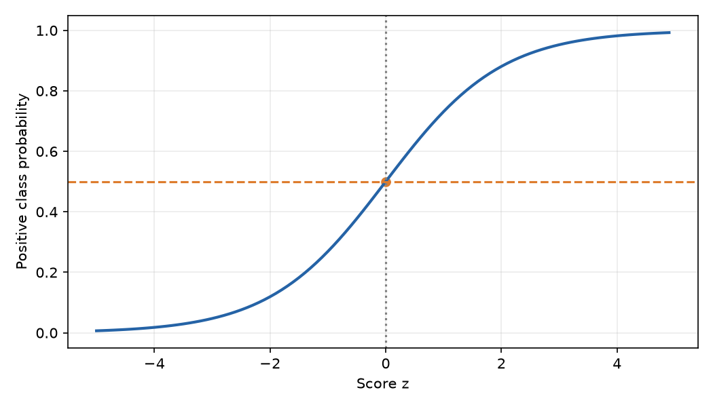
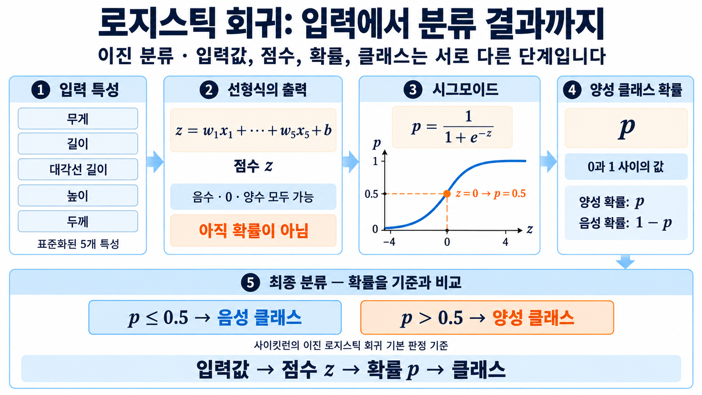

# 2. 로지스틱 회귀와 시그모이드

KNN은 이웃의 종류를 세어 확률을 계산했음. 로지스틱 회귀는 각 입력 특성에 계수를 곱하고 절편을 더한 뒤 그 결과를 확률로 바꿈. 이름에 회귀가 들어가지만 여기서는 두 종류를 구분하는 분류 모델임.

## 선형식으로 점수 만들기

표준화된 다섯 측정값을 $x_1$부터 $x_5$라고 하면 점수는 다음과 같음.

$$
z=w_1x_1+w_2x_2+w_3x_3+w_4x_4+w_5x_5+b
$$

$w_i$는 각 특성에 곱하는 계수이고 $b$는 절편. 훈련 데이터의 측정값과 정답을 이용해 이 값들을 학습함. 예측할 때는 학습된 값을 고정하고 새로운 생선의 측정값을 넣어 점수를 구함.

다른 특성이 같을 때 양수 계수의 입력이 증가하면 점수는 커지고 음수 계수의 입력이 증가하면 작아짐. 절편은 입력이 모두 0일 때의 점수. 표준화한 입력의 0은 해당 특성의 훈련 평균을 뜻함.

선형 회귀는 선형식의 결과를 수치 예측에 사용했지만 여기서는 점수를 확률로 바꾸어야 함. 점수는 -2나 3도 가능하지만 확률은 0과 1 사이여야 하기 때문임.

## 시그모이드로 점수를 확률로 바꾸기

$$
p=\sigma(z)=\frac{1}{1+e^{-z}}
$$

$e$는 자연상수이며 `exp(-z)`는 $e^{-z}$를 계산함. 시그모이드는 점수가 커질수록 출력도 커지는 함수임. $z=0$을 넣으면 $e^0=1$이므로 확률은 $1/(1+1)=0.5$가 됨.

양성 클래스는 이 확률 $p$가 가리키는 종류이고 나머지는 음성 클래스. 좋고 나쁨을 뜻하는 말이 아님. 두 종류 중 하나에만 속하므로 음성 확률은 $1-p$임.

| 점수 | 양성 확률 | 이번 기본 판정 |
| --- | --- | --- |
| -4 | 약 0.0180 | 음성 |
| -2 | 약 0.1192 | 음성 |
| 0 | 0.5 | 음성 |
| 2 | 약 0.8808 | 양성 |
| 4 | 약 0.9820 | 양성 |

양성 확률이 0.5보다 크면 양성을 선택함. 점수가 양수인지 비교하는 것과 같은 결과이며, 정확히 같으면 이번 사이킷런 모델은 첫 번째 클래스를 선택함.

```python
import numpy as np

z = np.array([-4.0, -2.0, 0.0, 2.0, 4.0])
p = 1 / (1 + np.exp(-z))
print(np.round(p, 4))
print(np.where(p > 0.5, '양성', '음성'))
```

```text
[0.018  0.1192 0.5    0.8808 0.982 ]
['음성' '음성' '음성' '양성' '양성']
```

위 코드는 모델을 학습하지 않고 지정한 점수를 변환함. `np.where()`는 각 확률이 기준을 넘는지에 따라 이름을 선택함. 점수 -4와 -2는 확률이 달라도 모두 음성이고, 2와 4는 모두 양성임.

## 곡선으로 변화 읽기

```python
import matplotlib.pyplot as plt

z = np.arange(-5, 5, 0.1)
p = 1 / (1 + np.exp(-z))
plt.plot(z, p)
plt.xlabel('z')
plt.ylabel('probability')
plt.grid()
plt.show()
```



가로축은 점수, 세로축은 양성 확률. `np.arange()`로 점수를 촘촘히 만들고 각각을 변환하면 S자 곡선이 됨. 큰 음수에서는 0, 큰 양수에서는 1에 가까워짐.

중앙은 가파르고 양 끝은 완만함. 따라서 같은 양만큼 점수가 변해도 확률 변화량은 현재 위치에 따라 다름. 나중에 계수와 입력의 영향을 읽을 때 이 차이를 다시 사용함.



그림은 입력 → 점수 → 확률 → 클래스의 순서. `predict_proba()`는 확률을 보여 주고 `predict()`는 그 확률을 기준으로 선택한 이름을 보여 줌. 실제 정답이 양성이면 0.8808과 0.9820 모두 정답으로 분류되지만 정답에 부여한 확률은 다름. 이 차이가 이후 손실 함수를 배우는 이유와 연결됨.

[다음: 도미와 빙어의 이진 분류](03-도미와-빙어의-이진-분류.md) | [전체 목차](../README.md)
