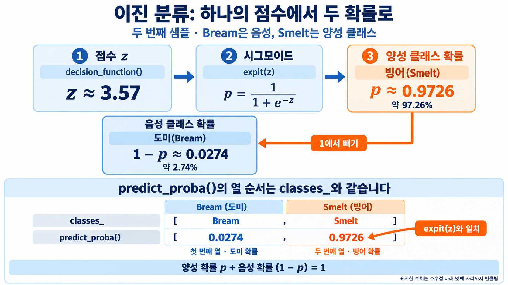

# 4. 계수와 점수 계산

앞에서 학습한 `lr_binary`는 도미와 빙어를 구분함. 이제 모델이 학습한 숫자를 확인해 측정값이 어떤 계산을 거쳐 확률이 되는지 따라감. 입력 `train_binary`는 표준화된 다섯 특성임.

## 입력 순서와 계수 연결하기

```python
print(lr_binary.coef_)
print(lr_binary.intercept_)
```

```text
[[-0.40451732 -0.57582787 -0.66248158 -1.01329614 -0.73123131]]
[-2.16172774]
```

`coef_`의 다섯 값은 무게, 길이, 대각선 길이, 높이, 두께 순서. `intercept_`는 마지막에 더하는 절편임. 소수점 일부를 반올림하면 모델의 계산은 다음과 같음.

$$
z\approx-0.405x_1-0.576x_2-0.662x_3-1.013x_4-0.731x_5-2.162
$$

| 순서 | 입력 특성 | 계수 약값 |
| ---: | --- | ---: |
| $x_1$ | 무게 | -0.405 |
| $x_2$ | 길이 | -0.576 |
| $x_3$ | 대각선 길이 | -0.662 |
| $x_4$ | 높이 | -1.013 |
| $x_5$ | 두께 | -0.731 |
| | 절편 | -2.162 |

여기서 각 $x_i$는 원래 측정값이 아닌 표준화된 값. 반올림한 계수는 식을 읽기 위한 것이고 실제 계산에는 모델에 저장된 전체 정밀도의 값을 사용함.

다른 특성을 고정한 채 표준화된 무게를 1 늘리면 무게 항의 영향으로 점수가 약 0.405 내려감. 이번 점수는 빙어에 대한 것이므로 빙어 확률도 내려감. 계수가 확률에 직접 더해지는 것은 아니며 확률 변화량은 시그모이드를 적용한 뒤 구해야 함.

## 중간 점수와 양성 확률 확인하기

```python
from scipy.special import expit

decisions = lr_binary.decision_function(train_binary[:5])
print(np.round(decisions, 4))
print(np.round(expit(decisions), 4))
print(np.allclose(expit(decisions),
                  lr_binary.predict_proba(train_binary[:5])[:, 1]))
```

```text
[-6.0299  3.5704 -5.2663 -4.2438 -6.0614]
[0.0024 0.9726 0.0051 0.0141 0.0023]
True
```

`decision_function()`은 계수와 입력을 곱하고 절편을 더한 점수만 반환함. 첫 생선은 약 -6.0299, 둘째는 3.5704. 점수의 부호를 보면 첫 생선은 도미 쪽, 둘째는 빙어 쪽이라는 것을 예상할 수 있음.

`expit()`은 시그모이드 함수. 두 번째 생선에 대해 계산하면 다음과 같음.

$$
p=\frac{1}{1+e^{-3.5704}}\approx0.9726
$$

빙어 확률은 약 97.26%, 도미 확률은 $1-0.9726=0.0274$. 첫 생선은 시그모이드 결과가 약 0.0024이므로 도미 확률이 약 0.9976임.



그림은 점수 하나에서 두 확률을 만드는 흐름을 보여 줌. `predict_proba()[:, 1]`은 모든 행의 둘째 열, 즉 빙어 확률을 선택함. 여기에 직접 구한 `expit(decisions)`를 비교한 `np.allclose()`가 `True`이므로 두 계산이 수치적으로 일치함.

## 계수 해석에서 고정하는 것

계수는 다른 특성이 같을 때 한 특성의 변화가 점수에 주는 영향임. 실제 생선은 무게와 길이 등이 함께 달라질 수 있어 한 계수만으로 전체 확률 변화를 판단하면 안 됨. 다음 파일에서는 이 관계를 분리해서 보기 위해 다른 입력을 고정하고 무게만 바꿈.

[다음: 입력 특성 변화](05-입력-특성과-확률-변화.md) | [전체 목차](../README.md)
