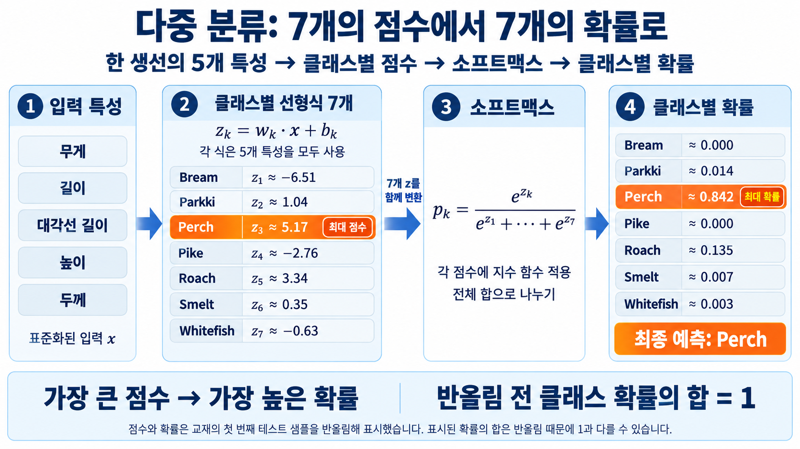

# 7. 소프트맥스와 클래스별 확률

학습 범위: 25에서 27쪽

앞에서 학습한 `lr_multi`와 `test_scaled`를 사용.

## 1. 클래스별 점수

```python
print(lr_multi.coef_.shape, lr_multi.intercept_.shape)
decisions = lr_multi.decision_function(test_scaled[:5])
print(np.round(decisions[0], 2))
```

```text
(7, 5) (7,)
[-6.51  1.04  5.17 -2.76  3.34  0.35 -0.63]
```

`coef_`의 7행은 7개 클래스, 5열은 각 클래스에서 사용하는 5개 특성의 계수. `intercept_`에는 클래스별 절편 7개가 있음

입력 하나를 넣으면 각 클래스의 계수와 절편으로 점수 7개를 계산. 위 출력에서도 세 번째 Perch의 점수가 5.17로 가장 높음. 점수는 확률이 아니므로 다음 변환이 필요함

## 2. 소프트맥스로 확률 계산

$$
p_k=\frac{e^{z_k}}{\sum_{j=1}^{7}e^{z_j}}
$$

$z_k$는 $k$번째 클래스의 점수. 각 점수에 지수함수를 적용하고, 변환된 값의 전체 합으로 나누면 확률의 합이 1이 됨

예를 들어 지수함수를 적용한 값이 Perch는 4, 나머지 6종은 각각 1이라면 전체 합은 10. Perch의 확률은 4/10, 나머지는 각각 1/10

이 예시에서 4와 1은 원래 점수 $z$가 아니라 지수함수를 적용한 뒤의 값임. 계산한 확률의 합은 $0.4 + 0.1 \times 6 = 1$. Perch 확률이 0.5보다 작아도 나머지 각각의 0.1보다 크므로 Perch를 선택함.

```python
from scipy.special import softmax

proba = softmax(decisions, axis=1)
print(np.round(proba[0], 3))
print(np.allclose(proba, lr_multi.predict_proba(test_scaled[:5])))
```

```text
[0.    0.014 0.842 0.    0.135 0.007 0.003]
True
```

`axis=1`은 생선 한 마리를 나타내는 각 행의 7개 점수를 묶어 계산한다는 뜻. `np.allclose()`는 계산 결과가 모델의 확률과 수치적으로 일치하는지 확인



그림은 첫 번째 생선의 점수 7개가 확률 7개로 바뀌는 과정. 가장 높은 Perch 점수 5.17이 가장 높은 확률 약 0.842가 되어 최종 예측도 Perch가 됨

## 3. 왜 `axis=1`을 사용할까?

`decisions`의 모양은 `(5, 7)`. 행마다 생선 한 마리, 열마다 생선 종류의 점수가 들어 있음. `axis=1`은 한 행의 7개 점수를 기준으로 확률을 계산한다는 뜻.

행별로 계산해야 생선 한 마리에 대한 7개 확률의 합이 1이 됨. 배열 전체를 한꺼번에 계산하면 서로 다른 생선의 점수가 하나의 분모에 섞이므로 원하는 확률이 아님.

소프트맥스는 같은 행의 점수 순서를 유지함. 그래서 가장 큰 점수와 가장 큰 확률은 같은 클래스에 대응하지만, 점수 자체가 확률인 것은 아님.

[다음: 점수 차이와 확률 분포](08-점수-변화와-확률-분포.md) | [전체 목차](../README.md)
