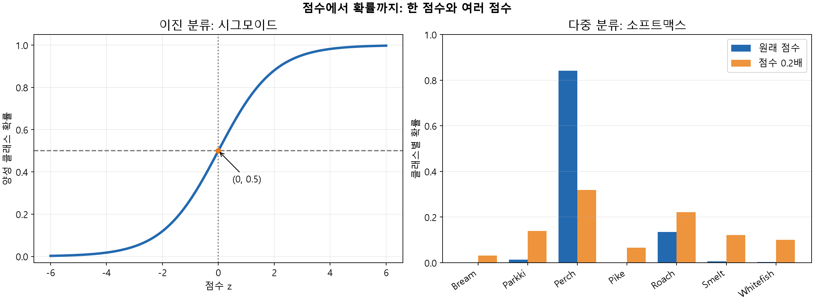

# 8. 점수 변화와 소프트맥스 확률

소프트맥스는 한 점수만 보는 것이 아니라 클래스 간 차이를 함께 반영함. 이를 확인하기 위해 `lr_multi`의 첫 테스트 생선에서 나온 점수에 배율을 곱함. 이미 학습된 모델의 계수를 고치는 것이 아니라 출력 점수를 변환해 비교하는 계산임.

## 순서는 유지하고 간격 바꾸기

모든 점수에 같은 양수를 곱하면 가장 높은 점수의 위치는 그대로임. 그러나 0.5를 곱하면 점수 간격은 절반으로 줄어들고 2를 곱하면 두 배가 됨.

```python
scores = lr_multi.decision_function(test_scaled[:1])[0]
factors = [1.0, 0.5, 0.2, 0.1]

for factor in factors:
    probabilities = softmax(scores * factor)
    best = np.argmax(probabilities)
    print(factor, lr_multi.classes_[best], round(probabilities[best], 3))
```

```text
1.0 Perch 0.842
0.5 Perch 0.59
0.2 Perch 0.32
0.1 Perch 0.225
```

`np.argmax()`는 가장 큰 확률의 위치를 반환하고 `classes_`에서 그 위치의 이름을 가져옴. 배율을 줄여도 이름은 Perch이지만 최고 확률은 0.842에서 0.225까지 낮아짐.

7종 중 하나를 선택하므로 반드시 0.5를 넘어야 할 필요는 없음. 0.32가 나머지 여섯 확률보다 크면 가장 높은 클래스로 선택됨. 두 클래스의 확률만 비교했던 이진 분류와 구분해야 함.

## 나머지 클래스에 확률이 나뉘는 과정

```python
import pandas as pd

scaled_scores = np.vstack([scores * factor for factor in factors])
scaled_proba = softmax(scaled_scores, axis=1)
table = pd.DataFrame(scaled_proba, columns=lr_multi.classes_,
                     index=[f'{factor}배' for factor in factors])
print(table.round(3).to_string())
print(np.allclose(scaled_proba[0], lr_multi.predict_proba(test_scaled[:1])[0]))
```

```text
       Bream  Parkki  Perch   Pike  Roach  Smelt  Whitefish
1.0배  0.000   0.014  0.842  0.000  0.135  0.007      0.003
0.5배  0.002   0.075  0.590  0.011  0.236  0.053      0.033
0.2배  0.031   0.140  0.320  0.066  0.222  0.122      0.100
0.1배  0.070   0.149  0.225  0.102  0.188  0.139      0.126
True
```

`np.vstack()`은 배율별 점수를 행으로 쌓음. 소프트맥스를 각 행에 적용한 뒤 열에 클래스 이름을 붙여 확률 분포를 비교함. 반올림 전 각 행의 합은 1임.

배율이 작아지면 점수 간격이 줄고 지수함수로 바꾼 값들의 차이도 줄어듦. 따라서 Perch에 집중됐던 비율이 다른 종류에도 더 고르게 나뉨. 배율이 0에 가까워지면 모든 점수가 0에 가까워져 일곱 확률은 각각 $1/7$에 가까워짐.

마지막 `True`는 1.0배 결과가 원래 모델의 확률과 같다는 뜻. 다른 배율은 원래 모델의 출력과 구분해서 읽어야 함.

## 간격을 늘리면 생기는 변화

```python
for factor in [0.2, 2.0]:
    probabilities = softmax(scores * factor)
    best = np.argmax(probabilities)
    print(factor, lr_multi.classes_[best], round(probabilities[best], 3))
```

```text
0.2 Perch 0.32
2.0 Perch 0.975
```

2배에서는 Perch 확률이 약 0.975로 커짐. 높은 점수와 낮은 점수의 차이가 커져 가장 높은 쪽으로 확률이 집중된 결과임. 양수를 곱했으므로 점수 순서는 그대로여서 예측 이름은 바뀌지 않음.

확률이 높아졌다는 사실만으로 실제 정답을 더 잘 맞혔다고 할 수는 없음. 이번 계산에서는 정답도 모델도 바꾸지 않았으며, 같은 이름을 선택하더라도 확률 분포가 달라질 수 있음을 확인한 것임.

## 시그모이드와 소프트맥스 비교

| 항목 | 이진 분류 | 이번 다중 분류 |
| --- | --- | --- |
| 분류 대상 | 도미와 빙어 | 7종 생선 |
| 한 샘플의 점수 | 1개 | 클래스별 7개 |
| 확률 변환 | 시그모이드 | 소프트맥스 |
| 확률의 관계 | 음성 확률은 $1-p$ | 7개 확률의 합은 1 |
| 클래스 선택 | 양성 확률을 0.5와 비교 | 가장 높은 확률 선택 |

이진 분류의 경계가 정확히 0.5일 때의 판정은 사용하는 모델의 규칙을 확인해야 함. 앞의 실습에서는 음성 클래스로 선택했음.



왼쪽은 이진 분류의 시그모이드. 가로축의 점수 하나를 양성 클래스 확률로 바꾸며, 점수 0에서는 확률이 0.5임. 음성 확률은 1에서 이 값을 빼서 구함.

오른쪽은 같은 생선에 대한 일곱 클래스의 소프트맥스 확률. 파란 막대는 원래 점수, 주황 막대는 일곱 점수에 모두 0.2를 곱한 결과임. 원래 점수는 앞에서 확인한 값을 소수점 둘째 자리까지 표시한 뒤 사용했으므로 모델의 전체 정밀도로 계산한 값과 끝자리가 조금 다를 수 있음.

Perch의 확률은 약 0.842에서 0.320으로 낮아지고 다른 클래스의 확률은 상대적으로 분산됨. 양수 0.2를 모든 점수에 곱해 크기 순서는 그대로이므로 가장 높은 클래스는 계속 Perch임. 왼쪽은 하나의 점수와 양성 확률의 관계이고, 오른쪽은 한 샘플의 여러 점수를 함께 비교한 확률 분포임.

[다음: 전체 핵심 복습](09-핵심-개념-복습.md) | [전체 목차](../README.md)
