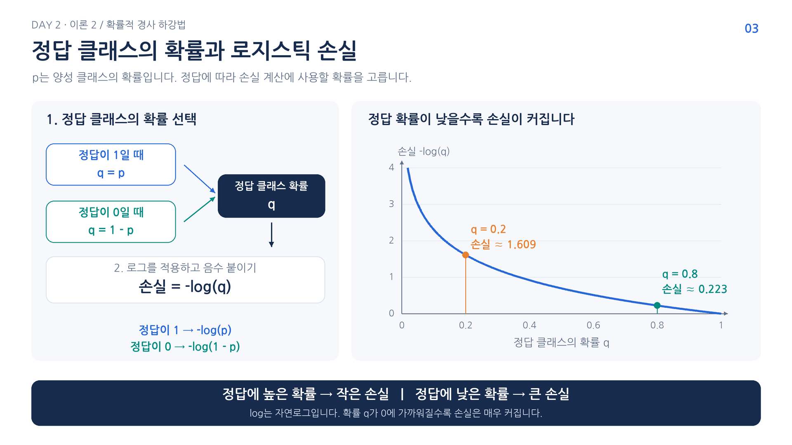
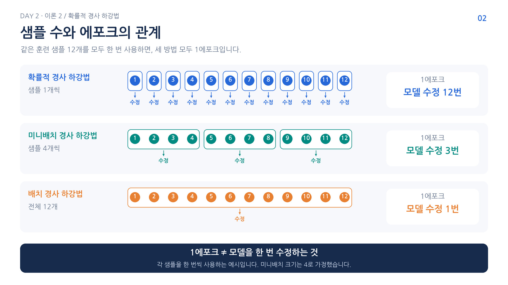

# 2. 손실함수와 정답 확률

실제 정답이 빙어인 생선을 모델 A는 빙어 확률 60%, 모델 B는 90%로 예측했다고 해보면 두 모델 모두 빙어를 선택함. 정확도는 둘 다 정답으로 세므로 이 차이를 구분하지 못함.

계수를 조금 수정해 확률이 60%에서 61%로 바뀌어도 최종 이름은 그대로임. 정확도만으로는 이 작은 변화가 나아진 것인지 학습에 반영하기 어려움. 확률의 변화까지 반영하는 손실 함수가 필요함.

## 어떤 클래스의 확률을 사용할까?

손실은 실제 정답과 예측을 비교함. 빙어를 정답 1, 도미를 정답 0으로 놓고 모델의 빙어 확률을 $p$라 하면 다음과 같음.

| 실제 정답 | 실제 정답에 부여한 확률 $q$ |
| --- | --- |
| 빙어, y=1 | p |
| 도미, y=0 | 1-p |

실제 도미에 빙어 확률 0.8을 주었다면 정답 확률은 0.2임. 가장 높은 예측 확률을 무조건 가져오는 것이 아니라 실제 정답의 열을 골라야 함.

## 로지스틱 손실로 변환하기

정답 확률이 높을수록 좋은 예측이므로 손실은 작아져야 함. 로지스틱 손실은 정답 확률에 음의 자연로그를 적용함.

$$
L=-\ln q=-[y\ln p+(1-y)\ln(1-p)]
$$

$y=1$이면 두 번째 항이 없어져 $-\ln p$가 남음. $y=0$이면 첫 항이 없어져 $-\ln(1-p)$가 남음. 같은 식에서 정답에 따라 적절한 확률이 선택됨.

가로축은 정답 클래스 확률, 세로축은 손실. 정답 확률 0.9의 손실은 약 0.105, 0.6은 약 0.511, 0.2는 약 1.609임. 정답 확률이 1에 가까우면 손실은 0에 가까워지고, 0에 가까우면 크게 증가함. 틀린 종류에 강하게 확신한 예측에 큰 손실이 생기는 이유임.

학습은 이 손실을 줄이도록 파라미터를 조정함. 학습 후에는 정확도로 맞힌 비율도 확인할 수 있음. 손실과 정확도는 서로 다른 정보를 주므로 함께 읽음. 샘플 하나의 값을 손실, 여러 손실의 합이나 평균을 비용이라고 구분하기도 하지만 두 용어를 함께 쓰는 경우도 있음.

## 계산 단위와 학습 단위 연결하기

그림은 한 번의 수정에 사용할 샘플 수와 에포크의 관계. 한 샘플의 손실을 사용해 바로 갱신할 수도 있고 여러 샘플의 손실을 합쳐 갱신할 수도 있음. 전체 12개를 한 번 사용했다면 모두 1에포크지만 갱신 횟수는 다름. 다음 파일에서는 먼저 한 샘플의 손실 계산부터 확인함.

[이전](01-점진적-학습과-에포크.md) | [다음: 로지스틱 손실 직접 계산](03-로지스틱-손실-직접-계산.md) | [전체 목차](../README.md)
