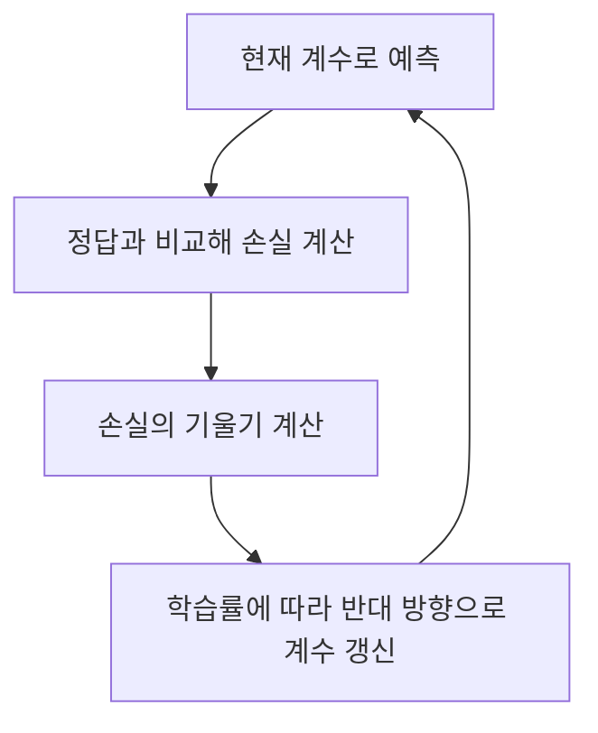
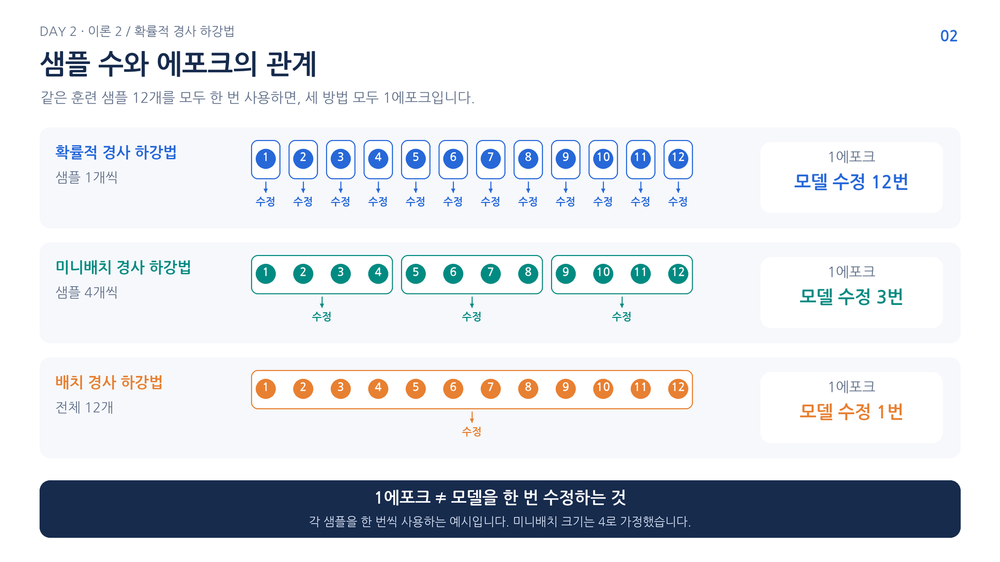
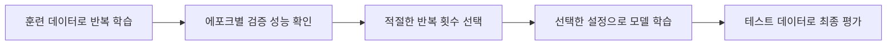
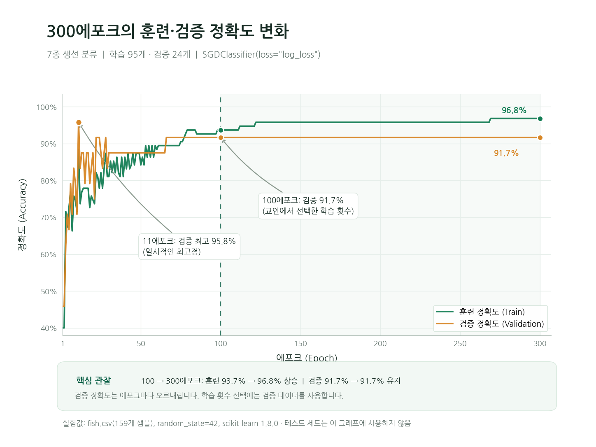

# Day 2. 확률적 경사 하강법

> 확률적 경사 하강법은 데이터를 조금씩 살펴보며 손실을 줄이는 방향으로 모델을 갱신한다.

## 1. 데이터가 계속 늘어나는 상황 (1-5쪽)

**점진적 학습(Incremental Learning)** 은 새 데이터가 들어올 때 기존 모델을 이어서 학습하는 방식이다.  
매번 전체 데이터를 처음부터 다시 학습하지 않아도 되므로 데이터가 지속적으로 추가되는 상황에 활용할 수 있다.

학습 결과를 유지하면서 새 데이터를 반영하려면 모델의 현재 상태에서 계수와 절편을 조금씩 바꿔야 한다.  
이때 어느 방향으로 얼마나 바꿀지를 정하는 방법이 경사 하강법이다.

## 2. 손실과 경사 하강법 (6-13쪽, 16-20쪽)

손실 함수(Loss Function)는 모델의 예측이 정답과 얼마나 다른지 수치로 나타낸다.  
모델은 정해진 손실을 줄이는 방향으로 계수와 절편을 조정한다.  
정확도는 맞힌 비율을 보여 주지만, 손실은 예측이 얼마나 확신을 갖고 틀렸는지도 반영할 수 있다.

로지스틱 손실(Logistic Loss)은 정답 클래스에 부여한 확률이 낮을수록 커진다.  
정답 클래스의 예측 확률을 $p$라고 하면 한 샘플의 손실은 다음과 같다.

$$
L = -\ln(p)
$$

| 정답 클래스의 확률 p | 계산 | 손실 약 |
| --- | --- | --- |
| 0.9 | -ln(0.9) | 0.105 |
| 0.6 | -ln(0.6) | 0.511 |
| 0.1 | -ln(0.1) | 2.303 |

정답에 0.1의 낮은 확률을 주면 손실이 크다.  
반대로 정답에 0.9를 주면 손실이 작아진다. $\ln$은 자연로그이며, 여기서는 정답 확률을 손실로 바꾸는 계산이라고 이해하면 된다.

경사 하강법(Gradient Descent)은 현재 위치에서 손실이 증가하는 방향인 기울기(Gradient)를 구하고, 그 반대 방향으로 모델의 값을 이동한다.

$$
w_{새값} = w_{현재값} - \eta g
$$

$w$는 조정할 계수, $g$는 그 계수에 대한 기울기, $\eta$는 학습률(Learning Rate)이다.  
예를 들어 $w=2$, $g=0.5$, $\eta=0.1$이면 새 계수는 1.95다.  
기울기가 음수라면 반대로 계수가 증가한다.

실습에서는 정답이 1인 샘플에 대해 계수와 절편을 각각 0에서 0.05로 조정했다.  
정답 확률은 0.5에서 약 0.525로 오르고 로지스틱 손실은 0.6931에서 0.6444로 줄었다.  
학습률을 0.1에서 0.5로 바꾸는 실습에서는 갱신 크기가 어떻게 달라지는지 비교한다.

학습률이 지나치게 크면 최솟값 주변을 지나치거나 학습이 불안정할 수 있다.  
너무 작으면 손실을 줄이는 데 많은 반복이 필요하다.

## 3. 한 번에 사용하는 데이터의 양 (3-5쪽)

**에포크(Epoch)** 는 훈련 데이터 전체를 한 번 학습에 사용하는 단위다.  
한 에포크에서 여러 번 계수를 갱신할 수 있으며, 갱신 횟수는 한 번에 처리하는 데이터의 양에 따라 달라진다.

| 방법 | 한 번의 갱신에 사용하는 데이터 | 특징 |
| --- | --- | --- |
| 배치 경사 하강법(Batch Gradient Descent) | 전체 훈련 데이터 | 한 번의 갱신에 전체 데이터를 사용 |
| 확률적 경사 하강법(Stochastic Gradient Descent) | 샘플 하나 | 빠르게 자주 갱신하지만 방향의 변동이 큼 |
| 미니배치 경사 하강법(Mini-batch Gradient Descent) | 일부 샘플 묶음 | 전체와 한 개 사이의 절충 |

예를 들어 훈련 샘플이 100개이고 미니배치 크기가 10이면 한 에포크에서 10개씩 총 10번 갱신한다.  
확률적 방식은 매번 선택한 샘플에 따라 손실이 일시적으로 커질 수 있지만, 반복하면서 전체적으로 낮은 손실을 찾는다.

> 5-6쪽 관련 그림: 샘플 12개를 모두 한 번 사용하는 동안 SGD는 12번, 크기 4의 미니배치는 3번, 전체 배치는 1번 갱신한다. 한 에포크와 한 번의 갱신을 구분한다.

## 4. 점진적 학습 실습 (19-24쪽)

생선 분류 데이터에서 훈련 데이터로 학습한 표준화 기준을 테스트 데이터에도 적용한다.  
확률적 경사 하강 분류기에 로지스틱 손실을 사용해 10에포크를 학습한 결과 훈련 정확도는 약 0.773, 테스트 정확도는 0.775였다.

기존 모델에 한 에포크를 추가로 학습시키자 훈련 정확도는 약 0.798, 테스트 정확도는 0.775였다.  
한 번 더 학습한다고 모든 데이터에서 성능이 반드시 오르는 것은 아니다.  
점진적 학습에서 처음 학습할 때는 가능한 클래스 목록을 알려 줘야 한다.

## 5. 에포크와 과대적합 (25-33쪽)

학습 초반에는 충분히 배우지 못해 훈련 성능과 검증 성능이 모두 낮을 수 있다.  
반대로 너무 오래 학습하면 훈련 데이터에 과하게 맞춰져 새로운 데이터의 성능이 낮아질 수 있다.  
이를 각각 과소적합(Underfitting)과 과대적합(Overfitting)이라고 한다.

조기 종료(Early Stopping)는 검증 성능을 살펴 학습을 적절한 시점에서 멈추는 방법이다.  
테스트 데이터는 학습 횟수를 고르는 데 사용하지 않고 마지막 평가에 남겨 둔다.

실습에서 300에포크 동안 검증 점수를 비교했을 때 최고점은 11에포크의 약 0.958이었다.  
이후 100, 200, 300에포크의 비교에서는 모두 검증 점수가 약 0.917이어서 100에포크를 선택했다.  
선택한 설정으로 전체 훈련 데이터를 다시 학습한 모델의 테스트 정확도는 0.925였다.

하나의 검증 점수는 데이터 분할과 학습의 무작위성에 따라 달라질 수 있다.  
최고점이 나온 한 시점과 실습에서 비교해 선택한 설정은 구분해서 읽는다.

> 28-31쪽 관련 그림: 훈련 정확도가 계속 높아져도 검증 정확도는 오르내릴 수 있다. 검증 점수가 가장 높은 에포크와 비교 후보 중 선택한 에포크를 구분한다.

## 6. 손실 함수 선택 (33-37쪽)

동일한 확률적 경사 하강 방식도 손실 함수를 달리하면 다른 분류 모델을 학습할 수 있다.  
로지스틱 손실은 확률을 다루는 분류에 사용하고, 힌지 손실(Hinge Loss)은 서포트 벡터 머신 분류에 사용한다.  
실습에서는 두 손실의 검증 점수가 모두 약 0.917로 나타났다.

## 핵심 개념 비교표

| 구분 | 의미 | 판단 기준 |
| --- | --- | --- |
| 손실 | 예측과 정답의 차이를 나타내는 값 | 학습 과정에서 작아지도록 조정 |
| 정확도 | 전체 중 올바르게 예측한 비율 | 분류 결과 평가 |
| 학습률 | 한 번 갱신할 때의 이동 크기 | 너무 크거나 작지 않게 설정 |
| 에포크 | 전체 훈련 데이터를 한 번 사용하는 단위 | 검증 성능을 보며 반복 횟수 선택 |

## 핵심 정리

- 점진적 학습은 기존 모델을 유지하면서 추가 데이터로 학습을 이어 간다.
- 손실 함수는 예측의 잘못된 정도를 수치화하며 경사 하강법의 조정 기준이 된다.
- 경사 하강법은 기울기의 반대 방향으로 계수와 절편을 갱신한다.
- 한 번에 한 개, 일부, 전체 샘플을 쓰는지에 따라 갱신 방식이 달라진다.
- 에포크가 너무 적으면 과소적합, 너무 많으면 과대적합이 나타날 수 있다.
- 반복 횟수는 검증 데이터로 선택하고 테스트 데이터는 최종 평가에 사용한다.
