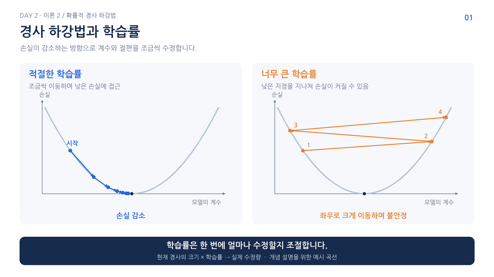
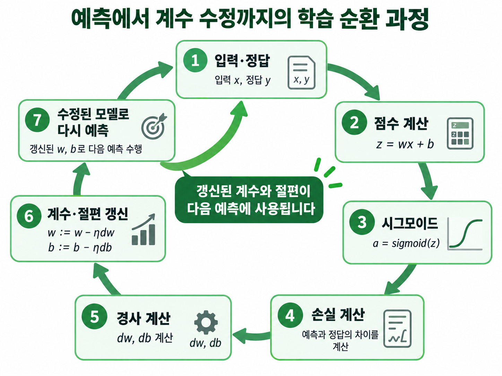

# 4. 경사와 학습률로 모델 수정

손실은 현재 예측이 얼마나 잘못됐는지 나타내지만 그 숫자만으로 계수를 늘릴지 줄일지 정할 수 없음. 현재 위치에서 계수를 조금 늘리면 손실이 증가하는지 감소하는지를 나타내는 것이 경사임.

## 경사의 반대 방향으로 수정하기

다른 값을 고정하고 계수를 늘릴 때 손실도 증가하면 경사는 양수. 손실을 줄이려면 계수를 줄임. 반대로 경사가 음수이면 계수를 늘리는 쪽으로 이동함. 이를 식으로 쓰면 다음과 같음.

$$
w_{\mathrm{new}}=w-\eta\frac{\partial L}{\partial w},\qquad
b_{\mathrm{new}}=b-\eta\frac{\partial L}{\partial b}
$$

$w$와 $b$는 현재 계수와 절편, $\eta$는 학습률. 편미분 기호는 다른 파라미터를 고정했을 때 해당 값에 대한 손실의 변화율을 뜻함. 여러 계수가 있으면 각각에 대해 경사를 구함.

현재 계수가 1, 경사가 -2, 학습률이 0.1이면 $1-0.1\times(-2)=1.2$가 됨. 계수 자체를 작게 만드는 것이 목적이 아니라 손실이 작아지는 쪽으로 이동하는 것이 목적임.



그림의 한 번 이동하는 크기에 학습률이 작용함. 너무 작으면 반복이 많이 필요하고 너무 크면 낮은 지점을 지나쳐 손실이 커지거나 학습이 흔들릴 수 있음. 그림은 이 원리를 보여 주는 개념 비교임.

## 샘플 하나에서 실제 계산 따라가기

입력 $x=1$, 정답 $y=1$, 초기 계수와 절편은 모두 0으로 놓음. 규제를 제외한 이진 로지스틱 손실의 경사는 다음과 같음.

$$
\frac{\partial L}{\partial w}=(p-y)x,\qquad
\frac{\partial L}{\partial b}=p-y
$$

$p$는 현재 모델의 양성 확률. 이 식은 현재 확률과 실제 정답의 차이를 계수 수정에 연결함. 아래 코드는 앞에서 사용한 NumPy의 `np`를 이어서 사용함.

```python
from scipy.special import expit

x, y = 1.0, 1.0
w, b = 0.0, 0.0
learning_rate = 0.1
p_before = expit(w * x + b)
loss_before = -np.log(p_before)
dw = (p_before - y) * x
db = p_before - y
w -= learning_rate * dw
b -= learning_rate * db
p_after = expit(w * x + b)
print(round(w, 4), round(b, 4))
print(round(p_before, 4), round(p_after, 4))
print(round(loss_before, 4), round(-np.log(p_after), 4))
```

```text
0.05 0.05
0.5 0.525
0.6931 0.6444
```

수정 전 점수는 $0\times1+0=0$이므로 확률은 0.5. 정답이 1이므로 손실은 $-\ln(0.5)\approx0.6931$임.

확률과 정답의 차이 $p-y$는 -0.5. 입력도 1이므로 두 경사 모두 -0.5임. 학습률 0.1을 적용하면 계수와 절편은 각각 $0-0.1\times(-0.5)=0.05$가 됨.

새 점수는 $0.05\times1+0.05=0.1$. 시그모이드 결과는 약 0.525이고 손실은 약 0.6444로 줄어듦. 정답 클래스의 확률을 높이는 방향으로 한 번 갱신한 것임. 처음부터 학습률 0.5로 계산하면 두 값은 각각 0.25가 되지만 큰 수정이 언제나 유리한 것은 아님.

## 다음 샘플에서는 갱신된 모델 사용하기



그림의 순서는 예측 → 정답과 비교한 손실 → 경사 계산 → 계수와 절편 수정. 입력과 정답을 바꾸는 것이 아니라 모델을 바꿈. 다음 샘플은 수정된 모델에서 계산을 시작함.

SGD는 한 샘플의 경사를 사용하므로 다음 샘플에서는 다른 방향으로 수정될 수 있음. 매 갱신마다 전체 평균 손실이 반드시 내려가지는 않으며 반복에 따른 흐름과 검증 성능을 확인해야 함.

[이전](03-로지스틱-손실-직접-계산.md) | [다음: 생선 데이터와 추가 학습](05-생선-데이터와-추가-학습.md) | [전체 목차](../README.md)
