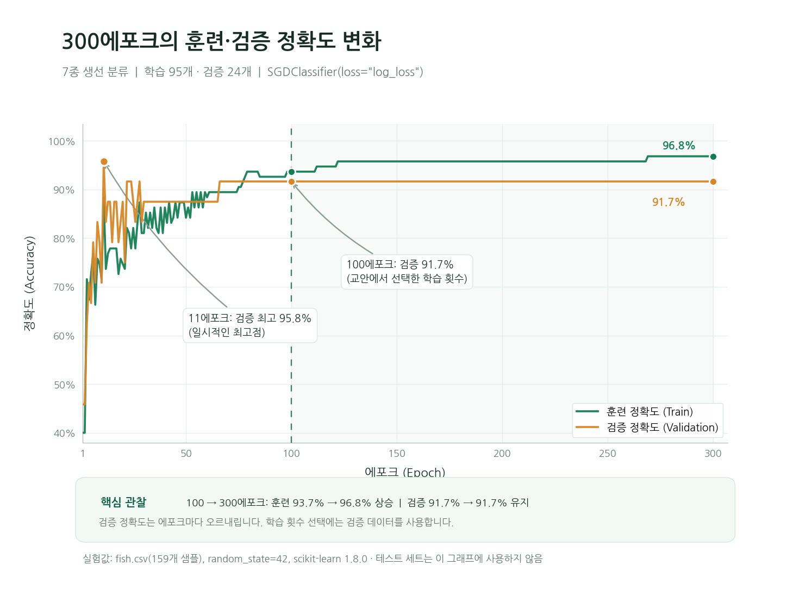
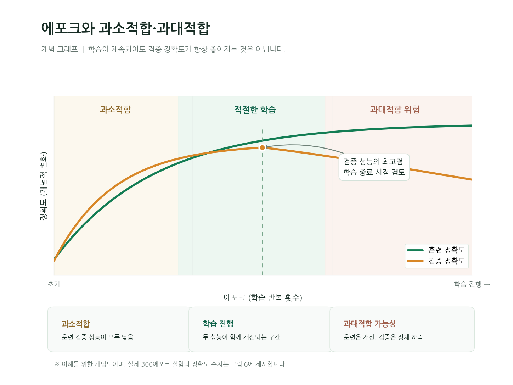

# 7. 에포크별 훈련과 검증

학습 횟수를 정하려면 학습에 직접 사용하지 않은 데이터에서 중간 모델을 확인해야 함. 테스트 점수를 반복해서 보고 횟수를 고르면 테스트 정보가 설정 선택에 들어감. 그래서 훈련 데이터 안에서 검증 세트를 다시 만듦.

## 학습용, 검증용, 테스트용 구분하기

기존 훈련 119개를 학습용 95개와 검증용 24개로 나눔. 테스트 40개는 이 비교에서 사용하지 않음. 학습용은 계수를 수정하고 검증용은 학습량을 비교하며 테스트는 최종 평가에 사용함.

```python
sub_input, val_input, sub_target, val_target = train_test_split(
    train_input, train_target, test_size=0.2,
    random_state=42, stratify=train_target
)
ss_val = StandardScaler()
ss_val.fit(sub_input)
sub_scaled = ss_val.transform(sub_input)
val_scaled = ss_val.transform(val_input)
print(sub_scaled.shape, val_scaled.shape)
```

```text
(95, 5) (24, 5)
```

`stratify=train_target`은 생선 종류의 비율이 가능한 한 비슷하도록 나눔. `ss_val`의 표준화 기준은 학습용 95개로만 구함. 기존 119개 기준에는 검증 24개의 정보도 포함되므로 여기서는 새 기준을 사용함.

## 한 에포크마다 두 점수 기록하기

```python
sc_epoch = SGDClassifier(loss='log_loss', random_state=42)
train_score, val_score = [], []
classes = np.unique(sub_target)
for _ in range(300):
    sc_epoch.partial_fit(sub_scaled, sub_target, classes=classes)
    train_score.append(sc_epoch.score(sub_scaled, sub_target))
    val_score.append(sc_epoch.score(val_scaled, val_target))
```

`classes`는 전체 종류를 중복 없이 모은 목록. 첫 `partial_fit()`에는 전체 클래스 목록이 필요하며 이후에도 같은 목록을 전달할 수 있음. 처음 주어진 묶음에 모든 종류가 들어 있지 않더라도 모델이 전체 선택지를 알도록 하는 설정임.

반복 한 번마다 학습용 전체를 한 에포크 더 학습함. 이어서 같은 학습용과 검증용의 정확도를 각각 계산해 리스트에 저장함. 검증 데이터는 `score()`에만 들어가며 파라미터를 수정하는 `partial_fit()`에는 들어가지 않음.

```python
import matplotlib.pyplot as plt

epochs = np.arange(1, 301)
plt.plot(epochs, train_score, label='Train')
plt.plot(epochs, val_score, label='Validation')
plt.xlabel('Epoch')
plt.ylabel('Accuracy')
plt.legend()
plt.show()
```



가로축은 누적 에포크, 세로축은 정확도. 100에포크에서 훈련 약 0.9368, 검증 약 0.9167이고 300에포크에서는 훈련 약 0.9684, 검증 약 0.9167임. 훈련 점수는 더 높아졌지만 검증에서 맞힌 비율은 같음.

## 과소적합과 과대적합으로 연결하기



학습이 부족해 훈련과 검증 성능이 모두 낮으면 과소적합을 살펴봄. 학습이 진행되며 둘 다 개선될 수 있지만 훈련만 계속 좋아지고 검증이 정체되거나 낮아지면 과대적합을 살펴봐야 함.

두 번째 그림은 이런 경향을 설명하는 개념 곡선. 실제 SGD 기록은 샘플별 갱신 때문에 오르내릴 수 있으며 정확도도 샘플을 맞힌 개수에 따라 움직임. 한 번의 상승이나 하락만으로 결론을 내리지 않고 전체 흐름과 검증 데이터의 크기를 함께 봄.

[이전](06-추가-학습과-파라미터-변화.md) | [다음: 학습 횟수 선택과 최종 평가](08-학습-횟수-선택과-최종-평가.md) | [전체 목차](../README.md)
