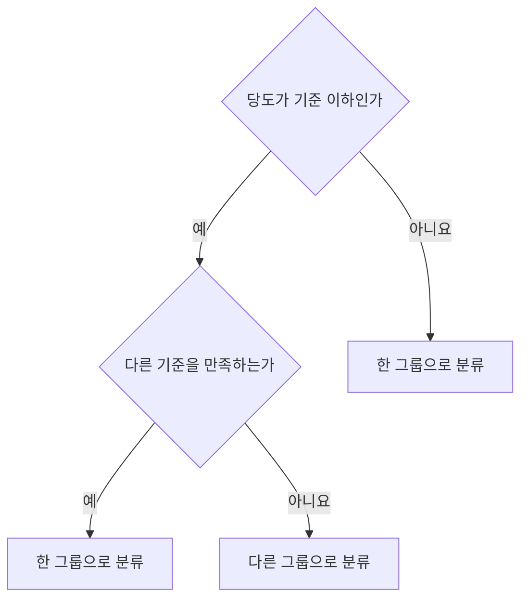
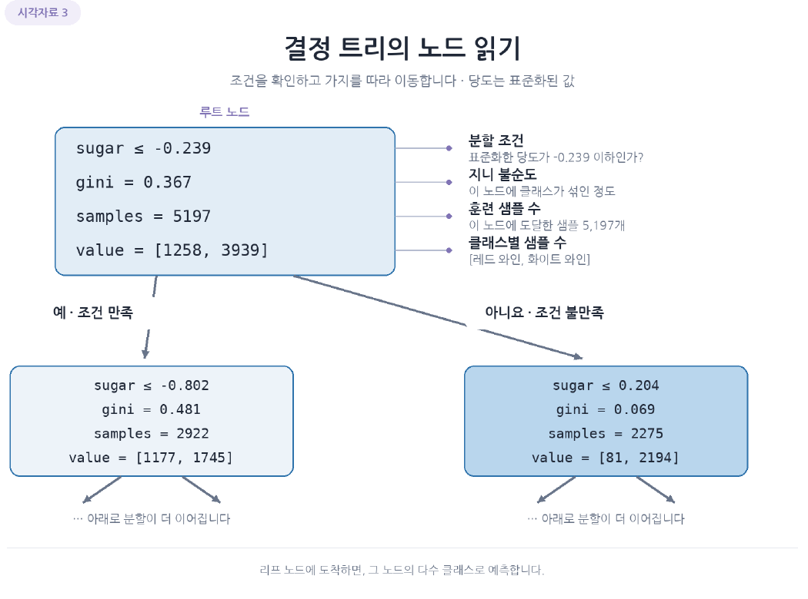
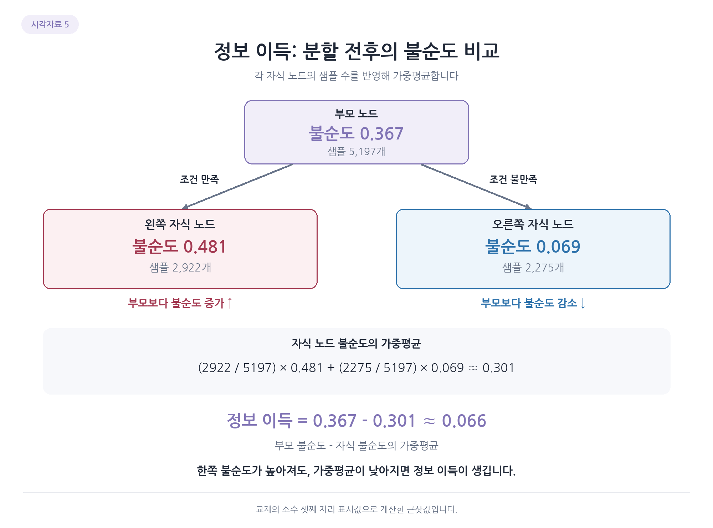
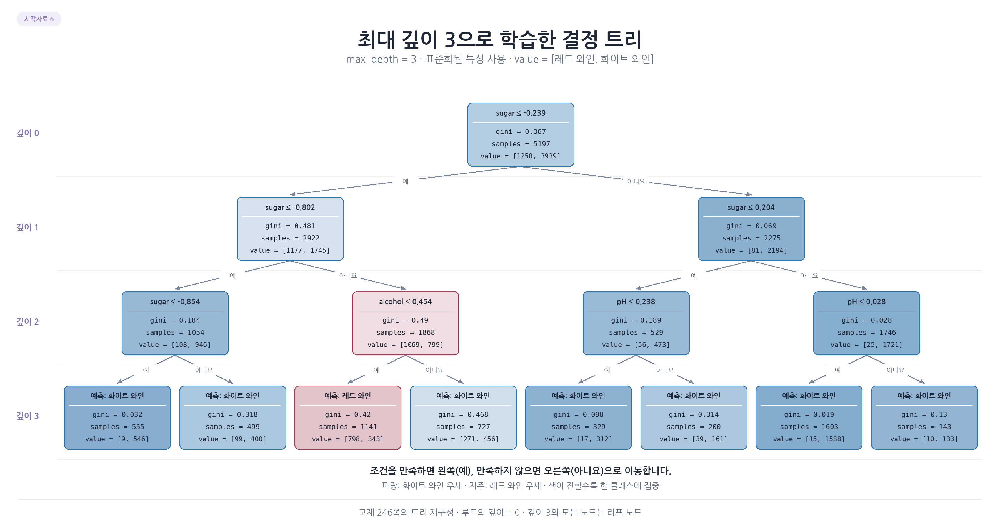
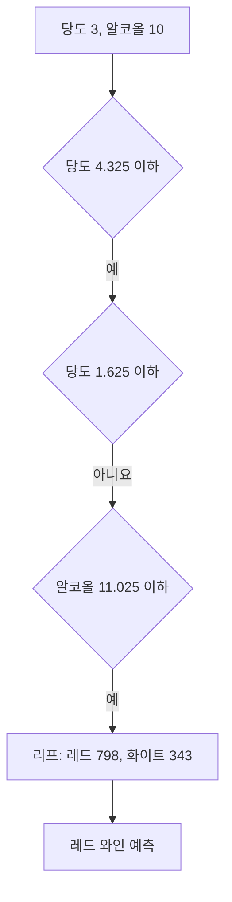

# Day 2. 결정 트리

> 결정 트리는 특성에 관한 질문을 차례로 나누며 예측한다. 분류 기준을 눈으로 따라갈 수 있지만, 너무 깊어지면 훈련 데이터에 과하게 맞춰질 수 있다.

## 1. 와인 분류와 결정 트리 (1-8쪽)

와인 데이터는 알코올 도수, 당도, pH를 사용해 레드 와인과 화이트 와인을 분류한다.  
총 6,497개 중 5,197개를 훈련에, 1,300개를 테스트에 사용한다.  
로지스틱 회귀의 정확도는 훈련 약 0.781, 테스트 약 0.778이었다.

<strong>결정 트리(Decision Tree)</strong>는 데이터를 구분하는 질문을 연속해서 만든다.  
예를 들어 당도가 특정 값 이하인지 묻고, 답에 따라 다시 알코올 도수 등의 조건으로 나눈다.  
모델이 선택한 질문을 따라가면 예측의 근거를 확인할 수 있다.

## 2. 노드와 분류 과정 (9-15쪽)

트리의 각 질문 또는 결과가 들어 있는 위치를 노드(Node)라고 한다.  
맨 처음 노드는 루트 노드(Root Node), 더 이상 나누지 않는 마지막 노드는 리프 노드(Leaf Node)다.  
질문의 결과에 따라 왼쪽과 오른쪽 자식 노드로 이동한다.

노드에는 분할 조건, 해당 노드에 도달한 샘플 수와 클래스별 개수, 불순도 등의 정보가 표시된다.  
리프에서는 도달한 샘플 중 더 많은 클래스가 예측 결과가 된다.  
예를 들어 레드 798개와 화이트 343개가 있는 리프라면 레드로 예측한다.

> 11쪽: 루트 노드의 분할 조건과 불순도, 샘플 수가 두 자식 노드로 이어지는 모습을 나타낸다.

조건에 사용되는 값은 학습에 넣은 특성의 단위와 같다.  
표준화한 데이터의 당도 기준 `-0.239`와 원래 단위로 학습한 트리의 기준 `4.325`는 서로 다른 트리의 조건이다.

## 3. 불순도와 정보 이득 (13-20쪽)

<strong>불순도(Impurity)</strong>는 한 노드에 서로 다른 클래스가 얼마나 섞였는지 나타낸다.  
트리는 분할 후 자식 노드들이 더 잘 구분되도록 질문을 선택한다.  
한 종류만 모인 노드는 불순도가 0이다.

지니 불순도(Gini Impurity)는 각 클래스 비율의 제곱을 더한 값을 1에서 뺀다.

$$
G = 1 - \sum_k p_k^2
$$

$p_k$는 해당 노드에서 클래스 $k$가 차지하는 비율이다.  
두 클래스의 비율이 각각 0.5이면 지니 불순도는 `1 - 0.5² - 0.5² = 0.5`다.  
한쪽이 1이고 다른 쪽이 0이면 불순도는 0이다.

트리는 자식 노드의 불순도를 샘플 수로 가중 평균한 뒤, 부모 불순도에서 뺀 값인 정보 이득(Information Gain)이 커지도록 분할을 찾는다.

| 단계 | 샘플 수 | 지니 불순도 약 |
| --- | --- | --- |
| 부모 | 5,197 | 0.367 |
| 왼쪽 자식 | 2,922 | 0.481 |
| 오른쪽 자식 | 2,275 | 0.069 |

[추가 설명] 두 자식의 가중 평균은 `(2922/5197 × 0.481) + (2275/5197 × 0.069)`로 약 0.301이다. 부모의 0.367에서 이를 빼면 정보 이득은 약 0.066이다. 샘플이 많은 자식의 불순도가 평균에 더 크게 반영된다.

엔트로피 불순도(Entropy Impurity)도 클래스가 섞인 정도를 측정하는 기준이다.  
두 클래스가 절반씩일 때 엔트로피는 1이고, 지니 불순도는 0.5다.  
수치의 범위는 다르지만 둘 다 더 순수한 분할을 찾는 데 쓰인다.

> 13-20쪽 관련 그림: 한 자식의 불순도가 높아져도 샘플 수를 반영한 두 자식의 가중평균이 낮아지면 전체 정보 이득은 양수일 수 있다.

## 4. 트리의 깊이와 과대적합 (21-25쪽)

트리 깊이(Depth)는 루트에서 얼마나 많은 분할을 거쳐 내려가는지 나타낸다.  
깊이를 제한하지 않은 실습 모델은 훈련 정확도 약 0.997, 테스트 정확도 약 0.859로, 훈련 데이터에 지나치게 잘 맞는 모습을 보였다.

가지치기(Pruning)는 트리의 복잡도를 제한하는 방법이다.  
최대 깊이를 3으로 제한한 모델은 훈련 약 0.846, 테스트 약 0.842였다.  
깊이를 줄여 훈련과 테스트의 차이는 줄었지만, 이 결과에서 테스트 정확도가 반드시 높아진 것은 아니다.

모델의 최대 깊이는 실제 학습을 제한하는 설정이다.  
그림에서 보여 줄 깊이를 제한하는 설정은 시각화만 바꾸므로 둘을 혼동하지 않는다.

> 21-25쪽 관련 그림: 깊이를 제한하면 질문 단계와 리프 수가 줄어든다. 각 분할 조건을 따라 내려가며 어떤 샘플이 같은 리프에 도달하는지 읽는다.

## 5. 원래 특성 값으로 해석하기 (26-34쪽)

결정 트리는 특성 값의 크기 순서를 기준으로 분할하므로 일반적으로 표준화가 필수는 아니다.  
원래 단위로 학습하면 `당도 4.325 이하`처럼 질문을 해석하기 쉽다.

예를 들어 당도 3, 알코올 도수 10인 와인은 `당도 4.325 이하`를 만족하고, 다음의 `당도 1.625 이하`는 만족하지 않는다.  
이어서 `알코올 도수 11.025 이하`를 만족하는 리프에 도달한다.  
그 리프의 레드 비율은 798/1141로 약 0.699이며, 더 많은 레드 와인을 예측한다.

## 6. 특성 중요도 (34-36쪽)

특성 중요도(Feature Importance)는 각 특성이 트리의 불순도를 줄이는 데 기여한 정도를 요약한 값이다.  
실습에서 당도는 약 0.869, 알코올은 0.124, pH는 0.008이었다.  
이 모델에서는 당도가 분류에 가장 크게 기여했다.

[추가 설명] 중요도는 학습한 모델과 데이터에 따른 값이다. 중요도가 높다는 사실만으로 해당 특성이 와인 종류의 원인이라고 결론 내릴 수는 없다.

## 핵심 개념 비교표

| 구분 | 의미 | 역할 |
| --- | --- | --- |
| 노드 | 샘플이 모이는 지점 | 조건과 클래스 구성을 표현 |
| 불순도 | 클래스가 섞인 정도 | 분할 전후의 상태를 평가 |
| 정보 이득 | 분할 전후 불순도 감소량 | 좋은 분할을 선택 |
| 최대 깊이 | 루트에서 내려갈 수 있는 깊이 제한 | 모델 복잡도 조절 |
| 특성 중요도 | 불순도 감소에 대한 특성별 기여 | 모델이 주로 사용한 특성 확인 |

## 핵심 정리

- 결정 트리는 특성에 관한 질문을 반복해 샘플을 분류한다.
- 루트에서 조건을 따라 리프에 도달하면 그 노드의 클래스 구성으로 예측한다.
- 지니 불순도와 엔트로피는 노드에 클래스가 섞인 정도를 나타낸다.
- 정보 이득은 부모와 자식 노드의 불순도 차이로 분할을 평가한다.
- 최대 깊이를 제한하면 복잡도를 줄일 수 있지만 테스트 성능이 항상 오르지는 않는다.
- 결정 트리는 보통 표준화 없이도 학습하며 원래 단위의 조건을 해석하기 쉽다.
- 특성 중요도는 모델의 분할 기여도를 뜻하며 인과관계를 보장하지 않는다.
