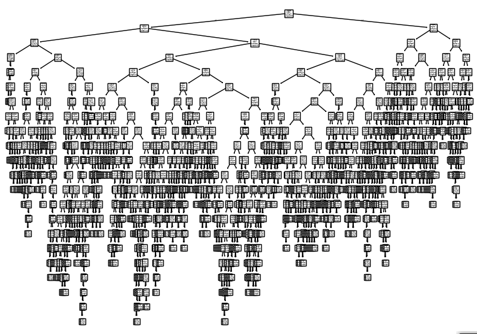
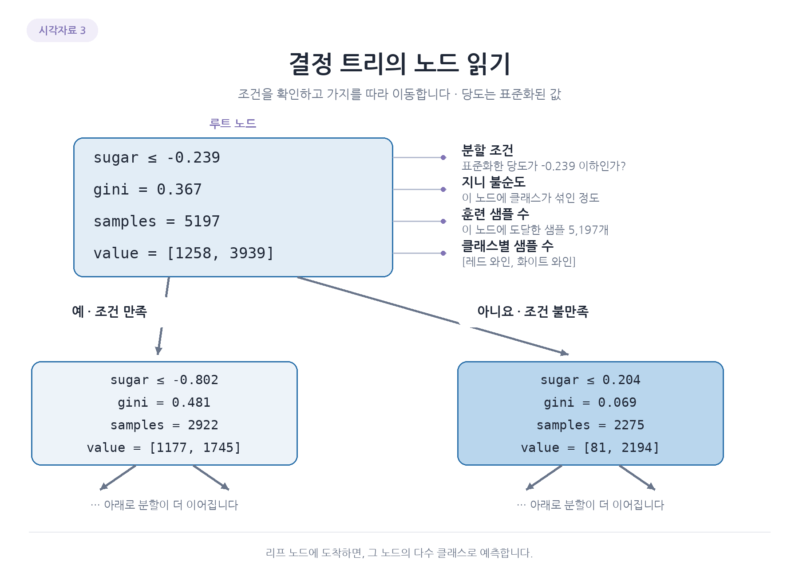
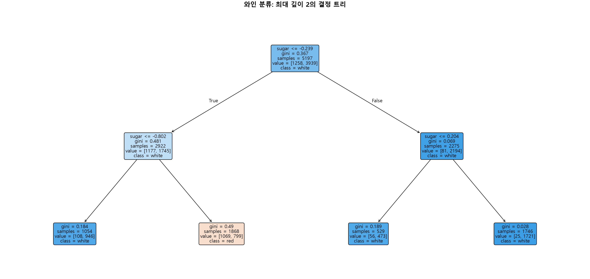

# 3. 노드와 분할 조건 읽기

학습된 트리를 그림으로 보면 노드와 가지가 연결된 구조임. 노드는 데이터를 모아 둔 집단이며 분할 조건이 있는 노드에서는 그 집단을 둘로 나눔. 가지는 조건에 따라 이동하는 경로임.

## 위에서 아래로 읽는 구조



맨 위 루트 노드는 전체 훈련 데이터를 포함함. 한 노드에서 나뉜 두 노드는 자식이고 나누기 전 노드는 부모임. 더 이상 나누지 않는 마지막 노드를 리프라고 함. 깊이는 루트 0에서 시작해 아래로 이동한 단계 수임.

전체 트리는 복잡하므로 윗부분부터 확인함.

```python
import matplotlib.pyplot as plt
from sklearn.tree import plot_tree

plt.figure(figsize=(10, 7))
plot_tree(dt_full, max_depth=1, filled=True,
          feature_names=['alcohol', 'sugar', 'pH'])
plt.show()
```

`plot_tree(max_depth=1)`은 그림에서 표시할 깊이만 제한함. 학습된 트리의 아래 규칙은 남아 있음. 실제 모델의 깊이를 제한하려면 모델 생성 시 `DecisionTreeClassifier(max_depth=...)`를 사용해야 함.

| 용어 | 의미 |
| --- | --- |
| 노드 | 데이터가 모이고 분할되는 지점 |
| 루트 노드 | 트리의 시작점 |
| 부모와 자식 노드 | 분할 전 노드와 분할 후 이어지는 노드 |
| 가지 | 분할 조건의 결과에 따라 이동하는 경로 |
| 리프 노드 | 더 나누지 않고 최종 예측을 결정하는 노드 |
| 깊이 | 루트에서부터 내려간 단계 수 |

## 루트 노드의 네 항목 연결하기



| 표시 | 읽는 방법 |
| --- | --- |
| sugar <= -0.239 | 표준화된 당도가 이 값 이하면 왼쪽, 초과면 오른쪽 |
| gini = 0.367 | 이 집단에서 두 클래스가 섞인 정도 |
| samples = 5197 | 이 노드에 도착한 훈련 샘플 수 |
| value = [1258, 3939] | 클래스 순서대로 레드와 화이트 개수 |

전체 데이터 6,497개가 아닌 훈련 5,197개가 루트에 있음. 테스트 정답으로 이 개수나 규칙을 만든 것이 아님. 당도 기준은 표준화된 값이므로 원래 당도와 바로 비교하면 안 됨.

왼쪽에는 2,922개가 모이고 레드 1,177개, 화이트 1,745개임. 오른쪽은 2,275개이며 레드 81개, 화이트 2,194개. 자식의 샘플 수를 합하면 부모의 수가 됨. 오른쪽은 화이트에 더 집중됐지만 왼쪽은 두 종류가 많이 섞여 있음.

`filled=True`의 색은 클래스 분포를 나타냄. 진한 색은 한쪽 클래스에 더 집중된 것을 보여 주지만, 어떤 클래스인지와 개수는 노드 숫자를 함께 봐야 함. 그림 아래가 생략된 자식은 실제 모델의 리프가 아닐 수 있음.

## 최대 깊이 2의 실제 와인 트리



이 그림은 같은 표준화 훈련 데이터로 `max_depth=2` 모델을 따로 학습해 그린 것임. 앞의 깊이 제한 없는 트리를 그림에서만 자른 것이 아니라 학습할 때부터 깊이를 2로 제한한 모델이므로 맨 아래 네 노드는 실제 리프임.

루트의 `sugar <= -0.239`는 표준화된 당도 조건. 참이면 왼쪽으로 가서 2,922개, 거짓이면 오른쪽으로 가서 2,275개가 모임. 각 자식은 다시 당도 기준을 확인하고, 도착한 리프의 `value` 순서 `[레드, 화이트]`에서 더 많은 종류를 `class`로 선택함.

예를 들어 왼쪽 자식에서 당도가 -0.802를 초과하면 레드 1,069개와 화이트 799개가 있는 리프에 도착해 레드로 예측함. 이 모델은 깊이 2에서 멈추므로 뒤에서 배우는 깊이 3 모델과 리프의 분포나 예측이 같아야 하는 것은 아님.

같은 그림은 앞에서 만든 `train_scaled`, `train_target`으로 다음처럼 그릴 수 있음.

```python
from sklearn.tree import DecisionTreeClassifier, plot_tree
import matplotlib.pyplot as plt

shallow_tree = DecisionTreeClassifier(max_depth=2, random_state=42)
shallow_tree.fit(train_scaled, train_target)
plt.figure(figsize=(19, 9))
plot_tree(shallow_tree, feature_names=['alcohol', 'sugar', 'pH'],
          class_names=['red', 'white'], filled=True, rounded=True,
          precision=3, fontsize=11)
plt.show()
```

`max_depth=2`는 실제 학습의 최대 깊이이고, `filled=True`는 각 노드에서 더 많은 클래스와 그 집중 정도를 색으로 표시함. 숫자와 조건은 표준화 입력 기준으로 읽어야 함.

## 리프에서 이름과 확률 결정하기

새 와인은 루트부터 한 조건씩 확인해 한쪽으로만 내려감. 리프에 도착하면 그곳의 훈련 클래스 분포로 예측함. 가중치가 없는 설정에서 레드 8개와 화이트 2개인 리프라면 레드 확률 0.8, 화이트 0.2이고 레드를 선택함.

확률 열 순서는 `classes_`로 확인함. 이 비율은 학습된 집단의 분포이지 새 와인의 정답을 보장하는 값은 아님. 이제 구조를 읽었으므로 다음에는 트리가 왜 그 분할을 골랐는지 배움.

[이전](02-로지스틱-회귀와-결정-트리.md) | [다음: 지니 불순도와 정보 이득](04-지니-불순도와-정보-이득.md) | [전체 목차](../README.md)
