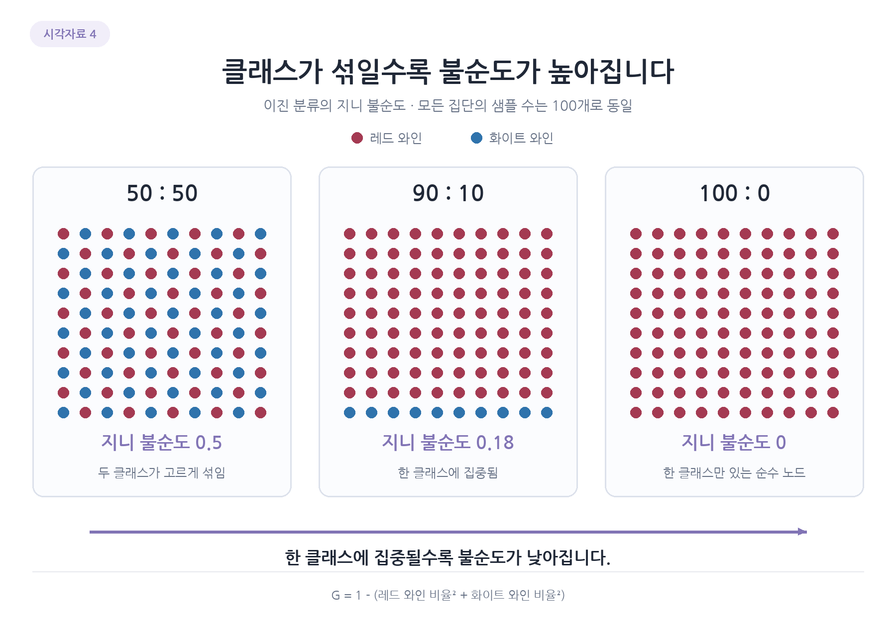
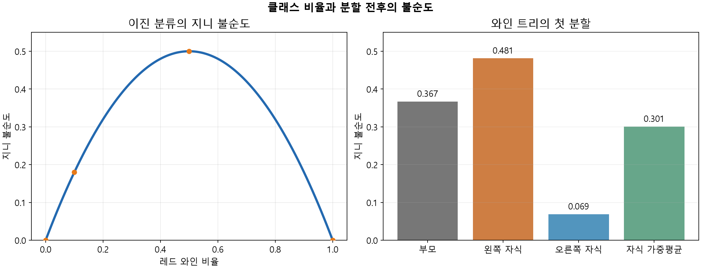
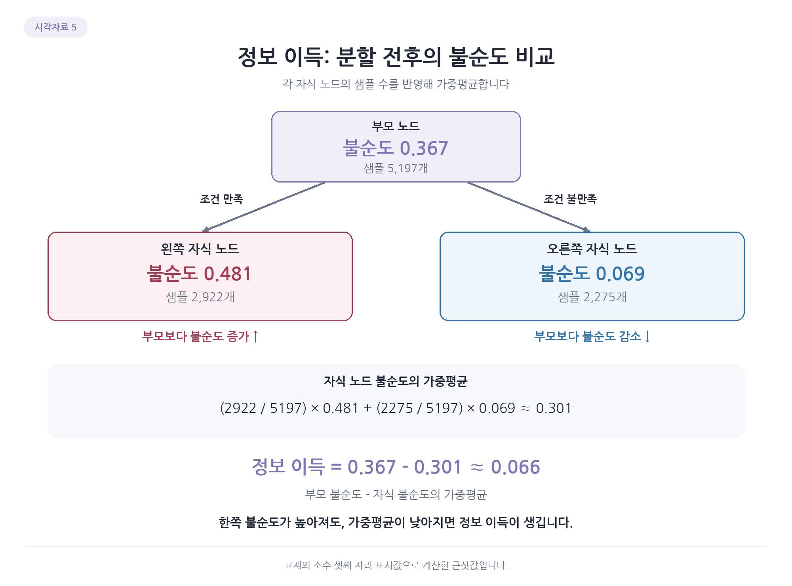

# 4. 지니 불순도와 정보 이득

트리는 어떤 특성과 기준으로 질문할지 훈련 데이터에서 결정함. 좋은 질문을 비교하려면 나누기 전보다 두 종류가 얼마나 덜 섞였는지 숫자로 측정해야 함. 한 노드의 혼합 정도를 불순도라고 함.

## 지니 불순도 계산하기

레드 비율을 $p_0$, 화이트 비율을 $p_1$이라 하면 이진 분류의 지니 불순도는 다음과 같음.

$$
G=1-(p_0^2+p_1^2)
$$

반반이면 $1-(0.5^2+0.5^2)=0.5$. 한 종류가 90%, 다른 종류가 10%이면 $1-(0.9^2+0.1^2)=0.18$. 한 종류만 있으면 $1-(1^2+0^2)=0$임.

| 클래스 구성 | 지니 불순도 |
| --- | ---: |
| 레드 50%, 화이트 50% | 0.50 |
| 레드 90%, 화이트 10% | 0.18 |
| 레드 100%, 화이트 0% | 0 |

한 종류로 모일수록 불순도가 작아짐. 비율이 반대인 레드 10%, 화이트 90%도 불순도는 0.18임.

그림에서 두 색이 반반일 때 가장 많이 섞여 있고 한 색으로 모일수록 순수해짐. 이진 분류의 지니는 최대 0.5이며 레드 90%와 화이트 90%는 모두 0.18임. 불순도는 섞인 정도를 나타내므로 어떤 종류가 더 많은지는 클래스 개수를 따로 읽어야 함.

루트의 레드 1,258개와 화이트 3,939개를 비율로 바꾸어 넣으면 다음과 같음.

$$
G=1-\left[\left(\frac{1258}{5197}\right)^2+\left(\frac{3939}{5197}\right)^2\right]\approx0.367
$$

지니가 0인 순수한 훈련 리프라도 새로운 와인을 모두 맞힌다는 뜻은 아님. 현재 집단의 훈련 정답이 한 종류라는 의미임.

## 클래스 비율과 첫 분할을 그래프로 보기

왼쪽 가로축은 레드의 비율이고 화이트의 비율은 $1-p$임. 레드 비율이 0.5면 두 클래스가 반반이라 지니가 0.5로 가장 큼. 0.1이나 0.9에서는 한쪽이 90%를 차지하므로 지니가 0.18이고, 0이나 1에서는 한 클래스만 남아 0임.

오른쪽은 표준화된 와인 데이터로 학습한 트리의 첫 분할을 사용함. 부모 약 0.367에서 왼쪽 자식은 약 0.481, 오른쪽은 약 0.069가 됨. 두 자식의 크기를 반영한 가중평균은 약 0.301이므로, 전체적으로 불순도가 약 0.066 감소했음. 왼쪽 자식 하나가 부모보다 덜 순수해졌어도 오른쪽의 감소를 함께 고려해야 함.

## 분할의 효과는 정보 이득으로 비교하기

자식의 불순도 하나만 보면 분할 전체를 판단할 수 없음. 두 자식에 들어간 샘플 수가 다를 수 있으므로 그 비율로 가중평균함.

$$
IG=G_{\mathrm{parent}}-\left(\frac{n_L}{n}G_L+\frac{n_R}{n}G_R\right)
$$

$n$은 부모 샘플 수이고 $n_L,n_R$은 두 자식의 수. $G_L,G_R$은 각 자식의 불순도임. 샘플이 많은 집단은 전체 결과에 더 큰 비중을 갖게 됨. 부모에서 이 평균을 빼면 분할로 혼합이 줄어든 양인 정보 이득이 나옴.

실제 분할의 자식 가중평균은 약 $2922/5197\times0.481+2275/5197\times0.069\approx0.301$. 부모 약 0.367보다 낮아 정보 이득은 약 0.066임.

왼쪽은 부모보다 불순도가 높지만 오른쪽이 충분히 낮아져 전체 평균은 감소함. 두 자식 모두 부모보다 낮아야 하는 것은 아님. 트리는 각 노드에서 후보 특성과 기준값의 불순도 감소를 비교해 선택함. 모든 트리 구조를 한꺼번에 비교해 전체 최적을 보장하는 방식은 아님.

[이전](03-노드와-분할-조건-읽기.md) | [다음: 불순도 계산과 엔트로피](05-불순도-계산과-엔트로피.md) | [전체 목차](../README.md)
