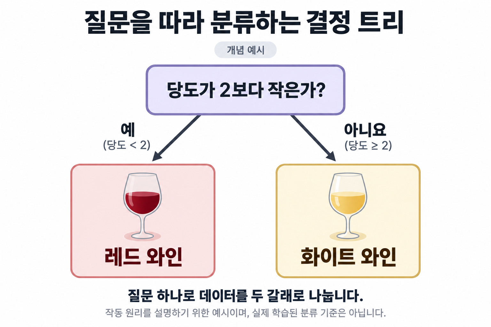
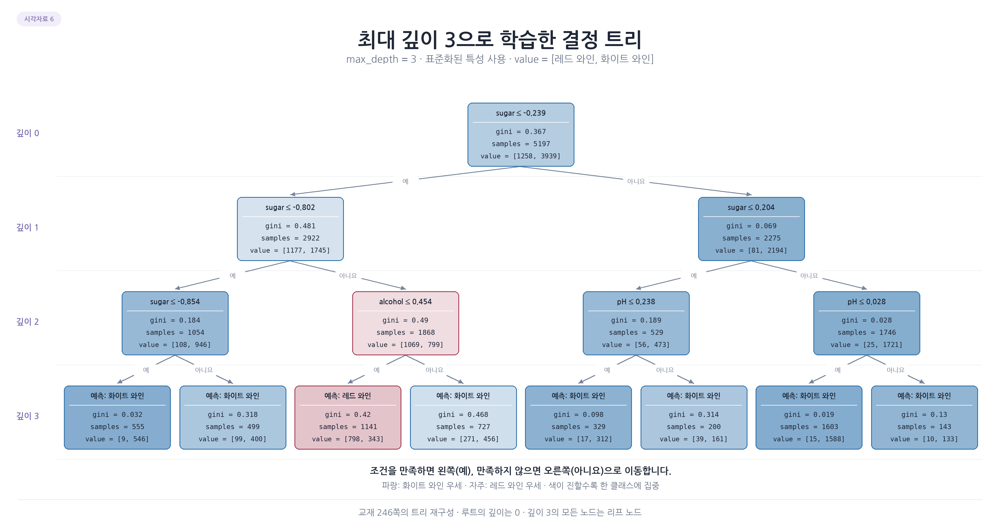

# 결정 트리 그림 살펴보기

## 1. 질문을 따라 분류하는 과정

당도가 2보다 작은지 묻고 조건을 만족하면 왼쪽, 아니면 오른쪽으로 나뉘는 개념 그림. 질문으로 두 집단을 나눌 수 있다는 원리를 보여줌.

당도 2나 두 와인 결과는 실제 학습한 모델의 규칙이 아님. 실제 트리는 여러 조건을 반복하며 루트에서 리프까지 이동하고, 도착한 리프의 분포로 예측함.

## 2. 제한 없는 트리의 복잡도

위쪽 루트에서 시작한 가지가 아래로 많이 갈라져 개별 노드의 글자가 작게 보임. 이것은 확대 없이 숫자를 하나씩 읽기보다 학습된 트리가 얼마나 복잡한지 확인하는 그림.

각 리프는 특정 조건 조합에 해당하는 훈련 집단. 이 예시에서는 실제 깊이 21, 리프 799개로 훈련 정확도는 거의 100%지만 테스트는 그보다 낮음. 복잡한 구조가 곧 높은 일반화 성능을 뜻하지는 않음.

## 3. 루트와 두 자식 노드 읽기

루트의 `sugar <= -0.239`는 표준화된 당도 조건. 참이면 왼쪽, 거짓이면 오른쪽. `samples`는 훈련 샘플 수, `value`는 레드와 화이트의 분포, `gini`는 혼합 정도.

부모의 `[1258, 3939]`가 왼쪽 `[1177, 1745]`와 오른쪽 `[81, 2194]`로 나뉨. 두 자식의 클래스 수를 더하면 부모의 수가 됨. 오른쪽은 화이트가 대부분이어서 색이 진하고 불순도가 낮음. 아래 생략 표시는 실제 트리가 여기서 끝난다는 뜻이 아님.

## 4. 클래스 비율과 불순도

각 칸은 동일하게 샘플 100개를 사용. 빨강과 파랑이 50:50이면 지니 0.5, 90:10이면 0.18, 100:0이면 0.

전체 샘플 수보다 클래스 비율이 얼마나 한쪽에 집중됐는지를 나타냄. 따라서 레드가 많든 화이트가 많든 한 클래스만 있으면 지니는 0. 지니가 낮다는 사실은 그 노드가 순수하다는 뜻이며 외부 데이터에 대한 정확도 자체는 아님.

## 5. 가중평균으로 정보 이득 판단

부모 지니는 약 0.367, 왼쪽은 0.481, 오른쪽은 0.069. 왼쪽만 보면 불순도가 올라갔지만 오른쪽은 크게 줄었음.

두 자식의 샘플 비중 2922/5197과 2275/5197을 각각 곱하면 분할 후 약 0.301. 부모에서 이 값을 빼면 정보 이득은 약 0.066. 자식 크기가 다르므로 두 불순도를 단순히 반반 평균하면 안 됨.

## 6. 최대 깊이 3의 트리

루트는 깊이 0, 맨 아래 리프는 깊이 3. 학습 자체를 최대 3단계로 제한해 분할 규칙과 예측 집단을 확인하기 쉬워짐. 이 모델에는 리프 8개가 있음.

각 리프에서 클래스가 완전히 한 종류로 나뉘지 않아도 분할을 멈출 수 있음. 깊이 제한은 복잡도를 줄이지만 훈련 정확도뿐 아니라 테스트 정확도도 조금 낮아졌으므로 점수 차이가 줄었다는 것만으로 더 좋다고 판단하지 않음. 기준값은 표준화된 단위라는 점도 함께 읽어야 함.

[그림 목차](../그림-살펴보기.md) | [전체 목차](../README.md)
