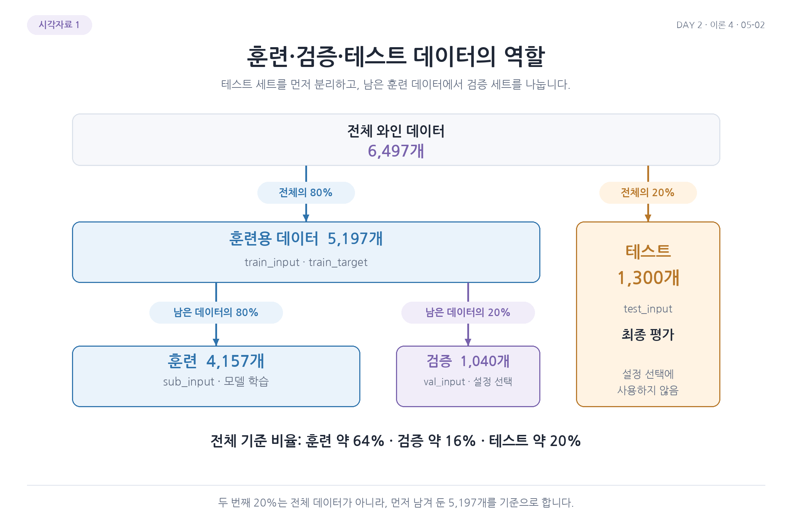

# 1. 훈련, 검증, 테스트 데이터 분리

앞에서는 결정 트리의 깊이를 바꾸며 와인 분류 결과를 살펴봤음. 깊이가 깊으면 훈련 데이터의 세부적인 차이까지 반영할 수 있고, 너무 얕으면 중요한 관계를 놓칠 수 있음. 그렇다면 어떤 깊이를 선택해야 할까?

여러 깊이의 테스트 점수를 확인하고 가장 높은 것을 고르면 테스트 정답을 `fit()`에 전달하지는 않아도 그 결과가 설정 선택에 영향을 줌. 선택에 이미 사용한 데이터로 다시 성능을 확인하면 처음 보는 데이터에 대한 평가로 해석하기 어려워짐. 그래서 선택을 위한 검증 데이터를 따로 사용함.

## 세 데이터의 역할

| 데이터 | 언제 사용하는가? | 역할 |
| --- | --- | --- |
| 훈련 | 모델을 학습할 때 | 입력과 정답으로 결정 트리의 분할 규칙 학습 |
| 검증 | 후보 설정을 비교할 때 | 학습에 사용하지 않은 데이터에서 각 설정의 성능 확인 |
| 테스트 | 모델과 설정을 선택한 뒤 | 최종 모델의 성능 평가 |

검증 데이터에도 실제 정답은 있음. 모델의 계수를 수정하거나 트리의 분할을 정할 때는 사용하지 않고, 예측한 종류와 비교해 점수를 계산할 때 사용함. 테스트도 정답으로 평가하지만 모델을 선택하기 전까지 따로 남겨 둠.

## 와인 데이터에서 테스트 먼저 남기기

```python
import pandas as pd
from sklearn.model_selection import train_test_split

wine = pd.read_csv('https://bit.ly/wine_csv_data')
data = wine[['alcohol', 'sugar', 'pH']]
target = wine['class']

train_input, test_input, train_target, test_target = train_test_split(
    data, target, test_size=0.2, random_state=42
)
print(train_input.shape, test_input.shape)
```

```text
(5197, 3) (1300, 3)
```

입력은 알코올, 당도, pH이고 정답 `class`는 레드 0, 화이트 1임. 전체 6,497개 중 1,300개를 테스트로 남김. 나머지 5,197개는 모델 학습과 설정 선택에 사용할 데이터임. 입력과 정답은 함께 분할해 같은 와인의 짝을 유지함.

| 구분 | 열 | 내용 |
| --- | --- | --- |
| 입력 특성 | `alcohol`, `sugar`, `pH` | 알코올 도수, 당도, 산도 |
| 정답 | `class` | 레드 와인 0, 화이트 와인 1 |

결정 트리는 특성값을 기준과 비교해 분할하므로 여기서는 원래 단위의 입력을 사용함. `random_state=42`는 같은 분할을 다시 만들기 위한 설정임.

## 남은 데이터에서 검증용 나누기

```python
sub_input, val_input, sub_target, val_target = train_test_split(
    train_input, train_target, test_size=0.2, random_state=42
)
print(sub_input.shape, val_input.shape)
```

```text
(4157, 3) (1040, 3)
```

두 번째 `test_size=0.2`는 전체 6,497개의 20%가 아니라 남은 5,197개의 20%를 뜻함. 그래서 학습용 4,157개, 검증용 1,040개, 최종 테스트 1,300개가 됨. 전체를 기준으로 보면 약 64%, 16%, 20%임.

| 데이터 | 변수 | 샘플 수 | 전체 기준 비율 |
| --- | --- | ---: | ---: |
| 훈련 | `sub_input`, `sub_target` | 4,157 | 약 64% |
| 검증 | `val_input`, `val_target` | 1,040 | 약 16% |
| 테스트 | `test_input`, `test_target` | 1,300 | 약 20% |
| 전체 | | 6,497 | 100% |



그림의 파란 영역은 모델의 분할 규칙을 학습하는 데이터, 보라색은 설정을 비교하는 데이터, 오른쪽은 처음부터 따로 남겨 둔 테스트 데이터임. 다음 파일에서는 이 한 번의 검증 분할로 모델을 평가하고 그 한계를 살펴봄.

[다음](02-단일-검증과-교차-검증.md) | [전체 목차](../README.md)
