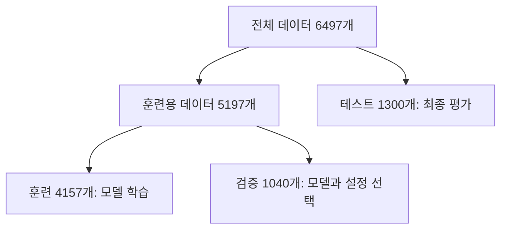
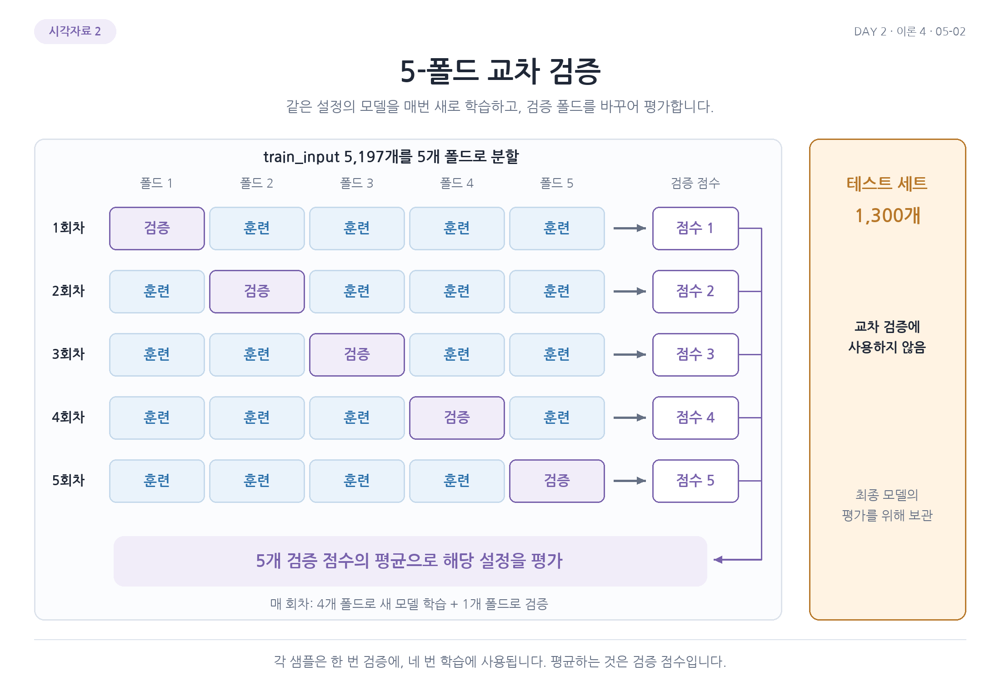
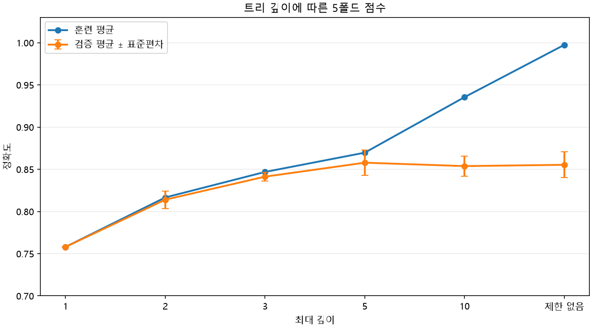
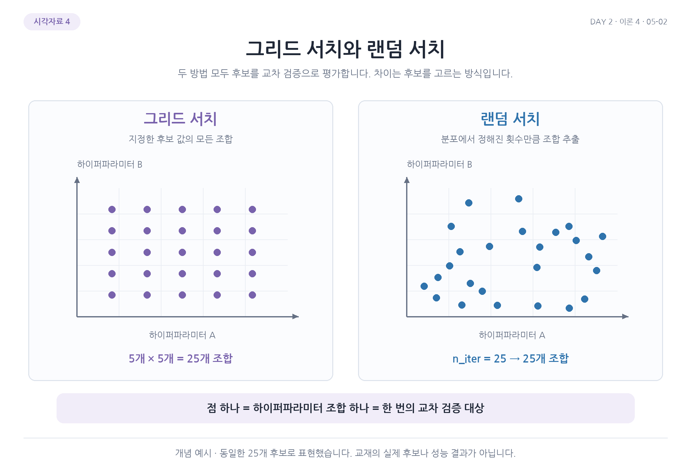

# Day 2. 교차 검증과 하이퍼파라미터 탐색

> 검증 데이터로 모델과 설정을 선택하고, 남겨 둔 테스트 데이터로 최종 성능을 평가한다. 교차 검증은 여러 번의 데이터 분할을 통해 선택의 근거를 넓힌다.

## 1. 훈련, 검증, 테스트 데이터 (1-5쪽)

모델의 성능을 높이기 위해 설정을 비교할 때 테스트 점수를 반복해서 기준으로 삼으면, 테스트 데이터의 특성에 맞는 설정을 고르게 된다.  
그러면 새로운 데이터에 대한 최종 평가가 낙관적으로 보일 수 있다.

<strong>검증 세트(Validation Set)</strong>는 학습한 모델과 하이퍼파라미터를 선택하는 데 사용하는 데이터다.  
하이퍼파라미터(Hyperparameter)는 최대 트리 깊이처럼 학습 전에 사람이 정하는 설정이다.  
테스트 세트는 선택을 마친 모델의 최종 평가에 남겨 둔다.

와인 데이터 6,497개 중 1,300개를 테스트용으로 먼저 분리한다.  
남은 5,197개 중 4,157개로 학습하고 1,040개로 검증하는 것이 한 가지 방법이다.  
두 번째 분할의 20%는 전체가 아니라 남은 5,197개를 기준으로 한다.

## 2. 교차 검증의 원리 (5-9쪽)

한 번 나눈 검증 세트의 점수는 어떤 샘플이 검증용으로 선택됐는지에 영향을 받는다.  
<strong>교차 검증(Cross-validation)</strong>은 훈련용 데이터를 여러 부분으로 나누고, 검증에 쓰는 부분을 바꿔 가며 성능을 측정한다.

5겹 교차 검증(5-fold Cross-validation)에서는 데이터를 다섯 묶음으로 나눈다.  
매번 한 묶음을 검증에 사용하고 나머지 네 묶음으로 학습한다.  
다섯 번의 검증 점수를 평균해 설정을 비교한다.

교차 검증에서도 처음에 떼어 둔 테스트 세트는 사용하지 않는다.  
결과 항목의 `test_score`는 각 반복에서 검증용으로 남겨 둔 묶음의 점수다.  
별도로 보관한 최종 테스트 세트의 점수와 구분해야 한다.

층화 교차 검증(Stratified Cross-validation)은 각 묶음에 클래스 비율이 비슷하게 들어가도록 나누는 방법이다.  
분류 문제에서 클래스 비율이 한쪽에 쏠리는 것을 줄이는 데 도움이 된다.  
실습에서는 섞기와 재현을 위한 `shuffle`과 `random_state=42`를 설정한 10겹 검증도 사용한다.

> 6쪽: 훈련 데이터 안에서 검증 부분을 바꾸어 다섯 모델을 평가한다. 별도 테스트 세트는 이 과정에 참여하지 않는다.

## 3. 모델 복잡도 비교 (9-14쪽)

결정 트리의 최대 깊이가 작으면 모델이 단순하고, 깊어질수록 복잡한 분할을 표현할 수 있다.  
깊이 1, 2, 3, 5, 10과 제한 없는 경우를 교차 검증으로 비교하면 훈련 점수와 검증 점수의 차이도 함께 살펴볼 수 있다.

실습에서는 최대 깊이 5일 때 평균 훈련 점수 약 0.870, 평균 검증 점수 약 0.858, 검증 점수의 표준편차 약 0.015가 나왔다.  
표준편차는 분할별 점수가 얼마나 흩어졌는지 나타낸다.  
평균만이 아니라 분할에 따른 변동도 함께 확인한다.

> 9-12쪽 관련 그림: 깊이가 커질수록 훈련 점수는 계속 높아지지만 검증 점수는 비슷한 수준에 머물 수 있다. 오차 막대는 폴드 간 점수 차이를 나타낸다.

## 4. 그리드 탐색 (14-22쪽)

그리드 탐색(Grid Search)은 미리 정한 후보 값들의 조합을 교차 검증으로 비교하는 방법이다.  
예를 들어 최대 깊이 후보가 3개, 최소 분할 샘플 수 후보가 2개라면 총 6개 조합을 평가한다.  
각 조합을 5겹 검증하면 모델 학습은 조합마다 다섯 번씩 진행된다.

실습에서는 불순도 감소의 최소 기준인 `min_impurity_decrease`를 비롯해 `max_depth`, `min_samples_split`을 탐색한다.  
`min_samples_split`은 노드를 나누기 위해 필요한 최소 샘플 수다.  
기준을 높이면 작은 이득의 분할이나 작은 노드의 분할을 억제해 트리의 복잡도를 제한할 수 있다.

여러 값을 함께 탐색한 결과 한 설정은 최대 깊이 14, 최소 불순도 감소 0.0004, 최소 분할 샘플 수 12였고 평균 검증 점수는 약 0.868이었다.  
선택 후에는 해당 설정으로 전체 훈련용 데이터를 다시 학습한다.

## 5. 랜덤 탐색 (23-29쪽)

랜덤 탐색(Random Search)은 모든 조합을 확인하는 대신 지정한 범위나 분포에서 설정을 무작위로 뽑아 평가한다.  
후보가 많을 때 평가 횟수를 정해 탐색할 수 있지만, 뽑히지 않은 조합은 확인하지 못한다.

정수 범위와 실수 분포를 각각 지정할 수 있다.  
실습에서는 100개 후보를 평가했고, 가장 높은 평균 검증 점수는 약 0.870이었다.  
선택한 모델의 최종 테스트 점수는 0.86이었다.  
이 수치는 해당 데이터 분할과 탐색 설정에서 나온 결과다.

> 24쪽 관련 그림: 그리드 서치는 정한 격자 조합을, 랜덤 서치는 분포에서 뽑은 조합을 평가한다. 그림의 25개 점은 배치 방식의 예이며 실제 실습의 100회 탐색과 구분한다.

## 핵심 개념 비교표

| 구분 | 검증 방법 또는 탐색 방식 | 목적 |
| --- | --- | --- |
| 단일 검증 | 훈련용 데이터를 한 번 분할 | 설정을 빠르게 비교 |
| 교차 검증 | 검증 묶음을 바꾸며 반복 | 여러 분할의 평균과 변동 확인 |
| 그리드 탐색 | 지정한 후보 조합을 모두 비교 | 정해진 조합을 체계적으로 탐색 |
| 랜덤 탐색 | 범위나 분포에서 후보를 추출 | 정해진 횟수 안에서 넓은 범위 탐색 |
| 테스트 평가 | 선택이 끝난 모델을 별도 데이터로 평가 | 최종 성능 확인 |

## 핵심 정리

- 훈련 세트는 학습에, 검증 세트는 모델 선택에, 테스트 세트는 최종 평가에 사용한다.
- 교차 검증은 검증 묶음을 바꾸면서 여러 차례 학습하고 점수를 평균한다.
- 층화 분할은 분류에서 각 묶음의 클래스 비율을 비슷하게 유지한다.
- 트리 깊이와 최소 분할 조건은 모델의 복잡도를 조절한다.
- 그리드 탐색은 정해진 조합을 비교하고 랜덤 탐색은 후보를 무작위로 고른다.
- 검증 점수로 설정을 선택한 뒤 전체 훈련용 데이터로 다시 학습한다.
- 최종 테스트 점수는 모델 선택 과정과 구분해 해석한다.
