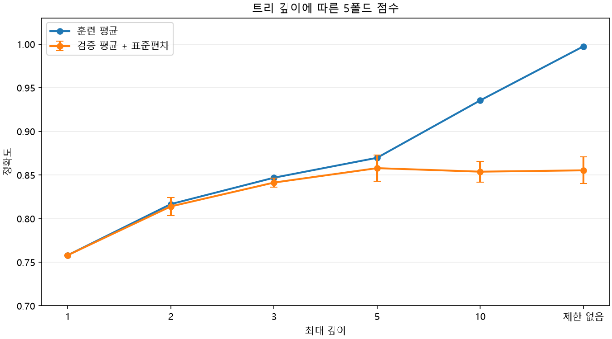

# 4. 트리 깊이별 교차 검증

결정 트리의 `max_depth`를 바꾸면 얼마나 많은 질문을 연속해서 할 수 있는지가 달라짐. 깊이를 하나만 정해 결과를 보는 대신 여러 후보를 같은 교차 검증 방식으로 비교하면 설정 선택의 근거를 얻을 수 있음.

## 같은 5개 폴드로 후보 비교하기

앞에서 만든 `train_input`, `train_target`, `StratifiedKFold`와 `cross_validate`를 사용함. 각 깊이마다 같은 분할 방식으로 다섯 번 학습하고, 훈련 점수와 검증 점수를 모두 기록함.

```python
import pandas as pd
from sklearn.tree import DecisionTreeClassifier

cv5 = StratifiedKFold(n_splits=5)
depth_candidates = [1, 2, 3, 5, 10, None]
depth_results = []

for depth in depth_candidates:
    model = DecisionTreeClassifier(max_depth=depth, random_state=42)
    scores = cross_validate(
        model, train_input, train_target,
        cv=cv5, return_train_score=True
    )
    depth_results.append({
        '최대 깊이': '제한 없음' if depth is None else str(depth),
        '훈련 평균': scores['train_score'].mean(),
        '검증 평균': scores['test_score'].mean(),
        '검증 표준편차': scores['test_score'].std(),
    })

results_depth = pd.DataFrame(depth_results)
print(results_depth.round(4).to_string(index=False))
```

실행 결과를 표로 정리하면 다음과 같음.

| 최대 깊이 | 훈련 평균 | 검증 평균 | 검증 표준편차 |
| --- | ---: | ---: | ---: |
| 1 | 0.7579 | 0.7579 | 0.0004 |
| 2 | 0.8166 | 0.8139 | 0.0104 |
| 3 | 0.8468 | 0.8413 | 0.0052 |
| 5 | 0.8697 | 0.8578 | 0.0151 |
| 10 | 0.9355 | 0.8538 | 0.0118 |
| 제한 없음 | 0.9975 | 0.8553 | 0.0153 |

`return_train_score=True`를 주면 각 회차에서 그 모델을 학습시킨 폴드의 점수도 함께 반환함. `train_score`와 `test_score`의 평균은 각각 다섯 회차의 훈련 점수와 검증 점수를 평균한 값임. 여기서 `test_score`는 최종 테스트가 아니라 검증 폴드 점수임.

위 출력에서 평균 검증 정확도가 높은 순서로 상위 세 후보를 비교하면 다음과 같음.

| 순위 | 최대 깊이 | 평균 훈련 정확도 | 평균 검증 정확도 | 검증 표준편차 |
| ---: | --- | ---: | ---: | ---: |
| 1 | 5 | 0.8697 | 0.8578 | 0.0151 |
| 2 | 제한 없음 | 0.9975 | 0.8553 | 0.0153 |
| 3 | 10 | 0.9355 | 0.8538 | 0.0118 |

## 가장 높은 훈련 점수와 검증 점수 비교

깊이 제한이 없는 모델의 훈련 평균은 약 0.9975로 가장 높지만 검증 평균은 약 0.8553임. 이 후보들 중 검증 평균이 가장 높은 것은 깊이 5의 약 0.8578. 훈련을 가장 잘 맞힌 모델이 검증에서도 가장 좋은 것은 아니었음.

깊이 1에서는 훈련과 검증이 모두 약 0.7579로 낮아 필요한 관계까지 충분히 표현하지 못할 수 있음. 깊이 10이나 제한 없음에서는 훈련과 검증의 차이가 커져 과대적합 가능성을 살펴봄. 점수 차이뿐 아니라 각각의 수준도 함께 봐야 함.

## 깊이에 따른 점수 그래프



가로축은 깊이 후보, 세로축은 각 후보의 평균 정확도임. 깊이가 깊어질수록 파란 훈련 점수는 계속 높아지지만 주황색 검증 점수는 깊이 5 부근에서 높아진 뒤 비슷한 수준을 유지함. 제한이 없는 오른쪽에서는 두 점수의 차이가 특히 커짐.

주황색 세로 막대는 각 후보의 검증 평균에서 표준편차만큼 위아래로 표시한 것임. 폴드 점수의 변동을 보기 위한 표시이며 평균의 신뢰구간이나 모델이 반드시 이 범위 안에서 점수를 얻는다는 뜻은 아님. 정확도 축은 0부터 시작하지 않으므로 변화의 크기는 눈금도 함께 확인함.

위에서 만든 `results_depth`로 같은 그래프를 그릴 수 있음.

```python
import matplotlib.pyplot as plt
import numpy as np

x = np.arange(len(results_depth))
plt.plot(x, results_depth['훈련 평균'], 'o-', label='훈련 평균')
plt.errorbar(
    x, results_depth['검증 평균'],
    yerr=results_depth['검증 표준편차'],
    fmt='o-', capsize=4, label='검증 평균 ± 표준편차'
)
plt.xticks(x, results_depth['최대 깊이'])
plt.xlabel('최대 깊이')
plt.ylabel('정확도')
plt.ylim(0.70, 1.03)
plt.legend()
plt.show()
```

`yerr`는 검증 점수의 폴드별 표준편차를 막대로 표시함. 한글 글꼴이 설정되지 않은 환경에서는 축 이름이 깨질 수 있음.

## 검증 표준편차는 무엇을 보여 줄까?

표준편차는 다섯 검증 점수가 평균 주변에서 얼마나 달라졌는지 나타냄. 깊이 5의 약 0.0151은 폴드 간 점수가 어느 정도 달랐음을 보여 주며, 점수가 항상 평균에서 정확히 이만큼 벗어난다는 뜻은 아님.

깊이 5와 다른 상위 후보의 평균 차이는 작음. 이번 후보와 분할에서 깊이 5가 가장 높았다고 모든 데이터에서 반드시 최선이라고 판단할 수는 없음. 4와 7을 추가하면 검증 평균은 각각 약 0.8534와 0.8553이고, 이 후보들에서는 깊이 5가 여전히 가장 높음.

다음에는 트리의 다른 설정도 함께 바꿀 때 후보를 어떻게 비교하는지 살펴봄.

[이전](03-교차-검증-실행과-층화-분할.md) | [다음](05-트리-하이퍼파라미터.md) | [전체 목차](../README.md)
