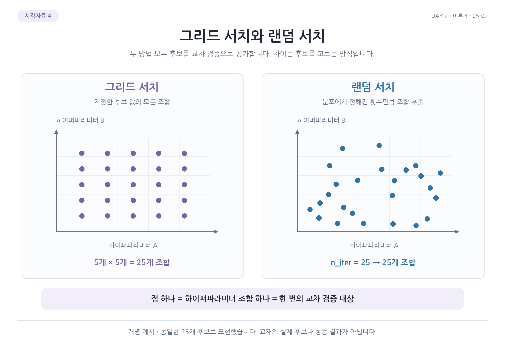

# 9. 랜덤 서치와 탐색 범위

그리드 서치는 후보가 많아질수록 모든 조합을 평가하는 데 시간이 많이 걸림. 특히 실수값은 어느 간격으로 후보를 나열할지도 정해야 함. 랜덤 서치는 지정한 분포나 목록에서 정해진 횟수만큼 조합을 뽑아 교차 검증함.

## 그리드와 랜덤은 무엇이 다를까?



그림의 점 하나는 하이퍼파라미터 조합 하나임. 왼쪽은 각 후보를 격자로 놓고 모든 조합을 평가하고, 오른쪽은 정해진 횟수의 조합을 추출함. 두 방식 모두 뽑은 각 조합을 교차 검증으로 평가함.

| 구분 | 그리드 서치 | 랜덤 서치 |
| --- | --- | --- |
| 후보 구성 | 지정한 후보의 모든 조합 | 분포나 목록에서 조합을 추출 |
| 탐색 횟수 | 후보의 전체 조합 수 | `n_iter`로 지정 |
| 장점 | 정해 둔 후보를 빠짐없이 비교 | 계산량을 제한하면서 넓은 범위를 시도 |
| 한계 | 후보가 많으면 계산량이 커짐 | 좋은 후보를 추출하지 못할 수 있음 |

그리드는 지정한 후보를 빠짐없이 비교하지만 후보가 많으면 계산 비용이 커짐. 랜덤은 `n_iter`로 평가할 조합 수를 제한하고 넓은 범위를 시도할 수 있지만 좋은 후보를 뽑지 못할 수도 있음.

## 정수와 실수 범위 읽기

```python
from scipy.stats import uniform, randint

params_random = {
    'min_impurity_decrease': uniform(0.0001, 0.001),
    'max_depth': randint(20, 50),
    'min_samples_split': randint(2, 25),
    'min_samples_leaf': randint(1, 25),
}
```

`randint(20, 50)`은 20 이상 50 미만의 정수를 뽑으므로 최대 깊이 후보는 20부터 49까지임. `randint(2, 25)`는 2부터 24까지의 정수임.

`uniform(0.0001, 0.001)`의 둘째 인수는 상한이 아니라 구간의 너비임. 따라서 첫 값 0.0001에서 너비 0.001을 더한 0.0011까지의 구간, 즉 0.0001 이상 0.0011 미만의 실수를 추출함. `uniform(0, 1)`은 0 이상 1 미만의 실수를 뽑음.

| 하이퍼파라미터 | 코드 | 추출 범위 |
| --- | --- | --- |
| `min_impurity_decrease` | `uniform(0.0001, 0.001)` | 0.0001 이상 0.0011 미만의 실수 |
| `max_depth` | `randint(20, 50)` | 20부터 49까지의 정수 |
| `min_samples_split` | `randint(2, 25)` | 2부터 24까지의 정수 |
| `min_samples_leaf` | `randint(1, 25)` | 1부터 24까지의 정수 |

분포의 `rvs(10)`은 값 10개를 추출하는 명령임. 균등 분포라도 적은 횟수의 실제 결과에서 모든 값이 정확히 같은 횟수로 나와야 하는 것은 아님. 무작위 결과를 반복 가능하게 하려면 난수 설정이 필요함.

## 부모 샘플과 자식 샘플의 최소 수

이번 범위에는 `min_samples_leaf`가 추가됨. `min_samples_split`은 분할을 시도할 부모 노드의 최소 샘플 수이고, `min_samples_leaf`는 나눈 뒤 각 자식에 남아야 할 최소 수임. 예를 들어 부모 수가 split 조건을 만족해도 분할 후 한 자식이 leaf 최소 수보다 작으면 그 분할은 허용되지 않음.

## 100개 조합으로 탐색하기

```python
from sklearn.model_selection import RandomizedSearchCV

rs = RandomizedSearchCV(
    DecisionTreeClassifier(random_state=42),
    params_random,
    n_iter=100,
    n_jobs=-1,
    random_state=42
)
rs.fit(train_input, train_target)
print(rs.best_params_)
print(round(rs.best_score_, 4))
```

```text
{'max_depth': 39, 'min_impurity_decrease': 0.00034102546602601173, 'min_samples_leaf': 7, 'min_samples_split': 13}
0.8695
```

`n_iter=100`은 모델을 총 100번만 학습한다는 뜻이 아니라 후보 조합을 100개 평가한다는 뜻. 기본 5폴드에서는 $100\times5=500$번의 교차 검증용 학습이 필요하고 기본 재학습은 별도임. 탐색 객체의 `random_state=42`는 조합 추출을 재현함. 트리의 `random_state=42`와 설정 대상이 다름.

| 탐색 방법 | 최고 평균 검증 정확도 | 후보 조합 | 교차 검증용 학습 횟수 |
| --- | ---: | ---: | ---: |
| 다중 그리드 서치 | 0.8684 | 1,350개 | 6,750번 |
| 랜덤 서치 | 0.8695 | 100개 | 500번 |

두 방법 모두 선택된 설정으로 전체 훈련 데이터에 재학습하는 횟수는 별도임.

이번 최고 평균 검증 점수는 약 0.8695이고 앞의 다중 그리드 서치는 약 0.8684였음. 두 실험은 탐색 범위가 다르고 랜덤 서치에 `min_samples_leaf`도 추가됐으므로 이 점수 차이만으로 방법의 일반적인 우열을 판단할 수 없음. 다음에는 선택된 모델을 테스트로 평가함.

[이전](08-여러-하이퍼파라미터-그리드-서치.md) | [다음](10-최종-모델과-테스트-평가.md) | [전체 목차](../README.md)
