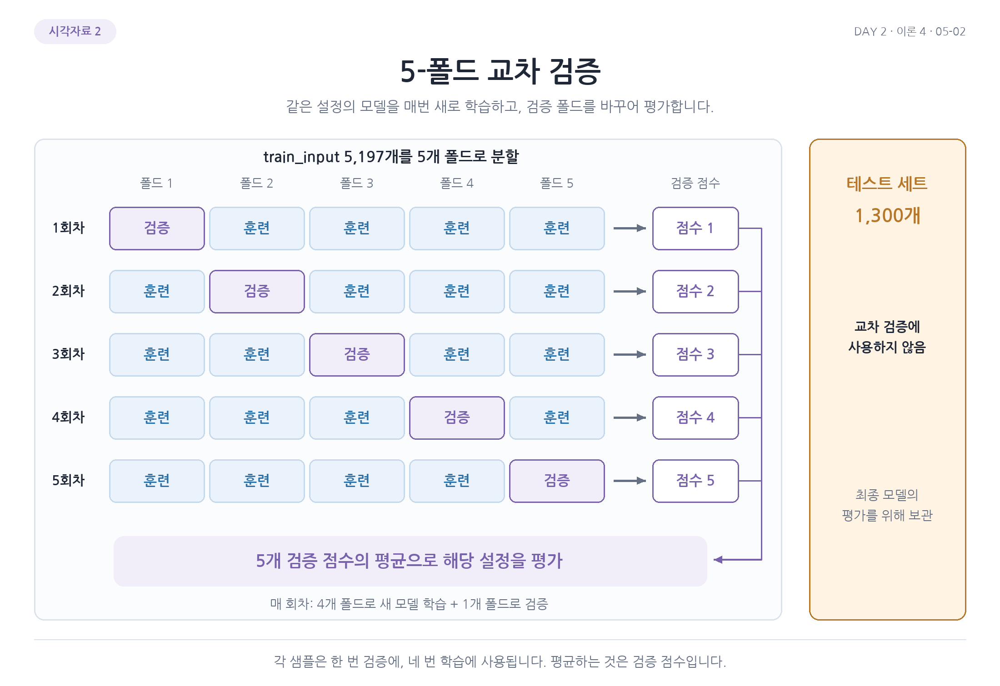
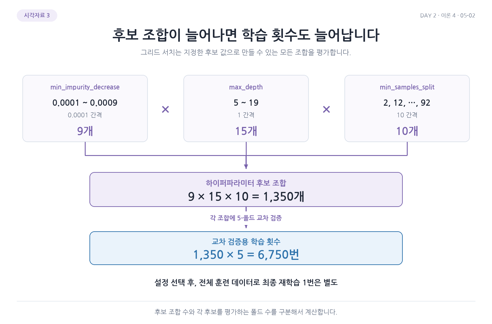

# 교차 검증과 하이퍼파라미터 탐색 그림 살펴보기

## 1. 훈련, 검증, 테스트 데이터의 역할

전체 와인 6,497개 중 오른쪽의 1,300개를 먼저 테스트로 남김. 왼쪽 5,197개를 다시 나누면 학습용 4,157개와 검증용 1,040개가 됨. 두 번째 20%는 전체가 아니라 남은 5,197개를 기준으로 함.

파란 훈련용은 트리의 분할 규칙을 학습하고 보라색 검증용은 설정을 비교함. 테스트는 선택이 끝난 모델을 평가하는 데 사용함. 비율은 전체 기준으로 약 64%, 16%, 20%임.

## 2. 5폴드 교차 검증

행 하나가 한 번의 학습과 검증을 뜻함. 보라색 검증 폴드가 각 행에서 옮겨 가고 나머지 네 폴드는 그 회차의 학습에 사용됨. 같은 설정의 모델을 회차마다 새로 학습하므로 한 모델을 다섯 번 이어서 학습하는 그림이 아님.

검증 점수 다섯 개의 평균으로 해당 설정을 평가함. 오른쪽 테스트 1,300개는 어떤 회차에도 포함하지 않음. 각 샘플은 다섯 회차에서 한 번 검증, 네 번 학습에 사용됨.

## 3. 트리 깊이별 훈련과 검증 점수

가로축은 `max_depth`, 세로축은 다섯 회차 점수의 평균 정확도임. 파란 선은 각 회차에서 학습에 사용한 데이터의 평균이고 주황색 선은 그 회차에서 제외한 검증 데이터의 평균임.

깊이 1에서는 두 점수가 약 0.758로 모두 낮음. 깊이가 커지면서 훈련 점수는 계속 높아지지만 검증 점수는 깊이 5에서 약 0.858을 기록한 뒤 크게 개선되지 않음. 깊이 제한이 없는 오른쪽에서는 훈련 점수가 약 0.997까지 오르는 반면 검증 점수는 약 0.855여서 두 점수의 차이가 커짐. 훈련 데이터를 잘 맞추는 것과 새로운 데이터를 잘 예측하는 것은 다를 수 있음.

주황색 막대는 검증 점수의 평균을 중심으로 폴드별 표준편차만큼 표시한 것임. 폴드에 따른 변동을 보여 주며 신뢰구간은 아님. 세로축은 0.70부터 시작하므로 값의 차이는 눈금으로 확인함.

## 4. 그리드 서치의 후보 수와 학습 횟수

세 상자는 불순도 감소 기준 9개, 최대 깊이 15개, 최소 분할 샘플 수 10개를 나타냄. 각 설정에서 하나씩 골라 만들 수 있는 조합은 $9\times15\times10=1350$개임.

각 조합을 5폴드로 평가하므로 $1350\times5=6750$번의 교차 검증용 학습이 필요함. 기본 재학습 한 번은 별도. 후보 조합 수와 한 조합을 평가하는 횟수를 서로 곱해야 전체 계산량을 이해할 수 있음.

## 5. 그리드 서치와 랜덤 서치

가로축과 세로축은 두 하이퍼파라미터의 값, 점 하나는 설정 조합 하나임. 왼쪽은 각각 다섯 후보의 모든 조합 25개를 격자로 표시함. 오른쪽은 범위에서 25개 조합을 무작위로 뽑는 개념을 보여 줌.

두 방법 모두 선택된 점마다 교차 검증을 수행함. 그림은 후보를 고르는 방식을 비교하는 것이며 점의 위치나 개수 자체가 어느 설정의 정확도가 더 높다는 뜻은 아님. 랜덤 서치의 `n_iter`는 평가할 조합 수이고 폴드 학습 횟수까지 포함한 숫자는 아님.

[이전](10-최종-모델과-테스트-평가.md) | [전체 목차](../README.md)
