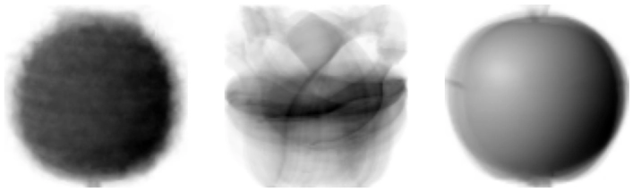
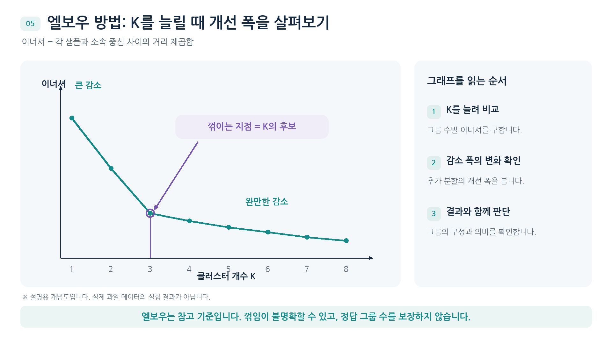

# 과일 이미지와 k 평균


사과와 바나나 사진만 있고 과일 이름은 없다고 해보자. 지도학습처럼 정답과 예측을 비교해 규칙을 배울 수는 없지만, 어떤 사진끼리 비슷한지는 계산할 수 있음. 이처럼 정답 없이 데이터에서 구조를 찾는 방법이 비지도 학습임.

## 사진 한 장을 숫자로 표현하기

100×100 흑백 사진에는 픽셀 밝기 10,000개가 있음. 사진 전체의 평균을 구하면 숫자 하나로 줄어들지만 밝은 부분이 어디였는지는 사라짐. 반대로 여러 사진을 같은 위치의 픽셀끼리 평균 내면 윤곽이 남는 대표 이미지가 만들어짐. 사진과 대표 이미지의 차이를 비교할 때는 각 위치의 밝기를 빼고 절댓값을 평균냄. 부호가 달라 오차가 상쇄되는 것을 막기 위해서임.

## 중심과 소속을 함께 찾기

종류별 평균 사진을 미리 만들려면 어느 사진이 어떤 종류인지 알아야 함. k-평균은 대신 중심 K개에서 시작함. 각 사진을 가장 가까운 중심에 배정하고, 같은 그룹에 모인 사진들의 평균으로 중심을 다시 계산함. 배정과 갱신을 반복하면 중심도, 사진의 소속도 달라짐. 그룹 번호 0이 사과라는 뜻은 아니므로 실제 이미지를 함께 살펴봐야 함.

## K를 늘렸을 때

이너셔는 각 샘플과 소속 중심 사이 거리의 제곱합임. K를 늘리면 중심을 더 촘촘히 둘 수 있으므로 값이 작아지는 것만으로 적절한 K를 고를 수 없음. 감소 폭이 둔해지는 지점과 각 그룹의 대표 이미지를 함께 확인함.

```python
import numpy as np
from sklearn.cluster import KMeans

fruits = np.load('fruits_300.npy')
X = fruits.reshape(len(fruits), -1)
model = KMeans(n_clusters=3, random_state=42, n_init=10).fit(X)
print(X.shape, model.cluster_centers_.shape)
```

```text
(300, 10000) (3, 10000)
```

과일 이미지 배열 파일이 있는 폴더에서 실행함. 한 행은 사진 한 장이고, 중심 세 개도 원래 사진과 같은 수의 픽셀값을 가짐.

## 군집 중심



각 중심은 그 그룹 사진들의 같은 위치 픽셀을 평균 낸 값임. 윤곽이 흐릿해도 오류가 아니라 여러 사진이 겹친 결과임.

## 이너셔



가로축은 K, 세로축은 이너셔임. 3 부근부터 감소 폭이 작아지지만 유일한 정답을 알려 주는 그래프는 아님.

## 사진을 펼쳤을 때 무엇이 달라질까?

과일 사진 300장을 쌓은 배열의 모양은 `(300, 100, 100)`임. 첫 축에서 한 번호를 고르면 사진 한 장이 나오고, 나머지 두 축은 세로와 가로 위치를 가리킴. k-평균에 넣으려면 한 행에 한 샘플이 있어야 하므로 사진을 `(300, 10000)`으로 펼침. 모든 사진을 같은 순서로 펼치면 첫 번째 열은 언제나 같은 위치의 픽셀임.

| 계산 | 결과 한 개의 의미 | 알 수 있는 것 |
| --- | --- | --- |
| 사진 한 장에서 픽셀 평균 | 그 사진의 평균 밝기 | 바나나처럼 배경이 많이 드러나는 사진의 경향 |
| 사진 여러 장에서 같은 위치의 픽셀 평균 | 대표 사진의 해당 위치 밝기 | 사과와 파인애플처럼 평균 밝기가 비슷해도 다른 윤곽 |

가령 두 픽셀로 된 사진 [0, 8]과 [8, 0]은 모두 평균 4임. 첫 사진을 기준으로 두 번째 사진과 위치별 차이를 구하면 평균 절댓값 차이는 (8+8)/2=8임. 밝기의 평균만 보았을 때 사라진 차이를 다시 볼 수 있음.

## 배정과 갱신을 한 번 따라가기

한 특성만 있는 샘플이 1, 3, 9이고 두 중심이 1과 9라면, 3은 거리 2인 첫 중심에 배정됨. 첫 그룹의 평균은 (1+3)/2=2이고 둘째 그룹의 평균은 9임. 중심이 2와 9로 바뀐 뒤 다시 배정해도 소속이 같으면 이 상태에서 멈출 수 있음. 과일 실습에서는 10,000개 픽셀 좌표 각각에 같은 평균 계산을 적용함.

`model.transform(X[100:101])`은 한 사진에서 각 중심까지의 거리를 반환함. 가장 작은 거리의 **열 번호**가 `predict()`의 그룹 번호임. `labels_`는 학습 샘플별 소속, `cluster_centers_`는 그룹별 중심, `inertia_`는 각 샘플에서 소속 중심까지 거리의 제곱을 더한 값임. 대표 이미지를 직접 골라 비교할 때 사용한 평균 절댓값 차이와 k-평균의 거리 기준을 구분함.

## 군집 번호와 과일 종류를 대조하기

| 군집 | 모인 사진 | 사진 수 |
| --- | --- | ---: |
| 0 | 파인애플 100장, 사과 10장, 바나나 2장 | 112 |
| 1 | 바나나 98장 | 98 |
| 2 | 사과 90장 | 90 |

과일 이름은 학습이 끝난 뒤 군집의 구성을 확인하는 데 사용함. 101번째 사진에 대해 관찰한 예측 [0]은 파인애플일 확률이나 정답 이름이 아니라 첫 중심에 가장 가깝다는 뜻임. 중심 초기화 조건에 따라 번호와 배정 결과가 달라질 수 있음.

[다음](02-투영과-주성분-분석.md) | [파트 목차](README.md)
