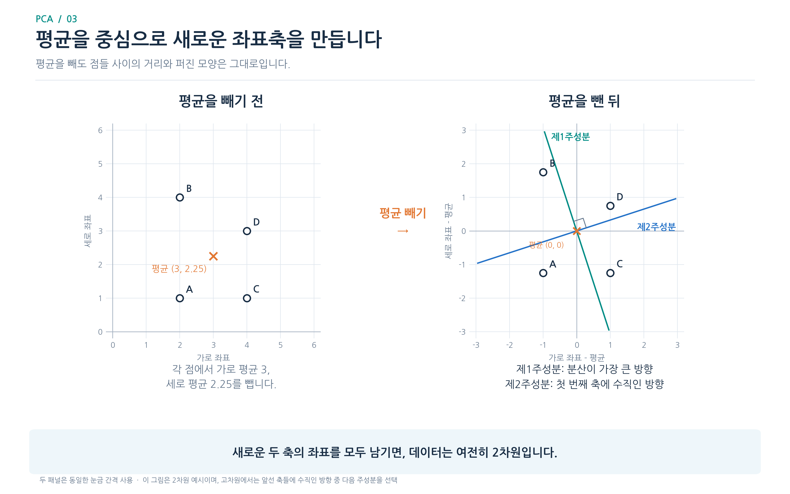
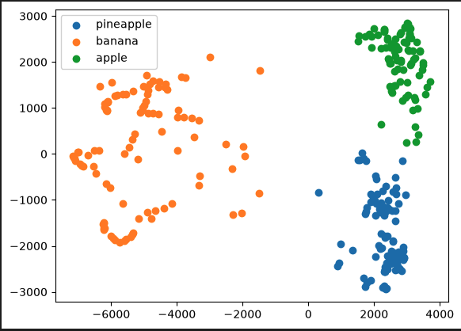

# 투영과 주성분 분석


과일 사진 한 장을 10,000개 숫자로 저장할 때 이웃한 픽셀은 함께 밝아지거나 어두워질 수 있음. PCA는 서로 겹치는 변화를 몇 개의 새로운 축으로 표현함. 사진의 그룹을 정하는 k-평균과는 목적이 다름.

## 왜 분산이 큰 방향인가

평면의 점들을 한 직선 위에 투영한다고 생각하면, 직선에 수직인 방향의 차이는 사라짐. 점들이 길게 늘어선 방향을 택하면 투영 후에도 서로 다른 점을 비교적 잘 구분할 수 있음. PCA는 특성 평균을 뺀 뒤 투영값의 분산이 가장 큰 방향을 첫 주성분으로 찾음. 다음 주성분은 앞의 방향과 수직인 방향 중 남은 분산을 가장 많이 담는 축임.

## 축과 좌표 구분하기

주성분은 원래 특성들의 조합으로 만든 방향이고, 변환 결과는 각 사진을 그 방향에 투영한 좌표임. 예를 들어 50개 축을 남기면 사진 한 장은 좌표 50개로 표현됨. inverse_transform은 이 좌표를 원래 픽셀 공간에 놓는 계산임. 버린 축의 정보는 돌아오지 않으므로 복원 사진은 원본과 다를 수 있음.

## 설명된 분산 읽기

explained_variance_ratio_는 축별로 원래 분산의 얼마를 담았는지 나타냄. 합계는 남긴 축 전체의 설명 비율임. 이 값이 높다는 것이 과일 종류 분류 정확도가 높다는 뜻은 아님. 보존한 변화와 지운 세부 내용을 복원 이미지에서 확인함.

```python
from sklearn.decomposition import PCA

pca = PCA(n_components=50, random_state=42)
coords = pca.fit_transform(X)
print(coords.shape, pca.inverse_transform(coords).shape)
```

```text
(300, 50) (300, 10000)
```

앞의 과일 배열 X를 사용함. 복원 결과의 열 수가 같아졌다고 원래 픽셀값이 모두 복구된 것은 아님.

## 투영을 숫자로 따라가기

가로와 세로가 함께 커지는 점 (1,1), (2,2), (3,3)을 생각해 보자. 평균 (2,2)를 빼면 세 점은 (−1,−1), (0,0), (1,1)임. 가로축만 남겨도 점의 순서는 보이지만, 두 값이 함께 변한다는 관계는 새 축 하나로 더 잘 표현할 수 있음.

대각선 방향의 길이 1인 벡터를 $u=(1,1)/\sqrt{2}$라고 하면 첫 점의 좌표는 $(-1,-1)\cdot u=-\sqrt{2}$임. 나머지 좌표는 0과 $\sqrt{2}$임. 좌표 하나에 u를 곱하고 평균을 더하면 이 예에서는 원래 점을 정확히 복원함. 실제 사진에는 이 축에서 벗어난 차이도 있으므로 적은 축만 사용하면 그 차이가 사라짐.

## 과일 사진에서 배열 모양 읽기

| 객체 | 모양 | 한 행의 의미 |
| --- | --- | --- |
| 원본 입력 | (300, 10000) | 사진 한 장의 픽셀 |
| `components_` | (50, 10000) | 픽셀 10,000개를 조합하는 축 하나 |
| `transform(X)` | (300, 50) | 사진 한 장의 주성분 좌표 50개 |
| `inverse_transform(coords)` | (300, 10000) | 남겨 둔 축으로 복원한 사진 |

공분산은 두 특성이 평균에서 함께 움직이는 정도임. 공분산 행렬의 고유벡터 중 큰 고유값에 대응하는 방향은 투영 후 분산이 큰 방향임. 구현에서는 중심화한 데이터의 특이값 분해로도 같은 축을 구할 수 있음. 첫 두 좌표로 산점도를 그리면 과일들이 평면에 어떻게 분포하는지 확인할 수 있지만, 겹친 점이 원래 10,000차원에서도 같은 사진이라는 뜻은 아님.
## 차원을 줄인 뒤 분류 성능 확인하기

| 분류에 사용한 입력 | 특성 수 | 평균 정확도 | 분류기 평균 학습 시간 |
| --- | ---: | ---: | ---: |
| 원본 픽셀 | 10,000 | 약 99.7% | 0.748초 |
| 주성분 좌표 | 50 | 약 99.7% | 0.021초 |
| 주성분 좌표 | 2 | 약 99.3% | 0.028초 |

PCA(0.5)는 전체 분산의 50% 이상을 보존할 최소 축 수를 찾음. 이 과일에서는 두 개가 선택됨. 표의 시간은 분류기 학습만 측정한 값임. PCA는 정답 없이 축을 구하지만 로지스틱 회귀는 과일 종류를 정답으로 사용함. 새 사진의 성능을 측정하려면 각 검증 폴드의 훈련 부분에서만 PCA를 학습하도록 두 단계를 파이프라인으로 묶음.


## 주성분 축



점 구름의 중심을 평균으로 옮긴 뒤 가장 길게 퍼진 쪽이 첫 축임. 축 자체와 점 하나의 투영 좌표를 구분해서 읽음.


## 군집 좌표



점 하나가 과일 사진 한 장이고 가로와 세로는 첫 두 주성분 좌표임. 색은 k-평균이 붙인 그룹 번호임.


[이전](01-과일-이미지와-k-평균.md) | [다음](03-퍼셉트론과-순전파.md) | [파트 목차](README.md)
