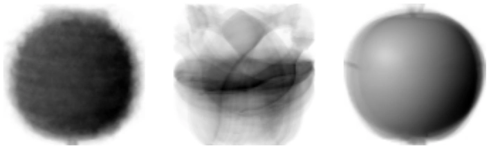
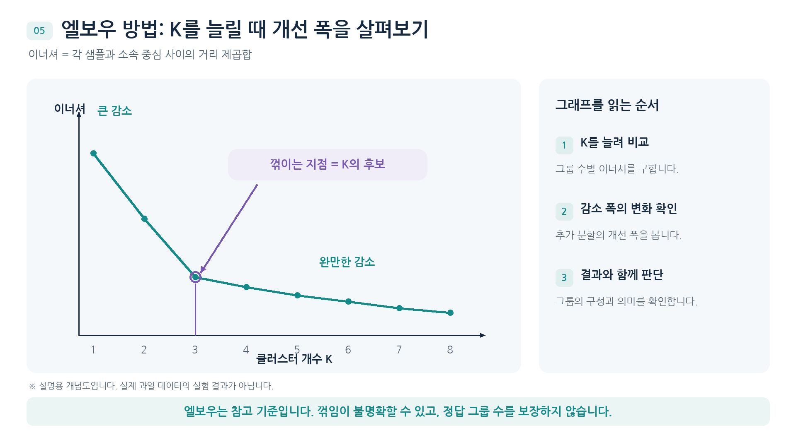
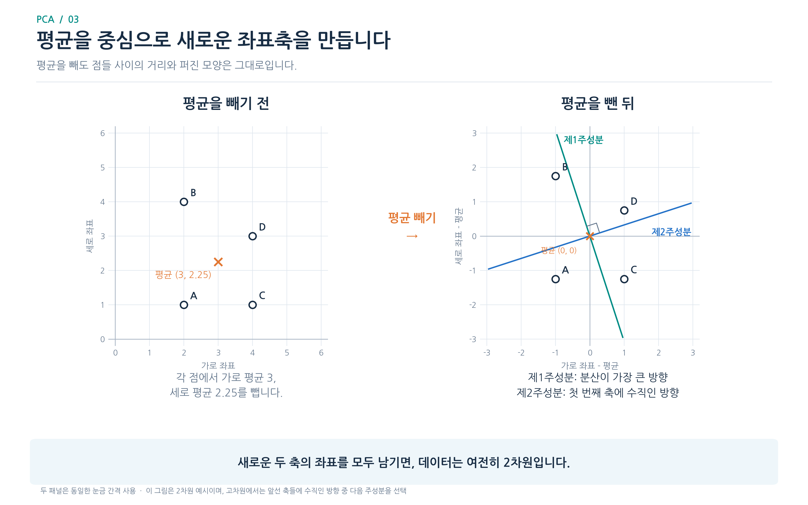
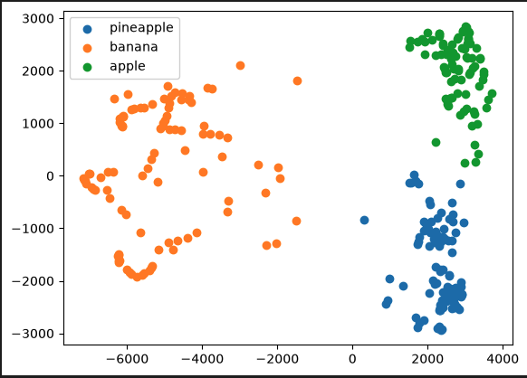
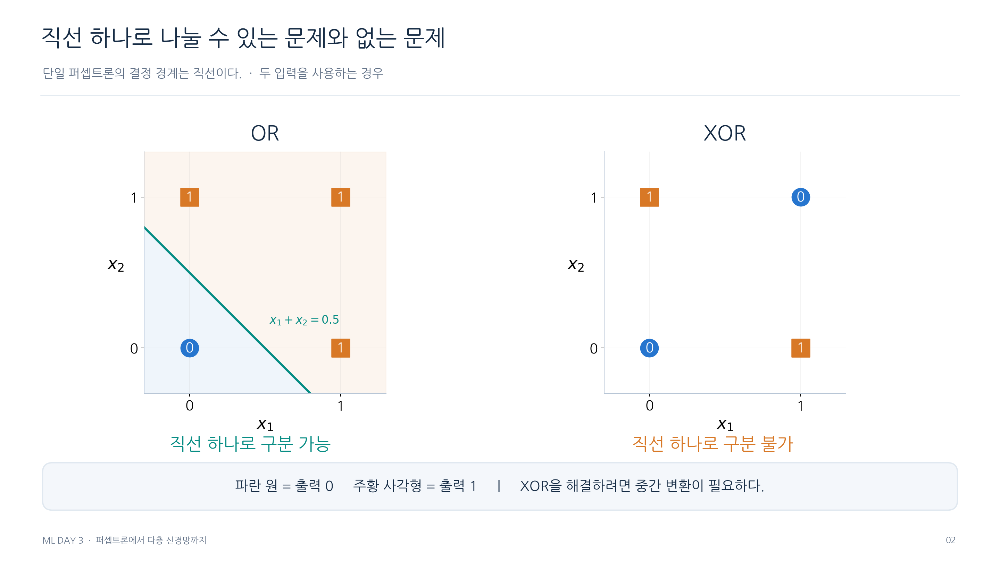
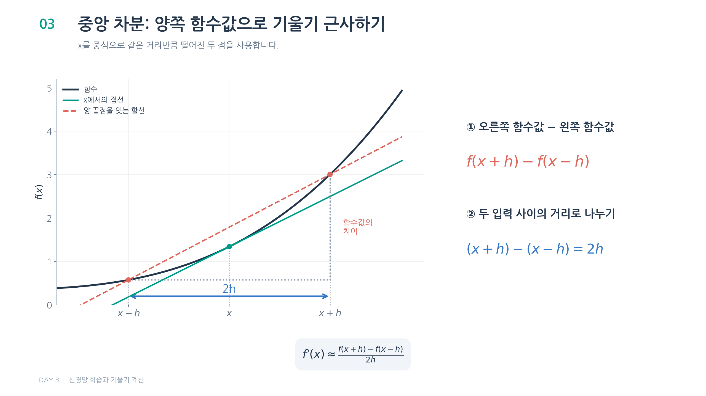
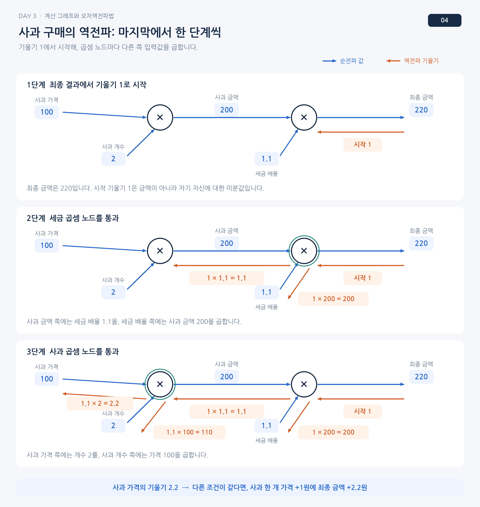

# 그림 살펴보기

## 군집 중심

각 중심은 그 그룹 사진들의 같은 위치 픽셀을 평균 낸 값임. 윤곽이 흐릿해도 오류가 아니라 여러 사진이 겹친 결과임.

## 이너셔

가로축은 K, 세로축은 이너셔임. 3 부근부터 감소 폭이 작아지지만 유일한 정답을 알려 주는 그래프는 아님.

## 주성분 축

점 구름의 중심을 평균으로 옮긴 뒤 가장 길게 퍼진 쪽이 첫 축임. 축 자체와 점 하나의 투영 좌표를 구분해서 읽음.

## 군집 좌표

점 하나가 과일 사진 한 장이고 가로와 세로는 첫 두 주성분 좌표임. 색은 k-평균이 붙인 그룹 번호임.

## OR와 XOR

두 입력을 가로와 세로 좌표로 놓고 정답이 같은 점끼리 살펴봄. XOR의 같은 클래스 점들은 대각선으로 마주 보므로 한 직선으로 분리할 수 없음.

## 중앙 차분

곡선 위에서 현재 값의 양쪽을 고르고 두 점을 잇는 기울기를 구함. 두 점 사이의 가로 간격은 h가 아니라 2h임.

## 사과값 역전파

순전파의 중간 금액 200과 세금 배율 1.1을 다시 사용함. 가격 쪽에는 수량을, 수량 쪽에는 가격을 곱하기 때문에 같은 손실 방향에서도 전달값이 달라짐.

[파트 목차](README.md)
