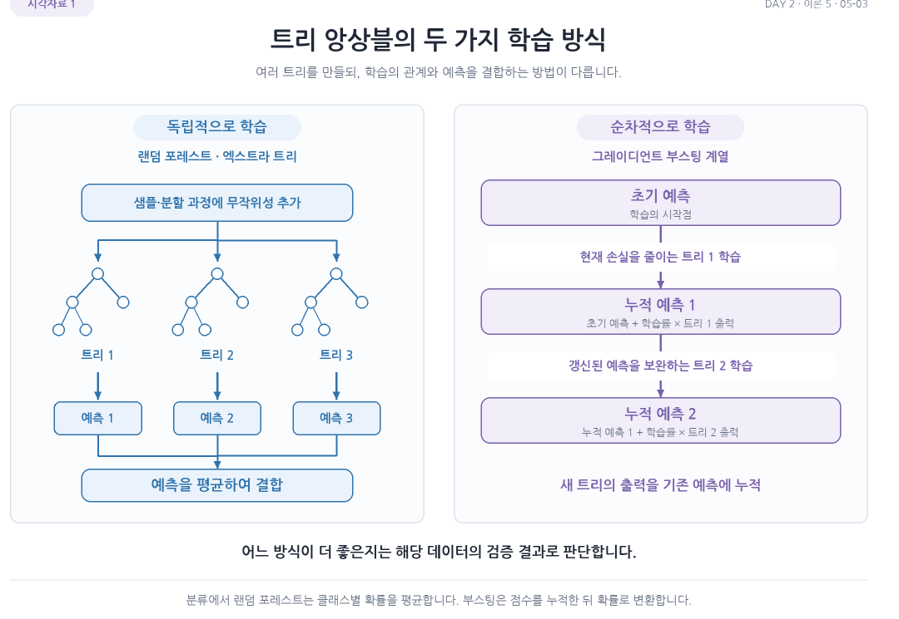
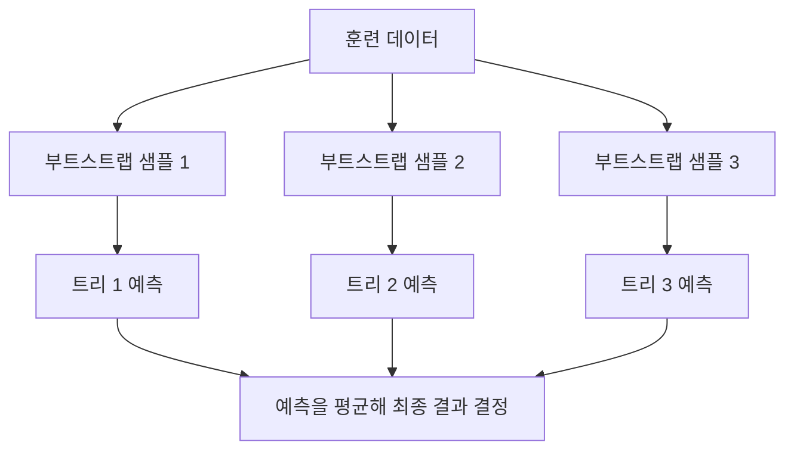
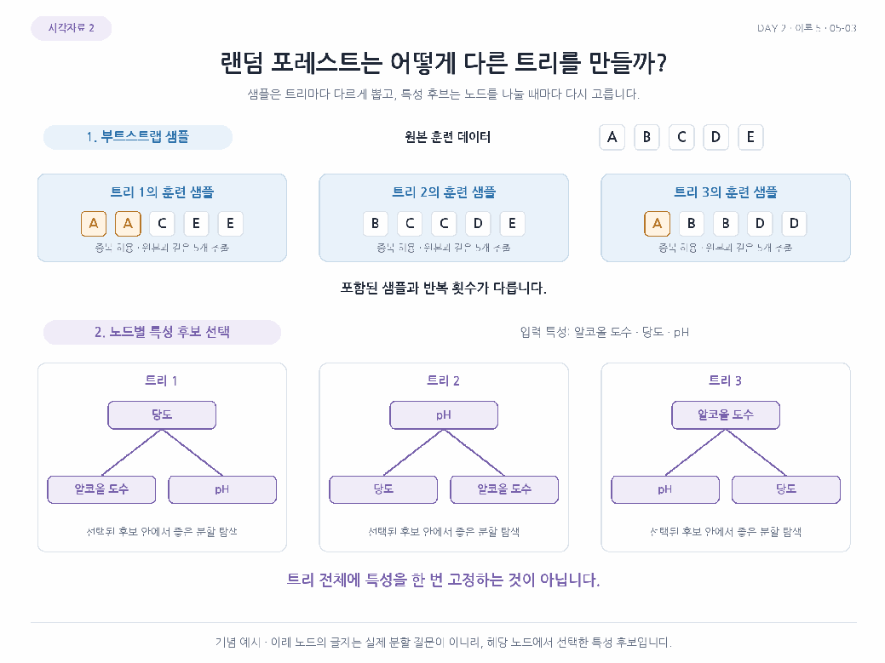
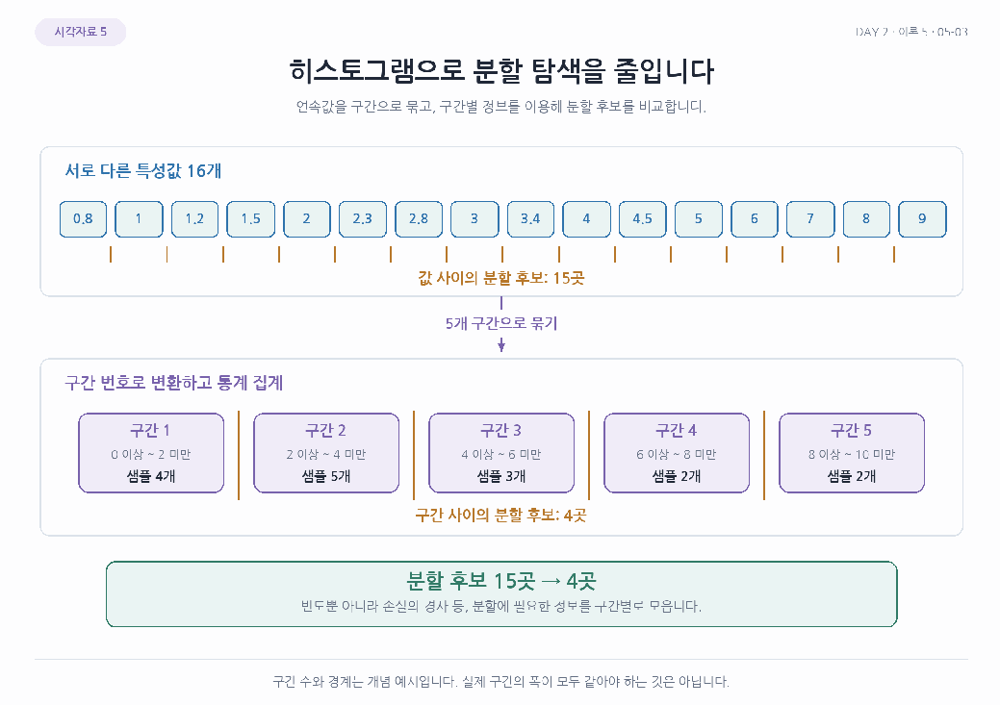

# Day 2. 트리의 앙상블

> 앙상블은 여러 모델의 결과를 결합해 예측한다. 결정 트리를 다양하게 만들거나 순서대로 보완하는 방법을 이해한다.

## 1. 정형 데이터와 앙상블 (3-5쪽)

정형 데이터(Structured Data)는 와인 데이터처럼 행과 열로 정리된 자료다. 각 열은 알코올 도수나 당도 같은 특성을 나타내며 각 행은 하나의 샘플에 해당한다. 이미지나 텍스트처럼 고정된 표 형태로 표현하기 어려운 자료는 비정형 데이터(Unstructured Data)라고 한다.

앙상블 학습(Ensemble Learning)은 여러 모델을 함께 사용해 하나의 예측을 만드는 방법이다. 트리 앙상블은 여러 결정 트리의 예측을 결합한다. 트리를 만드는 방식과 결합하는 방식에 따라 랜덤 포레스트와 부스팅 등으로 나뉜다.

> 5쪽: 랜덤 포레스트 계열은 트리를 독립적으로 학습해 예측을 결합하고, 부스팅은 이전 예측을 보완하며 트리를 추가한다.

## 2. 랜덤 포레스트 (4-10쪽)

랜덤 포레스트(Random Forest)는 여러 결정 트리를 각각 학습하고 결과를 결합한다. 트리가 모두 똑같은 판단을 하지 않도록 학습 데이터와 분할에 사용할 특성에 무작위성을 넣는다.

부트스트랩 샘플(Bootstrap Sample)은 원본 훈련 데이터에서 샘플을 **중복을 허용해** 다시 뽑아 만든 데이터다. 예를 들어 원본이 A, B, C, D이면 A, B, B, D처럼 같은 항목이 여러 번 뽑히거나 뽑히지 않는 항목이 생길 수 있다. 각 트리는 서로 다른 부트스트랩 샘플로 학습한다.

각 노드를 분할할 때에도 전체 특성 중 일부를 무작위로 골라 좋은 조건을 찾는다. 분류에서는 트리별 클래스 확률을 평균한 후 가장 높은 클래스를 예측하고, 회귀에서는 트리별 예측값을 평균한다.

아웃 오브 백(Out-of-Bag, OOB) 샘플은 특정 트리의 부트스트랩 샘플에 뽑히지 않은 데이터다. 각 샘플에 대해 그 샘플을 학습에 쓰지 않은 트리들의 예측을 이용하면 별도의 검증 세트를 따로 떼지 않고도 성능을 추정할 수 있다.

[추가 설명] OOB 점수를 설정 선택에 활용할 수 있지만, 반복해서 선택에 사용한 점수는 독립적으로 보관한 최종 테스트 점수와 역할이 다르다. 실습의 랜덤 포레스트 평균 훈련 점수는 약 0.997, 교차 검증 점수는 약 0.891이었다. 이 모델의 당도 특성 중요도는 약 0.500으로 세 특성 중 가장 높았고, OOB 정확도는 약 0.893이었다.

> 8쪽: 같은 샘플이 반복 추출되거나 제외될 수 있고 노드마다 분할에 사용할 특성 후보도 달라진다. 특성 일부를 트리 전체에 한 번 고정하는 방식과 구분한다.

## 3. 엑스트라 트리 (12-13쪽)

엑스트라 트리(Extra Trees)는 랜덤 포레스트처럼 여러 트리를 결합하지만, 분할 기준을 고르는 과정에 더 많은 무작위성을 사용한다. 후보 특성의 분할값도 무작위로 정하고 그중 좋은 분할을 선택한다.

기본 설정에서는 부트스트랩 샘플 대신 전체 훈련 샘플을 각 트리에 사용한다. 실습의 평균 훈련 점수는 약 0.998, 교차 검증 점수는 약 0.889였다. 이 결과만으로 모든 데이터에서 어느 방법이 더 좋다고 결론 내릴 수는 없다.

## 4. 그레이디언트 부스팅 (14-18쪽)

부스팅(Boosting)은 모델을 순서대로 추가하면서 앞선 모델의 부족한 부분을 보완하는 방식이다. 그레이디언트 부스팅(Gradient Boosting)은 손실을 줄이는 방향을 이용해 새 트리를 학습하고 기존 예측에 더한다.

[추가 설명] 제곱 오차를 쓰는 회귀에서 현재 예측이 모두 7이고 실제 값이 각각 5와 9라면 잔차는 -2와 2다. 다음 트리는 이런 차이를 줄이도록 학습한다. 일반적인 손실 함수에서는 단순 잔차가 아니라 손실의 기울기에 따라 보완 방향을 정한다.

학습률(Learning Rate)은 새 트리의 결과를 기존 예측에 얼마나 반영할지 조절한다. 일반적으로 학습률을 낮추면 더 많은 트리가 필요할 수 있으며, 트리 수와 깊이도 함께 조절한다. 실습의 기본 설정은 트리 100개와 최대 깊이 3이고, 평균 검증 점수는 약 0.872였다. 트리를 500개, 학습률을 0.2로 함께 바꾼 경우 훈련 점수는 약 0.947, 검증 점수는 약 0.878이었다. 두 설정을 동시에 바꿨으므로 어느 한 설정의 효과라고 단정할 수 없다.

## 5. 히스토그램 기반 부스팅 (18-23쪽)

히스토그램 기반 그레이디언트 부스팅(Histogram-based Gradient Boosting)은 연속된 특성 값을 일정한 구간인 빈(Bin)으로 묶은 뒤 분할 후보를 찾는다. 모든 값 사이를 일일이 비교하는 대신 구간 경계만 살펴 분할 탐색을 효율적으로 수행한다.

[추가 설명] 서로 다른 값이 9개이면 값 사이에 분할할 경계는 8개다. 이를 순서가 유지되는 3개 구간으로 묶으면 구간 사이의 경계 2개를 후보로 비교할 수 있다. 구간화는 계산량을 줄이는 대신 세부 값을 같은 구간으로 합친다.

실습에서 수치형 값은 최대 255개 구간으로 나누고 결측값을 위한 구간을 따로 둔다. 순열 특성 중요도(Permutation Feature Importance)는 한 특성의 값을 섞은 뒤 점수가 얼마나 떨어지는지 살펴 해당 특성의 기여도를 평가한다. 모델은 다시 학습하지 않으며, 섞기를 여러 번 반복해 점수 감소량을 평균한다. 정확도가 0.90에서 0.70으로 줄면 중요도는 0.20이다. 평가 데이터가 훈련용인지 테스트용인지에 따라 결과 해석이 달라지며, 순열 중요도는 불순도 기반 중요도처럼 합이 1로 정규화된 값이 아니다.

> 20쪽: 연속값 사이의 많은 후보 대신 구간 경계와 구간별 통계를 활용한다. 그림의 다섯 구간은 개념 예시이며 실제 구간의 개수나 폭을 그대로 지정한 것은 아니다.

## 6. XGBoost와 LightGBM (24-29쪽)

엑스지부스트(XGBoost)와 라이트지비엠(LightGBM)은 그레이디언트 부스팅 계열의 구현이다. 두 방법 모두 트리를 추가하며 손실을 줄이지만, 트리를 만들고 최적화하는 방식과 설정은 다르다.

XGBoost는 복잡도에 대한 규제를 활용하며 히스토그램 기반 트리 구성 방식도 제공한다. LightGBM은 리프 중심으로 트리를 확장하는 방식을 사용한다. 리프 수나 깊이 같은 설정은 모델의 복잡도와 실행 비용에 영향을 준다.

같은 와인 데이터의 실습에서 교차 검증 점수는 히스토그램 기반 부스팅 약 0.880, XGBoost 약 0.878, LightGBM 약 0.880이었다. 점수는 데이터와 설정에 따라 달라지므로 모델의 순위로 일반화하지 않는다.

## 핵심 개념 비교표

| 방법 | 트리를 만드는 방식 | 결과 결합 또는 특징 |
| --- | --- | --- |
| 랜덤 포레스트 | 부트스트랩 샘플과 무작위 특성 사용 | 여러 트리의 예측 평균 |
| 엑스트라 트리 | 기본적으로 전체 샘플 사용, 분할값도 무작위화 | 여러 트리의 예측 평균 |
| 그레이디언트 부스팅 | 앞선 예측의 손실을 줄이도록 순서대로 추가 | 새 트리의 출력을 기존 예측에 반영 |
| 히스토그램 기반 부스팅 | 특성 값을 구간으로 묶어 분할 | 분할 후보를 줄여 탐색 |

## 핵심 정리

- 앙상블은 여러 모델을 결합해 하나의 예측을 만든다.
- 랜덤 포레스트는 샘플과 특성에 무작위성을 적용한 여러 트리의 예측을 평균한다.
- OOB 평가는 각 샘플을 학습하지 않은 트리들을 이용한다.
- 엑스트라 트리는 분할값도 무작위로 선택해 트리의 다양성을 만든다.
- 그레이디언트 부스팅은 손실을 줄이는 방향으로 트리를 순차적으로 추가한다.
- 히스토그램 기반 방법은 특성 값을 구간화해 분할 후보를 줄인다.
- XGBoost와 LightGBM은 부스팅을 효율적으로 수행하는 구현이며 설정과 데이터에 따라 성능이 달라진다.
