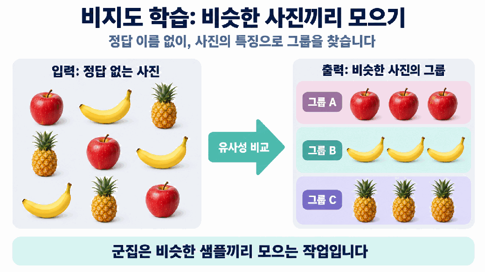
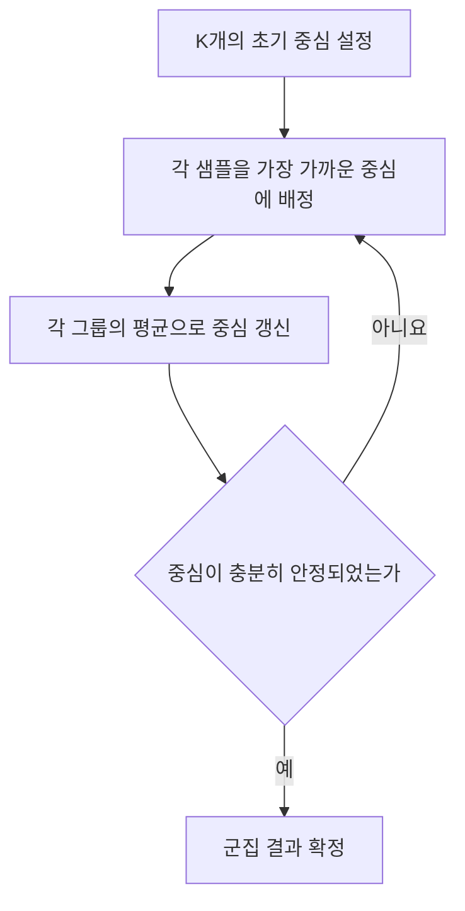
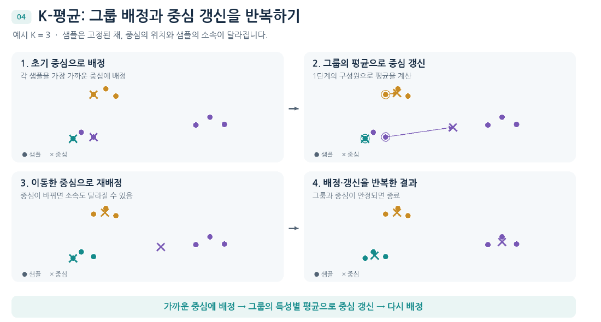
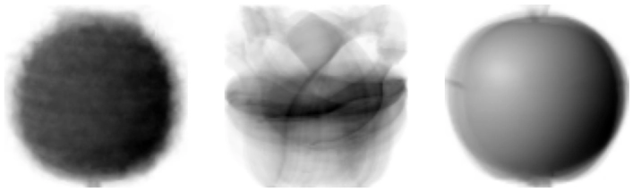
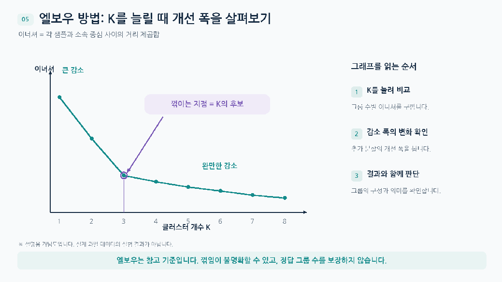

# Day 3. 비지도 학습과 K-평균

> 정답이 없는 과일 사진에서 비슷한 샘플을 모으고, 중심과 그룹을 반복해서 갱신하는 K-평균의 원리를 살펴본다.

## 1. 정답 없이 데이터를 묶기

비지도 학습(Unsupervised Learning)은 정답 레이블 없이 입력 데이터의 구조나 패턴을 찾는 방법이다.  
군집(Clustering)은 비슷한 샘플을 묶는 작업이며, 만들어진 각 그룹을 클러스터(Cluster)라고 한다.

지도 학습의 분류(Classification)는 정답 클래스를 사용해 학습하지만, 군집은 입력의 유사성을 기준으로 그룹을 만든다.  
따라서 클러스터 번호만으로 실제 과일 종류를 알 수 없으며, 결과를 이해하려면 그룹에 모인 사진을 별도로 확인해야 한다.

## 2. 과일 이미지를 숫자로 표현하기

실습 데이터는 사과, 파인애플, 바나나 사진이 각각 100장씩인 흑백 이미지 300장이다.  
한 사진은 100×100개 픽셀(Pixel)로 이루어지고, 각 픽셀값은 0부터 255까지의 숫자다.

```text
전체 이미지 배열: (300, 100, 100)
                          ↓ 사진마다 픽셀을 펼침
모델의 입력 배열: (300, 10000)
```

배열의 모양(Shape)을 바꾸는 과정에서 사진 수와 픽셀값은 그대로이고, 한 사진을 표현하는 10,000개 픽셀이 한 행으로 정리된다.  
화면에서 흑백을 반전해 표시해도 실제 픽셀값이 바뀌는 것은 아니다.



> 학습 입력에는 과일 이름을 정답으로 제공하지 않는다. 그룹 A, B, C의 번호와 이름은 데이터의 특징으로 만들어진 그룹을 해석하기 위한 표시다.

## 3. 대표 이미지로 비슷한 사진 찾기

사진 한 장의 픽셀 10,000개를 평균 내면 사진당 숫자 하나가 나온다.  
이 값으로 바나나는 어느 정도 구분되지만, 사과와 파인애플은 평균값 분포가 겹친다.  
한 숫자로 줄이는 과정에서 **픽셀의 위치와 형태 정보**가 사라지기 때문이다.

픽셀별 평균은 방향이 다르다.  
사과 사진 100장의 같은 위치에 있는 픽셀끼리 평균을 구하면 10,000개 값이 나오고, 이를 100×100으로 다시 배열하면 사과의 대표 이미지가 된다.  
대표 이미지는 실제 사진 한 장이 아니라 여러 사진의 위치별 평균이다.

대표 이미지와 각 사진을 비교하려면 같은 위치의 픽셀 차이에 절댓값을 취해 평균한다.  
차이가 작은 사진 100장을 고른 실습에서는 모두 사과였다.  
다만 이 과정에는 사과 사진을 미리 알고 대표 이미지를 만든 점과 사과가 100장임을 알고 선택한 점이 포함된다.

| 평균 방식 | 계산 대상 | 결과와 의미 |
| --- | --- | --- |
| 사진별 평균 | 한 사진의 전체 픽셀 | 사진 한 장당 숫자 하나, 위치 정보는 사라짐 |
| 픽셀별 평균 | 여러 사진의 같은 위치 | 위치별 값 10,000개, 대표적인 형태 표현 |

## 4. K-평균의 작동 원리

K-평균(K-means)은 K개의 중심을 기준으로 샘플을 나누고, 각 그룹의 평균으로 중심을 다시 구하는 군집 알고리즘이다.  
그룹의 중심은 센트로이드(Centroid)라고 하며 과일 이미지에서는 그룹에 속한 사진들의 픽셀별 평균이다.



거리는 유클리드 거리(Euclidean Distance)를 사용한다.  
각 특성의 차이를 제곱해 더한 뒤 제곱근을 취하며, 거리가 가장 작은 중심에 배정한다.  
예를 들어 두 점 (1, 2)와 (4, 6)의 거리는 √(3² + 4²) = 5다. [추가 설명]



> 샘플 위치는 고정된 상태에서 중심과 그룹 소속이 바뀌는 과정을 보여준다.

앞에서 대표 이미지와 사진을 비교할 때 사용한 것은 픽셀 차이의 절댓값 평균이다.  
K-평균의 유클리드 거리는 차이의 제곱합에 제곱근을 적용하므로 두 거리값을 같은 계산으로 취급하지 않는다.

초기 중심이 달라지면 배정과 최종 결과도 달라질 수 있다.  
중심이 거의 바뀌지 않거나 최대 반복 횟수에 도달하면 종료한다.

## 5. 과일 사진 군집 결과

실습은 `n_clusters=3`, `random_state=42`로 설정한다.  
클러스터 수 3은 미리 지정하지만, 과일 종류는 정답으로 알려 주지 않는다.  
무작위 상태 설정은 초기화 결과를 재현하기 위한 것이다.

| 클러스터 | 사진 수 | 확인된 구성 |
| --- | --- | --- |
| 0 | 112 | 파인애플 100, 사과 10, 바나나 2 |
| 1 | 98 | 바나나 98 |
| 2 | 90 | 사과 90 |

비슷한 과일이 대체로 모였지만 0번 그룹에는 다른 과일도 섞였다.  
K-평균은 과일의 의미를 이해하는 것이 아니라 픽셀값의 거리로 묶기 때문이다.  
학습한 중심을 다시 100×100 이미지로 보면 각 그룹을 대표하는 형태를 확인할 수 있다.

한 사진과 세 중심의 거리를 비교하면 거리가 가장 작은 중심의 번호가 예측 결과가 된다.  
클러스터 번호는 그룹을 식별하는 값이며, 숫자 0이 특정 종류를 뜻하도록 사전에 정해진 것은 아니다.



> 군집 중심을 100×100으로 다시 배열한 결과다. 중심은 특정 사진 한 장이 아니라 같은 그룹에 속한 사진들의 픽셀별 평균이다.

## 6. K 선택과 이너셔

이너셔(Inertia)는 각 샘플과 소속 중심 사이의 **거리 제곱을 모두 더한 값**이다.  
샘플이 중심 가까이에 모일수록 값이 작다. [추가 설명] 거리가 각각 2와 3인 두 샘플의 이너셔는 2² + 3² = 13이다.

K를 늘리면 보통 이너셔가 감소하므로 무조건 가장 작은 값을 고르면 의미 있는 그룹을 찾기 어렵다.  
사진 300장을 각각 하나의 그룹으로 만들면 이너셔는 0이지만 유사한 사진을 묶는 목적에는 도움이 되지 않는다.

엘보우 방법(Elbow Method)은 K를 늘릴 때 이너셔 감소 폭이 눈에 띄게 작아지는 지점을 후보로 삼는다.  
실습에서는 초기화 횟수를 자동으로 정하는 `n_init` 설정과 `random_state=42`를 사용하고 K를 2부터 6까지 비교하고 3 부근을 살펴보지만 꺾임이 뚜렷하지 않으므로 실제 그룹의 구성도 함께 확인한다.



> 이 그래프는 실제 이너셔 측정값이 아닌 개념도다. 급격한 감소에서 완만한 감소로 바뀌는 지점을 후보로 삼되, 꺾이는 지점이 정답 그룹 수를 보장하지는 않는다.

## 핵심 개념 비교표

| 구분 | 기준 | 결과 |
| --- | --- | --- |
| 분류 | 정답 레이블을 사용해 학습 | 학습한 클래스 예측 |
| 군집 | 정답 없이 샘플의 유사성 비교 | 비슷한 샘플의 그룹 |
| 클러스터 중심 | 그룹에 속한 샘플의 특성별 평균 | 거리 비교의 기준 |
| 이너셔 | 샘플과 소속 중심의 거리 제곱합 | 그룹 내부의 모임 정도 |

## 핵심 정리

- 비지도 학습은 정답 레이블 없이 데이터의 구조를 찾는다.
- 이미지의 픽셀을 펼치면 한 사진을 여러 숫자 특성으로 표현할 수 있다.
- 사진별 전체 평균은 위치 정보를 잃지만 픽셀별 평균은 대표적인 형태를 보여준다.
- K-평균은 가까운 중심에 배정하고 그룹 평균으로 중심을 갱신하는 과정을 반복한다.
- 클러스터 번호는 그룹 식별자이며 실제 정답 종류와 자동으로 일치하지 않는다.
- 이너셔가 줄어드는 속도와 실제 그룹 구성을 함께 살펴 K를 선택한다.

---

다음 학습: [Day 3. 주성분 분석](02-투영과-주성분-분석.md)
