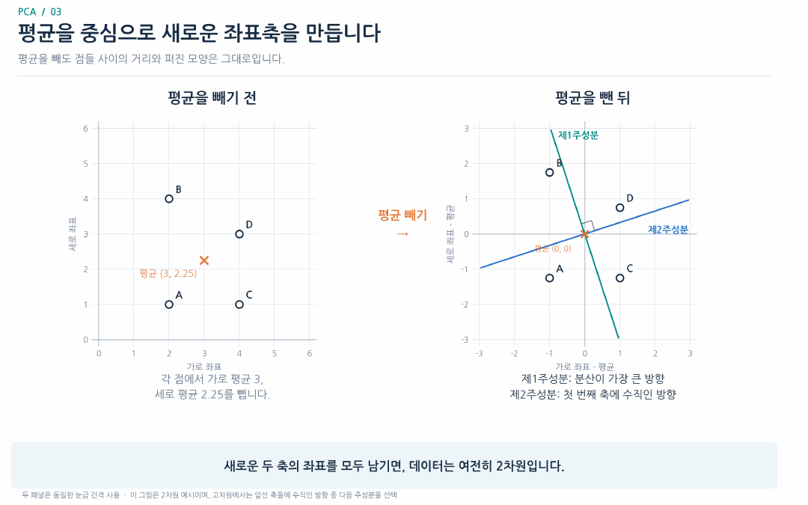
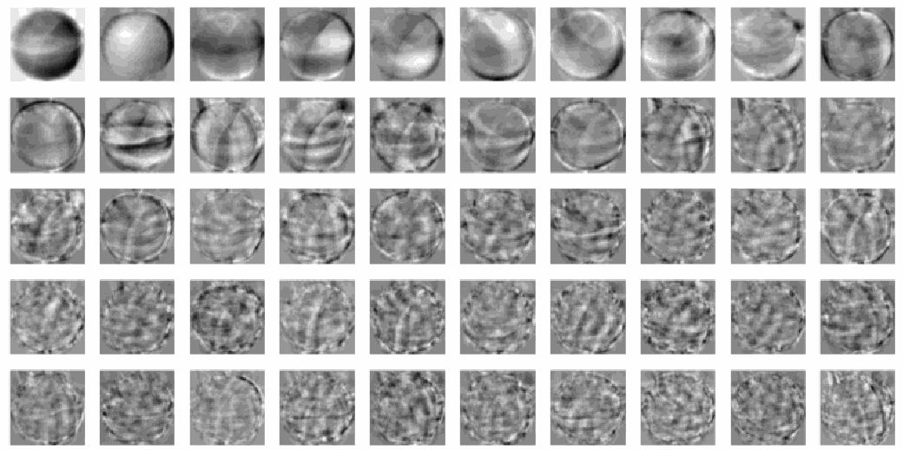
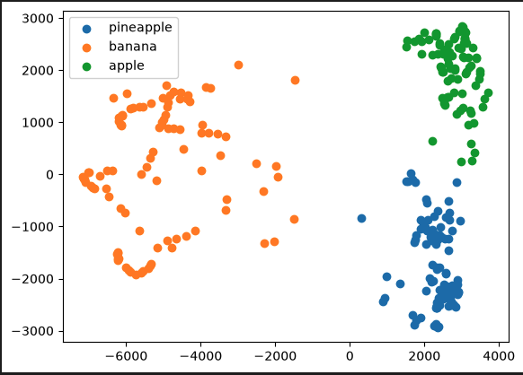

# Day 3. 주성분 분석

> 주성분 분석은 데이터가 많이 변하는 방향을 새 좌표축으로 삼아, 원래의 변동을 가능한 한 남기면서 특성 수를 줄인다.

## 1. 차원과 투영 (1-4쪽)

차원(Dimension)은 샘플 하나를 표현하는 특성의 개수다.
키와 몸무게는 2차원이며, 100×100 흑백 이미지는 10,000개의 픽셀값으로 표현하는 10,000차원 데이터다.
차원 축소(Dimensionality Reduction)는 샘플 수는 유지하면서 샘플당 특성 수를 줄인다.

특성이 줄면 저장과 후속 모델의 계산 부담을 줄일 수 있고, 2차원이나 3차원으로 줄인 결과는 시각화하기 쉽다.
다만 줄이는 과정에서 일부 정보가 사라질 수 있다.

투영(Projection)은 데이터를 특정 축 위의 좌표로 옮겨 표현하는 것이다.
예를 들어 (2, 1)과 (2, 4)를 가로축에 투영하면 둘 다 2가 된다.
숫자 두 개가 하나로 줄어든 대신 세로 방향의 차이를 잃는다.

## 2. 분산이 큰 방향을 찾기 (4-9쪽)

분산(Variance)은 값이 평균을 중심으로 얼마나 퍼져 있는지 나타낸다.
주성분 분석(Principal Component Analysis, PCA)은 투영 후 분산이 가장 큰 방향부터 새로운 축을 찾는다.
여기서 보존하려는 정보는 데이터의 변동이며, 분류에 필요한 정보와 반드시 같지는 않다.

| 네 점의 투영 방향 | 투영 후 분산 |
| --- | --- |
| 가로 방향 | 1.000 |
| 세로 방향 | 약 1.688 |
| 45도 대각선 방향 | 약 1.094 |

대각선에서는 네 점이 겹치지 않지만, 분산은 세로 방향보다 작다.
PCA는 점이 겹치지 않는지만 보는 것이 아니라 분산을 최대화하며, 이 세 방향 외에도 축을 기울여 더 큰 분산을 찾는다.

평균 중심화(Mean Centering)는 각 특성에서 그 특성의 평균을 빼 데이터 중심을 원점으로 옮기는 과정이다.
네 점의 평균이 (3, 2.25)이면 점 (2, 1)은 (-1, -1.25)가 된다.
데이터 전체가 이동할 뿐 점 사이의 거리와 퍼진 모양은 유지된다.

제1주성분(First Principal Component)은 분산이 가장 큰 방향이다.
제2주성분은 첫 번째 축과 수직인 방향 중 분산이 가장 큰 방향이다.
축을 새로 만든 다음 모든 좌표를 유지하면 차원은 그대로이며, 일부 주성분 좌표만 남길 때 차원이 줄어든다.




> 8쪽: 평균을 원점으로 이동하고 분산이 큰 방향에 주성분 축을 만드는 모습을 나타낸다.

PCA는 기존 열 일부를 그대로 고르는 것이 아니라 기존 특성을 조합한 새로운 축을 만든다.
공분산 행렬(Covariance Matrix)은 특성들의 분산과 함께 변하는 관계를 나타내고, 그 고유벡터(Eigenvector)는 축의 방향, 고유값(Eigenvalue)은 해당 방향의 분산에 대응한다.

## 3. 설명된 분산과 복원 (10-11쪽)

설명된 분산 비율(Explained Variance Ratio)은 한 주성분이 전체 분산 중 얼마를 담는지 나타낸다.
전체 분산이 100이고 앞의 세 주성분이 각각 70, 20, 10을 담는다면, 첫 두 주성분의 누적 비율은 `(70 + 20) / 100 = 0.9`다.
즉 전체 분산의 90%를 보존한다.

축소한 좌표를 원래 차원으로 복원해도 버린 방향의 값은 되찾을 수 없다.
원래 크기의 배열을 얻는 것과 원본을 완전히 복구하는 것은 다르며, 원본과 복원값의 차이를 복원 오차(Reconstruction Error)라고 한다.
같은 데이터에서 주성분을 더 많이 유지하면 버리는 변동이 줄어든다.

## 4. 과일 이미지에 적용하기 (11-14쪽)

과일 사진 300장은 사진별 픽셀 10,000개로 표현한다.
`n_components=50`은 주성분 축을 50개 선택하는 설정이다.
PCA를 학습할 때 과일 종류는 알려 주지 않는다.

```text
원본 이미지       (300, 100, 100)
펼친 입력         (300, 10000)
주성분 축          (50, 10000)
변환된 좌표        (300, 50)
복원한 픽셀값     (300, 10000)
```

주성분 축을 찾는 학습 단계와 각 사진을 그 축의 좌표로 바꾸는 변환 단계는 다르다.
이 좌표를 이용해 원래 픽셀 공간으로 돌아가는 복원 단계도 별도로 수행한다.

주성분 축 50개는 각각 원래 10,000개 특성을 조합하는 방향이다.
변환 후 사진 수는 그대로 300장이며, 각 사진은 50개의 주성분 좌표로 표현된다.
실습에서 50개 주성분이 보존한 누적 분산은 약 0.922였다.



> 13쪽: 각 작은 그림은 사진 한 장이 아니라 10,000차원 주성분 축 하나를 이미지 형태로 표현한 것이다. 변환된 샘플의 50개 좌표와 이 축 자체를 구분한다.

## 5. 축소한 데이터 활용과 평가 (15-20쪽)

PCA는 정답 없이 축을 찾지만, 변환된 좌표를 분류 모델의 입력으로 사용하는 경우 분류 모델의 학습과 평가에는 정답이 필요하다.
실습에서 `n_components=0.5`는 특성의 절반이 아니라 **전체 분산의 50% 이상을 보존할 주성분 수**를 뜻하며, 이 데이터에서는 2개가 선택됐다.

| 분류 입력 | 교차 검증 평균 정확도 | 분류 모델 평균 학습 시간 |
| --- | --- | --- |
| 원본 픽셀 10,000개 | 약 99.7% | 약 0.748초 |
| 주성분 50개 | 약 99.7% | 약 0.021초 |
| 주성분 2개 | 약 99.3% | 약 0.028초 |

이 시간에는 PCA 학습과 변환 시간이 포함되지 않는다.
또한 교재의 비교는 전체 데이터로 먼저 PCA를 학습하므로, 실제 평가에서는 교차 검증의 각 훈련 폴드에서만 PCA를 학습하도록 분류 모델과 파이프라인(Pipeline)으로 묶어 데이터 누수를 방지한다.

2개 주성분 좌표로 K-평균을 수행하면 군집별 사진 수는 110, 99, 91개였다.
각 사진을 두 좌표를 가진 점으로 그리면 그룹의 분포를 볼 수 있다.
PCA는 차원을 줄이고, K-평균은 그 좌표에서 비슷한 샘플을 묶는다.



> 20쪽: 가로축은 제1주성분, 세로축은 제2주성분이며 점 하나가 사진 한 장이다. 색은 군집 결과를 구분하고 과일 이름은 결과 해석을 위한 표시다.

## 핵심 개념 비교표

| 구분 | 무엇을 하는가 | 주의할 점 |
| --- | --- | --- |
| 평균 중심화 | 각 특성에서 평균을 뺌 | 차원 수는 그대로 |
| 주성분 축 | 데이터의 변동이 큰 새로운 방향 | 원래 특성 하나와 같을 필요가 없음 |
| 주성분 좌표 | 샘플을 새 축에 투영한 값 | 일부 좌표만 남겨 차원을 줄임 |
| 설명된 분산 비율 | 주성분이 보존하는 원본 분산의 비율 | 분류 정확도와 다름 |
| 복원 | 축소 좌표를 원래 크기로 변환 | 버린 정보는 일반적으로 복구할 수 없음 |

## 핵심 정리

- 차원은 샘플당 특성의 수이며 차원 축소는 샘플 수를 줄이지 않는다.
- 투영 방향에 따라 남는 정보와 사라지는 정보가 달라진다.
- PCA는 평균 중심화 후 분산이 큰 방향부터 새로운 주성분 축을 찾는다.
- 축만 바꾸면 차원은 그대로이고 일부 주성분 좌표를 버려야 차원이 줄어든다.
- 설명된 분산은 보존한 데이터 변동의 비율이며 분류 정확도는 별도로 평가한다.
- 복원된 배열의 크기가 원본과 같아도 버린 세부 정보는 되살아나지 않는다.
- 실제 교차 검증에서는 PCA도 각 훈련 폴드에만 맞춰 학습해야 한다.
