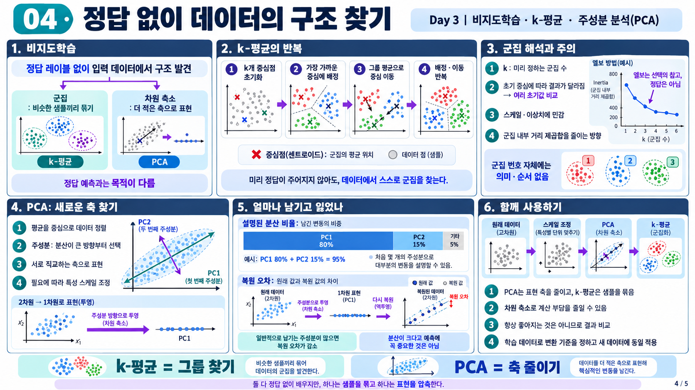

# 비지도 학습

| 순서 | 학습 내용 |
| --- | --- |
| 1 | [비지도 학습과 K-평균](01-과일-이미지와-k-평균.md) |
| 2 | [주성분 분석](02-투영과-주성분-분석.md) |

## 전체 흐름

> K-평균은 비슷한 샘플을 그룹으로 묶고, PCA는 정보를 표현하는 축의 수를 줄인다. 두 방법은 정답 없이 구조를 찾지만 출력과 목적이 다르다.

[머신러닝 목차](../README.md) | [신경망 기초](../../deep-learning/01-신경망-기초/README.md) | [그림 살펴보기](그림-살펴보기.md)
