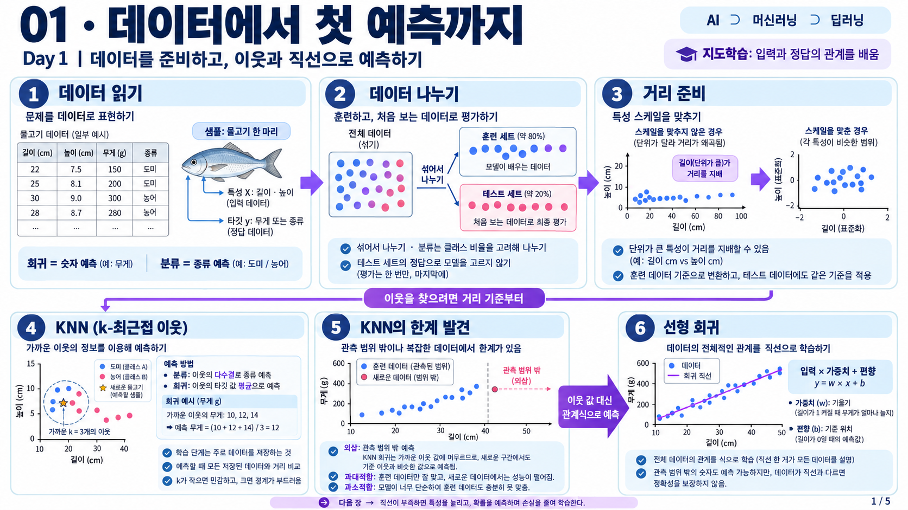
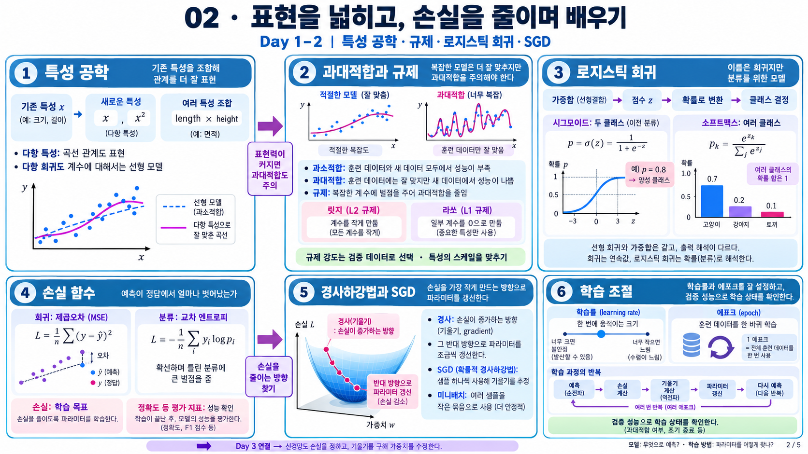
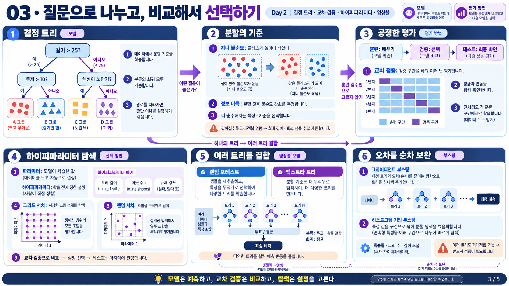

# 머신러닝

머신러닝의 기본 개념부터 모델 학습과 평가, 비지도 학습까지 정리한다.

## 학습 순서

| 순서 | 주제 | 핵심 내용 |
| --- | --- | --- |
| 1 | [머신러닝 기초와 KNN 분류](01-ml-basics/01-머신러닝-기본과-데이터-준비.md) | 데이터 준비, 훈련과 테스트, 스케일 조정 |
| 2 | [KNN 회귀](02-knn-regression/02-k-최근접-이웃-회귀.md) | 가까운 이웃으로 수치 예측 |
| 3 | [선형 회귀와 다항 회귀](03-linear-regression/03-선형-회귀.md) | 직선과 곡선으로 데이터 관계 표현 |
| 4 | [특성 공학과 규제](04-feature-engineering-and-regularization/04-특성-공학과-규제.md) | 특성 생성과 과대적합 조절 |
| 5 | [로지스틱 회귀](05-로지스틱-회귀/01-로지스틱-회귀.md) | 분류 점수를 확률로 변환 |
| 6 | [확률적 경사 하강법](06-확률적-경사-하강법/02-확률적-경사-하강법.md) | 손실의 기울기로 모델 갱신 |
| 7 | [결정 트리](07-결정-트리/03-결정-트리.md) | 분할 기준과 특성 중요도 |
| 8 | [교차 검증과 하이퍼파라미터 탐색](08-교차-검증과-하이퍼파라미터-탐색/04-교차-검증과-하이퍼파라미터-탐색.md) | 검증을 통한 설정 비교와 모델 선택 |
| 9 | [트리 앙상블](09-트리-앙상블/05-트리-앙상블.md) | 여러 결정 트리의 예측 결합 |
| 10 | [비지도 학습](10-비지도-학습/README.md) | K-평균 군집과 주성분 분석 |

## 그림으로 보는 학습 흐름

### 데이터 준비에서 회귀까지

데이터를 나누고 특성의 스케일을 맞춘 뒤 이웃의 평균과 학습한 관계식의 예측 차이를 비교한다.

### 특성 확장에서 분류 모델 학습까지

특성을 늘려 표현력을 높이고 규제로 복잡도를 조절한다. 분류에서는 점수를 확률로 바꾸고 손실의 기울기로 계수와 절편을 갱신한다.

### 결정 트리에서 모델 선택과 앙상블까지

트리의 분할 기준을 이해한 뒤 교차 검증으로 설정을 비교한다. 여러 트리를 결합할 때는 독립적으로 학습하는 방법과 앞선 오차를 순차적으로 보완하는 방법을 구분한다.

## 주요 참고 자료

- 박해선, 『혼자 공부하는 머신러닝+딥러닝』, 한빛미디어, 2020, ISBN 979-11-6224-366-4
- 『파이토치 딥러닝 마스터』

[그림 살펴보기](그림-살펴보기.md) | [딥러닝 목차](../deep-learning/README.md) | [전체 공부 기록](../../README.md)
