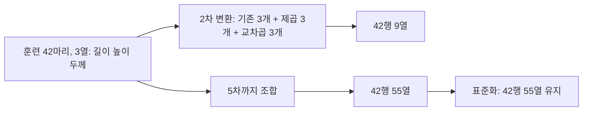

# 추가 그림과 실험 읽기

[데이터 준비](실행-안내.md) 후 저장소 루트에서 다음 파일 실행. 한 프로세스에서 필요한 입력부터 새로 준비한다.

```powershell
python topics/machine-learning/examples/06-그림-생성.py
```

생성 소스: [06-그림-생성.py](examples/06-그림-생성.py)

## k를 3, 5, 10으로 바꾼 응용


같은 훈련 농어와 길이 입력을 사용하고 k만 바꾼 결과다. 파란 점은 실제 무게, 주황 선은 예측 무게. 이웃 집합이 같은 구간에서는 평균도 같아 선이 계단처럼 보인다. 선이 바뀌는 지점은 선택된 이웃이 바뀌는 구간이다. 세로축은 무게(g), 가로축은 길이(cm).

## 훈련 범위 밖의 이웃


파란 원은 훈련 샘플, 주황 마름모는 선택한 세 이웃, 초록 삼각형은 예측 무게다. 삼각형은 실제 관측 무게가 아니다. 질의 길이가 50에서 100cm로 늘어도 같은 이웃의 평균을 써서 무게가 같게 나온다.

## 기울기와 절편


가로축은 길이, 세로축은 식의 예측 무게. 직선은 실제 학습한 계수와 절편으로 계산했다. 점선의 가로 변화 10cm에 대응하는 세로 변화가 약 390g이므로 기울기는 약 39g/cm다. 입력 0에서 표시한 점은 절편이며 실제 0cm 농어를 측정한 결과가 아니다.

## 2차와 5차 평가 비교


막대 하나는 해당 차수의 특성으로 학습한 모델의 점수다. 이 환경에서는 표준화 전 5차 모델도 테스트 R² 약 0.9780으로 나왔다. 교재의 약 -144.4와 다르며 교재 결과를 재현했다고 표시하지 않는다. 높은 차수의 수치적 불안정은 환경과 계산 기준에 민감하다. 5차 모델이 반드시 과대적합한다고 일반화하지 않는다.

## 과소적합과 과대적합의 개념 그림


별도 난수 시드 42로 만든 합성 데이터의 보충 그림이다. PDF 그림의 점과 숫자를 재현한 것이 아니다. 가로축과 세로축은 합성 입력과 타깃이며 생선 단위가 없다. 1차는 휘어진 흐름을 충분히 표현하지 못하고, 높은 차수는 개별 점 사이에서 더 크게 흔들릴 수 있다. 그림 모양만으로 테스트 성능을 확정하지 않는다.

## 특성 수와 배열 구조



화살표는 샘플 추가가 아니라 입력 열의 변환이다. 규제는 계수를 제한하며 라쏘 계수가 0이 되어도 입력 열 자체를 삭제하지 않는다.

[목차로](README.md)
