# 그림 살펴보기

학습 문서에 나온 그림을 주제별로 모아 정리함. 같은 그림이 여러 문서에 나와도 한 번만 설명함.

## 1. 머신러닝의 기본 흐름과 데이터 준비

### 생선의 길이와 무게

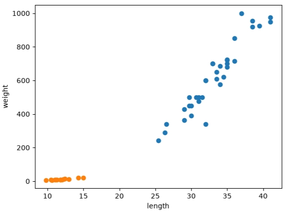

가로축은 길이(cm), 세로축은 무게(g). 점 하나가 생선 한 마리를 뜻함. 파란 점은 도미, 주황 점은 빙어로 두 종류가 서로 다른 위치에 모여 있음. 길이와 무게를 특성으로 사용해 생선 종류를 구분할 수 있는 이유를 보여줌.

그래프를 보면 왼쪽 아래의 빙어는 길이가 약 10\~15cm이고, 오른쪽 위의 도미는 대체로 약 25\~42cm에 모여 있음. 같은 종류 안에서도 길이와 무게가 서로 조금씩 다르기 때문에 한 마리의 값만으로 모든 생선을 설명할 수는 없음.

새로운 생선이 들어오면 모델은 이 두 숫자를 기존 생선의 숫자와 비교함. 예를 들어 길이와 무게가 도미가 모인 영역에 가까우면 주변 이웃에도 도미가 많을 가능성이 있음. 다만 이 그림의 데이터가 잘 구분된다고 해서 모든 생선이 항상 이렇게 나뉜다는 뜻은 아님.

### 생선 분포

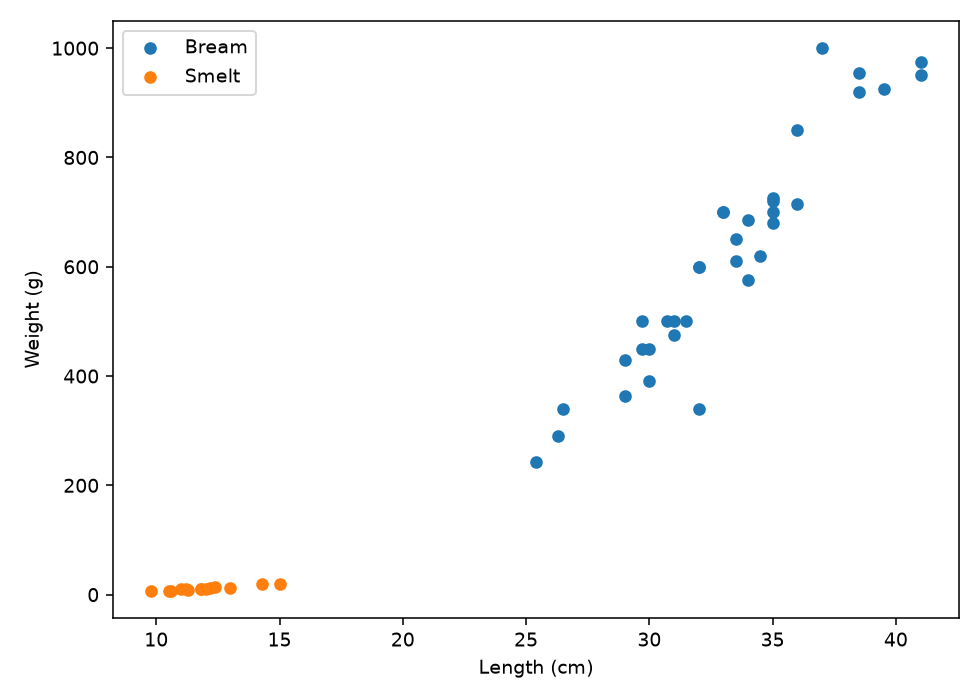

같은 생선 데이터를 도미와 빙어로 나누어 표시한 그림. 도미는 대체로 길고 무겁고 빙어는 짧고 가벼움. 산점도의 가까운 점들을 살펴보면 새로운 생선이 어느 종류에 가까운지 짐작할 수 있음.

가로 방향으로 움직이면 길이가 달라지고, 세로 방향으로 움직이면 무게가 달라짐. 두 특성을 함께 보면 같은 길이에서도 무게가 다를 수 있다는 것을 확인할 수 있음.

KNN은 새 생선과 훈련 데이터 사이의 거리를 계산한 뒤 가까운 생선들의 종류를 살펴봄. 단, 그래프에서 눈으로 보이는 거리와 모델이 계산하는 거리는 축의 표시 비율에 따라 다르게 느껴질 수 있으므로 특성의 스케일도 확인해야 함.

### 순서대로 나눈 데이터의 문제

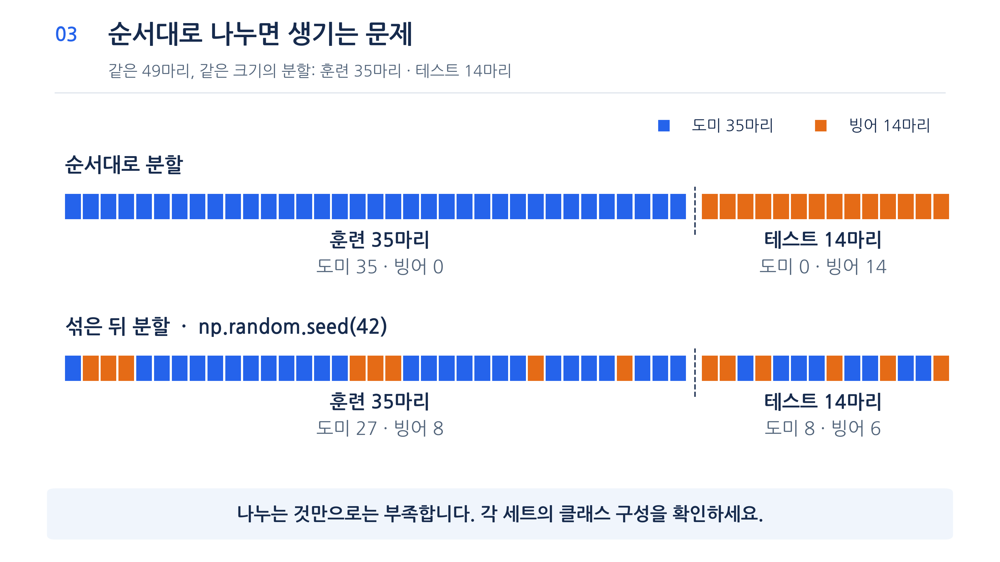

파란색은 도미, 주황색은 빙어. 위처럼 순서대로 나누면 훈련 세트에 도미만, 테스트 세트에 빙어만 들어감. 아래처럼 섞으면 두 종류가 양쪽에 포함됨. 데이터를 나누기 전 순서와 분포를 확인해야 하는 이유임.

전체 49마리가 도미 35마리 다음에 빙어 14마리 순서로 저장돼 있다고 가정함. 앞의 35마리로 훈련하고 뒤의 14마리로 평가하면 훈련에는 도미만, 테스트에는 빙어만 들어감.

이때 모델은 훈련 과정에서 빙어를 한 번도 보지 못했기 때문에 두 종류를 구분하는 방법을 제대로 배울 수 없음. 그림 아래에서는 섞은 뒤 훈련에 도미 27마리와 빙어 8마리, 테스트에 도미 8마리와 빙어 6마리가 들어감. 섞기는 편향을 줄이는 데 도움이 되지만, 종류별 비율까지 맞추려면 층화 분할도 고려해야 함.

### 훈련 데이터와 테스트 데이터 분포

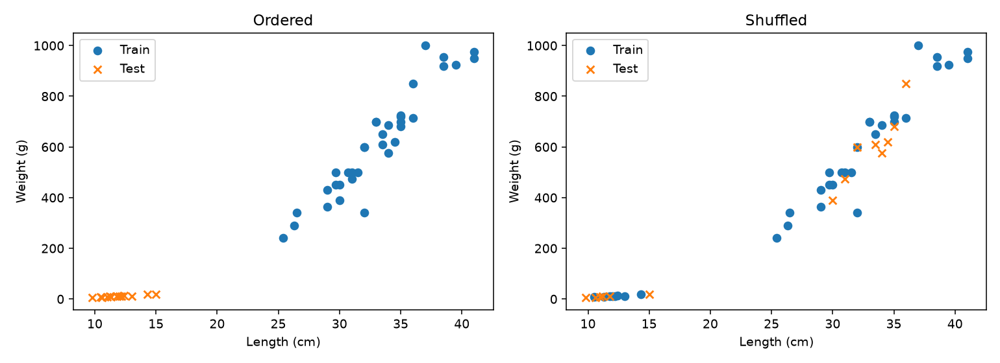

파란 점은 훈련 데이터, 주황색 ×는 테스트 데이터. 왼쪽은 순서대로 나누어 테스트에 빙어만 들어갔고, 오른쪽은 섞은 뒤 나누어 두 종류가 양쪽에 들어감. 무작위 분할도 항상 비율을 보장하는 것은 아니므로 결과를 확인해야 함.

각 점의 위치는 생선의 길이와 무게를 나타내고, 색상과 모양은 생선 종류가 아니라 어느 세트에 들어갔는지를 나타냄. 왼쪽에서는 주황색 테스트 점이 왼쪽 아래에만 몰려 있음.

오른쪽은 테스트 점이 양쪽에 분포하므로 훈련에 사용하지 않은 도미와 빙어를 모두 평가할 수 있음. 다만 특정 무작위 분할의 결과일 뿐이므로 세트마다 샘플 수와 종류별 비율을 확인하는 것이 중요함.

### 표준화 전후 이웃 비교

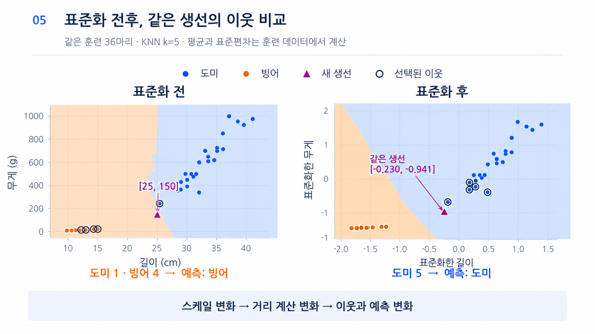

삼각형은 새 생선, 동그라미로 표시한 점은 선택된 이웃. 왼쪽은 무게의 숫자 범위가 길이보다 커서 거리에 미치는 영향이 큼. 오른쪽은 각 특성을 표준화한 결과이며 이웃이 달라져 예측도 빙어에서 도미로 바뀜.

새 생선의 원래 값은 길이 25cm, 무게 150g임. 표준화 전에는 숫자 차이가 큰 무게의 영향으로 선택된 다섯 이웃 중 빙어가 네 마리여서 빙어로 예측함.

표준화 후에는 훈련 데이터에서 계산한 평균과 표준편차로 각 값을 변환함. 새 생선도 같은 기준으로 바꾸고 거리를 다시 계산하니 선택된 다섯 이웃이 모두 도미가 됨. 즉 생선 자체가 바뀐 것이 아니라 거리의 기준이 바뀐 것임.

### 표준화와 축의 차이

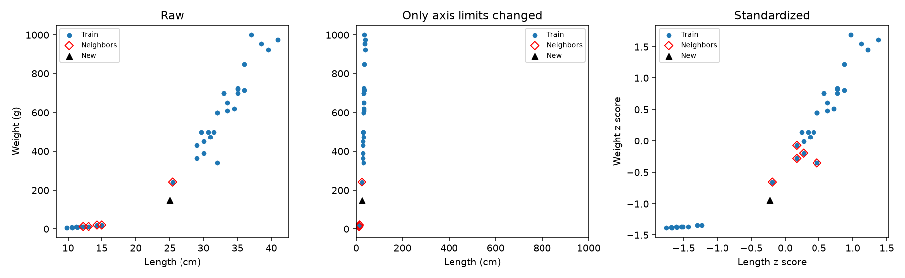

세 그림은 원래 데이터, 축 범위만 변경한 그림, 표준화한 데이터를 차례로 보여줌. 빨간 마름모는 이웃, 검은 삼각형은 새 생선. 축 범위만 바꾸면 화면 모습만 바뀌지만 표준화는 실제 입력값과 거리 계산을 바꿔 이웃 선택에도 영향을 줌.

왼쪽과 가운데는 같은 원본 데이터임. 가운데에서 가로축을 세로축과 비슷한 숫자 범위로 표시하면 점들이 한쪽에 몰려 보이지만, 축의 눈금만 바꿨으므로 실제 데이터와 모델의 이웃은 변하지 않음.

오른쪽은 각 특성에서 훈련 평균을 빼고 훈련 표준편차로 나눈 값임. 따라서 가로축과 세로축의 단위가 원래 cm와 g이 아닌 표준화된 값이 됨. 새 생선에도 훈련 데이터에서 구한 평균과 표준편차를 적용해야 같은 기준으로 거리를 비교할 수 있음.

## 2. 최근접 이웃 회귀

### 농어의 길이와 무게

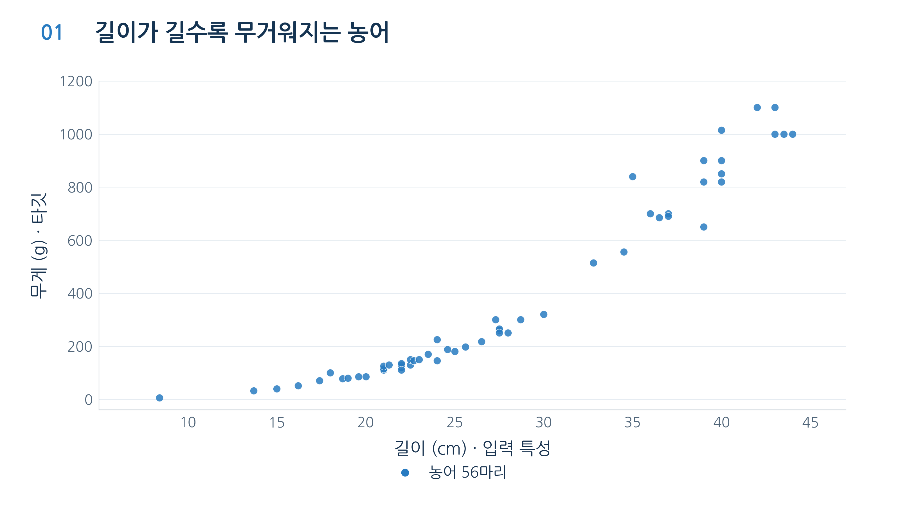

가로축은 농어 길이(cm), 세로축은 무게(g). 점 하나가 농어 한 마리이며 길이가 길수록 무게도 늘어나는 경향이 있음. 길이와 무게 관계가 직선보다 휘어진 형태에 가까운지도 살펴볼 수 있음.

길이가 약 20cm인 농어들은 주로 낮은 무게 영역에 있고, 40cm 부근의 농어들은 수백 g에서 1,000g 안팎에 있음. 길이가 늘어날수록 무게가 늘어나는 폭도 커지는 모습을 볼 수 있음.

이 그림에서 길이는 모델의 입력, 무게는 모델이 맞혀야 할 정답임. 새로운 길이를 입력했을 때 무게처럼 연속적인 숫자를 예측하므로 분류가 아니라 회귀 문제에 해당함.

### 농어 데이터 분포

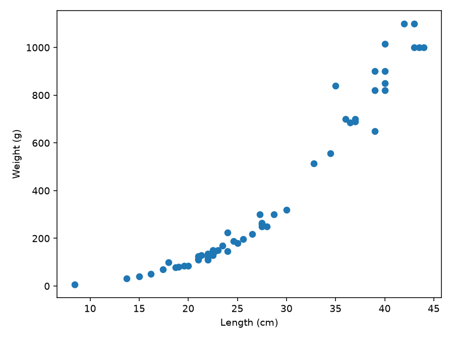

같은 농어 데이터를 산점도로 나타낸 그림. 가까운 길이를 가진 농어의 무게를 이용해 새로운 농어의 무게를 예측하는 것이 최근접 이웃 회귀의 출발점임. 같은 길이 근처에서도 무게가 조금씩 다름.

점들이 정확히 한 선 위에 놓이지 않는 이유는 비슷한 길이의 농어라도 높이, 두께 등 다른 조건이 달라 무게가 다를 수 있기 때문임. 길이 하나만 사용하면 이런 차이를 모두 반영하기 어려움.

최근접 이웃 회귀에서는 길이가 비슷한 농어를 k마리 찾고, 그 농어들의 무게를 평균해 예측함. 예를 들어 이웃 세 마리의 무게가 300g, 350g, 400g이라면 예측값은 350g임.

### 이웃 수 1, 5, 20에 따른 예측

파란 점은 훈련 농어, 선은 길이별 예측 무게. k=1은 가장 가까운 한 마리만 따라가서 예측선이 자주 변함. k=20은 여러 농어의 평균을 사용해 선이 완만해지고 큰 농어의 무게를 충분히 따라가지 못함.

세 그림의 점은 같은 훈련 데이터이고, 바뀐 것은 예측에 사용하는 이웃의 수 k임. 가로축은 길이, 세로축은 무게이므로 선의 높이를 통해 해당 길이에서 모델이 예측한 무게를 읽을 수 있음.

k=1은 가까운 한 점의 무게를 그대로 사용하므로 훈련 데이터의 작은 변화에도 민감함. k=5는 주변 다섯 점을 평균해 변동이 줄어들고, k=20은 더 넓은 범위를 평균해 가장 큰 농어의 무게를 낮게 예측하는 모습이 보임.

### 이웃 수에 따른 회귀선

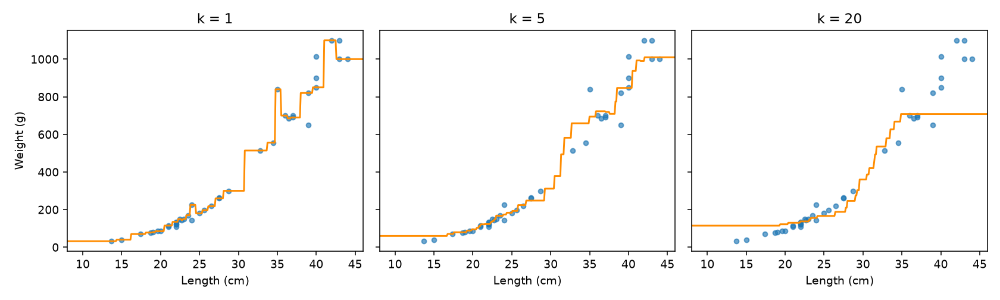

위와 같은 비교를 주황색 예측선으로 나타낸 그림. 선이 계단처럼 보이는 이유는 가까운 이웃의 구성이 그대로인 구간에서는 무게의 평균도 같기 때문임. k가 커질수록 한 샘플의 영향은 줄어듦.

예측할 길이가 조금 변해도 선택된 이웃의 목록이 바뀌지 않으면 평균 무게도 변하지 않음. 그래서 주황색 선이 일정한 높이를 유지하다가 이웃이 바뀌는 지점에서 계단처럼 올라감.

예를 들어 k=1에서는 한 마리만 바뀌어도 예측값이 그 농어의 무게로 바뀜. k=20에서는 한 마리의 변화가 전체 평균에 미치는 영향이 작아지지만 주변 관계를 지나치게 뭉뚱그릴 수 있음.

### 이웃 수 3, 5, 10 비교

같은 농어 데이터에서 k만 3, 5, 10으로 바꿈. 이웃 수가 적을 때는 주변 점의 변화에 더 민감하고, 많을 때는 더 넓은 범위의 무게를 평균함. 어떤 k가 좋은지는 그래프뿐 아니라 훈련과 테스트 점수도 함께 확인해야 함.

왼쪽에서 오른쪽으로 갈수록 평균에 사용하는 이웃이 많아짐. 그래프를 비교할 때는 같은 길이에서 주황 선의 높이가 어떻게 바뀌는지, 특히 데이터가 드문 양쪽 끝에서 점들과 얼마나 차이가 나는지 살펴보면 됨.

k가 작으면 가까운 일부 샘플에 지나치게 맞춰질 수 있고, 너무 크면 멀리 있는 샘플까지 평균해서 중요한 변화를 놓칠 수 있음. 적절한 k는 검증 데이터를 이용해 비교하고 테스트 데이터는 최종 평가에 사용함.

### 모델 복잡도와 과대적합

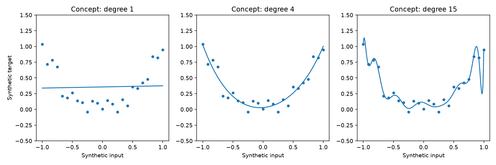

점은 예시 데이터, 선은 각각 1차, 4차, 15차 모델의 예측. 1차는 곡선 형태의 흐름을 충분히 표현하지 못하고, 15차는 점 주변에서 크게 흔들림. 지나치게 단순하거나 복잡한 모델의 모습을 비교한 개념 그림이며, 선의 모양만으로 테스트 성능을 확정할 수는 없음.

세 그래프는 농어 데이터가 아닌 예시 데이터로 모델의 복잡도를 비교함. 가로축은 입력, 세로축은 정답이며, 세 그림 모두 같은 점들을 사용함.

1차 모델은 거의 직선이라 가운데가 낮고 양쪽이 높은 흐름을 잘 담지 못함. 4차는 전체적인 곡선 흐름을 따라가고, 15차는 특히 양 끝에서 굴곡이 커짐. 복잡도가 너무 낮으면 과소적합, 훈련 점에 지나치게 맞으면 과대적합이 생길 수 있으므로 새로운 데이터에서의 점수로 확인해야 함.

## 3. 선형 회귀

### 훈련 범위 밖에서 최근접 이웃 회귀의 한계

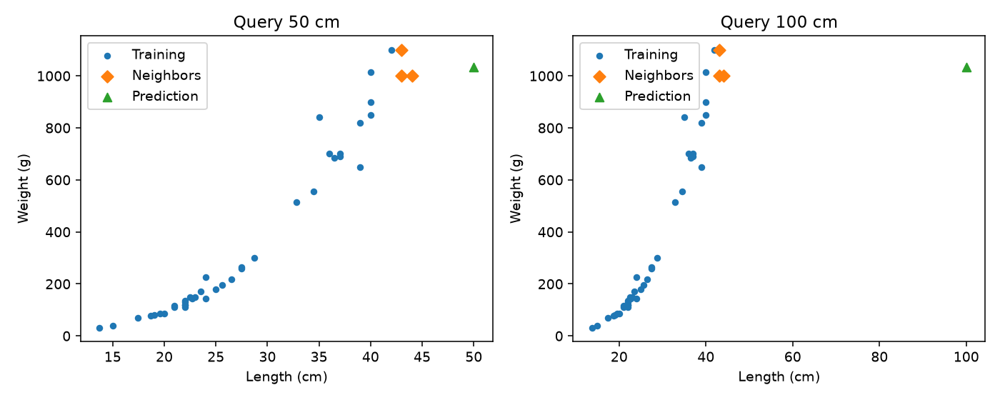

파란 점은 훈련 농어, 주황 마름모는 선택된 세 이웃, 초록 삼각형은 예측값. 길이가 50cm에서 100cm로 바뀌어도 가장 가까운 이웃이 같아 예측 무게도 같음. 초록 점은 실제 측정 무게가 아니라 이웃 무게의 평균임.

왼쪽에서는 50cm를, 오른쪽에서는 100cm를 입력함. 두 경우 모두 훈련 데이터에서 가장 긴 농어 세 마리가 가까운 이웃으로 선택됨.

이웃이 같으므로 무게 평균도 같고, 초록 삼각형의 높이도 같아짐. 입력 길이가 두 배가 됐다고 예측 무게도 늘어나지는 않는다는 뜻임. 훈련 범위 밖에서 무게가 늘어나는 추세를 표현하려면 다른 모델을 살펴볼 필요가 있음.

### 직선의 기울기와 절편

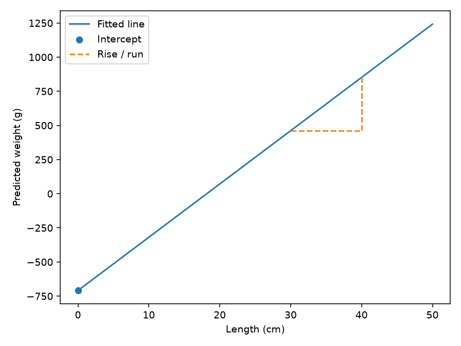

가로축은 길이, 세로축은 모델이 예측한 무게. 파란 직선의 기울기는 길이가 1cm 늘어날 때 예측 무게가 얼마나 바뀌는지 나타냄. 주황 점선에서 10cm 증가에 약 390g이 증가하므로 기울기는 약 39g/cm. 길이 0에서의 절편은 직선의 계산값이며 실제 0cm 농어의 무게가 아님.

선형 회귀의 예측식은 `예측 무게 = 기울기 × 길이 + 절편`으로 나타낼 수 있음. 여기서 기울기는 직선의 기울어진 정도이고, 절편은 길이를 0으로 넣었을 때 식이 내놓는 값임.

그림의 주황 점선은 길이 약 30cm에서 40cm로 움직일 때 직선의 높이가 얼마나 달라지는지 보여줌. 기울기가 양수이므로 길이가 증가하면 예측 무게도 증가함. 절편이 음수로 나와도 이 직선이 실제 0cm 생선을 관찰했다는 의미는 아님.

### 세 회귀 모델 비교

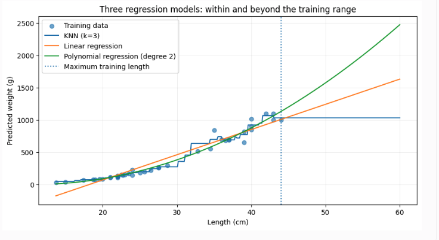

파란 계단은 최근접 이웃 회귀, 주황 직선은 선형 회귀, 초록 곡선은 2차 다항 회귀. 세로 점선은 훈련 길이의 최대값임. 그 오른쪽에서 최근접 이웃은 같은 값을 유지하지만 나머지 모델은 각자의 식을 따라 계속 변함. 훈련 범위 밖 예측이 실제로 맞는지는 별도 데이터로 확인해야 함.

파란 점은 훈련 농어이며, 점선 왼쪽은 훈련 길이의 범위, 오른쪽은 그 범위를 넘어선 구간임. 같은 데이터를 학습했어도 모델이 관계를 표현하는 방법이 다르면 새로운 길이에서의 예측이 달라짐.

KNN은 가장 가까운 이웃이 더 이상 바뀌지 않아 선이 수평이 됨. 선형 회귀는 일정한 기울기로 증가하고, 다항 회귀는 제곱 항의 영향으로 점점 더 가파르게 증가함. 오른쪽의 선은 모델이 계산한 값이지 실제 농어를 측정한 결과가 아님.

### 회귀 모델의 예측선

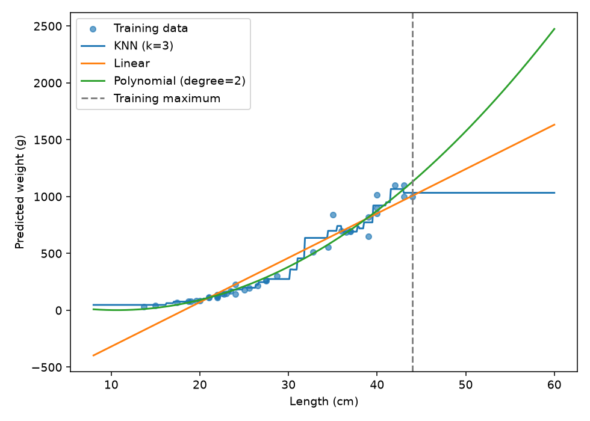

같은 세 모델을 다른 그래프로 비교함. 훈련 데이터 안에서는 예측선이 비슷하게 보이지만 범위 밖에서는 수평선, 직선, 곡선으로 차이가 커짐. 다항 회귀는 길이의 제곱 항을 사용해 휘어진 관계를 표현함.

점선은 가장 긴 훈련 농어의 위치임. 그 왼쪽에서는 세 모델이 전체적인 증가 흐름을 대체로 따라가지만, 오른쪽에서는 데이터가 없는데도 각 모델의 방식대로 선을 이어 그림.

2차 다항 회귀는 길이와 길이의 제곱을 입력으로 사용하므로 곡선을 표현할 수 있음. 곡선이 훈련 데이터를 잘 따라간다고 해서 아주 큰 농어에서도 반드시 정확하다는 뜻은 아니며, 범위 밖 데이터로 검증해야 함.

### 선형 회귀와 다항 회귀의 잔차

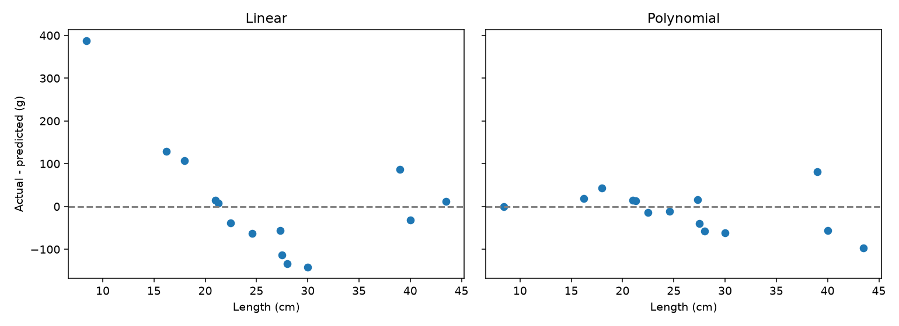

가로축은 농어 길이, 세로축은 실제 무게에서 예측 무게를 뺀 잔차. 점이 0보다 위면 실제 무게를 낮게 예측했고, 아래면 높게 예측한 것임. 왼쪽 선형 회귀는 길이에 따라 잔차가 한쪽으로 치우치는 구간이 보이고, 오른쪽 다항 회귀는 이 데이터에서 잔차의 크기가 대체로 줄어듦.

가로 점선은 잔차가 0인 위치임. 점이 이 선에서 멀수록 실제값과 예측값의 차이가 크고, 0에 가까울수록 해당 데이터의 예측 오차가 작음.

왼쪽에서는 짧은 길이의 잔차가 양수이고 중간 길이에서는 음수인 점이 많아 예측이 길이에 따라 치우친 패턴을 보임. 오른쪽의 2차 모델은 그 패턴이 줄어들지만 일부 점에는 여전히 오차가 있음. 잔차 그림은 오차의 크기뿐 아니라 일정한 패턴이 남아 있는지도 확인하는 데 사용함.

## 4. 특성 공학과 규제

### 특성 3개를 9개로 확장

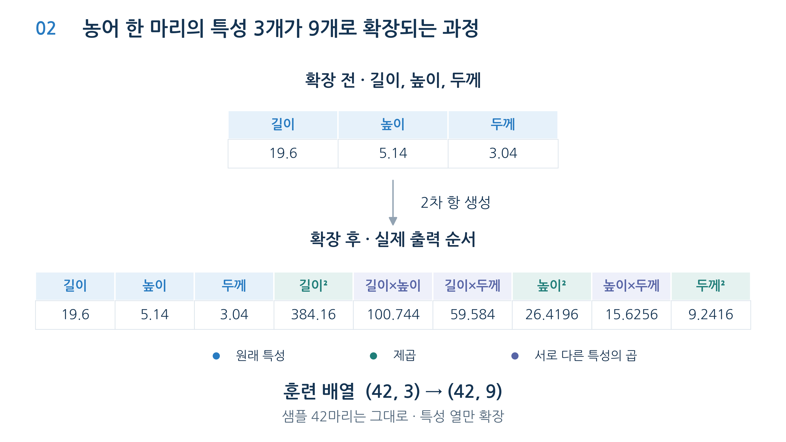

농어 한 마리의 길이, 높이, 두께에서 제곱과 서로 다른 특성의 곱을 만들어 총 9개로 늘림. 예를 들어 길이와 높이를 곱한 값도 새로운 열이 됨. 농어 수는 그대로이고 특성 수만 늘어나 훈련 배열은 `(42, 3)`에서 `(42, 9)`로 바뀜.

원래 세 특성은 길이, 높이, 두께임. 여기에 길이², 높이², 두께²와 길이×높이, 길이×두께, 높이×두께를 더하면 3 + 3 + 3 = 9개가 됨.

예를 들어 그림에서 길이 19.6과 높이 5.14를 곱하면 길이×높이는 100.744가 됨. 이 값은 새로운 농어가 아니라 기존 농어의 새로운 특성임. 모델은 이런 항의 계수를 따로 학습하므로 입력 특성 사이의 더 다양한 관계를 표현할 수 있음.

### 특성 확장과 훈련 및 테스트 점수

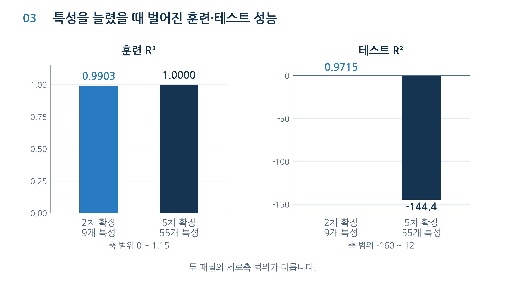

왼쪽은 훈련 R², 오른쪽은 테스트 R². 9개 특성에서는 각각 0.9903과 0.9715이고, 55개 특성에서는 훈련 점수가 거의 1인 반면 테스트 점수는 -144.4로 떨어짐. 두 그래프의 세로축 범위가 다르므로 막대 길이만 비교하지 말아야 함. 음수 R²는 평균으로 예측하는 기준보다 제곱오차가 크다는 뜻임.

2차 특성 9개를 사용한 경우에는 훈련과 테스트 점수가 모두 1에 가까움. 반면 5차까지 확장한 55개 특성 모델은 훈련 데이터 42마리를 거의 완벽하게 맞추지만 테스트 결과가 크게 나빠짐.

이는 훈련 데이터의 세부적인 차이까지 모델이 지나치게 맞추면서 새로운 데이터에서 큰 오차가 생긴 예시임. R²가 -144.4라는 값은 정확도가 음수라는 뜻이 아니라, 테스트 정답의 평균으로 예측하는 기준보다 제곱오차가 훨씬 크다는 뜻임.

### 2차와 5차 특성의 점수

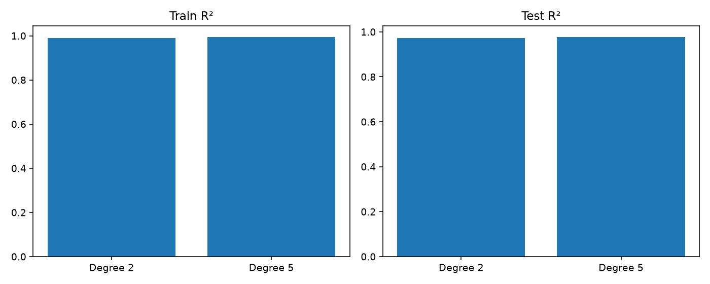

왼쪽은 훈련 R², 오른쪽은 테스트 R²를 2차와 5차 특성으로 나누어 표시함. 이 그림에서는 두 차수 모두 테스트 점수가 높게 나옴. 고차 특성의 결과는 계산 조건에 민감하므로 다른 그래프의 값과 차이가 날 수 있으며, 특성 수만으로 과대적합을 단정할 수 없음.

각 그래프에서 왼쪽 막대는 2차, 오른쪽 막대는 5차 특성 모델임. 둘 다 높이가 1에 가까워 보여도 막대의 전체 축 범위가 넓어서 작은 점수 차이는 눈으로 구분하기 어려움.

이 결과에서는 5차 모델의 테스트 점수도 높으므로 앞 그림처럼 반드시 크게 떨어진다고 말할 수 없음. 고차 특성은 계산상 불안정할 수 있고 데이터 분할이나 수치 계산 조건에도 영향을 받으므로 실제 출력값과 평가 조건을 함께 확인해야 함.

### 계수와 규제 강도 비교

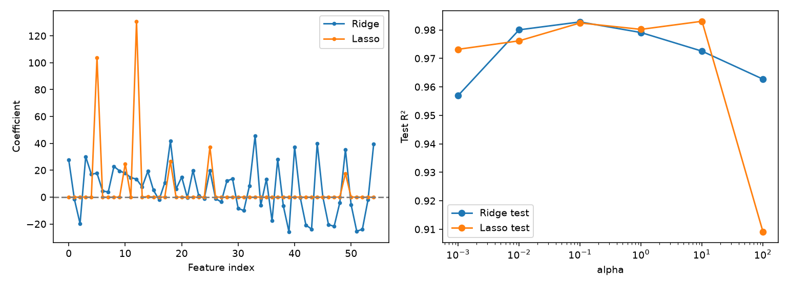

왼쪽은 각 특성에 붙은 릿지와 라쏘의 계수, 오른쪽은 alpha에 따른 테스트 R². 라쏘에서는 많은 계수가 0에 놓이고 일부 계수만 남음. 오른쪽에서 점수가 높은 alpha는 모델마다 다르며, 릿지와 라쏘는 벌점 계산 방식이 달라 alpha 숫자를 직접 비교해 규제 강도를 판단할 수 없음.

왼쪽 가로축의 번호는 확장된 특성의 순서, 세로축은 그 특성에 곱해지는 계수임. 라쏘의 주황 점 중 상당수는 0에 있고 일부만 0에서 떨어져 있음. 계수가 0인 특성은 이 모델의 예측에 직접 기여하지 않지만 입력 배열의 열 자체가 삭제된 것은 아님.

오른쪽 가로축은 alpha를 로그 간격으로 표시함. 한 칸 이동할 때 alpha가 일정한 양만큼이 아니라 10배씩 변함. 테스트 점수가 높아지는 구간과 다시 낮아지는 구간을 비교하면서 규제가 너무 약하거나 강할 때의 영향을 살펴볼 수 있음.

### L1과 L2 벌점

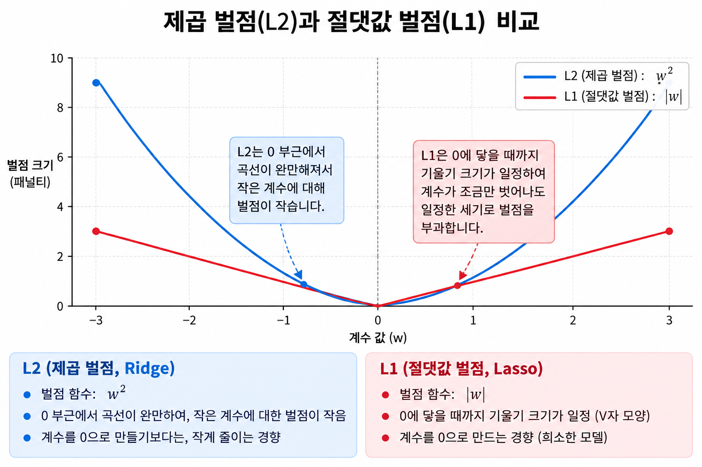

가로축은 계수, 세로축은 벌점. L2는 계수의 제곱이라 0 근처가 둥글고, L1은 절댓값이라 0에서 뾰족한 V자임. 이 차이와 최적화 방식 때문에 릿지는 계수를 작게 줄이는 경향이 있고 라쏘는 일부를 정확히 0으로 만들 수 있음.

예를 들어 계수가 3이면 L1 벌점은 |3|=3이고 L2 벌점은 3²=9임. 계수가 -3이어도 절댓값과 제곱은 각각 3과 9이므로 두 벌점 모두 부호보다 크기에 반응함.

릿지는 예측 오차에 계수 제곱합을, 라쏘는 계수 절댓값의 합을 벌점으로 더해 학습함. 그림은 계수 하나의 벌점 모양을 보여주는 것이며, 실제 모델에서는 여러 계수와 예측 오차를 함께 고려함.

### 벌점 함수의 모양

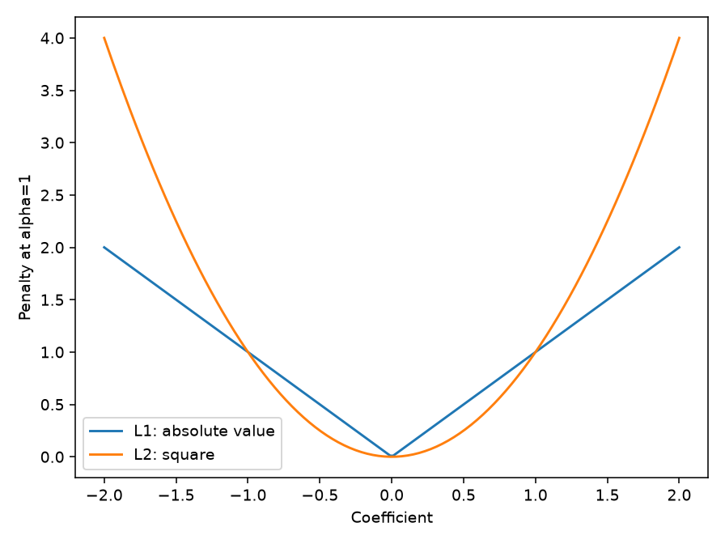

같은 벌점 함수를 따로 표시한 그림. 파란 V자 선은 L1, 주황 곡선은 L2이며 두 값 모두 계수가 0일 때 벌점이 0임. 이 그래프는 계수에 대한 벌점이지 생선 무게의 예측선이 아님.

계수의 절댓값이 1보다 클 때는 제곱한 값이 절댓값보다 빠르게 커짐. 반대로 0과 1 사이에서는 제곱한 값이 절댓값보다 작음. 따라서 벌점의 증가 방식이 모델의 계수 조정에 서로 다른 영향을 줌.

L1은 0에서 뾰족하고 L2는 0 근처가 완만함. 다만 그림 하나만 보고 어떤 특성이 반드시 0이 된다고 판단할 수는 없음. 결과는 데이터, alpha, 다른 특성과의 관계에 따라 달라짐.

### 릿지의 alpha와 점수

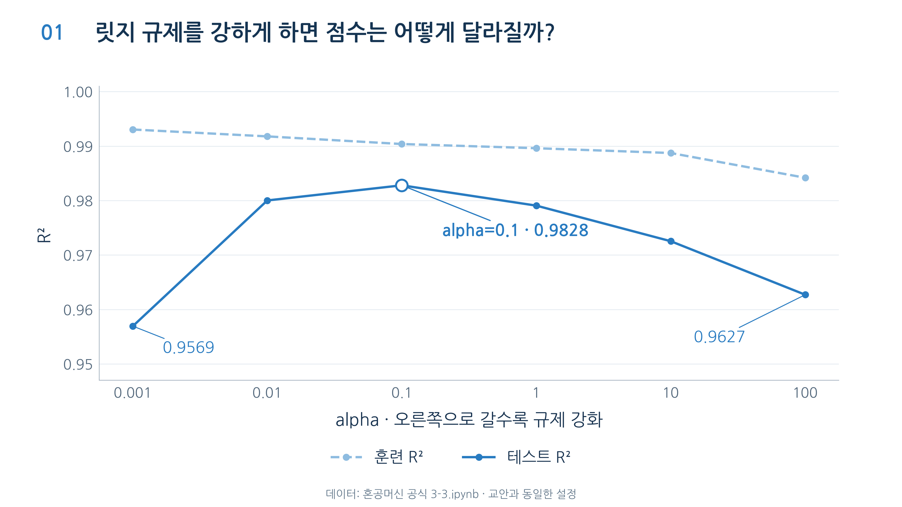

가로축은 로그 간격으로 표시한 alpha, 세로축은 R². 점선은 훈련, 실선은 테스트 점수. 이 실험에서는 alpha=0.1에서 테스트 점수가 약 0.9828이고, alpha가 100으로 커지면 두 점수가 모두 낮아짐. 규제가 너무 강하면 과소적합될 수 있음.

alpha가 0.001에서 0.1로 커질 때 훈련 점수는 조금 낮아지지만 테스트 점수는 올라감. 훈련 데이터에 지나치게 맞추는 것을 일부 억제해 새로운 데이터에서의 결과가 개선된 모습임.

반대로 alpha를 100까지 키우면 계수에 대한 제한이 강해져 테스트 점수가 다시 낮아짐. 가로축은 0.001, 0.01, 0.1처럼 10배씩 증가하고, 세로축은 0부터 시작하지 않으므로 선의 높이 차이를 실제 점수와 함께 읽어야 함.

### 릿지 훈련 및 테스트 점수

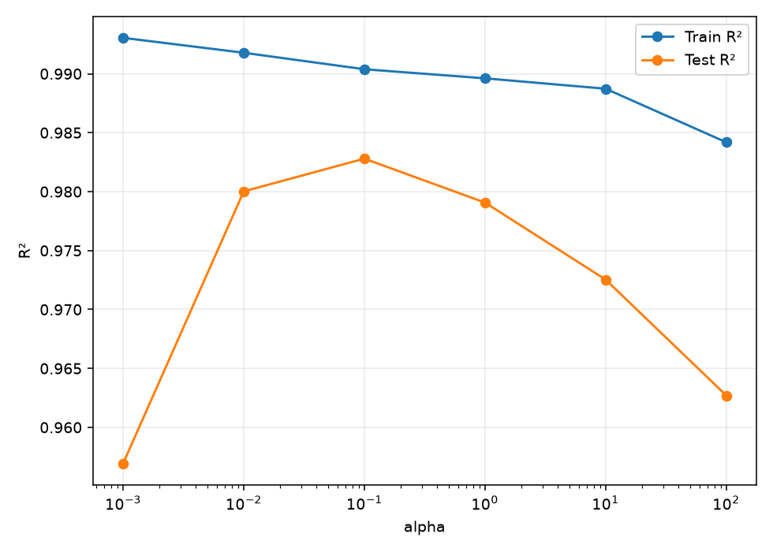

같은 릿지 점수를 파란색 훈련선과 주황색 테스트선으로 표시함. 규제를 조금 높이는 동안 테스트 점수가 개선되지만, 더 강해지면 다시 감소함. 최적의 alpha는 데이터와 분할에 따라 달라짐.

파란 선은 모델을 학습시킨 데이터에서의 R²이고 주황 선은 학습에 사용하지 않은 테스트 데이터에서의 R²임. alpha가 0.1 부근일 때 주황 선이 가장 높으며, 이후 alpha를 높이면 점수가 내려감.

훈련 점수와 테스트 점수가 둘 다 높고 차이가 작다면 이 분할에서는 일반화가 잘 된 모습으로 볼 수 있음. 하지만 테스트 세트는 전체 데이터의 일부이므로 한 번의 결과만으로 모든 새 데이터에서의 성능을 보장하지는 못함.

### 릿지 점수 변화

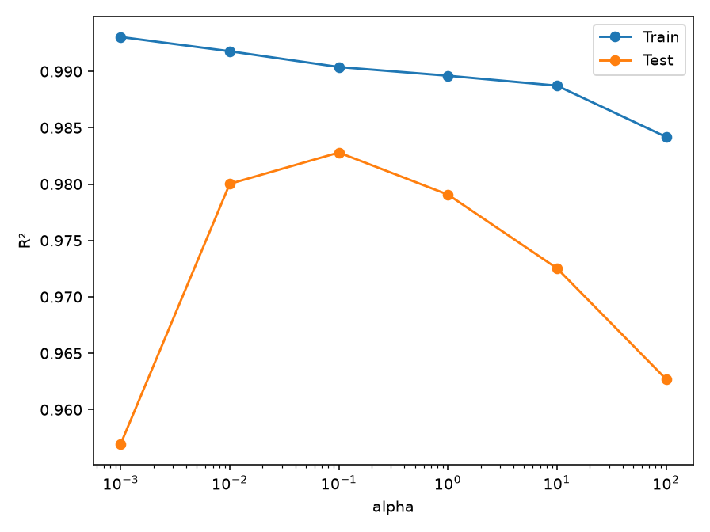

위 그림과 같은 방식으로 alpha별 R²를 비교함. 훈련 점수는 규제가 강해질수록 낮아지고 테스트 점수는 중간에서 가장 높음. 테스트 세트를 반복해서 설정 선택에 사용하기보다는 검증 데이터를 활용해야 함.

가로축에서 오른쪽으로 갈수록 규제가 강하고, 세로축의 값은 높을수록 해당 데이터에 대한 R²가 좋음. 가장 약한 규제에서는 훈련과 테스트 점수 차이가 크고, 중간 규제에서는 차이가 줄어듦.

alpha를 정할 때 훈련 점수만 보면 약한 규제가 좋아 보일 수 있음. 그러나 훈련 점수만으로는 새로운 데이터에 대한 성능을 알기 어려우므로 검증 점수와 함께 비교해야 함.

### 라쏘의 alpha와 점수

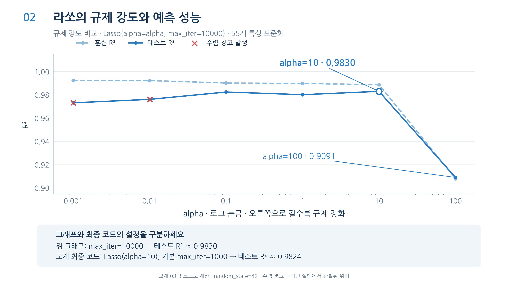

가로축은 alpha, 세로축은 R². 이 실험에서는 alpha=10에서 테스트 점수가 약 0.9830이고, 100에서는 훈련과 테스트 점수가 함께 떨어짐. 빨간 ×가 있는 작은 alpha에서는 수렴 경고가 발생했으므로 점수 해석에 주의해야 함.

alpha를 높이면 라쏘가 계수에 주는 벌점도 커짐. 이 그림에서는 중간 범위에서 테스트 점수가 높게 유지되다가 alpha=100에서 약 0.9091까지 하락함. 강한 규제가 필요한 계수까지 지나치게 줄여 관계를 충분히 표현하지 못한 모습임.

작은 alpha의 빨간 ×는 계산이 수렴 조건을 만족하지 못했다는 경고를 나타냄. 해당 값은 충분히 수렴한 해라고 단정하지 말고 반복 횟수나 설정을 확인해야 함. 그림의 alpha=10 결과는 표시된 반복 횟수 설정에서의 값임.

### 라쏘 점수 변화

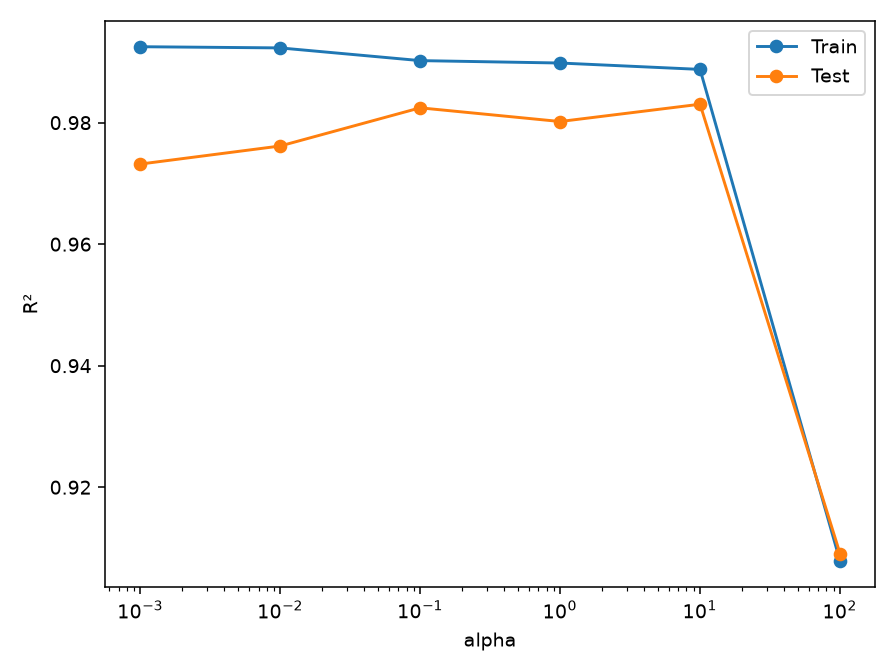

파란 선은 훈련, 주황 선은 테스트 R². alpha가 100일 때 두 점수가 크게 낮아져 규제가 지나치게 강한 모습을 볼 수 있음. 가장 높은 테스트 점수만 보고 일반적인 최적값으로 받아들이지 않음.

alpha가 작을 때는 두 점수가 모두 높지만 일부 설정에서 수렴 경고가 발생할 수 있음. alpha가 10을 지나 100이 되면 파란 선과 주황 선이 함께 내려가므로 훈련 데이터조차 충분히 설명하지 못하는 과소적합을 의심할 수 있음.

적절한 alpha에서는 예측에 불필요한 계수를 줄이면서 중요한 관계를 유지할 수 있음. alpha는 검증 데이터나 교차 검증으로 선택하고, 마지막에 테스트 데이터로 선택한 모델의 성능을 평가함.

[목차로](README.md)
