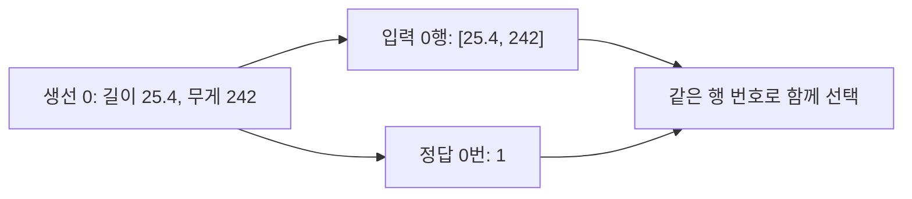
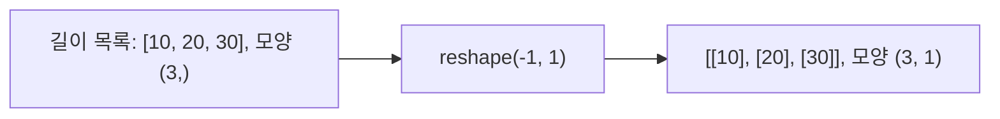

# 코드와 수식 읽기

이 문서는 본문을 읽는 데 필요한 보충 설명이다.

## 객체와 메서드

라이브러리는 다른 코드에서 가져와 사용할 수 있는 기능 모음. `sklearn`은 머신러닝, `numpy`는 숫자 배열, `pandas`는 표를 다룬다.

`KNeighborsClassifier`는 모델 객체를 만드는 클래스다. `kn = KNeighborsClassifier()`로 객체 하나를 만들고 `kn`이라는 이름을 붙인다. 클래스는 객체를 만드는 틀, 객체는 그 틀로 만든 실제 대상이다. 분류에서 말하는 클래스(도미, 빙어)와 프로그래밍의 클래스는 문맥이 다르다.

`kn.fit()`은 객체에 속한 함수인 메서드. 점 앞은 대상을, 점 뒤는 사용할 기능을 가리킨다. `lr` 같은 변수명은 직접 정한 이름이며 알고리즘 이름은 아니다.

## 배열과 인덱스

`X[:, 0]`에서 `:`은 모든 행, `0`은 첫 번째 열. `indexes[0]`은 2차원 인덱스 배열의 첫 번째 행 전체이며, 첫 이웃 하나를 뜻하지 않는다.

`distances, indexes = model.kneighbors(...)`는 반환된 두 배열을 각각 다른 변수에 저장하는 대입이다. `append()`는 리스트 맨 뒤에 값 하나를 추가한다. alpha별 점수 리스트의 순서는 alphas의 순서와 대응한다.

리스트에서 `+`는 연결이다. `zip(length, weight)`는 같은 위치의 두 값을 묶고, `[[l, w] for l, w in zip(...)]`는 각 쌍으로 작은 리스트를 만들어 모은다. 길이와 무게 목록 길이가 같고 같은 순서인지 먼저 확인해야 한다.

배열을 2차원으로 만들었다고 특성이 두 개가 되는 것은 아니다. 열 하나이므로 특성 하나다.

## 수식 기호

- $i$: 몇 번째 샘플인지 나타내는 번호. $n$: 샘플 수.
- $y_i$: i번째 실제값. $\hat y_i$: i번째 예측값.
- $\bar y$: 평가하는 실제값들의 평균.
- $\sum_{i=1}^{n}$: i를 1부터 n까지 바꾸며 뒤의 값을 모두 더하라는 뜻.
- $(y_i-\hat y_i)^2$: 차이에 같은 차이를 다시 곱한 값.
- $|y_i-\hat y_i|$: 부호를 없앤 차이의 크기.

오차가 -10, 20이면 단순 합은 10, 절댓값 합은 30, 제곱합은 500이다. 오차가 서로 상쇄되는 것을 막는 방식이 서로 다르다.

## 그림에서 점과 선

`scatter()`의 점은 측정한 생선 한 마리. `plot(x, model.predict(x))`의 선은 여러 입력에 대한 예측값을 연결한 것. 훈련 생선 점들을 단순히 이은 선이 아니다.

`linspace()`로 예측 입력 500개를 만들어도 훈련 데이터가 500마리로 늘지는 않는다. `scatter(alpha=0.65)`의 alpha는 점의 투명도이고 `Ridge(alpha=0.1)`의 alpha는 규제 강도다.

화살표는 앞 개념에 뒤 개념이 포함된다는 관계를 나타낸다. 모든 인공지능이 머신러닝이거나 모든 머신러닝이 딥러닝인 것은 아니다.

[목차로](README.md)
