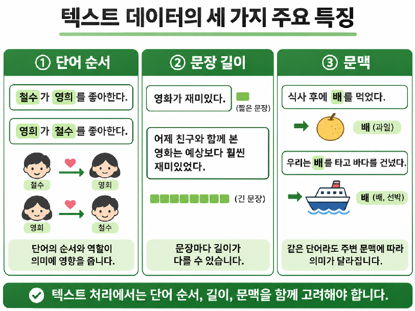
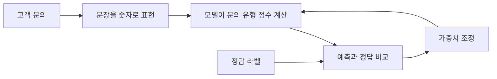
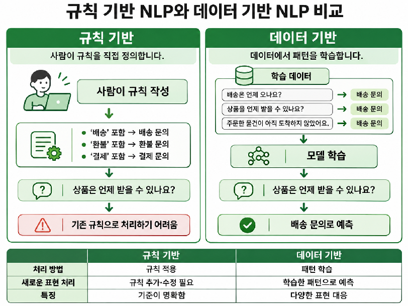

# Day 1. NLP의 문제와 텍스트 데이터의 특징

> 자연어 처리에서는 텍스트를 숫자로 표현하고, 작업에 맞는 결과를 계산한다. 어떤 표현을 고르느냐에 따라 모델이 단어의 순서와 문맥을 활용할 수 있는 범위가 달라진다.

## 1. 자연어 처리의 입력과 출력

**자연어 처리(Natural Language Processing, NLP)** 는 컴퓨터가 사람이 사용하는 언어를 분석하고 언어 관련 작업을 수행하도록 만드는 분야다.  
영화 리뷰를 읽고 감정을 분류하는 모델과 같은 리뷰를 다른 언어로 번역하는 모델은 둘 다 텍스트를 다룬다. 그러나 전자는 정해진 범주를 고르고, 후자는 새 문장을 출력한다.

| 작업 | 입력 | 출력 |
| --- | --- | --- |
| 텍스트 분류(Text Classification) | 영화 리뷰 한 편 | 긍정 또는 부정 같은 범주 |
| 문장 유사도(Sentence Similarity) | 사용자 질문과 FAQ 질문 | 두 문장의 유사도 점수 |
| 기계 번역(Machine Translation) | 한 언어로 쓴 문장 | 다른 언어로 옮긴 문장 |
| 요약(Summarization) | 여러 문단으로 된 기사 | 주요 내용을 담은 짧은 글 |
| 생성(Generation) | `오늘 날씨는` 같은 앞 문맥 | 입력 뒤에 이어지는 텍스트 |

“배송은 언제 오나요?”와 “상품 도착 예정일은 언제인가요?”는 사용한 표현이 달라도 같은 시점을 묻는다.  
문장 유사도를 이용하면 이런 질문을 관련 FAQ와 연결할 수 있다. 분류 결과인 ‘배송 문의’는 문장 하나의 유형이고, 유사도 점수는 두 문장을 비교한 결과다.

## 2. 텍스트의 순서, 길이, 문맥

### 단어의 순서와 역할

“철수가 영희를 좋아한다”와 “영희가 철수를 좋아한다”는 등장하는 인물이 같지만 누가 누구를 좋아하는지는 다르다.  
이름과 조사를 각각 토큰으로 나눈 뒤 등장 횟수만 세면 두 문장의 구성 요소가 같아져 누가 주어인지 구별할 단서를 잃는다. 주체와 대상을 구분하려면 문장 안의 순서와 문법적 역할을 활용할 수 있는 표현이 필요하다.

### 문장마다 다른 길이

“영화가 재미있다”는 띄어쓰기 기준으로 두 어절이고, “어제 친구와 함께 본 영화는 예상보다 훨씬 재미있었다”는 여덟 어절이다.  
같은 방식으로 둘을 토큰화해도 각 문장의 길이가 달라서 정해진 모양의 한 묶음으로 만들기 어려울 수 있다. 짧은 입력에 값을 채우는 패딩(Padding)이나 긴 입력의 일부를 자르는 절단(Truncation)은 이런 경우에 길이를 맞추는 방법이다.

### 같은 단어의 다른 의미

“배를 먹었다”의 ‘배’는 과일이고, “배를 타고 바다를 건넜다”의 ‘배’는 이동 수단이다.  
**문맥(Context)** 은 이처럼 단어의 의미나 역할을 판단하는 데 필요한 주변 정보다. ‘먹었다’, ‘타고’, ‘바다’ 같은 표현이 어느 의미로 쓰였는지 알려 주는 단서가 된다.

## 3. 규칙과 데이터로 판단 기준 만들기

**규칙 기반 자연어 처리(Rule-based NLP)** 는 사람이 만든 조건이나 사전을 적용한다.  
‘배송’이 들어가면 배송 문의로 분류하는 규칙은 결과를 설명하기 쉽다. 그러나 “주문한 물건이 아직 도착하지 않았어요”처럼 단어가 달라지면 규칙을 보완해야 한다.

**데이터 기반 자연어 처리(Data-driven NLP)** 는 학습 사례에서 예측에 필요한 패턴을 배운다.  
예를 들어 배송, 환불, 결제로 분류한 고객 문의를 모으면 ‘택배’, ‘도착’, ‘받는 날짜’ 같은 표현이 어떤 유형과 함께 나오는지 모델이 학습할 수 있다. 다음 흐름은 정답 라벨이 있는 문의 분류의 학습 과정이다.

학습을 마친 모델이 “상품을 언제 받을 수 있나요?” 같은 처음 보는 문의도 배송으로 분류할 수 있다면, 학습한 판단 기준이 새 입력에도 적용된 것이다.  
이 능력을 **일반화(Generalization)** 라고 한다. 다양한 표현이 학습에 충분히 반영됐는지, 숫자 표현이 필요한 단서를 보존하는지, 모델이 그 단서를 활용할 수 있는지에 따라 결과가 달라진다.

## 4. 숫자 표현이 모델에 전달하는 정보

문장 분류의 기본 흐름은 `텍스트 → 숫자 표현 → 모델 → 예측 결과`다.  
여기서 숫자 표현의 형태가 중요하다. 문서에서 각 단어의 등장 횟수를 세면 자주 쓰인 표현을 알 수 있고, 토큰을 등장 순서대로 배열하면 위치와 순서를 유지할 수 있다.

‘재미있다’가 등장했다는 사실만으로도 리뷰 감성을 분류할 단서가 된다.  
반면 ‘재미있을 줄 알았는데 지루했다’에서는 두 표현이 어떻게 이어졌는지를 함께 봐야 전체 감정이 분명해진다. 문제에 필요한 정보를 기준으로 입력 표현과 모델을 선택한다.

## 5. 핵심 개념 비교

| 구분 | 무엇을 나타내는가 | 예시 |
| --- | --- | --- |
| 분류 결과 | 입력 하나가 속하는 범주 | 배송 문의 |
| 유사도 점수 | 두 입력 사이의 관련성 | 표현은 달라도 같은 배송 시점을 문의 |
| 등장 횟수 표현 | 문서에 어떤 단어가 몇 번 나왔는지 | ‘재미있다’ 1회 |
| 순서가 있는 표현 | 토큰이 나열된 위치와 순서 | ‘재미있을 줄’ 다음에 ‘지루했다’가 등장 |
| 규칙 기반 처리 | 사람이 정한 판단 조건 | ‘배송’이 포함되면 배송으로 분류 |
| 데이터 기반 처리 | 학습 사례에서 얻은 판단 기준 | ‘상품을 받는 날짜’도 배송으로 예측 |

## 6. 핵심 정리

- 같은 텍스트라도 분류, 유사도, 번역, 요약, 생성은 요구하는 출력이 다르다.
- 단어의 순서와 문법적 역할은 누가 무엇을 했는지 표현하는 데 필요하다.
- 문장마다 길이가 다르므로 한 묶음으로 계산할 때 입력 길이를 조정할 수 있다.
- 주변 문맥을 이용하면 같은 단어가 쓰인 서로 다른 의미를 구분할 수 있다.
- 데이터 기반 분류는 입력과 정답의 관계를 학습하고, 처음 보는 문장에서의 일반화가 중요하다.
- 숫자 표현이 어떤 정보를 보존하는지에 따라 모델이 활용할 수 있는 단서가 달라진다.

[학습 목차로 이동](README.md) | [다음: 텍스트 전처리와 토큰화](02-텍스트-전처리와-토큰화.md)
