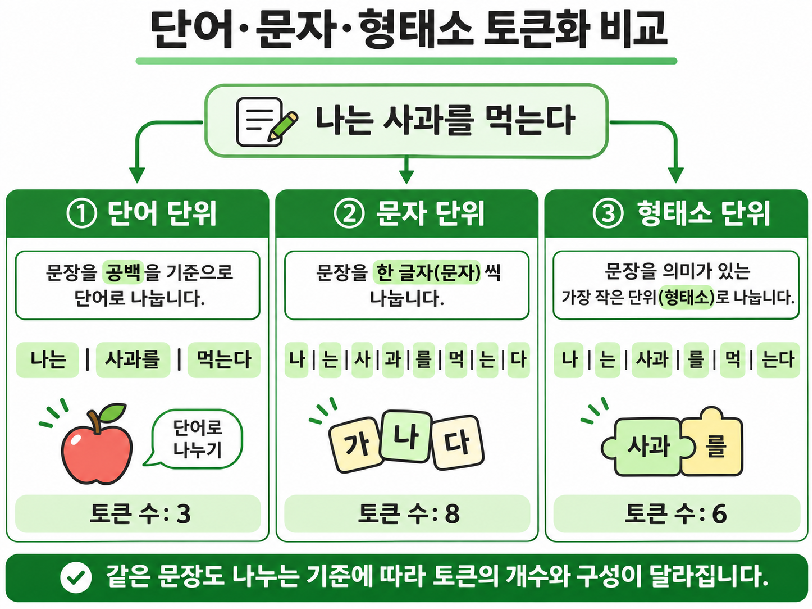
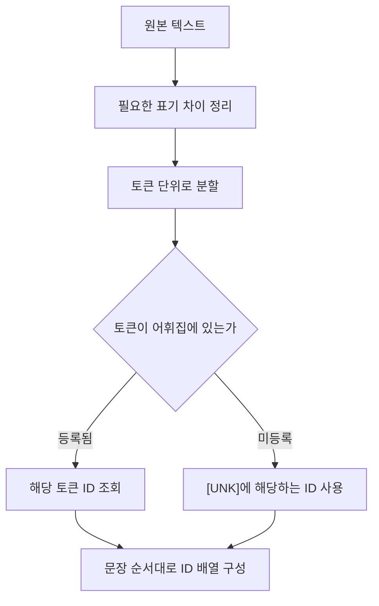
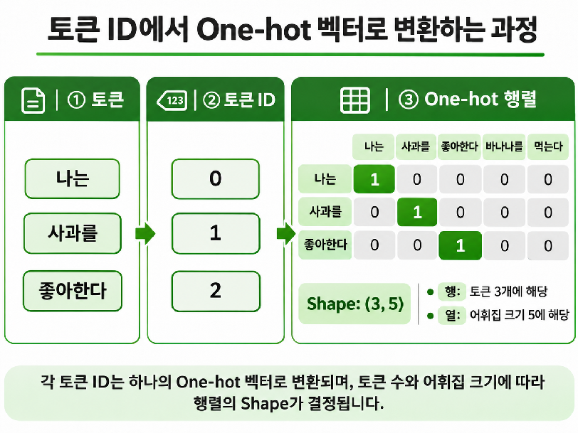

# Day 1. 텍스트 전처리와 토큰화, 숫자 표현

> 원문을 정리한 뒤 토큰으로 나누고, 공통 어휘집으로 정수 ID를 부여한다. 토큰을 원핫 벡터로 펼쳤을 때 각 행과 열이 무엇을 뜻하는지도 살펴본다.

## 1. 전처리에서 유지할 정보

**텍스트 전처리(Text Preprocessing)** 는 모델이 사용할 텍스트의 표기를 정리하는 과정이다.  
예를 들어 공백 기준으로 문장을 나누면 `재미있다`와 `재미있다.`가 서로 다른 토큰이 될 수 있다. 문장 끝의 마침표가 작업에 필요하지 않다면, 마침표를 제거해 두 표현을 같은 토큰으로 처리할 수 있다.

| 방법 | 처리 예 | 정리하는 대상 |
| --- | --- | --- |
| 공백 정리 | `나는  학생이다` → `나는 학생이다` | 반복 공백과 앞뒤 공백 |
| 대소문자 통일 | `Hello WORLD` → `hello world` | 영어 단어의 대소문자 차이 |
| HTML 태그 제거 | `<b>맛있어요</b>` → `맛있어요` | 웹에서 수집한 문서의 표시용 태그 |
| 문장부호 처리 | `재미있다.` → `재미있다` | 작업에 필요하지 않은 문장부호 |

전처리 방법은 작업에 맞춰 선택한다.  
“재미있어요.”와 “재미있어요!!!”의 감정 강도를 구분하는 일이라면 느낌표가 단서가 된다. 물음표도 질문 여부가 중요한 작업에서는 유지할 수 있다.

## 2. 토큰화 단위와 한국어

**토큰(Token)** 은 모델이 텍스트를 처리할 때 사용하는 기본 단위이고, **토큰화(Tokenization)** 는 원문을 그런 단위로 나누는 과정이다.  
같은 문장도 분할 기준에 따라 토큰 개수와 어휘집에 들어가는 항목이 달라진다.

| 방식 | 분할 기준 | 특징 |
| --- | --- | --- |
| 어절 또는 단어 토큰화(Word-level Tokenization) | 공백이나 단어 경계 | 단어를 한 토큰으로 다루기 쉽고, 새 단어가 별도 항목으로 필요할 수 있음 |
| 문자 토큰화(Character-level Tokenization) | 개별 문자 | 알고 있는 문자로 새 단어를 표현할 수 있으며, 문장당 토큰 수가 늘어남 |
| 형태소 토큰화(Morpheme-level Tokenization) | 의미나 문법 기능을 가진 단위 | 조사와 어미를 분리해 공통 형태소를 구별 |
| 서브워드 토큰화(Subword Tokenization) | 데이터에서 학습한 분할 규칙 | 드물거나 새로운 단어를 등록된 조각의 조합으로 표현 |

한국어에서는 명사에 조사가, 동사나 형용사에 어미가 붙는다.  
공백으로만 나누면 `사과가`, `사과를`, `사과는`이 각각 어휘집에 들어갈 수 있다. 형태소를 기준으로 하면 공통된 `사과`와 문법 역할을 나타내는 `가`, `를`, `는`을 따로 처리할 수 있다.

서브워드는 형태소와 분할 기준이 다르다.  
형태소 분석은 언어의 의미와 문법 기능을 기준으로 삼고, 서브워드는 학습된 규칙에 따라 단어를 조각으로 나눈다. 대표적인 서브워드 방식으로 바이트 페어 인코딩(Byte Pair Encoding, BPE)과 워드피스(WordPiece)가 있다.

## 3. 공통 어휘집과 토큰 ID

**어휘집(Vocabulary)** 은 서로 다른 토큰을 한 번씩 등록한 목록이다.  
각 토큰에 하나씩 부여하는 정수 번호를 토큰 ID(Token ID)라고 한다. 문장마다 따로 번호를 매기면 같은 토큰을 일관되게 식별하기 어려우므로 여러 문장에 공통 어휘집을 사용한다.

| 토큰 | 나는 | 사과를 | 좋아한다 | 바나나를 | 먹는다 |
| --- | --- | --- | --- | --- | --- |
| ID | 0 | 1 | 2 | 3 | 4 |

- `나는 사과를 좋아한다` → `[0, 1, 2]`
- `나는 바나나를 먹는다` → `[0, 3, 4]`

두 문장에서 `나는`은 모두 ID 0이다. **토큰 ID는 토큰을 식별하는 인덱스(Index)** 로, ID가 1과 3이라는 사실만으로 두 단어의 의미 거리나 중요도를 판단할 수 없다. 토큰의 벡터를 만들거나 임베딩 행렬에서 해당 행을 찾을 때 이 번호를 사용한다.

### 어휘집에 없는 토큰 처리

**미등록 토큰 문제(Out-of-Vocabulary, OOV)** 는 입력 토큰이 어휘집에 없어 해당 ID를 찾을 수 없는 상황이다.  
위 어휘집에서 `나는 귤을 좋아한다`를 처리하면 `귤을`이 미등록 토큰이 된다. 사전에 등록한 미등록 토큰(Unknown Token)인 `[UNK]`로 바꾸면 ID를 붙일 수 있지만, 여러 미등록 표현이 같은 ID에 합쳐진다.

서브워드 방식에서는 `귤`과 `을`에 해당하는 조각이 등록되어 있다면 두 ID로 표현할 수 있다.  
단어 전체가 어휘집에 없어도 등록된 조각을 이용할 수 있어 OOV를 줄이는 데 도움이 된다.

## 4. 원핫 인코딩과 행렬의 크기

**원핫 인코딩(One-hot Encoding)** 은 어휘집 크기만큼 벡터를 만들고 토큰 ID에 해당하는 위치만 1로 채운다.  
어휘집 크기가 5이고 ID가 3일 때, 위치를 0부터 세면 네 번째 칸이 1인 `[0, 0, 0, 1, 0]`이 된다.

`나는 사과를 좋아한다`의 토큰 ID `[0, 1, 2]`를 각각 원핫 벡터로 바꿔 쌓으면 행렬의 크기(Shape)는 `(3, 5)`다.  
행 3개는 토큰의 등장 순서에 대응하고 열 5개는 어휘집의 토큰 종류에 대응한다. 같은 어휘집을 쓰면 문장 길이가 달라져도 열의 개수는 그대로이고, 행의 개수만 달라진다.

어휘집 크기가 10,000이면 토큰 하나를 표현하는 데 10,000차원 중 한 칸만 1이다.  
이처럼 대부분의 값이 0인 벡터를 **희소 벡터(Sparse Vector)** 라고 한다. 모든 값을 채워 저장하면 비효율적이고, ‘사과’와 ‘바나나’처럼 비슷한 단어도 다른 토큰과 똑같이 서로 다른 위치의 1로만 구분된다.

단어 임베딩(Word Embedding)은 토큰에 대응하는 실수 벡터를 데이터에서 학습하는 표현이다.  
원핫 인코딩이 토큰의 정체성을 표시한다면, 임베딩은 학습을 통해 단어 사이의 관계를 벡터에 담을 수 있다.

## 5. 핵심 개념 비교

| 개념 | 처리 단위 | 결과와 용도 |
| --- | --- | --- |
| 전처리 | 원문 | 목적에 맞게 정리한 텍스트 |
| 토큰화 | 문장 | 선택한 단위로 분할한 토큰열 |
| 어휘집 | 서로 다른 토큰 | 텍스트 토큰과 숫자 ID의 공통 대응 |
| 토큰 ID | 토큰 하나 | 토큰을 식별하는 정수 번호 |
| 원핫 인코딩 | 토큰 하나 | 토큰 위치만 1인 어휘집 크기의 벡터 |
| 문서 벡터 | 문서 하나 | 단어별 등장 정보나 가중치를 한 행에 집계 |

## 6. 핵심 정리

- 전처리는 작업에 필요한 정보를 유지하면서 불필요한 표기 차이를 줄인다.
- 토큰화 방식에 따라 토큰 수와 어휘집 구성이 달라진다.
- 한국어 형태소 분석은 조사와 어미를 분리하며, 서브워드는 학습된 분할 규칙을 적용한다.
- 공통 어휘집은 같은 토큰을 같은 ID로 변환한다.
- 미등록 토큰은 특수 토큰으로 대체하거나 등록된 서브워드 조각으로 표현할 수 있다.
- 원핫 행렬의 크기는 `(문장의 토큰 수, 어휘집 크기)`이며 토큰끼리의 의미 관계는 표현하지 않는다.

[학습 목차로 이동](README.md) | [다음: BoW, TF-IDF와 텍스트 분류](03-BoW와-TF-IDF-텍스트-분류.md)
