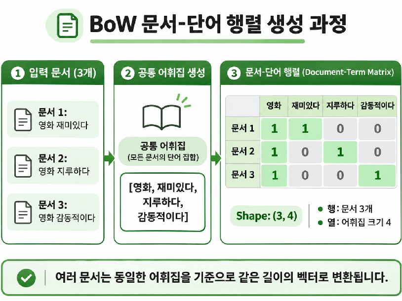
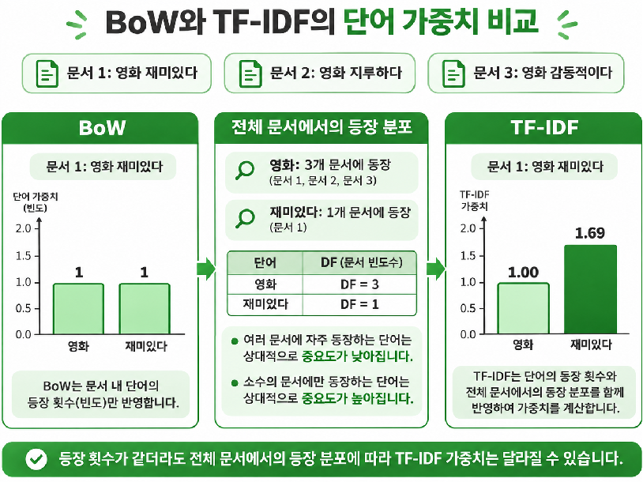
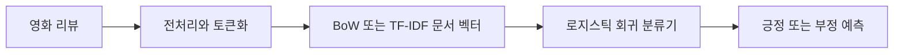
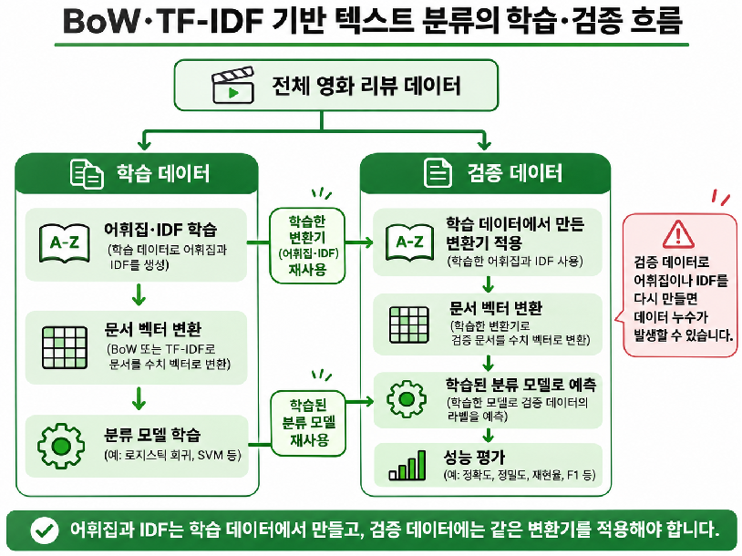

# Day 1. BoW, TF-IDF와 전통적인 텍스트 분류

> 문서 하나를 단어별 등장 횟수나 가중치로 표현하면 길이가 다른 리뷰도 같은 수의 특징으로 비교할 수 있다. 벡터를 만드는 과정과 분류 모델을 학습하는 과정을 구분한다.

## 1. 개별 토큰과 문서의 표현

**문서 표현(Document Representation)** 은 문장이나 문서 전체를 모델에 입력할 수 있는 숫자 벡터로 나타내는 방법이다.  
어휘집이 `[영화, 재미있다, 지루하다]`이고 문장이 `영화 재미있다`라면 원핫 인코딩(One-hot Encoding)은 토큰마다 `[1, 0, 0]`, `[0, 1, 0]`을 만든다. 단어를 세는 문서 표현은 두 토큰을 한 행의 `[1, 1, 0]`으로 모아 문서 하나의 특징으로 사용한다.

토큰별 원핫 행렬은 행의 위치에 따라 원래 토큰의 순서를 유지한다.  
문서별 횟수 벡터로 합치면 위치 정보는 사라지지만, 문서마다 토큰 수가 달라도 어휘집 크기만큼의 특징을 갖는다. 영화 리뷰의 감성 분류처럼 문서 하나에 정답 하나를 붙이는 문제에 사용할 수 있다.

## 2. 단어 등장 횟수를 기록하는 BoW

**단어 가방(Bag of Words, BoW)** 은 공통 어휘집의 각 단어가 문서에 몇 번 등장하는지 세는 표현이다.  
열 순서가 `[영화, 재미있다, 지루하다, 감동적이다]`라면 `영화 재미있다`는 `[1, 1, 0, 0]`, `영화 영화 재미있다`는 `[2, 1, 0, 0]`이다. 증가한 첫 칸은 ‘영화’가 한 번 더 등장했다는 뜻이다.

문서 벡터를 행으로 쌓으면 **문서-단어 행렬(Document-Term Matrix, DTM)** 이 된다.  
행은 문서, 열은 어휘집 항목, 값은 해당 문서에서의 등장 횟수다. 그림의 행렬은 문서 3개와 단어 4개로 이루어져 크기(Shape)가 `(3, 4)`다. 새 문서도 같은 어휘집으로 변환하면 같은 네 열을 사용한다.

BoW는 단어의 출현을 간단히 표현하지만, 단어 순서가 바뀌어도 횟수가 같으면 같은 벡터가 된다.  
‘재미있다’와 ‘흥미롭다’처럼 의미가 비슷한 단어도 서로 다른 열을 사용한다. 또한 여러 문서에서 공통으로 쓰이는 단어와 드물게 쓰이는 단어는 등장 횟수가 같을 때 같은 값을 갖는다.

## 3. 문서 안의 빈도와 문서 전체에서의 희소성

**단어 빈도-역문서 빈도(Term Frequency-Inverse Document Frequency, TF-IDF)** 는 문서 안에서의 단어 빈도에 문서 모음에서의 희소성을 곱해 가중치를 만든다.  
여러 리뷰에 공통으로 들어간 ‘영화’보다 일부 리뷰에 등장한 ‘재미있다’에 상대적으로 높은 값을 줄 수 있다.

- **단어 빈도(Term Frequency, TF)** 는 특정 문서에 등장한 횟수다. `영화 영화 재미있다`에서 ‘영화’의 TF는 2다.
- **문서 빈도(Document Frequency, DF)** 는 그 단어를 포함한 문서의 개수다. 한 문서에서 같은 단어가 여러 번 나오더라도 그 문서는 한 번만 센다.
- **역문서 빈도(Inverse Document Frequency, IDF)** 는 DF에서 계산한 가중치다. 더 많은 문서에 등장한 단어에 상대적으로 작은 값을 준다.

### 가중치 계산

다음 식에서 $t$는 단어, $d$는 문서, $N$은 계산에 사용한 전체 문서 수다. $\ln$은 자연로그다.

$$
\begin{aligned}
\mathrm{IDF}(t) &= 1 + \ln\left(\frac{N+1}{\mathrm{DF}(t)+1}\right) \\
\mathrm{TF\text{-}IDF}(t,d) &= \mathrm{TF}(t,d) \times \mathrm{IDF}(t)
\end{aligned}
$$

`영화 재미있다`, `영화 지루하다`, `영화 감동적이다`를 학습 문서로 쓰면 $N=3$이다.  
첫 문서 안에서는 ‘영화’와 ‘재미있다’가 모두 한 번 등장한다. ‘영화’의 DF는 3이므로 IDF는 $1+\ln(4/4)=1$이고, ‘재미있다’의 DF는 1이므로 $1+\ln(4/2)\approx1.69$다.

같은 열 순서에서 첫 문서의 BoW 벡터는 `[1, 1, 0, 0]`, TF-IDF 벡터는 정규화 전 `[1.00, 1.69, 0, 0]`이다.  
나머지 두 단어는 이 문서에서 TF가 0이라 가중치도 0이다. 벡터 정규화(Normalization)가 적용되는 설정에서는 최종 수치가 달라질 수 있다.

## 4. 문서 분류와 데이터 누수

BoW와 TF-IDF로 만든 문서 벡터는 **입력 특징(Feature)** 이다.  
**로지스틱 회귀(Logistic Regression)** 는 이 특징과 정답 라벨을 바탕으로 긍정과 부정을 구별하는 기준을 학습한다. 변환기는 각 리뷰를 같은 형태로 만들고, 분류기는 그 값에서 정답을 예측한다.

**리뷰를 학습용과 검증용으로 나눈 뒤, 학습 리뷰에서만 어휘집과 IDF를 결정한다.**  
학습 단계에서는 변환기를 맞추고 바로 벡터를 만드는 `fit_transform`에 해당하는 처리를 한다. 검증 단계에서는 이미 정한 열과 IDF를 그대로 적용하는 `transform`에 해당하는 처리를 한다. 검증 리뷰까지 써서 변환기를 맞추면 검증 데이터의 분포가 학습 과정에 미리 반영되는 **데이터 누수(Data Leakage)** 가 발생할 수 있다.

### BoW와 TF-IDF를 공정하게 비교하기

두 표현을 비교할 때는 같은 학습과 검증 데이터, 같은 분류기 종류와 설정을 유지하고 벡터화 방식만 바꾼다.  
각 벡터에 맞는 분류기를 따로 학습한 뒤, 정확도(Accuracy)와 F1 점수(F1 Score)를 비교한다. 정확도는 전체 리뷰 중 맞힌 비율이고, F1은 정밀도(Precision)와 재현율(Recall)을 함께 반영한다. TF-IDF가 더 많은 통계를 사용하더라도 실제 분류 성능은 데이터에 따라 달라진다.

오분류 사례도 같이 확인한다.  
“재미있을 줄 알았는데 지루했다”에는 긍정과 부정으로 볼 수 있는 표현이 함께 있지만 전체 감성은 부정이다. 단어의 출현 비중만 이용하면 앞뒤 표현이 어떤 관계인지 반영하기 어렵다.

## 5. 핵심 개념 비교

| 개념 | 사용하는 정보 | 결과 |
| --- | --- | --- |
| 원핫 인코딩 | 개별 토큰의 ID | 토큰별 벡터 |
| BoW | 문서 안의 단어별 등장 횟수 | 문서별 횟수 벡터 |
| TF-IDF | 문서 내부의 빈도와 전체 문서의 등장 분포 | 문서별 가중치 벡터 |
| 로지스틱 회귀 | 문서 벡터와 정답 라벨의 관계 | 문서의 클래스 예측 |

## 6. 핵심 정리

- 원핫 인코딩은 토큰을, BoW와 TF-IDF는 문서를 벡터로 표현한다.
- BoW의 문서-단어 행렬은 `(문서 수, 어휘집 크기)`이며 각 셀은 단어 횟수다.
- TF는 한 문서에서의 빈도, DF는 해당 단어가 등장한 문서 수를 뜻한다.
- TF-IDF는 DF가 낮은 단어에 상대적으로 큰 IDF를 곱하며 순서와 문맥을 직접 보존하지 않는다.
- 변환기의 어휘집과 IDF를 학습 데이터에서만 만들면 검증 정보의 누수를 막을 수 있다.
- 분류 성능은 같은 데이터와 분류기 설정으로 비교하고, 지표와 오분류를 함께 확인한다.

[학습 목차로 이동](README.md) | [다음: 언어모델과 N-gram](04-언어모델과-N-gram.md)
