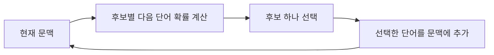
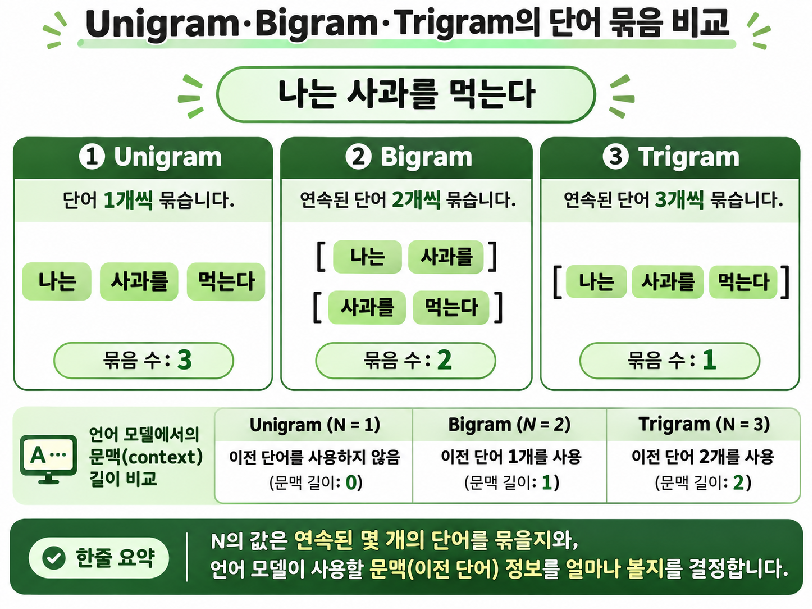
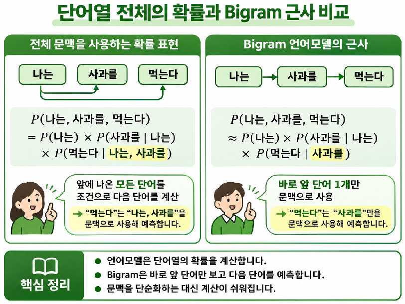
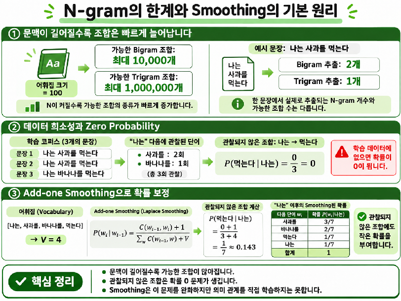

# Day 1. 언어모델과 N-gram의 기본 원리

> N-gram 언어모델은 연속된 단어 조합의 횟수로 다음 단어의 확률을 추정한다. Bigram의 계산과 미관찰 조합에 확률을 주는 평활화를 같은 예제로 비교한다.

## 1. 다음 단어를 예측하는 언어모델

**언어모델(Language Model, LM)** 은 단어열이나 다음 단어에 확률을 부여하는 모델이다.  
다음 단어를 예측할 때 참고하는 앞선 단어들을 문맥(Context)이라고 한다. 텍스트 분류에서 리뷰 전체를 보고 ‘긍정’ 같은 범주를 고른다면, 다음 단어 예측에서는 주어진 문맥 뒤에 올 후보별로 확률을 계산한다.

예를 들어 `나는 사과를` 다음 후보의 확률을 ‘먹는다’ 0.6, ‘좋아한다’ 0.3, ‘샀다’ 0.1로 가정할 수 있다.  
확률이 가장 높은 후보를 선택하면 `나는 사과를 먹는다`가 된다. 선택한 단어를 문맥에 추가한 뒤 같은 과정을 반복하면 문장 생성으로 이어진다.

## 2. N-gram과 문맥의 길이

**N-그램(N-gram)** 은 문장에서 연속하는 $N$개의 단어 또는 토큰을 묶은 것이다.  
예를 들어 Bigram은 두 칸 길이의 창을 한 칸씩 옮기며 `나는 사과를 먹는다`를 `(나는, 사과를)`와 `(사과를, 먹는다)`로 나눈다. N-gram 언어모델에서는 묶음의 마지막 단어가 예측 대상이고 앞의 $N-1$개가 문맥이다.

유니그램(Unigram)은 앞 단어를 참고하지 않고 단어 자체의 빈도를 본다.  
바이그램(Bigram)은 ‘먹는다’를 예측할 때 바로 앞의 ‘사과를’을 참고한다. 트라이그램(Trigram)은 앞의 두 단어인 ‘나는 사과를’을 함께 참고한다. $N$을 키우면 더 긴 문맥을 쓰는 만큼 구별할 단어 조합도 많아진다.

### 조건부확률과 단어열의 확률

**조건부확률(Conditional Probability)** 은 특정 조건이 주어진 상황에서 사건이 발생할 확률이다.  
$P(w_i \mid w_{i-1})$에서 $w_i$는 예측할 단어이고 $w_{i-1}$은 바로 앞 단어다. 예를 들어 $P(\text{사과를}\mid\text{나는})$은 ‘나는’ 다음 단어가 ‘사과를’일 확률이다.

**확률의 연쇄법칙(Chain Rule)** 을 적용하면 단어열의 확률을 각 위치의 조건부확률을 곱해서 구할 수 있다.  
세 단어로 된 단어열에서는 첫 단어 자체의 확률, 첫 단어를 조건으로 한 둘째 단어의 확률, 첫째와 둘째 단어를 조건으로 한 셋째 단어의 확률을 곱한다. Bigram은 마지막 계산도 바로 앞 단어만 사용해 근사한다.

$$
P(w_1,w_2,w_3)
= P(w_1)\,P(w_2\mid w_1)\,P(w_3\mid w_1,w_2)
\approx P(w_1)\,P(w_2\mid w_1)\,P(w_3\mid w_2)
$$

## 3. 등장 횟수에서 다음 단어 확률 계산

**말뭉치(Corpus)** 는 언어 분석이나 모델 학습에 쓰는 텍스트 모음이다.  
`나는 사과를 먹는다`가 두 번, `나는 바나나를 먹는다`가 한 번 관찰된 말뭉치를 사용한다. 같은 문장이라도 두 번 관찰됐다면 등장 횟수에 두 번 포함한다.

| 앞 단어 | 다음 단어 | 조합의 등장 횟수 |
| --- | --- | ---: |
| 나는 | 사과를 | 2 |
| 나는 | 바나나를 | 1 |
| 사과를 | 먹는다 | 2 |
| 바나나를 | 먹는다 | 1 |

특정 앞 단어 $h$와 뒤따르는 단어 $w$가 이어서 관찰된 횟수를 $C(h,w)$라고 하면, 전체 말뭉치 길이 대신 **같은 앞 단어 뒤에 관찰된 모든 후보의 횟수 합**으로 나눈다.  
문맥이 ‘나는’이면 분모는 $2+1=3$이다. 이때 ‘사과를’의 확률은 $2/3\approx0.667$, ‘바나나를’의 확률은 $1/3\approx0.333$이므로 가장 높은 후보는 ‘사과를’이다.

$$
P(w\mid h)=\frac{C(h,w)}{\sum_u C(h,u)}
$$

분모의 $u$는 가능한 다음 단어를 차례로 나타낸다. 말뭉치에 `나는 바나나를 먹는다`가 한 번 더 들어오면 두 후보가 모두 2회로 같아져 각각의 확률은 $2/4=0.5$가 된다. 모델이 예측하는 확률은 관찰한 자료의 분포를 반영한다.

## 4. 미관찰 조합과 평활화

**데이터 희소성(Data Sparsity)** 은 가능한 조합에 비해 실제로 관찰된 데이터가 부족한 현상이다.  
어휘집이 100개라면 가능한 Bigram은 최대 10,000개, Trigram은 최대 1,000,000개다. 길이가 긴 조합까지 세면 문맥을 자세히 구별할 수 있지만 충분한 관측을 얻기 어려워진다.

위 말뭉치에서 `나는 → 먹는다`는 관찰되지 않아 $0/3=0$이 된다.  
실제로 사용할 수 있는 표현인데도 관찰 횟수가 없어 확률이 0인 경우를 **제로 확률 문제(Zero Probability Problem)** 라고 한다. 단어열의 확률을 곱으로 계산할 때는 한 항이 0이면 전체도 0이 된다.

### 가능한 모든 후보에 1을 더하는 방법

**평활화(Smoothing)** 는 관찰된 횟수를 조정해 미관찰 조합에 확률을 부여하는 방법이다.  
1 더하기 평활화(Add-one Smoothing)는 라플라스 평활화(Laplace Smoothing)라고도 한다. 후보마다 1씩 더하므로 후보가 $V$개일 때 분자에는 1을, 분모에는 $V$를 더한다.

$$
P_{\mathrm{add1}}(w\mid h)=\frac{C(h,w)+1}{\sum_u C(h,u)+V}
$$

‘나는’ 뒤의 원래 관찰 횟수는 3이고 가능한 다음 단어는 ‘나는’, ‘사과를’, ‘바나나를’, ‘먹는다’ 네 개다.  
따라서 ‘먹는다’의 확률은 $0/3$에서 $(0+1)/(3+4)=1/7\approx0.143$으로 바뀐다. 다른 후보까지 포함한 확률 합은 $(3+2+1+1)/7=1$이며, 이전에 관찰된 두 후보의 확률도 함께 조정된다.

평활화는 등장 횟수를 보정한다.  
‘사과’와 ‘바나나’가 의미상 비슷하다는 정보는 이 보정으로 얻을 수 없다. 단어 임베딩(Word Embedding)은 단어별 숫자 벡터를 학습해 이런 관계를 표현하는 접근이다.

## 5. 핵심 개념 비교

| 구분 | 어떤 정보를 쓰는가 | 무엇을 구하는가 |
| --- | --- | --- |
| 텍스트 분류 | 문서의 특징과 정답 라벨 | 문서의 범주 |
| Unigram 언어모델 | 개별 단어의 횟수 | 앞 단어 없이 다음 단어 확률 추정 |
| Bigram 언어모델 | 연속한 두 단어의 횟수 | 앞 단어 하나를 조건으로 한 확률 |
| Trigram 언어모델 | 연속한 세 단어의 횟수 | 앞 단어 두 개를 조건으로 한 확률 |
| 1 더하기 평활화 | 전체 후보의 조정된 횟수 | 미관찰 후보까지 포함한 확률 분포 |

## 6. 핵심 정리

- 다음 단어 예측에서는 문맥을 입력으로 사용하고 후보별 확률을 구한다.
- N-gram은 연속된 $N$개 단어를 묶으며, 예측에 참고하는 문맥은 앞의 $N-1$개다.
- Bigram의 조건부확률은 같은 앞 단어 뒤에서 관찰한 횟수의 비율이다.
- 여러 위치의 확률을 곱해 단어열의 확률을 계산하고, Bigram은 앞 단어 하나만 사용해 이를 근사한다.
- 문맥이 길어지면 가능한 조합이 많아지므로 관찰하지 못한 조합이 늘어날 수 있다.
- 1 더하기 평활화는 모든 후보의 횟수를 조정해 확률의 합을 1로 유지하면서 미관찰 조합에도 확률을 준다.

[학습 목차로 이동](README.md) | [다음: 텍스트 표현에서 N-gram 언어모델까지](05-텍스트-표현에서-N-gram까지.md)
