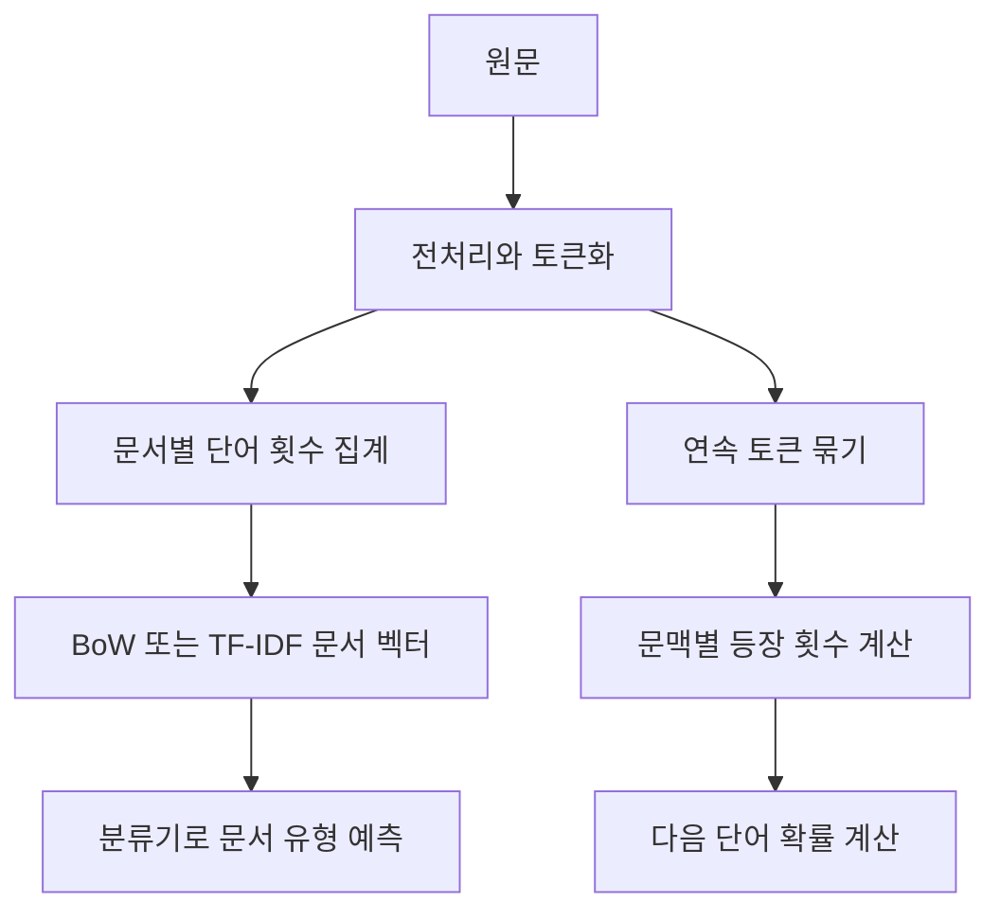

# Day 1. 텍스트 표현에서 N-gram 언어모델까지

> 문서 분류와 다음 단어 예측은 모두 텍스트에서 출발하지만, 모델에 전달해야 할 정보는 다르다. 전처리와 토큰화가 두 작업으로 어떻게 이어지는지 정리한다.

## 1. 작업에 따라 남겨야 할 정보

**자연어 처리(Natural Language Processing, NLP)** 는 텍스트를 숫자로 표현해 분류, 문장 유사도, 번역, 요약, 생성 같은 작업을 수행한다.  
리뷰 한 편의 감성을 분류할 때는 어떤 표현이 등장했는지가 단서가 된다. 다음 단어를 예측할 때는 어떤 토큰이 바로 앞에 나왔는지처럼 **토큰의 순서와 문맥(Context)** 이 중요하다. 같은 단어라도 ‘배를 먹었다’와 ‘배를 타고 갔다’에서는 주변 표현에 따라 뜻이 달라진다.

텍스트는 문장마다 길이가 다르다.  
토큰열을 여러 개 묶어 처리할 때는 길이를 맞출 수 있고, 문서별 단어 횟수를 집계하면 길이와 무관하게 같은 어휘집 크기의 벡터를 만들 수 있다. 두 표현은 길이 차이를 다루는 방식과 남기는 정보가 다르다.

규칙 기반 처리(Rule-based NLP)는 사람이 정의한 조건을 적용한다. 데이터 기반 처리(Data-driven NLP)의 문의 분류 모델은 입력을 숫자로 표현한 뒤 예측과 정답을 비교해 가중치를 조정한다.  
학습한 패턴을 새 문장에도 적용하는 능력을 **일반화(Generalization)** 라고 한다.

## 2. 원문에서 토큰 표현으로

전처리(Text Preprocessing)는 문장부호나 공백처럼 작업에 불필요한 표기 차이를 줄인다.  
토큰화(Tokenization)는 텍스트를 어절, 문자, 형태소 또는 학습한 서브워드 규칙으로 나눈다. `사과가`와 `사과를`을 형태소로 나누면 공통된 `사과`와 각 조사로 구분할 수 있다.

공통 어휘집(Vocabulary)이 `[나는, 사과를, 좋아한다, 바나나를, 먹는다]`라면 `나는 사과를 좋아한다`는 `[0, 1, 2]`, `나는 바나나를 먹는다`는 `[0, 3, 4]`가 된다.  
토큰 ID(Token ID)는 토큰을 식별하는 번호다. 미등록 토큰(Out-of-Vocabulary, OOV)은 미리 등록한 `[UNK]`로 바꾸거나 어휘집에 있는 서브워드 조각으로 나타낼 수 있다.

**원핫 인코딩(One-hot Encoding)** 은 ID에 해당하는 칸만 1로 펼친다.  
세 토큰 `[0, 1, 2]`를 길이 5인 벡터 세 개로 바꿔 쌓으면 `(3, 5)` 행렬이다. 행 순서로 토큰의 위치를 유지할 수 있지만, 각 행은 대부분 0이고 단어 사이의 의미 관계를 담지 않는다.

## 3. 문서 분류와 다음 단어 예측의 두 흐름

### 단어를 집계해 문서를 분류하기

**단어 가방(Bag of Words, BoW)** 은 문서 안의 단어별 횟수를 센다.  
`영화 재미있다`, `영화 지루하다`, `영화 감동적이다`를 공통 어휘집의 네 열에 맞춰 쌓으면 `(3, 4)` 크기의 문서-단어 행렬(Document-Term Matrix, DTM)이 된다. 첫 문서의 행은 `[1, 1, 0, 0]`이다.

**단어 빈도-역문서 빈도(Term Frequency-Inverse Document Frequency, TF-IDF)** 는 문서 안의 빈도(TF)에 전체 문서에서 드물게 등장하는 정도(IDF)를 곱한다.  
첫 문서의 ‘영화’와 ‘재미있다’는 모두 TF가 1이다. ‘영화’가 세 문서 모두에, ‘재미있다’가 한 문서에만 나오므로 정규화 전 가중치는 각각 1.00과 약 1.69다.

두 표현은 단어의 순서와 문맥을 직접 전달하지 않는다.  
이 벡터를 입력으로 받아 긍정 또는 부정을 예측하는 것은 로지스틱 회귀(Logistic Regression) 같은 분류기다. 어휘집과 IDF는 학습 데이터에서만 만들고 검증 데이터에는 그대로 적용해 **데이터 누수(Data Leakage)** 를 막는다.

두 표현의 효과는 같은 데이터 분할과 같은 분류기 설정에서 정확도(Accuracy), F1 점수(F1 Score), 오분류 사례를 함께 비교해 판단한다.  
‘재미있을 줄 알았는데 지루했다’처럼 표현 간 관계에 따라 해석이 달라지는 예시는 어떤 정보가 벡터에서 빠졌는지 보여 준다.

### 앞 단어를 조건으로 다음 단어 예측하기

**언어모델(Language Model, LM)** 은 단어열이나 다음 단어에 확률을 부여한다.  
N-그램(N-gram)은 연속된 $N$개 단어를 묶고, 앞의 $N-1$개를 다음 단어 예측의 문맥으로 쓴다. ‘먹는다’를 예측할 때 바이그램(Bigram)은 ‘사과를’을, 트라이그램(Trigram)은 ‘나는 사과를’을 참고한다. 유니그램(Unigram)은 앞 단어를 참고하지 않는다.

말뭉치(Corpus)에서 ‘나는’ 다음에 ‘사과를’이 두 번, ‘바나나를’이 한 번 등장했다면, 각 조건부확률(Conditional Probability)은 $2/3$, $1/3$이다.  
가능한 조합에 비해 관찰 사례가 적은 **데이터 희소성(Data Sparsity)** 때문에 관찰되지 않은 ‘나는 → 먹는다’는 확률이 0으로 계산된다.

가능한 다음 단어가 네 개라면, **1 더하기 평활화(Add-one Smoothing)** 로 네 후보의 횟수에 각각 1을 더한다.  
이때 ‘먹는다’의 확률은 $(0+1)/(3+4)=1/7$이 된다. 평활화는 미관찰 조합의 확률을 보정하고, 단어 임베딩(Word Embedding)은 단어 관계를 학습 가능한 벡터로 표현한다.

## 4. 핵심 개념 비교

| 개념 | 계산하거나 표현하는 단위 | 남는 정보 |
| --- | --- | --- |
| 토큰 ID | 개별 토큰 | 어휘집에서 토큰을 찾는 번호 |
| 원핫 인코딩 | 개별 토큰 | 토큰의 정체성, 쌓은 행렬에서는 행 순서 |
| BoW | 문서 | 단어별 등장 횟수 |
| TF-IDF | 문서 | 문서 안의 빈도와 문서 모음에서의 희소성 |
| 로지스틱 회귀 분류기 | 문서 | 입력 특징으로 추정한 문서 범주 |
| N-gram 언어모델 | 앞 문맥과 다음 단어 후보 | 짧은 문맥을 조건으로 한 다음 단어의 확률 |

## 5. 핵심 정리

- NLP에서 선택한 숫자 표현은 모델에 전달되는 단어, 순서, 문맥 정보를 결정한다.
- 토큰화는 처리 단위를 정하고, 공통 어휘집은 같은 토큰에 같은 ID를 부여한다.
- 원핫 행렬의 행은 문장 속 토큰이고, BoW 문서-단어 행렬의 행은 문서다.
- TF-IDF는 문서 안의 빈도와 전체 문서에서의 등장 분포를 결합한다.
- 문서 분류는 학습 데이터에서 맞춘 변환기를 검증에도 적용해 입력을 동일한 기준으로 처리한다.
- N-gram은 짧은 앞 문맥을 조건으로 다음 단어의 확률을 계산하며, 평활화는 관찰되지 않은 조합에도 확률을 배정한다.

[학습 목차로 이동](README.md) | [다음: 분산표현과 임베딩 조회](06-분산표현과-임베딩-조회.md) | [관련 학습: 순차 데이터와 Transformer](../deep-learning/11-순차-데이터와-Transformer/README.md)
