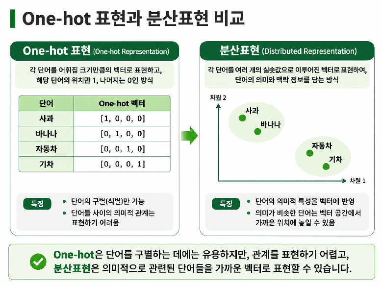
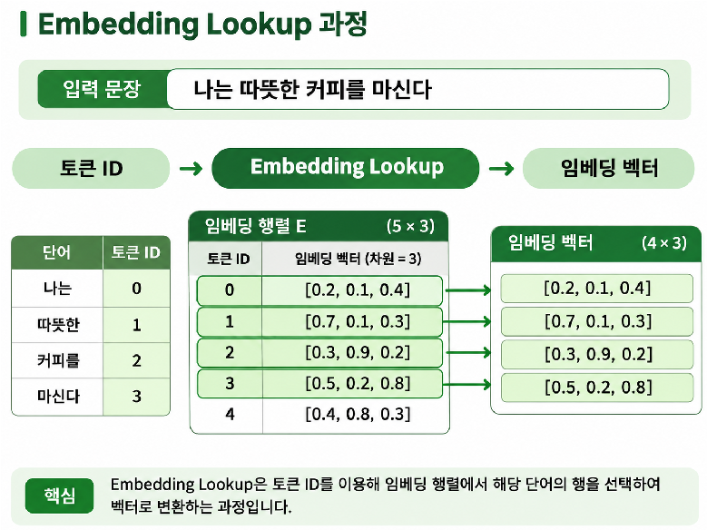
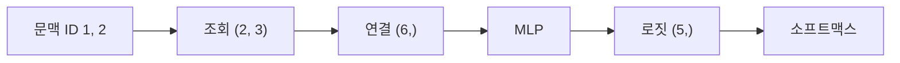

# Day 2. 분산표현과 임베딩 조회

> 임베딩 조회는 토큰의 ID로 벡터를 가져오는 연산이다. 신경망 언어모델은 조회한 벡터로 다음 단어를 예측하고, 예측 손실을 줄이면서 벡터와 신경망 가중치를 함께 학습한다.

## 1. 원핫 표현에서 분산표현으로

**원핫 인코딩(One-hot Encoding)** 은 어휘집에서 해당 단어의 위치만 1로 표시한다.  
‘사과’, ‘바나나’, ‘자동차’는 모두 다른 위치가 1이다. 이 벡터만으로는 사과가 자동차보다 바나나와 더 비슷하다는 관계를 알 수 없다. 어휘집이 10,000개라면 단어 하나를 표현하는 10,000칸 중 9,999칸이 0이다.

**분산표현(Distributed Representation)** 에서는 여러 차원의 실숫값이 함께 단어의 특징을 나타낸다.  
데이터에서 이런 벡터를 학습해 얻은 표현을 단어 임베딩(Word Embedding)이라고 한다. 비슷한 문맥에 등장한 ‘사과’와 ‘바나나’는 학습 이후 비슷한 벡터를 가질 수 있다. 그림의 값은 설명용 예시이며, 사람이 각 차원에 ‘과일’ 같은 이름을 붙여 값을 정하는 방식이 아니다.

## 2. 임베딩 행렬의 크기

**임베딩 행렬(Embedding Matrix)** 은 토큰에 대응하는 벡터를 행으로 쌓은 표다.  
어휘집 크기(Vocabulary Size) $V$는 등록된 토큰 수이고, 임베딩 차원(Embedding Dimension) $D$는 토큰 하나를 표현하는 벡터 길이다. 두 값을 독립적으로 정할 수 있으며, 행렬의 크기(Shape)는 `(V, D)`다.

| 토큰 ID | 토큰 | 예시 임베딩 벡터 |
| --- | --- | --- |
| 0 | 나는 | `[0.2, 0.1, 0.4]` |
| 1 | 따뜻한 | `[0.7, 0.1, 0.3]` |
| 2 | 커피를 | `[0.3, 0.9, 0.2]` |
| 3 | 마신다 | `[0.5, 0.2, 0.8]` |
| 4 | 차를 | `[0.4, 0.8, 0.3]` |

표에는 5개 토큰마다 값이 3개씩 있으므로 전체 행렬 크기는 `(5, 3)`이다.  
어휘집이 10,000개이고 임베딩 차원이 128이면 `(10000, 128)` 행렬에 가중치 1,280,000개가 들어간다. 어휘집을 늘리면 행이, 임베딩 차원을 늘리면 열이 늘어난다.

## 3. 토큰 ID로 벡터의 행 찾기

**임베딩 조회(Embedding Lookup)** 는 토큰 ID를 행 인덱스로 사용해 대응하는 벡터를 가져오는 연산이다.  
‘커피를’의 ID가 2이면 0부터 세었을 때 세 번째 행인 `[0.3, 0.9, 0.2]`를 읽는다. `[0, 1, 2, 3]`을 입력하면 각 ID에 해당하는 행을 입력 순서대로 쌓으므로 출력은 `(4, 3)`이 된다.

같은 결과를 원핫 벡터로도 얻을 수 있다.  
ID 2의 원핫 벡터 `[0, 0, 1, 0, 0]`에 임베딩 행렬을 곱하면 각 행에 왼쪽 벡터의 값을 곱해 더한다. 세 번째 행에만 1이 곱해져 결과가 `[0.3, 0.9, 0.2]`로 남는다. 계산 크기는 `(1, 5) × (5, 3) → (1, 3)`이다.

실제 PyTorch의 임베딩 계층 `nn.Embedding`은 어휘집 크기와 임베딩 차원을 설정하고, 원핫 벡터를 만들지 않고 정수 ID로 행을 조회한다.  
어휘집이 5개이고 차원이 3인 계층에 `[1, 2]`를 넘기면 결과의 크기는 `(2, 3)`이다. 학습 가능한 임베딩 계층이라면 이 조회에 사용된 벡터도 손실을 줄이는 방향으로 갱신된다.

## 4. 신경망 언어모델에서 다음 단어 예측하기

**신경망 언어모델(Neural Language Model)** 은 입력 문맥을 임베딩으로 바꾸고, 신경망을 사용해 다음 단어의 점수를 계산한다.  
N-gram은 특정 조합의 등장 횟수에 의존한다. 신경망 언어모델은 학습한 벡터와 가중치를 다른 조합에도 적용할 수 있어, 관찰하지 못한 문맥에도 확률을 계산할 수 있다.

예제의 다층 퍼셉트론(Multi-Layer Perceptron, MLP)은 ‘따뜻한 커피를’의 두 벡터를 순서대로 이어 붙여 6개 값을 입력받는다.  
출력의 로짓(Logits)은 어휘집의 각 토큰에 대한 점수다. 소프트맥스(Softmax)는 점수 5개를 합이 1인 확률로 변환한다.

| 다음 단어 후보 | 나는 | 따뜻한 | 커피를 | 마신다 | 차를 |
| --- | ---: | ---: | ---: | ---: | ---: |
| 예시 확률 | 0.05 | 0.10 | 0.10 | 0.60 | 0.15 |

예시에서는 ‘마신다’의 확률 0.60이 가장 높다.  
정답이 ‘마신다’라면 **교차 엔트로피 손실(Cross-Entropy Loss)** 은 정답에 0.1을 부여한 예측에 0.9를 부여한 예측보다 큰 손실을 준다. **역전파(Backpropagation)** 는 이 손실에서 임베딩과 신경망의 기울기를 계산하고, **옵티마이저(Optimizer)** 는 기울기로 가중치를 갱신한다.

## 5. 핵심 개념 비교

| 개념 | 사용하는 정보 | 결과 |
| --- | --- | --- |
| 토큰 ID | 어휘집의 토큰 위치 | 토큰을 식별하는 정수 |
| 원핫 벡터 | 토큰 ID와 어휘집 크기 | 해당 토큰의 위치만 1인 벡터 |
| 임베딩 조회 | 토큰 ID와 임베딩 행렬 | 토큰에 대응하는 실수 벡터 |
| N-gram 언어모델 | 관찰한 단어 조합의 빈도 | 빈도로 추정한 다음 단어 확률 |
| 신경망 언어모델 | 문맥 임베딩과 신경망 가중치 | 신경망이 계산한 다음 단어 확률 |

## 6. 핵심 정리

- 원핫 벡터는 단어를 구별하고, 분산표현은 여러 차원에 학습한 특징을 담는다.
- 임베딩 행렬의 행 수는 어휘집 크기이고 열 수는 한 벡터의 차원이다.
- 임베딩 조회는 토큰 ID에 해당하는 행을 직접 가져온다.
- 같은 토큰의 원핫 벡터를 임베딩 행렬에 곱해도 같은 행을 얻는다.
- 신경망 언어모델은 문맥 벡터에서 어휘별 로짓을 만들고 소프트맥스로 확률을 계산한다.
- 역전파로 계산한 기울기를 사용해 임베딩과 신경망 가중치를 함께 갱신할 수 있다.

[학습 목차로 이동](README.md) | [다음: Word2Vec의 학습 원리](07-Word2Vec의-학습-원리.md)
