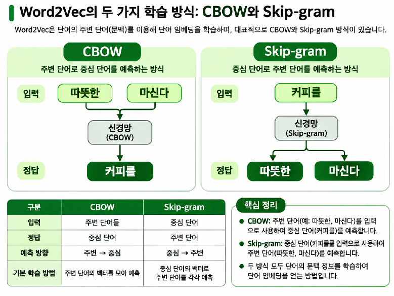
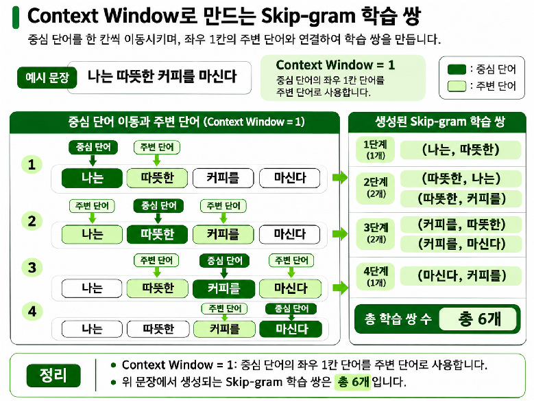
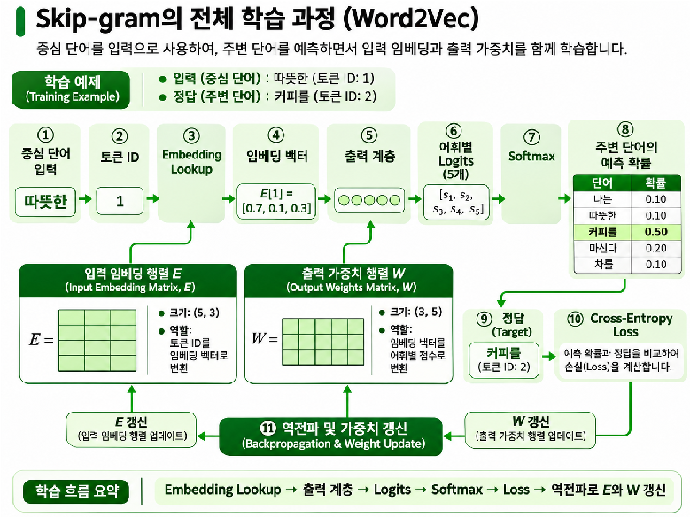
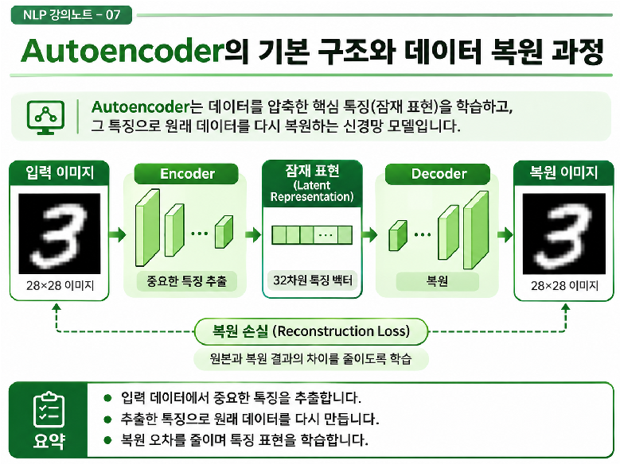

# Day 2. Word2Vec의 학습 원리

> Word2Vec은 중심 단어와 주변 단어의 관계를 예측하는 과정에서 임베딩을 학습한다. CBOW와 Skip-gram은 같은 문장에서 서로 다른 입력과 정답을 만든다.

## 1. 단어가 등장한 문맥에서 관계 학습하기

**Word2Vec** 은 단어와 그 주변의 관계를 이용해 단어 임베딩(Word Embedding)을 학습하는 신경망 기반 방법이다.  
‘따뜻한 커피를 마신다’와 ‘따뜻한 차를 마신다’에서는 ‘커피를’과 ‘차를’이 모두 ‘따뜻한’, ‘마신다’와 함께 등장한다. 두 단어에 유사하다는 라벨을 붙이지 않아도, 비슷한 문맥을 거듭 예측하는 과정에서 두 벡터가 비슷해질 수 있다.

신경망 언어모델은 앞 문맥에 이어질 단어의 확률을 추정하는 데 목적이 있다.  
Word2Vec은 중심과 주변의 관계를 예측하며 학습하고, 학습 과정에서 얻은 단어 벡터를 유사어 검색이나 다른 모델의 입력에 활용한다.

## 2. CBOW와 Skip-gram에서 입력과 정답

**연속 단어 가방(Continuous Bag of Words, CBOW)** 은 주변 단어들을 입력받아 가운데 빠진 단어를 예측한다.  
‘나는 따뜻한 커피를 마신다’에서 ‘커피를’을 중심으로 좌우 한 칸을 쓰면 ‘따뜻한’과 ‘마신다’가 입력이다. 두 벡터 `[0.7, 0.1, 0.3]`, `[0.5, 0.2, 0.8]`의 같은 위치를 평균하면 문맥 벡터 `[0.6, 0.15, 0.55]`를 얻는다. 기본 CBOW는 주변 벡터의 합이나 평균을 사용하므로 좌우 순서를 바꿔도 같은 문맥 벡터가 나온다.

**스킵그램(Skip-gram)** 은 중심 단어 하나를 입력받아 바로 주변에 등장한 단어를 예측한다.  
같은 예제에서 중심 ‘커피를’로부터 `(커피를, 따뜻한)`, `(커피를, 마신다)`라는 두 개의 별도 학습 쌍을 만든다. 각 쌍에는 입력 단어 하나와 정답 단어 하나가 들어간다.

## 3. 문맥 범위로 학습 쌍 만들기

**문맥 범위(Context Window)** 는 중심 단어에서 좌우로 몇 칸 떨어진 위치까지 주변 단어로 사용할지 정한다.  
‘따뜻한’을 중심으로 범위가 1이면 ‘나는’과 ‘커피를’을 사용한다. 범위를 2로 넓히면 오른쪽 두 번째인 ‘마신다’도 포함된다. 왼쪽 두 번째는 문장 밖이므로 포함할 단어가 없다.

범위가 1일 때 네 토큰을 차례로 중심으로 삼으면 양끝에서 1쌍씩, 가운데 두 위치에서 2쌍씩 만들어져 총 6쌍이 된다.  
정답이 문장 속 위치 관계로부터 정해지므로 사람이 따로 분류 라벨을 작성할 필요가 없다.

## 4. Skip-gram의 순전파와 역전파

중심 단어 ‘따뜻한’의 ID가 1, 정답인 주변 단어 ‘커피를’의 ID가 2라고 하자.  
어휘집 크기가 5이고 임베딩 차원이 3이면 입력 임베딩 행렬 $E$는 `(5, 3)`이다. 첫 단계의 **임베딩 조회(Embedding Lookup)** 로 ID 1에 해당하는 `[0.7, 0.1, 0.3]`을 가져온다.

**출력 가중치 행렬(Output Weight Matrix)** $W$의 크기는 `(3, 5)`다.  
중심 단어 벡터를 한 행으로 두고 $W$를 곱하면 `(1, 3) × (3, 5) → (1, 5)`로 어휘별 로짓(Logits) 5개가 나온다. 교안의 기본 구조에서는 전체 어휘에 소프트맥스(Softmax)를 적용해 확률을 만든다.

교차 엔트로피 손실(Cross-Entropy Loss)은 정답 ID 2에 얼마나 높은 확률을 부여했는지 반영한다.  
역전파(Backpropagation)는 손실에서 두 행렬의 기울기를 계산하고, 옵티마이저(Optimizer)는 이를 사용해 가중치를 갱신한다. 여러 쌍을 반복해서 처리하면 각 단어를 예측하는 데 필요한 벡터 표현이 학습된다.

[추가 설명] 이 예처럼 정답이 하나라면 교차 엔트로피 손실은 $-\ln p$이고, $p$는 정답에 준 확률이다. ‘커피를’의 확률을 0.50으로 예측하면 손실은 약 0.693이다. 확률이 0.10이라면 손실은 약 2.303으로 커진다.

학습이 끝나면 이 구조의 입력 행렬 $E$에서 단어 벡터를 직접 조회할 수 있다.  
그 벡터로 유사한 단어를 찾거나, 여러 단어의 벡터를 평균해 문장을 표현하거나, 순환 신경망(Recurrent Neural Network, RNN)의 입력으로 사용할 수 있다. Word2Vec의 벡터는 한 토큰에 고정된 표현을 쓰는 **정적 임베딩(Static Embedding)** 이다.

## 5. 표현 학습과 오토인코더

**표현 학습(Representation Learning)** 은 모델이 데이터에서 작업에 필요한 특징을 벡터로 학습하는 것이다.  
Word2Vec은 단어 예측으로 특징을 얻는다. **오토인코더(Autoencoder)** 는 입력을 인코더(Encoder)로 압축해 잠재 표현(Latent Representation)을 만들고, 디코더(Decoder)가 그 표현에서 입력을 복원하도록 학습한다.

손글씨 이미지를 압축한 예에서는 복원 이미지와 원본의 차이인 **복원 손실(Reconstruction Loss)** 을 줄인다. Word2Vec과는 맞혀야 할 정답이 다르지만, 두 방법 모두 학습한 표현을 다른 작업에 사용할 수 있다.

## 6. 핵심 개념 비교

| 개념 | 입력 | 학습 목표 | 주로 얻는 결과 |
| --- | --- | --- | --- |
| 신경망 언어모델 | 앞 문맥 | 다음 단어 예측 | 다음 단어의 확률을 계산하는 모델 |
| Word2Vec의 CBOW | 주변 단어들의 벡터 합 또는 평균 | 중심 단어 예측 | 학습된 단어 임베딩 |
| Word2Vec의 Skip-gram | 중심 단어의 벡터 | 주변 단어를 개별 예측 | 학습된 단어 임베딩 |
| 오토인코더 | 이미지 등 원본 데이터 | 입력 복원 | 입력을 담은 잠재 표현 |

## 7. 핵심 정리

- Word2Vec은 주변 문맥을 예측하는 과정에서 단어 벡터를 학습한다.
- CBOW는 주변 단어들로 중심 단어를, Skip-gram은 중심 단어로 주변 단어를 예측한다.
- 문맥 범위가 커질수록 더 먼 위치의 단어까지 학습에 포함할 수 있다.
- 중심과 주변 단어의 위치를 이용해 학습 쌍을 구성하므로 별도의 수작업 라벨이 필요 없다.
- 역전파가 입력 임베딩 행렬과 출력 가중치의 기울기를 계산한다.
- 학습된 벡터는 단어 유사도, 문장 벡터, 다른 신경망 입력에 사용할 수 있다.
- 오토인코더는 입력의 복원을 목표로 잠재 표현을 학습한다.

[학습 목차로 이동](README.md) | [다음: 단어 임베딩과 벡터 유사도](08-단어-임베딩과-벡터-유사도.md)
