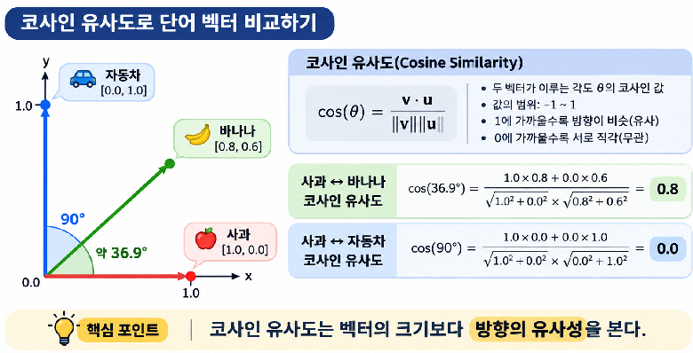
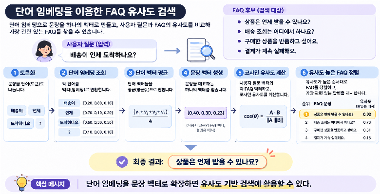
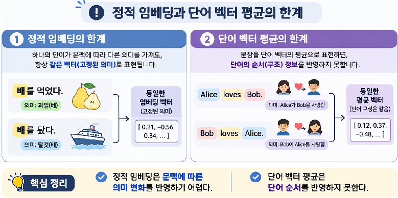

# Day 2. 단어 임베딩과 벡터 유사도

> 코사인 유사도로 단어와 문장의 벡터를 비교한다. 고정된 단어 벡터와 단순 평균이 각각 어떤 정보를 놓치는지도 구분한다.

## 1. 벡터의 내적과 크기

**내적(Dot Product)** 은 같은 위치의 값끼리 곱한 뒤 모두 더하는 연산이다.  
`[1, 0]`과 `[0.8, 0.6]`의 내적은 $1\times0.8+0\times0.6=0.8$이다. 벡터의 방향이 그대로인 경우에도 길이가 커지면 내적이 변한다. 예를 들어 `[1, 0]`과 `[2, 0]`의 내적은 2이고, 두 번째 벡터를 `[3, 0]`으로 늘리면 3이다.

**벡터의 크기(Norm)** 는 원점부터 벡터 끝까지의 길이다.  
여기서는 각 성분을 제곱해 더한 뒤 제곱근을 구하는 유클리드 노름(Euclidean Norm)을 사용한다. `[3, 4]`의 크기는 $\sqrt{3^2+4^2}=5$다.

## 2. 코사인 유사도로 방향 비교하기

**코사인 유사도(Cosine Similarity)** 는 내적을 두 벡터 크기의 곱으로 나눠 방향이 얼마나 비슷한지 계산한다.  
식에서 $A\cdot B$는 두 벡터의 내적이고 $\lVert A\rVert$, $\lVert B\rVert$는 각 벡터의 크기다. 방향이 같은 두 벡터는 길이가 달라도 1이고, 직각이면 0, 정반대 방향이면 -1이다. 영벡터가 포함되면 분모가 0이라 이 식으로는 유사도를 정할 수 없다.

$$
\mathrm{cosine}(A,B)=\frac{A\cdot B}{\lVert A\rVert\thinspace\lVert B\rVert}
$$

사과 벡터를 `[1.0, 0.0]`, 바나나를 `[0.8, 0.6]`, 자동차를 `[0.0, 1.0]`이라 하자.  
바나나 벡터의 크기는 $\sqrt{0.8^2+0.6^2}=1$이고 다른 두 벡터의 크기도 1이다. 따라서 사과와 바나나는 $0.8/(1\times1)=0.8$, 사과와 자동차는 $0/(1\times1)=0$이다. 이 예시의 벡터 공간에서는 바나나가 자동차보다 사과에 더 가까운 방향을 가리킨다.

## 3. 유사한 단어와 문장 검색

비슷한 단어를 찾으려면 기준 단어의 벡터를 조회하고 다른 단어들과의 코사인 유사도를 계산한다.  
다른 단어를 점수순으로 정렬하면, ‘커피’를 검색했을 때 비슷한 문맥에서 사용된 ‘차’가 위에 나타날 수 있다. 결과는 단어의 사용 패턴을 학습한 임베딩에 따라 달라진다.

### 단어 벡터를 평균해 문장 벡터 만들기

‘따뜻한 커피를 마신다’를 하나의 벡터로 만들려면 단어 벡터의 각 차원을 따로 평균할 수 있다.

| 차원 | 계산 | 결과 |
| --- | --- | ---: |
| 첫 번째 | `(0.7 + 0.3 + 0.5) / 3` | 0.5 |
| 두 번째 | `(0.1 + 0.9 + 0.2) / 3` | 0.4 |
| 세 번째 | `(0.3 + 0.2 + 0.8) / 3` | 약 0.433 |

세 토큰이 각각 3차원이므로 평균 문장 벡터는 `[0.5, 0.4, 0.433]`에 가깝다.  
임베딩이 128차원이면 3단어인 문장과 10단어인 문장을 각각 평균해도 두 결과는 모두 128차원이다.

### FAQ 검색

‘배송이 언제 도착하나요?’와 각 FAQ를 같은 방식으로 토큰화하고, 각 문장의 평균 벡터를 구한다.  
질문 벡터와 FAQ 벡터의 코사인 유사도를 계산한 뒤 높은 순서대로 정렬한다. ‘상품은 언제 받을 수 있나요?’처럼 다른 말로 같은 내용을 묻는 문장도 후보가 될 수 있다. 실제 순위는 사용한 임베딩과 문장 처리 방식에 따라 달라진다.

## 4. 고정 벡터와 단순 평균의 한계

**정적 임베딩(Static Embedding)** 은 같은 토큰이 나타날 때마다 같은 기본 벡터를 사용한다.  
‘배를 먹었다’의 ‘배’는 과일이고 ‘배를 탔다’의 ‘배’는 이동 수단이지만, 정적 임베딩에서 두 입력이 같은 토큰이면 조회한 벡터가 같다.

**단순 평균의 한계는 순서를 잃는다는 점이다.**  
`Alice loves Bob`과 `Bob loves Alice`는 누가 누구를 좋아하는지가 다르다. 같은 세 단어의 고정 벡터를 더해 3으로 나누면 두 문장은 동일한 벡터가 된다. 벡터 자체가 문맥에 따라 달라지지 않는 문제와, 여러 벡터를 평균할 때 순서가 지워지는 문제를 구분해야 한다.

순환 신경망(RNN)과 장단기 기억 신경망(LSTM)은 순서대로 입력을 처리하며 앞선 정보를 전달한다.  
Transformer와 BERT는 다른 토큰과의 관계를 계산해 주변 문맥에 따라 달라지는 토큰 표현을 만들 수 있다.

## 5. GloVe와 fastText

**GloVe(Global Vectors for Word Representation)** 는 말뭉치 전체에서 단어가 얼마나 자주 함께 나오는지를 이용한다.  
정해진 문맥 범위 안에서 두 단어가 함께 나온 횟수를 **공동 등장 행렬(Co-occurrence Matrix)** 에 모으고, 그 통계적 관계를 반영하도록 단어 벡터를 학습한다.

**fastText** 는 단어 내부의 연속된 문자 조각(Character n-gram)을 이용한다.  
‘공부하다’를 두 음절씩 묶으면 ‘공부’, ‘부하’, ‘하다’ 같은 조각이 나온다. 실제 방식에서는 여러 길이와 단어 경계도 고려한다. 어휘집에 없는 단어라도 학습된 문자 조각의 정보를 이용해 단어 벡터를 구성할 수 있다.

fastText와 서브워드 토큰화(Subword Tokenization)는 단어 내부의 조각을 활용하는 목적이 다르다. fastText는 조각의 벡터로 단어 하나의 벡터를 구성한다. 서브워드 토크나이저는 원문을 작은 단위의 토큰들로 나눠 모델에 전달할 ID를 만든다.

## 6. 핵심 개념 비교

| 개념 | 사용하는 정보 | 결과 또는 용도 |
| --- | --- | --- |
| 벡터 내적 | 방향과 크기 | 두 벡터 간 곱셈과 합의 결과 |
| 코사인 유사도 | 두 벡터의 방향 | 크기의 영향을 제거한 비교 점수 |
| Word2Vec | 중심 단어와 주변 단어의 예측 | 문맥 관계를 반영한 단어 벡터 |
| GloVe | 말뭉치 전체의 공동 등장 통계 | 공동 등장 관계를 반영한 단어 벡터 |
| fastText | 단어 내부의 문자 조각 정보 | 조각으로 구성한 단어 벡터 |
| 서브워드 토큰화 | 학습된 분할 규칙이나 토큰 어휘집 | 입력을 나눈 토큰과 ID |

## 7. 핵심 정리

- 코사인 유사도는 내적을 두 벡터의 크기로 나눠 방향이 얼마나 유사한지 나타낸다.
- 학습한 벡터를 비교하고 점수순으로 정렬하면 유사한 단어나 FAQ를 찾을 수 있다.
- 단어 벡터를 평균하면 문장 길이와 관계없이 임베딩과 같은 차원의 벡터를 얻는다.
- 정적 임베딩은 같은 토큰에 같은 벡터를 부여하므로 토큰만으로 다의어의 뜻을 가르기 어렵다.
- 단어 벡터의 단순 평균은 순서를 보존하지 않아 문장 속 역할의 차이를 구분하지 못한다.
- GloVe는 공동 등장 통계를 학습하고, fastText는 문자 조각을 활용해 단어 벡터를 구성한다.

[학습 목차로 이동](README.md) | [다음: 서브워드 토큰화와 가변 길이 입력](09-서브워드-토큰화와-가변-길이-입력.md)
