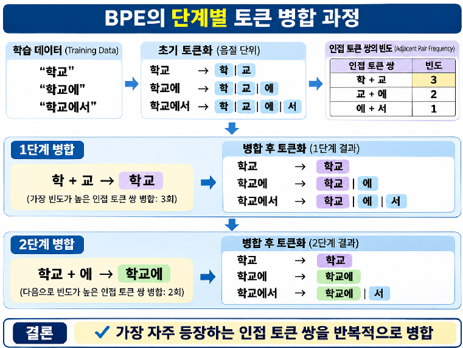
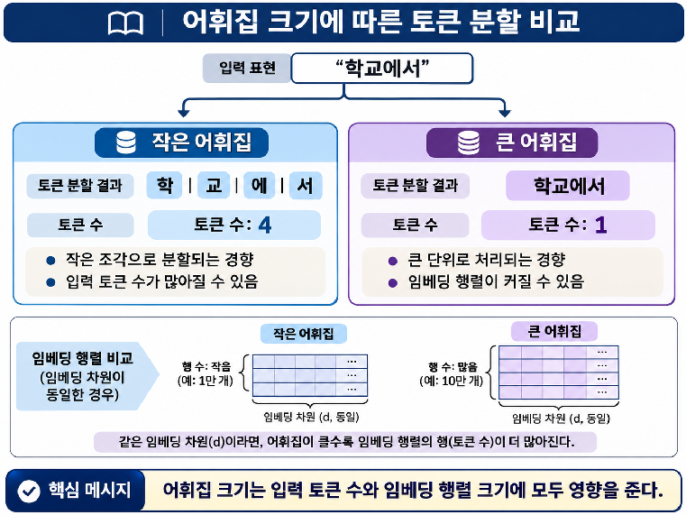
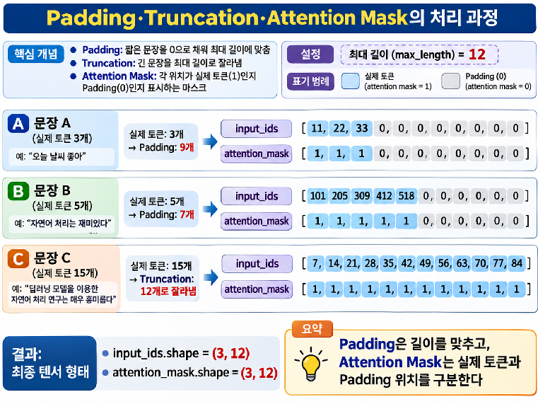
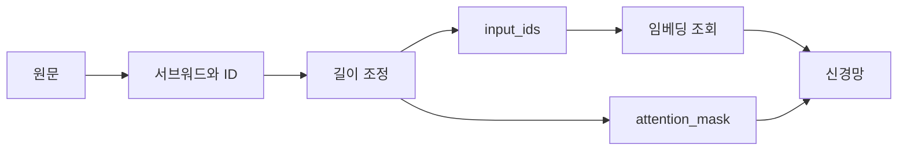

# Day 2. 서브워드 토큰화와 가변 길이 입력

> 서브워드 토크나이저는 어휘집에 없는 단어를 이미 아는 조각으로 표현할 수 있다. 길이가 다른 토큰열을 배치로 묶을 때는 토큰 ID와 어텐션 마스크를 함께 준비한다.

## 1. 단어 전체를 등록하기 어려운 이유

한국어는 조사와 어미가 결합해 ‘공부하다’, ‘공부하는’, ‘공부했습니다’처럼 형태가 달라진다.  
단어 전체에 ID를 부여하면 각 형태를 따로 등록해야 한다. **미등록 단어(Out-of-Vocabulary, OOV)** 를 모두 `[UNK]`로 바꾸면 ‘공부했습니다’와 ‘공부하겠습니다’가 같은 ID로 처리돼 원래의 차이를 잃는다.

**서브워드 토큰화(Subword Tokenization)** 는 자주 등장하는 표현은 큰 조각으로, 드문 표현은 어휘집에 있는 작은 조각으로 나눌 수 있게 한다.  
예를 들어 ‘공부했습니다’를 `[공부, 했, 습니다]`로 표현할 수 있다. 실제 분할은 학습된 토크나이저에 따라 달라진다. 토크나이저는 이 조각마다 ID를 부여하며, fastText는 문자 조각 정보를 이용해 단어의 벡터를 구성한다.

## 2. BPE로 서브워드 학습하기

**바이트 페어 인코딩(Byte Pair Encoding, BPE)** 은 인접한 토큰 쌍의 빈도를 세고 가장 자주 나온 쌍을 병합하는 과정을 반복한다.  
예시에서는 ‘학교’, ‘학교에’, ‘학교에서’를 각각 한글 음절로 나눈다. 실제 토크나이저의 초기 단위는 구현에 따라 다르고, 목표 어휘집 크기나 병합 횟수에 도달하면 학습을 멈춘다.

처음에는 ‘학 + 교’가 3번, ‘교 + 에’가 2번, ‘에 + 서’가 1번 나온다.  
‘학 + 교’를 ‘학교’로 합친 뒤 빈도를 다시 세면 ‘학교 + 에’가 2번으로 가장 많다. 두 번째로 이 쌍을 병합하면 ‘학교에서’는 `[학교에, 서]`로 남는다. 반복할 때는 첫 단계의 빈도를 계속 사용하는 것이 아니라, 바뀐 토큰열에서 인접 쌍을 다시 센다.

새 입력을 처리할 때는 배운 병합 규칙과 어휘집을 적용한다.  
예를 들어 새 문장에 나온 ‘학교에’를 먼저 `[학, 교, 에]`로 나눈 뒤 `[학교, 에]`, `[학교에]` 순서로 병합하고 해당 ID로 변환한다.

## 3. WordPiece와 SentencePiece

**워드피스(WordPiece)** 는 토큰 조합의 유용성을 평가하는 점수를 기준으로 서브워드 어휘집을 학습한다.  
대표적으로 BERT에서 사용하며, 학습된 어휘집에 따라 `playing`을 `[play, ##ing]`으로 나눌 수 있다. `##`는 단어 중간에서 앞 조각과 이어지는 토큰이라는 뜻이다.

**센텐스피스(SentencePiece)** 는 BPE나 유니그램(Unigram) 방식의 토크나이저를 학습하고 적용하는 도구다.  
공백으로 단어를 미리 분리하지 않은 원문을 다룰 수 있으며, `▁`를 사용해 공백 경계를 표현한다. 예를 들어 ‘나는 학교에서 공부한다’가 `[▁나는, ▁학교, 에서, ▁공부, 한다]`로 나뉠 수 있다.

### 어휘집 크기와 입력 길이

같은 표현도 어휘집에 작은 조각만 있으면 더 많은 토큰으로 나뉠 수 있다.  
예를 들어 ‘학교에서’가 작은 어휘집에서는 `[학, 교, 에, 서]` 네 토큰, 큰 어휘집에서는 한 토큰으로 표현될 수 있다. 임베딩 차원이 같을 때 큰 어휘집은 입력을 짧게 표현할 여지가 있지만, 저장해야 하는 토큰 벡터의 행 수가 늘어난다.

## 4. 배치에 맞는 길이로 처리하기

여러 입력을 한 번에 처리하는 단위를 **배치(Batch)** 라고 한다.  
문장마다 토큰 수가 다르므로 하나의 직사각형 텐서(Tensor)로 묶을 때는 길이를 맞춘다. 패딩(Padding)은 짧은 문장에 특수 토큰을 채우고, 잘림 처리(Truncation)는 최대 길이를 넘는 토큰을 제거한다.

| 문장 | 원래 토큰 수 | 최대 길이 12 적용 | 최종 길이 |
| --- | ---: | --- | ---: |
| A | 3 | 패딩 9개 추가 | 12 |
| B | 5 | 패딩 7개 추가 | 12 |
| C | 15 | 뒤쪽 3개 제거 | 12 |

교안의 Hugging Face 예제는 `padding="max_length"`로 짧은 배열을 지정한 길이까지 채우고, `truncation=True`로 긴 배열을 자르며, `max_length=12`로 이 길이를 정한다.  
잘려 나간 부분이 모델에 전달되지 않으므로 긴 입력을 처리할 때 필요한 정보가 어디에 있는지 고려한다.

## 5. 토큰 ID와 어텐션 마스크

**어텐션 마스크(Attention Mask)** 는 입력의 각 위치가 실제 토큰인지 패딩인지 알려 준다.  
교안은 패딩 ID를 0으로 가정한다. 아래 예에서 **마스크의 0은 패딩 위치라는 표시** 이며, 패딩에 어떤 토큰 ID를 배정하는지는 토크나이저 설정에 따라 다를 수 있다.

문장 A의 `input_ids`는 실제 ID 세 개 `[11, 22, 33]` 뒤에 패딩 ID 아홉 개가 붙는다. `attention_mask`는 처음 세 칸이 1, 나머지 아홉 칸이 0이다.  
세 문장을 묶으면 두 배열의 크기는 모두 `(3, 12)`다. 마스크는 패딩 위치를 어텐션 계산에서 제외할 수 있도록 모델에 별도로 전달한다.

[추가 설명] 임베딩 조회는 각 ID 자리에 길이 $D$인 벡터를 놓는다. 따라서 조회 결과의 크기는 `(3, 12, D)`가 되고, 어텐션 마스크는 위치마다 값 하나를 유지한다.

## 6. 핵심 개념 비교

| 개념 | 역할 | 결과 |
| --- | --- | --- |
| BPE | 자주 등장하는 인접 쌍을 반복 병합 | 서브워드와 병합 규칙 |
| WordPiece | 조합을 점수로 평가해 토큰 선택 | 서브워드 어휘집 |
| SentencePiece | BPE나 Unigram 방식의 학습과 적용 지원 | 원문을 처리하는 토크나이저 |
| 패딩 | 짧은 입력에 특수 토큰 추가 | 지정한 길이의 ID 배열 |
| 잘림 처리 | 최대 길이를 넘는 토큰 제거 | 길이 제한을 지킨 ID 배열 |
| 어텐션 마스크 | 실제 토큰과 패딩의 위치 구분 | ID 배열과 같은 크기의 표시값 |

## 7. 핵심 정리

- 서브워드 토큰화는 미등록 단어를 기존 어휘집의 조각으로 표현할 수 있게 한다.
- BPE는 인접 쌍의 빈도를 기준으로 병합 규칙을 학습하고 새 입력에 그 규칙을 적용한다.
- WordPiece는 조합 평가 점수를 사용하고, SentencePiece는 여러 토큰화 방식을 지원하는 도구다.
- 임베딩 차원이 같다면 더 큰 어휘집은 행렬에 저장할 벡터 수를 늘린다.
- 패딩은 짧은 입력을 채우고, 잘림 처리는 긴 입력에서 최대 길이를 초과한 토큰을 제거한다.
- 토큰 ID는 임베딩 조회에 쓰고 어텐션 마스크는 패딩 위치를 모델에 알려 준다.

[학습 목차로 이동](README.md) | [다음: 단어 임베딩에서 모델 입력까지](10-단어-임베딩에서-모델-입력까지.md)
