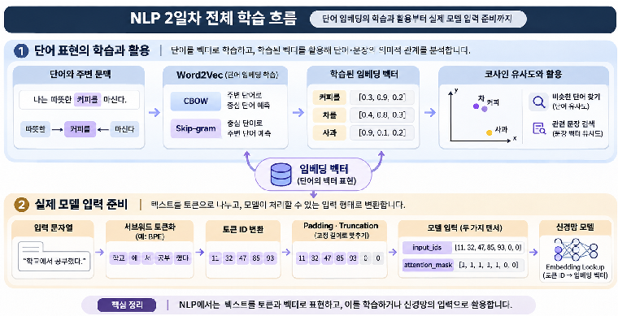

# Day 2. 단어 임베딩에서 모델 입력까지

> 단어 벡터를 학습하고 검색에 사용하는 흐름과, 토크나이저로 새 문장의 모델 입력을 만드는 흐름을 연결한다.

## 1. 토큰 번호에서 학습 가능한 벡터로

원핫 인코딩(One-hot Encoding)은 어휘집에서 토큰에 해당하는 위치만 1로 표시한다.  
**분산표현(Distributed Representation)** 은 여러 실숫값이 함께 단어의 특징을 나타낸다. 단어 임베딩(Word Embedding)은 이런 벡터를 학습해 비슷한 문맥의 단어들이 유사한 표현을 갖도록 할 수 있다.

**임베딩 행렬(Embedding Matrix)** 의 크기는 `(어휘집 크기, 임베딩 차원)`이다.  
토큰이 5개이고 각 토큰을 3차원으로 표현하면 행렬은 `(5, 3)`이다. ‘커피를’의 ID가 2라면 임베딩 조회(Embedding Lookup)로 0부터 세어 세 번째 행을 가져온다. 같은 토큰을 원핫 벡터로 만든 뒤 행렬에 곱해도 결과는 같다.

**신경망 언어모델(Neural Language Model)** 에서 ‘따뜻한 커피를’의 ID `[1, 2]`를 두 벡터로 바꾸면 조회 결과가 `(2, 3)`이다.  
교안의 모델은 이를 6차원 입력으로 이어 붙여 어휘별 로짓(Logits) 5개를 계산한다. 소프트맥스(Softmax)로 다음 단어 확률을 만들고, 학습할 때는 손실에서 역전파(Backpropagation)로 기울기를 구해 임베딩과 신경망 가중치를 조정한다.

## 2. Word2Vec으로 단어 벡터 학습하기

**Word2Vec** 은 중심 단어와 주변 단어의 관계를 예측하도록 학습한다.  
‘따뜻한 커피를 마신다’에서 ‘커피를’을 중심으로 좌우 한 칸을 사용한다면, 연속 단어 가방(Continuous Bag of Words, CBOW)은 ‘따뜻한’과 ‘마신다’의 벡터를 합치거나 평균해 중심을 예측한다. 스킵그램(Skip-gram)은 ‘커피를’을 입력으로 두 주변 단어를 별도의 학습 쌍으로 예측한다.

**문맥 범위(Context Window)** 는 중심 위치의 좌우 몇 칸을 사용할지 결정한다.  
‘나는 따뜻한 커피를 마신다’에서 범위가 1이면 네 위치가 각각 1, 2, 2, 1쌍을 만들어 총 6쌍이 된다. 정답으로 쓰는 주변 단어는 문장에 이미 있으므로 사람이 따로 라벨을 붙일 필요가 없다.

스킵그램 학습에서 조회한 3차원 벡터를 `(3, 5)` 크기의 출력 가중치에 곱하면 점수 5개가 나온다.  
교차 엔트로피 손실(Cross-Entropy Loss)을 줄이는 과정에서 입력 임베딩 행렬과 출력 가중치가 함께 갱신된다. 오토인코더(Autoencoder)는 입력 복원으로 잠재 표현(Latent Representation)을 학습한다. 두 모델은 목표는 다르지만 데이터에서 벡터 표현을 얻는 **표현 학습(Representation Learning)** 의 예다.

## 3. 학습한 벡터로 검색하기

**코사인 유사도(Cosine Similarity)** 는 두 벡터의 내적을 각 벡터의 크기의 곱으로 나눠 방향을 비교한다.  
길이가 1인 설명용 벡터 `[1, 0]`과 `[0.8, 0.6]`은 유사도가 0.8이고, `[1, 0]`과 `[0, 1]`은 서로 직각이므로 0이다.

단어 벡터를 차원별로 평균하면 문장을 벡터 하나로 표현할 수 있다.  
질문과 FAQ를 같은 방식으로 변환하고, 코사인 유사도가 높은 순서로 후보를 정렬하면 ‘배송이 언제 도착하나요?’와 표현이 다른 관련 FAQ를 찾을 수 있다.

정적 임베딩(Static Embedding)은 ‘배를 먹었다’와 ‘배를 탔다’에서 같은 토큰에 같은 벡터를 부여한다.  
그리고 문장 표현에 단순 평균을 쓰면 같은 단어라도 순서에 따라 의미가 다른 `Alice loves Bob`과 `Bob loves Alice`가 같은 벡터가 된다. GloVe는 공동 등장 통계를, fastText는 단어 내부의 문자 조각을 활용해 단어 벡터를 학습한다.

## 4. 새 문장을 신경망 입력으로 준비하기

**서브워드 토큰화(Subword Tokenization)** 는 ‘공부했습니다’처럼 어휘집에 없는 표현을 더 작은 조각의 ID로 나타낼 수 있게 한다.  
BPE(Byte Pair Encoding)는 자주 등장하는 인접 쌍을 병합한다. 예시에서 ‘학 + 교’를 먼저 합치고 ‘학교 + 에’를 합치면 ‘학교에서’는 `[학교에, 서]`가 된다. WordPiece는 조합 평가 점수를 사용하며, SentencePiece는 BPE나 Unigram 등의 토큰화 방식을 학습하고 적용하는 도구다.

어휘집이 커지면 단어를 적은 수의 조각으로 처리할 가능성이 높아지고, 임베딩 행렬에는 더 많은 행이 필요하다.  
토큰 수가 3, 5, 15인 문장을 길이 12로 맞추는 경우, 패딩(Padding)으로 앞의 두 문장을 각각 9칸과 7칸 채우고, 잘림 처리(Truncation)로 세 번째 문장에서 토큰 3개를 제거한다.

**어텐션 마스크(Attention Mask)** 의 값은 실제 토큰 위치에 1, 패딩 위치에 0을 넣는다.  
위 예에서 `input_ids`와 `attention_mask`의 크기는 모두 `(3, 12)`다. `input_ids`는 임베딩 행렬을 조회해 벡터로 바꾸고, `attention_mask`는 패딩을 구분하는 정보로 모델에 전달한다.

## 5. 핵심 개념 비교

| 개념 | 입력 | 결과 |
| --- | --- | --- |
| 토크나이저 | 텍스트 | 토큰과 정수 ID |
| 임베딩 조회 | 토큰 ID | 학습 가능한 행렬에서 조회한 벡터 |
| Word2Vec 학습 | 중심 단어와 주변 단어 | 학습된 단어 임베딩 |
| 코사인 유사도 | 단어나 문장을 나타내는 두 벡터 | 방향을 비교한 점수 |
| 패딩과 잘림 처리 | 길이가 다른 토큰열 | 배치로 묶을 수 있는 입력 |
| 어텐션 마스크 | 실제 토큰과 패딩의 위치 | 모델에 전달할 위치 구분 배열 |

## 6. 핵심 정리

- 어휘집 크기는 임베딩 행렬의 행 수를, 임베딩 차원은 토큰을 표현하는 벡터의 길이를 정한다.
- CBOW는 주변에서 중심을, Skip-gram은 중심에서 주변을 예측하면서 임베딩을 학습한다.
- 단어 벡터를 평균한 문장 벡터와 코사인 유사도를 사용해 FAQ를 검색할 수 있다.
- 정적 임베딩은 같은 토큰에 고정 벡터를 사용하며, 단순 평균은 단어 순서를 잃는다.
- 서브워드 토큰화는 새 단어를 기존 조각으로 표현하며, 어휘집 크기는 입력 토큰 수와 임베딩 행 수에 영향을 준다.
- 패딩과 잘림 처리로 입력 길이를 맞추고, 토큰 ID와 어텐션 마스크를 각 역할에 맞게 사용한다.

[학습 목차로 이동](README.md) | [다음: RNN의 구조와 순차 처리](11-RNN의-구조와-순차-처리.md) | [관련 학습: 순차 데이터와 Transformer](../deep-learning/11-순차-데이터와-Transformer/README.md)
