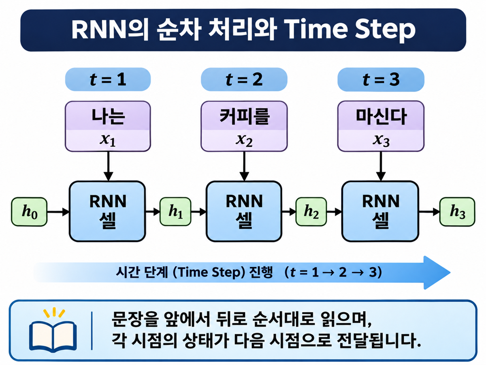
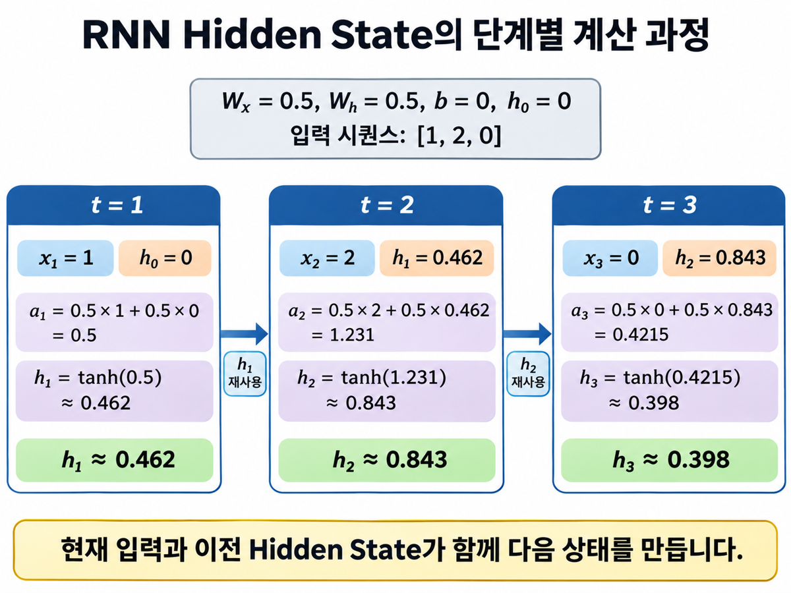
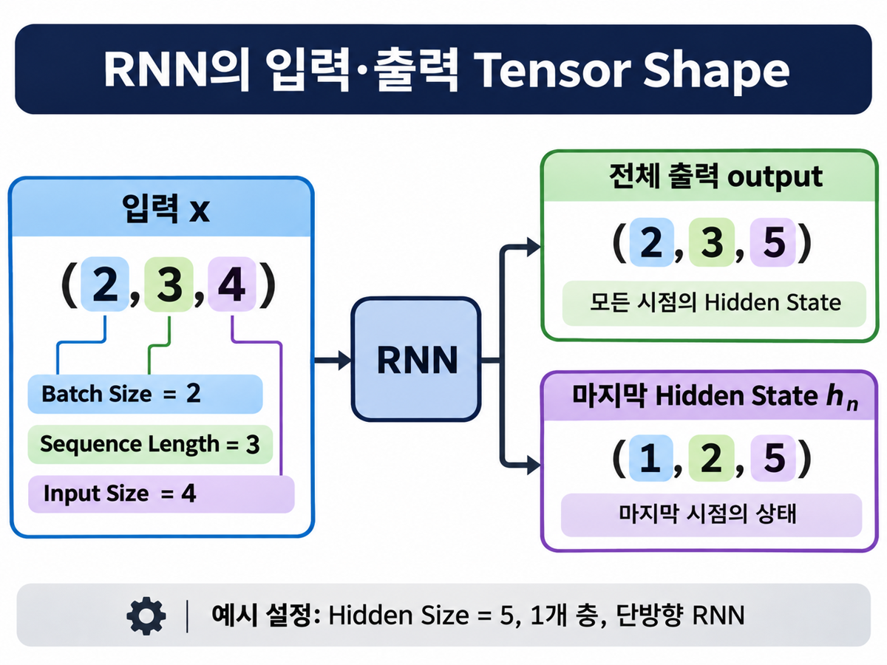

# Day 3. RNN의 구조와 순차 처리

> 순환 신경망은 매 시점에 현재 토큰과 직전 상태를 함께 읽는다. 같은 계산을 반복해도 앞에서 읽은 토큰이 다르면 현재 상태도 달라진다.

## 1. 토큰의 순서를 계산에 반영하기

두 단어 벡터를 더해 평균하면 더하는 순서를 바꿔도 결과가 같다. 반면 문장에서는 주어와 목적어의 역할이 바뀌면 같은 인물과 동작이 등장해도 뜻이 달라진다. 문장을 처리하려면 각 토큰의 특징뿐 아니라 앞뒤 관계를 보존할 방법이 필요하다.

**순차 데이터(Sequential Data)** 는 관측값의 순서에 의미가 있는 데이터다. ‘나는 커피를 마신다’를 세 토큰으로 나누면 첫 번째 시점(Time Step)에는 ‘나는’, 두 번째에는 ‘커피를’, 세 번째에는 ‘마신다’를 처리한다.  
**순환 신경망(Recurrent Neural Network, RNN)** 은 앞 시점의 계산 결과를 다음 시점으로 전달한다. 각 토큰에 독립적으로 같은 신경망을 적용하는 경우와 달리, ‘마신다’를 읽을 때 이미 ‘나는 커피를’의 영향을 받은 상태에서 계산을 시작한다.

## 2. 은닉 상태가 전달되는 과정

토큰 ID로 임베딩을 조회해 얻은 벡터를 현재 입력 $x_t$라고 한다. **은닉 상태(Hidden State)** $h_t$는 현재 입력과 이전 상태로부터 계산한 벡터다. 토큰 ID가 단어 하나를 식별한다면, 은닉 상태는 모델이 그 위치까지 처리한 정보를 담는다. 은닉 차원이 3이면 문장이 길어져도 매 시점의 상태에는 값이 3개씩 들어간다.

첫 시점에는 아직 앞 토큰이 없으므로 초기 상태 $h_0$에서 출발한다. 초기 상태가 0이면 첫 계산에는 현재 입력과 편향이 반영된다. 두 번째 시점부터는 새 토큰과 직전 시점이 만든 상태가 모두 계산에 참여한다.

$$
h_t=\tanh(W_x x_t+W_h h_{t-1}+b)
$$

$W_x$는 입력 벡터를, $W_h$는 이전 상태를 새 상태에 필요한 차원으로 변환하는 가중치다. 편향(Bias) $b$를 더한 뒤 쌍곡탄젠트(Tanh)를 적용하면 각 성분이 -1과 1 사이인 새 상태를 얻는다. 이 비선형 변환 덕분에 여러 시점의 처리가 단순한 선형 연산의 반복을 넘어선다.

## 3. 세 시점의 상태를 직접 계산하기

입력과 상태가 모두 숫자 하나인 경우를 생각한다. 입력은 순서대로 1, 2, 0이고 두 가중치는 모두 0.5, 편향과 초기 상태는 0이다.

| 시점 | 현재 입력 | 활성화 전 계산 | 다음으로 넘기는 상태 |
| --- | ---: | --- | ---: |
| 1 | 1 | 0.5 × 1 + 0.5 × 0 = 0.5 | tanh(0.5) ≈ 0.462 |
| 2 | 2 | 0.5 × 2 + 0.5 × 0.462 = 1.231 | tanh(1.231) ≈ 0.843 |
| 3 | 0 | 0.5 × 0 + 0.5 × 0.843 ≈ 0.422 | tanh(0.422) ≈ 0.398 |

세 번째 입력은 0인데 상태는 약 0.398이다. 직전 상태 0.843의 일부가 남아 있기 때문이다. **가중치 공유(Weight Sharing)** 는 각 시점이 같은 가중치와 편향을 사용하는 방식이다. 표에서 매번 0.5를 사용하지만 입력과 이전 상태가 달라지므로 결과는 매번 새로 계산된다.

실제 계산에서는 여러 성분을 동시에 다룬다. 입력이 4차원이고 상태가 5차원이면 입력 가중치의 크기는 `(5, 4)`다. 한 행이 `[1, 2, 3, 4]`, 입력이 `[1, 2, 0, 1]`이면 그 행의 계산 결과는 9다. 이렇게 얻은 값 5개에 이전 상태에서 계산한 값 5개와 편향을 더한 뒤 Tanh를 적용한다.

## 4. 모든 시점의 출력과 마지막 상태

다음 토큰 예측에서는 문장 안의 각 위치에 정답이 있으므로 **모든 시점의 상태**를 사용한다. 문장 전체를 하나의 범주로 분류할 때는 **마지막 상태**를 분류기에 전달할 수 있다. 어느 쪽이든 RNN은 앞에서부터 차례대로 상태를 계산한다.

PyTorch의 단방향 단일 계층 RNN에서 배치 크기가 2, 문장 길이가 5, 입력 차원이 16, 은닉 차원이 32라고 하자. `batch_first=True`이면 입력의 처음 두 축은 문장 번호와 시점이다.

| 텐서 | 크기 | 읽는 방법 |
| --- | --- | --- |
| 입력 임베딩 | `(2, 5, 16)` | 문장 2개에 토큰이 5개씩, 토큰마다 값 16개 |
| 전체 출력 `output` | `(2, 5, 32)` | 모든 문장의 모든 시점에 대한 32차원 상태 |
| 마지막 상태 `h_n` | `(1, 2, 32)` | 계층과 방향을 나타내는 첫 축, 배치, 은닉 차원 |

계산에는 순서가 있다. 다섯 번째 상태를 계산하려면 네 번째 상태가 준비돼야 한다. 문장이 길어질수록 앞쪽 정보가 거쳐야 하는 갱신 횟수도 늘어나므로 먼 위치의 관계를 유지하고 학습하기 어려울 수 있다.

## 5. 핵심 정리

- 토큰 임베딩은 현재 단어를, 은닉 상태는 현재 위치까지 처리한 문맥을 표현한다.
- 새 상태를 구할 때 현재 입력과 이전 상태에 서로 다른 가중치를 적용한다.
- 현재 입력이 0이어도 이전 상태의 영향으로 출력이 0이 아닐 수 있다.
- 가중치를 공유하므로 문장이 길어져도 시점마다 새 가중치를 만들 필요가 없다.
- 모든 위치에서 예측할 때는 전체 출력을, 문장 하나를 분류할 때는 마지막 상태를 사용할 수 있다.

[학습 목차로 이동](README.md) | [다음: RNN 언어모델의 학습](12-RNN-언어모델의-학습.md)
