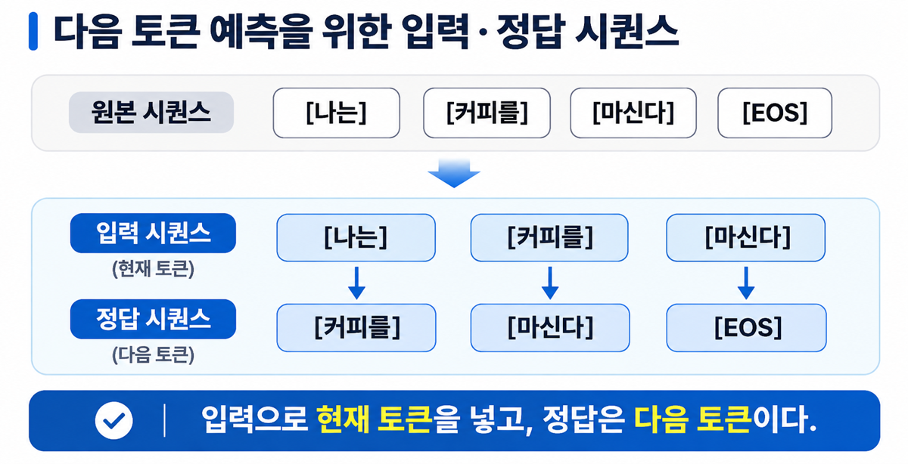
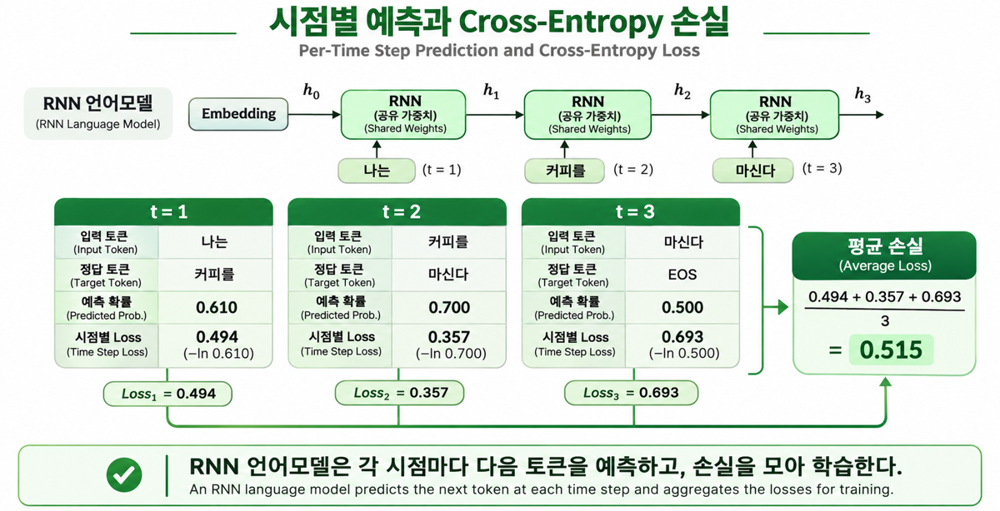
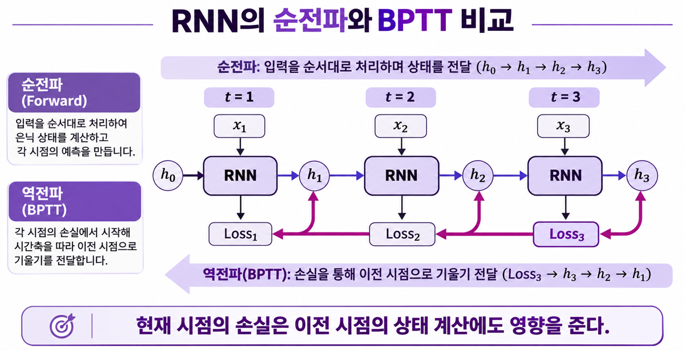

# Day 3. RNN 언어모델의 입력과 정답, 학습 원리

> RNN 언어모델은 문장을 한 칸씩 어긋난 입력과 정답으로 바꾼다. 각 시점의 은닉 상태에서 다음 토큰의 점수를 계산하고, 여러 시점의 손실을 합쳐 모델을 학습한다.

## 1. 문장에서 다음 토큰 정답 만들기

**RNN 언어모델(RNN Language Model)** 은 현재 위치까지 읽은 토큰을 이용해 바로 다음 토큰을 예측한다. 후보는 어휘집 전체이고 정답은 그중 한 토큰이므로 한 시점의 예측을 다중 클래스 분류로 볼 수 있다.

‘나는 커피를 마신다’ 뒤에 문장 끝 토큰(End of Sequence, EOS)을 붙인다. 이 토큰열에서 마지막 항목을 제외하면 입력, 첫 항목을 제외하면 정답이 된다. 이런 한 칸 이동(Shift)으로 원문에서 학습에 필요한 정답을 얻는다.

| 시점 | 모델이 지금까지 읽은 토큰 | 이번 시점의 정답 |
| --- | --- | --- |
| 1 | 나는 | 커피를 |
| 2 | 나는 커피를 | 마신다 |
| 3 | 나는 커피를 마신다 | EOS |

EOS도 하나의 예측 대상이다. 마지막 시점에서 EOS에 높은 확률을 주도록 학습하면 어떤 문맥에서 생성을 끝낼지 배울 수 있다.

## 2. 은닉 상태를 어휘별 점수로 변환하기

**선형 출력층(Linear Output Layer)** 은 은닉 상태를 어휘집 크기만큼의 점수로 변환한다. 어휘에 토큰이 4개, 은닉 차원이 5라면 출력 가중치는 `(4, 5)`다. 각 행은 한 후보 토큰에 대응하며 은닉 벡터와의 내적에 편향을 더해 점수를 만든다.

은닉 상태가 `[0.5, 0.5, 0.5, 0.5, 0.5]`이고 ‘커피를’의 가중치가 `[1, 1, 1, 1, 0]`이라고 하자. 편향이 0이면 네 성분이 0.5씩 기여해 점수는 2.0이다. 이렇게 얻은 확률 변환 전 점수를 **로짓(Logit)** 이라고 한다.

후보 네 개의 로짓이 `[0, 2, 1, 0]`일 때 **소프트맥스(Softmax)** 는 각 점수의 지수값을 전체 지수값의 합으로 나눈다. 두 번째 후보 ‘커피를’의 확률은 다음과 같다.

$$
p=\frac{e^2}{e^0+e^2+e^1+e^0}\approx0.610
$$

배치에 문장 2개, 문장당 토큰 5개가 있다면 RNN 출력은 예를 들어 `(2, 5, 32)`다. 같은 선형층을 모든 위치에 적용하면 마지막 축만 바뀌어 로짓은 `(2, 5, V)`가 된다. $V$는 어휘집 크기이며, 열에 해당하는 후보 중 어느 토큰이 정답인지는 위치마다 다르다.

## 3. 정답 확률에서 문장 손실까지

**교차 엔트로피 손실(Cross-Entropy Loss)** 은 모델이 실제 정답에 부여한 확률 $p$로부터 $-\ln p$를 계산한다. 정답이 두 번째 토큰이면 첫 시점의 손실은 $-\ln(0.610)\approx0.494$다. 가장 높은 점수를 받은 토큰이 정답이어도, 정답 확률이 달라지면 손실도 달라진다.

| 정답 토큰 | 해당 위치의 예시 손실 |
| --- | ---: |
| 커피를 | 0.494 |
| 마신다 | 0.357 |
| EOS | 0.693 |
| 세 시점의 평균 | 약 0.515 |

PyTorch의 `CrossEntropyLoss`는 로짓과 정답 클래스 ID를 입력받아 필요한 확률 계산을 내부적으로 처리한다. 예시의 정답 ID는 1이고 입력은 네 후보의 원래 로짓이다. 그 앞에서 소프트맥스를 다시 적용하면 손실 함수에 전달하는 수치의 의미가 달라진다.

## 4. 시간축을 따라 기울기 전달하기

**시간 역전파(Backpropagation Through Time, BPTT)** 는 순환 신경망을 시점별로 펼쳐 놓고 역전파하는 방법이다. 마지막 예측은 마지막 입력뿐 아니라 앞선 상태를 이용하므로, 마지막 손실의 기울기도 그 상태를 만든 앞 시점의 계산으로 전달된다.

각 시점은 같은 순환 가중치를 사용한다. 따라서 해당 가중치가 각 시점에서 손실에 미친 영향이 하나의 기울기에 누적된다. 옵티마이저(Optimizer)는 이 기울기를 이용해 임베딩, RNN, 출력층의 학습 가능한 가중치를 갱신한다.

오래전 상태까지 거슬러 갈수록 순환 가중치와 활성화 함수의 미분값이 여러 번 곱해진다. 각 단계의 효과를 0.5라고 단순화하면 다섯 번 뒤에는 0.03125가 된다. 반대로 2가 다섯 번 곱해지면 32가 된다. 전자는 먼 시점의 영향이 약해지는 **기울기 소실(Vanishing Gradient)** 을, 후자는 갱신을 불안정하게 만드는 **기울기 폭발(Exploding Gradient)** 을 설명하는 예다.

## 5. 핵심 개념 비교

| 개념 | 역할 |
| --- | --- |
| 소프트맥스 | 후보별 로짓을 합이 1인 확률 분포로 변환 |
| 교차 엔트로피 | 정답 확률을 기준으로 예측 오류를 수치화 |
| BPTT | 시점 간 상태 연결을 따라 공유 가중치의 기울기를 계산 |
| 기울기 클리핑(Gradient Clipping) | 지나치게 큰 기울기의 크기를 제한해 폭발을 완화 |
| LSTM과 GRU | 게이트로 정보 전달을 조절해 긴 의존 관계의 학습을 지원 |

## 6. 핵심 정리

- 입력과 정답을 한 칸 어긋나게 배치하면 모든 시점에서 다음 토큰을 예측할 수 있다.
- 선형층은 은닉 차원을 어휘집 차원으로 바꾸며, 같은 가중치를 각 시점에 적용한다.
- 교차 엔트로피는 정답에 낮은 확률을 줄수록 커진다.
- 여러 시점의 손실을 모으면 같은 순환 가중치에 대한 각 시점의 기여가 함께 반영된다.
- BPTT는 기울기를 계산하고 옵티마이저는 계산된 기울기로 가중치를 갱신한다.
- 긴 시간축에서 반복되는 곱셈은 기울기 소실이나 폭발로 이어질 수 있다.

[학습 목차로 이동](README.md) | [다음: LSTM과 GRU의 작동 원리](13-LSTM과-GRU의-작동-원리.md)
