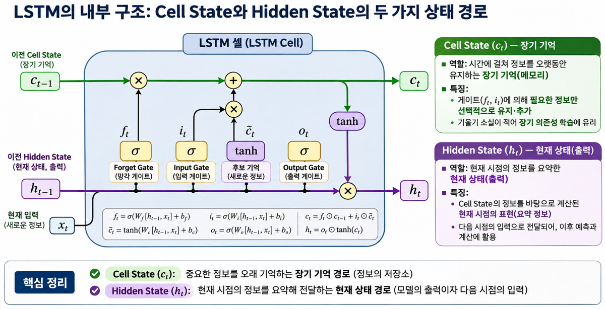
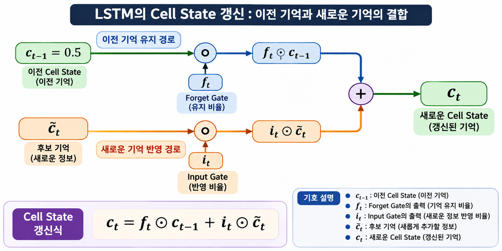
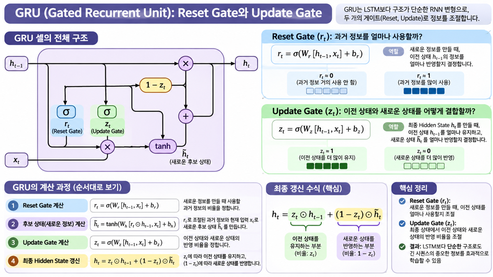

# Day 3. LSTM과 GRU의 내부 구조와 작동 원리

> LSTM과 GRU는 과거 상태를 얼마나 유지하고 새 정보를 얼마나 반영할지 학습한다. 두 구조의 차이는 어떤 상태를 다음 시점으로 넘기고, 그 상태를 어떤 게이트로 갱신하는지에 있다.

## 1. 오래된 정보를 유지하는 경로

문장 앞부분의 정보가 뒤쪽 토큰의 해석이나 예측에 필요한 관계를 **장기 의존성(Long-Term Dependency)** 이라고 한다. 기본 RNN은 매 시점에 이전 상태와 새 입력을 섞어 새 상태를 만든다. 오래된 정보가 여러 번 변환되는 동안 약해질 수 있고, 뒤쪽 손실에서 앞쪽 가중치까지 전달되는 기울기도 작아질 수 있다.

**장단기 기억 신경망(Long Short-Term Memory, LSTM)** 은 두 종류의 상태를 전달한다. 셀 상태(Cell State) $c_t$는 기억을 저장하고 갱신하는 경로다. 은닉 상태(Hidden State) $h_t$는 현재 셀 상태에서 출력에 사용할 부분을 꺼낸 값으로, 다음 시점의 게이트 계산에도 쓰인다.

**게이트(Gate)** 는 현재 입력과 이전 은닉 상태에 가중치와 편향을 적용하고, 시그모이드(Sigmoid)로 성분별 제어값을 만든다. 1에 가까우면 많이 통과시키고 0에 가까우면 적게 통과시킨다. 게이트와 상태를 결합하는 $\odot$는 같은 위치끼리 곱하는 **원소별 곱(Element-wise Product)** 이다. 상태 전체에 똑같은 비율을 적용할 필요가 없다.

## 2. LSTM의 기억 유지, 추가, 출력

현재 입력과 이전 은닉 상태를 이어 붙인 벡터를 $u_t$라 두면 망각 게이트(Forget Gate)는 $f_t=\sigma(W_f u_t+b_f)$로 계산한다. 입력 게이트(Input Gate) $i_t$와 출력 게이트(Output Gate) $o_t$도 각각 자기 가중치와 편향을 사용한다. 후보 기억 $g_t$는 Tanh를 적용해 양수와 음수를 모두 표현한다.

| 계산 | 역할 | 값이 큰 경우의 의미 |
| --- | --- | --- |
| 망각 게이트 $f_t$ | 이전 셀 상태를 유지할 비율 | 해당 기억을 많이 유지 |
| 입력 게이트 $i_t$ | 후보 기억을 기록할 비율 | 해당 후보값을 많이 반영 |
| 출력 게이트 $o_t$ | 현재 기억을 은닉 상태로 꺼낼 비율 | 해당 성분을 출력에 많이 반영 |

$$
c_t=f_t\odot c_{t-1}+i_t\odot g_t
$$

이 식의 첫 항은 남기는 기억, 둘째 항은 추가하는 기억이다. 두 비율은 별도 게이트가 결정한다. 따라서 이전 기억을 많이 유지하면서 새로운 정보도 더할 수 있다.

| 단계 | 벡터 계산 | 결과 |
| --- | --- | --- |
| 이전 기억 유지 | `[0.9, 0.2, 0.5]`와 `[0.8, -0.4, 0.6]`을 성분별로 곱함 | `[0.72, -0.08, 0.30]` |
| 후보 기억 기록 | `[0.8, 0.1, 0.6]`과 `[0.5, -0.7, 0.4]`를 성분별로 곱함 | `[0.40, -0.07, 0.24]` |
| 셀 상태 갱신 | 위 두 결과를 더함 | `[1.12, -0.15, 0.54]` |

은닉 상태는 $h_t=o_t\odot\tanh(c_t)$다. 새 셀 상태에 Tanh를 적용하면 약 `[0.808, -0.149, 0.493]`이다. 출력 게이트가 `[0.5, 0.8, 0.2]`이면 현재 은닉 상태는 약 `[0.404, -0.119, 0.099]`가 된다. 출력 게이트가 작아서 적게 드러난 성분도 셀 상태에는 남아 있을 수 있다.

### 한 시점의 계산을 숫자 하나로 따라가기

게이트의 출력값 자체도 학습된 가중치에서 나온다. 스칼라 예제에서 활성화 전 값이 각각 0.8, 0, 0.5이면 망각 게이트는 약 0.690, 입력 게이트는 0.500, 후보 기억은 약 0.462다. 앞의 두 값에는 시그모이드, 후보값에는 Tanh를 적용한 결과다.

이전 기억이 0.5이면 새 기억은 $0.690\times0.5+0.500\times0.462\approx0.576$이다. 출력 게이트가 0.622라면 은닉 상태는 $0.622\times\tanh(0.576)\approx0.324$다. 셀 상태에 이전 기억을 더해 전달하는 경로가 있고 망각 게이트가 1에 가까울수록 기억과 기울기를 길게 유지하기가 쉬워진다.

## 3. GRU의 후보 계산과 상태 갱신

**게이트 순환 유닛(Gated Recurrent Unit, GRU)** 은 하나의 은닉 상태를 전달한다. 리셋 게이트(Reset Gate) $r_t$는 후보 상태를 만들 때 과거 정보가 얼마나 들어갈지 정한다. 업데이트 게이트(Update Gate) $z_t$는 이전 은닉 상태와 후보 상태 $n_t$를 어느 비율로 섞을지 정한다.

후보 상태를 구할 때는 현재 입력의 가중합에 리셋 게이트로 조절한 이전 상태의 가중합을 더하고 Tanh를 적용한다. 예를 들어 과거 쪽 가중합이 0.6이고 리셋 게이트가 0.25이면 그 기여는 0.15다. 현재 입력 쪽 값이 0.1이면 후보값은 $\tanh(0.1+0.15)\approx0.245$가 된다.

$$
h_t=z_t\odot h_{t-1}+(1-z_t)\odot n_t
$$

이 표기에서 $z_t$는 **이전 상태의 유지 비율**이다. 이전 상태가 0.6이고 업데이트 게이트가 0.8이면 $0.8\times0.6+0.2\times0.245\approx0.529$가 된다. 리셋은 후보를 만드는 단계에, 업데이트는 완성한 후보와 이전 상태를 섞는 단계에 작용한다.

## 4. 핵심 개념 비교

| 구분 | LSTM | GRU |
| --- | --- | --- |
| 다음 시점으로 전달 | 셀 상태와 은닉 상태 | 은닉 상태 |
| 유지와 기록 | 망각 게이트와 입력 게이트가 독립적으로 결정 | 업데이트 게이트가 유지 비율과 그 나머지를 결정 |
| 현재 출력 | 셀 상태를 Tanh로 변환하고 출력 게이트 적용 | 이전 상태와 후보의 결합 결과 |
| 구조 | 세 게이트와 별도 기억 경로 | 두 게이트로 상태 갱신 |

## 5. 핵심 정리

- 게이트는 벡터의 각 성분이 얼마나 통과할지를 학습한다.
- LSTM은 기억을 담는 셀 상태와 현재 드러낼 은닉 상태를 구분한다.
- 망각 게이트가 1에 가까우면 이전 셀 상태의 해당 성분이 많이 남는다.
- 입력 게이트는 후보 기억의 기록량을, 출력 게이트는 현재 기억의 노출량을 정한다.
- GRU의 리셋 게이트는 후보 계산에서 이전 정보의 기여를 조절한다.
- GRU는 업데이트 게이트로 이전 은닉 상태와 후보 상태의 결합 비율을 정한다.

[학습 목차로 이동](README.md) | [다음: Seq2Seq의 인코더와 디코더](14-Seq2Seq의-인코더와-디코더.md)
