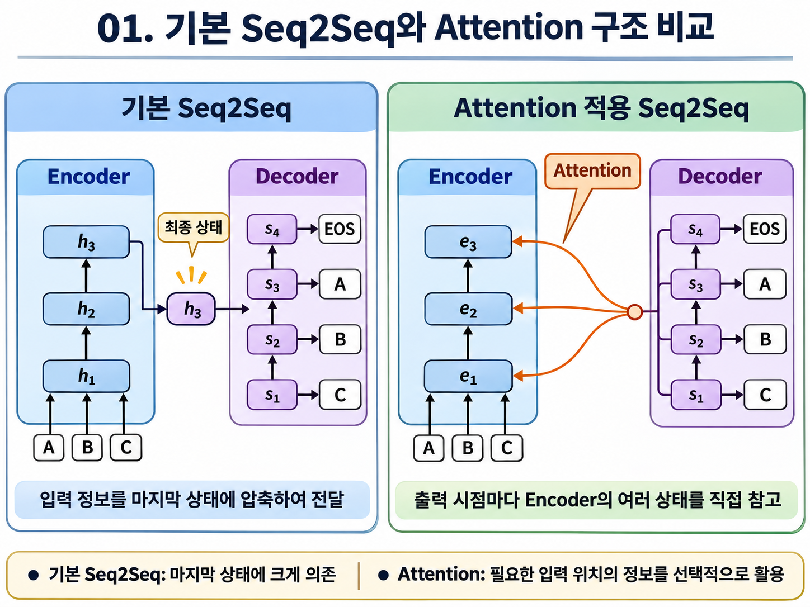
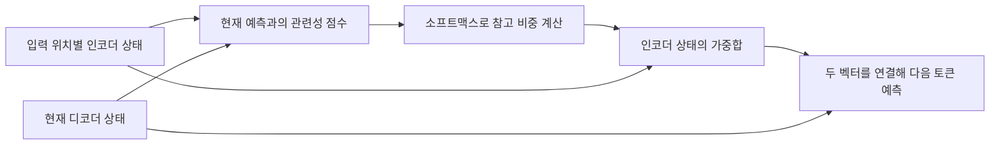
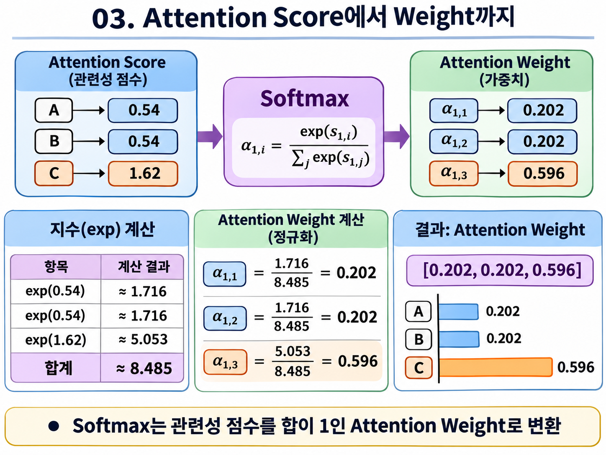
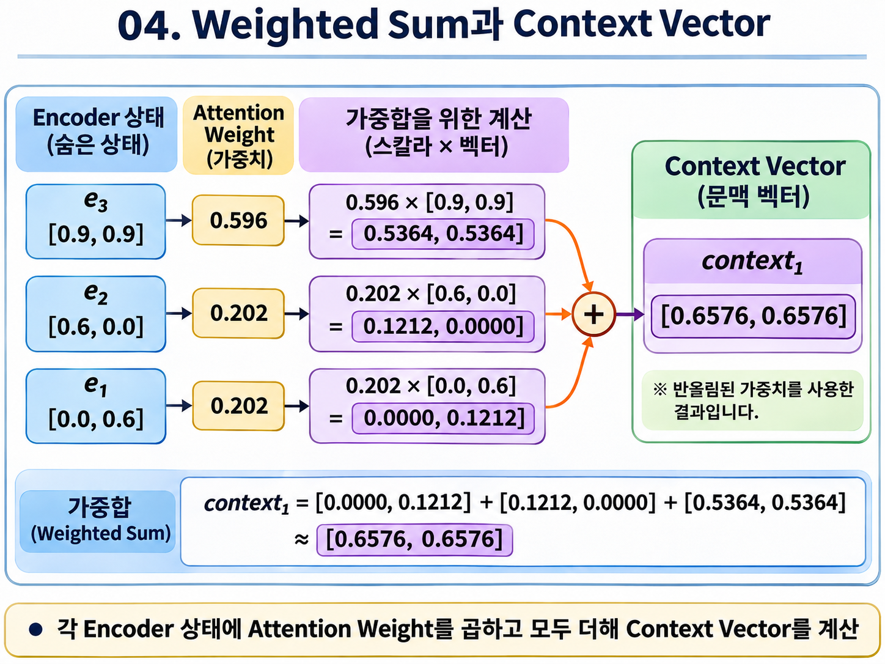
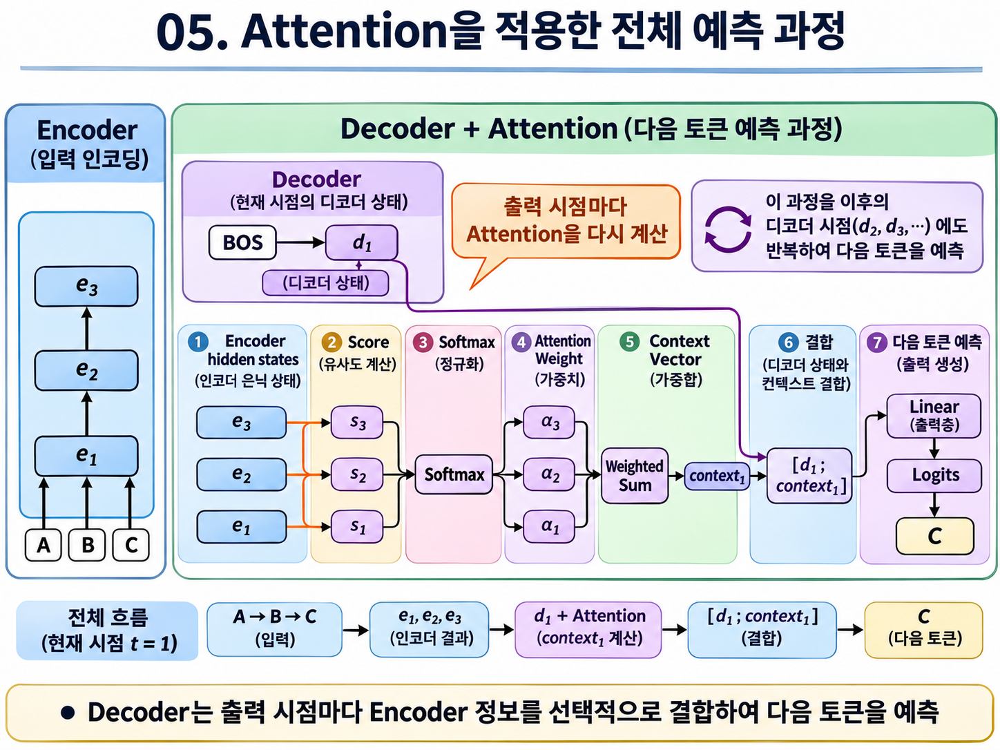

# Day 3. 어텐션의 작동 원리

> 어텐션을 적용한 Seq2Seq에서 디코더는 다음 토큰을 예측할 때 인코더의 여러 시점에서 정보를 가져온다. 입력 위치별 점수가 문맥 벡터와 토큰 예측으로 이어지는 과정을 살펴본다.

## 1. 마지막 상태에 모인 입력 정보

기본 시퀀스 변환(Sequence-to-Sequence, Seq2Seq)에서는 인코더의 마지막 은닉 상태(Hidden State)와 셀 상태(Cell State)를 디코더의 초기 상태로 넘긴다.
입력이 길어져도 두 상태의 차원은 고정되어 있으므로, 출력에 필요한 세부 정보가 최종 상태에 충분히 남지 않을 수 있다. 이를 <strong>정보 병목(Information Bottleneck)</strong>이라고 한다.

<strong>어텐션(Attention)</strong>은 디코더가 현재 예측에 필요한 단서를 인코더의 여러 은닉 상태에서 가중합으로 가져오는 방법이다.
이 강의의 LSTM 기반 예제에서도 마지막 은닉 상태와 셀 상태는 초기화에 쓰인다. 어텐션을 추가하면 디코더는 예측할 때 입력의 중간 상태도 함께 참고할 수 있다.

예제는 입력 `A → B → C`를 출력 `C → B → A`로 뒤집는 작업이다.
인코더가 A까지 처리한 상태를 $e_1$, A와 B까지 처리한 상태를 $e_2$, 전체를 처리한 상태를 $e_3$이라고 한다.
디코더는 시작 토큰(Beginning of Sequence, BOS)과 초기 상태로 첫 은닉 상태 $d_1$을 계산하고, 그 상태를 기준으로 $e_1$, $e_2$, $e_3$을 비교한다.

## 2. 관련성 점수에서 참고 비중으로

<strong>어텐션 점수(Attention Score)</strong>는 현재 디코더 상태와 각 입력 위치의 관련성을 수치로 나타낸 값이다.
예제에서는 <strong>내적(Dot Product)</strong>을 사용한다. 두 벡터의 같은 위치에 있는 값끼리 곱해서 모두 더한다.
첫 디코더 상태를 $d_1=[0.9,0.9]$로 놓으면, C 위치와의 점수는 $0.9\times0.9+0.9\times0.9=1.62$다.

| 인코더 위치 | 은닉 상태 | $d_1$과의 내적 | 참고 비중 |
| --- | --- | ---: | ---: |
| A | `[0.0, 0.6]` | 0.54 | 약 0.20 |
| B | `[0.6, 0.0]` | 0.54 | 약 0.20 |
| C | `[0.9, 0.9]` | 1.62 | 약 0.60 |

점수 `[0.54, 0.54, 1.62]`에 <strong>소프트맥스(Softmax)</strong>를 적용하면 합이 1인 어텐션 가중치(Attention Weight)가 된다.
각 점수의 지수값을 모두 더한 값이 공통 분모다. 예를 들어 C의 가중치는 $e^{1.62}/(e^{0.54}+e^{0.54}+e^{1.62})\approx0.596$이다.
각 가중치는 입력 위치 하나를 참고하는 비중으로 쓰인다. 출력 어휘별 토큰 확률은 이후 예측 단계에서 별도로 계산한다.

## 3. 문맥 벡터에 입력 정보 담기

<strong>문맥 벡터(Context Vector)</strong>는 각 인코더 상태에 어텐션 가중치를 곱한 뒤 성분별로 더한 결과다.
이를 <strong>가중합(Weighted Sum)</strong>이라고 한다. 이 예에서는 C의 비중이 가장 크고, A와 B의 정보도 함께 반영된다.

$$
\begin{aligned}
c_1 &= \alpha_{11}e_1 + \alpha_{12}e_2 + \alpha_{13}e_3 \\
    &\approx 0.20[0.0,0.6]+0.20[0.6,0.0]+0.60[0.9,0.9] \\
    &= [0.66,0.66]
\end{aligned}
$$

$c_1$은 첫 디코더 시점의 문맥 벡터이며, $\alpha_{tj}$는 출력 시점 $t$에서 입력 위치 $j$를 참고하는 비중이다.
첫 성분은 $0+0.12+0.54=0.66$이 된다. 그림은 가중치를 소수 셋째 자리까지 사용하므로 소수 둘째 자리까지 반올림한 위 계산과 세부 값이 다르다.

## 4. 문맥 벡터를 예측에 사용하는 과정

첫 디코더 상태 `[0.9, 0.9]`와 문맥 벡터 `[0.66, 0.66]`를 **이어 붙이기**(Concatenation)하면 `[0.9, 0.9, 0.66, 0.66]`이 된다.
선형층(Linear Layer)은 이 벡터를 어휘별 로짓(Logits)으로 변환한다.
여기에 소프트맥스를 적용해 다음 토큰 확률을 구하고, 탐욕적 디코딩(Greedy Decoding)을 쓰면 가장 높은 확률의 토큰을 고른다.
이 예제에서는 모델이 첫 토큰 C를 고르도록 학습됐다고 가정한다.

다음 시점에는 새 디코더 상태 $d_2$로 점수를 다시 계산한다. 따라서 같은 인코더 상태를 사용해도 시점마다 가중치와 문맥 벡터가 달라질 수 있다.
역순 생성 모델이라면 C를 예측할 때 C 위치, B를 예측할 때 B 위치에 비교적 큰 가중치를 줄 수 있다. 실제 분포는 학습된 모델과 입력에 따라 달라진다.

모델은 인코더와 디코더의 상태를 비교해 입력마다 어텐션 가중치를 계산한다.
정답 토큰과 예측을 비교해 교차 엔트로피 손실(Cross-Entropy Loss)을 계산하고, 역전파(Backpropagation)로 인코더와 디코더의 학습 파라미터를 조정한다.
관련성 점수를 계산하는 데 별도의 학습 파라미터를 사용하는 방식이라면 그 파라미터도 함께 갱신된다.

## 5. 핵심 개념 비교

| 개념 | 무엇으로 계산하는가 | 결과 |
| --- | --- | --- |
| 어텐션 점수 | 현재 디코더 상태와 인코더의 각 위치 상태 비교 | 입력 위치별 관련성 |
| 어텐션 가중치 | 입력 위치별 점수에 소프트맥스 적용 | 입력 정보를 참고하는 비중 |
| 문맥 벡터 | 인코더 상태를 비중에 따라 가중합 | 현재 예측에 사용할 입력 정보 |
| 출력 토큰 확률 | 디코더 상태와 문맥 벡터를 결합한 뒤 출력층 적용 | 어휘집에서 다음 토큰을 선택할 확률 |

## 6. 핵심 정리

- 기본 Seq2Seq에서 입력의 최종 상태만 전달하면 긴 입력의 세부 정보가 줄어들 수 있다.
- 인코더-디코더 어텐션은 현재 디코더 상태를 기준으로 여러 입력 위치를 비교한다.
- 위치별 점수는 소프트맥스를 거쳐 참고 비중이 되고, 이 비중으로 인코더 상태를 가중합하면 문맥 벡터가 된다.
- 디코더는 현재 상태에 문맥 벡터를 결합해 다음 토큰을 예측하고, 매 출력 시점에 참고 비중을 다시 계산한다.
- 자기 어텐션(Self-Attention)에도 같은 점수 계산과 정보 결합 원리가 쓰이며, 비교 기준과 참고 대상은 같은 시퀀스에서 나온다.

[이전 글: Seq2Seq의 인코더와 디코더](14-Seq2Seq의-인코더와-디코더.md) | [학습 목차](README.md) | [다음 글: Self-Attention과 QKV 생성](15-Self-Attention과-QKV-생성.md)
