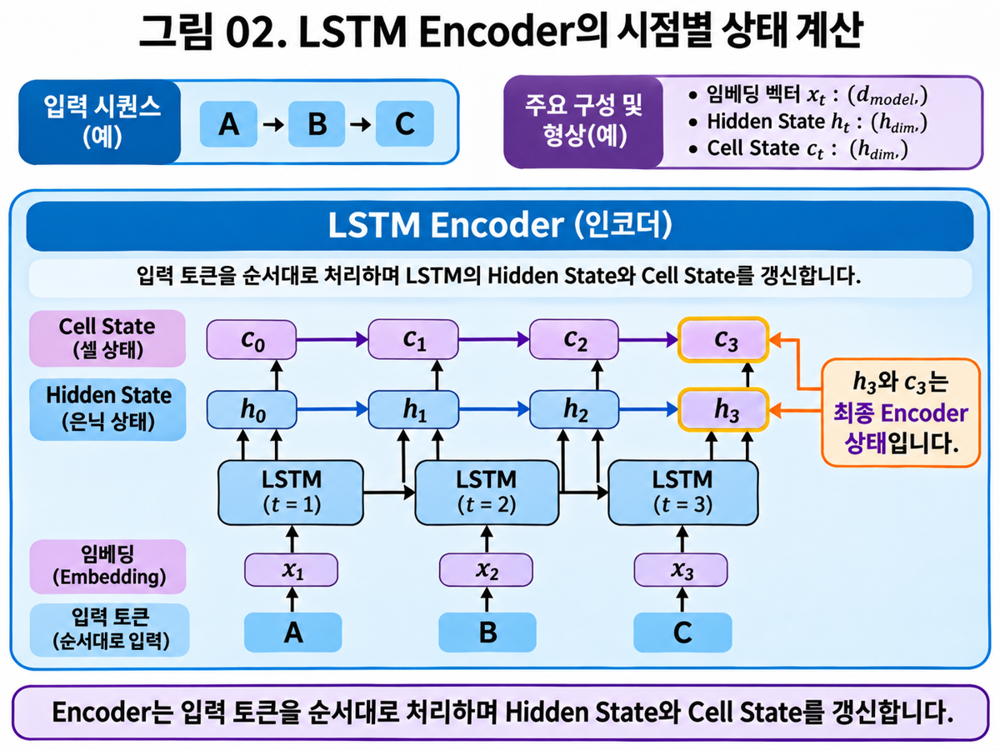
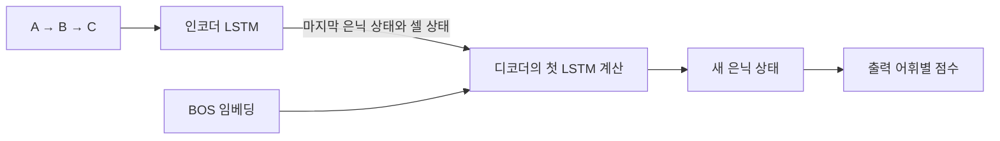
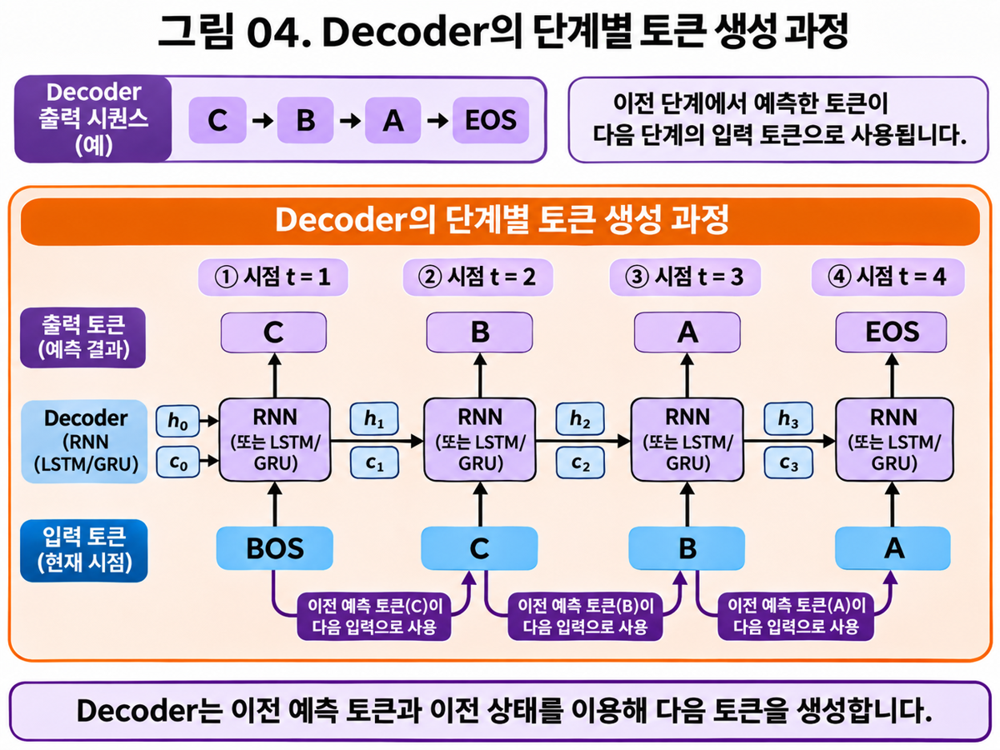
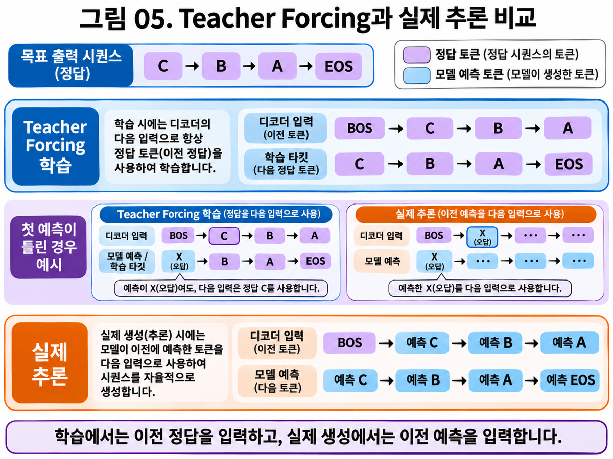
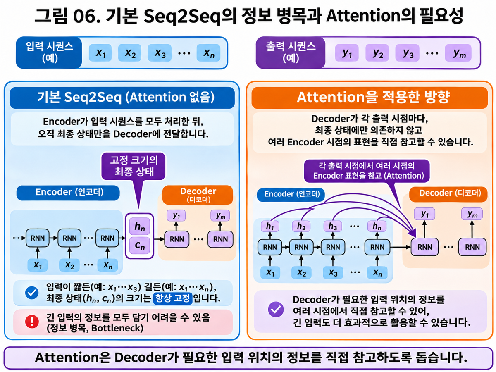

# Day 3. Seq2Seq의 인코더와 디코더

> Seq2Seq는 입력 토큰열을 읽은 뒤 별도의 출력 토큰열을 생성한다. LSTM 기반 구조에서 인코더가 전달하는 상태와 디코더가 매 시점에 입력받는 토큰을 구분한다.

## 1. 하나의 시퀀스를 다른 시퀀스로 변환하기

**시퀀스 변환(Sequence-to-Sequence, Seq2Seq)** 은 순서가 있는 입력을 받아 순서가 있는 출력을 만드는 작업이다. 번역에서는 원문과 번역문의 단어 순서가 달라지고 길이도 달라질 수 있다. 앞 문맥에 다음 토큰을 이어 붙이는 언어모델에서 한 걸음 더 나아가, 입력 전체의 영향을 받는 **별도의 출력열**을 생성한다.

구조를 살펴보기 위한 예제는 입력 `A B C`를 역순인 `C B A`로 바꾸는 작업이다. 인코더(Encoder)는 입력열을 읽고, 디코더(Decoder)는 읽은 결과를 바탕으로 출력열을 만든다. 이 예제에서는 두 부분에 각각 LSTM을 사용한다.

## 2. 인코더의 마지막 상태가 전달되는 위치

인코더는 `A B C`를 토큰 ID로 바꾸고, 임베딩 조회(Embedding Lookup)로 벡터를 가져온다. A를 읽어 계산한 은닉 상태(Hidden State)와 셀 상태(Cell State)가 B를 읽을 때 사용되고, B에서 갱신한 상태는 C를 읽을 때 사용된다.

| 인코더 시점 | 입력 | 계산에 쓰는 이전 상태 | 계산 결과 |
| --- | --- | --- | --- |
| 1 | A의 임베딩 | 초기 상태 | $h_1,c_1$ |
| 2 | B의 임베딩 | $h_1,c_1$ | $h_2,c_2$ |
| 3 | C의 임베딩 | $h_2,c_2$ | $h_3,c_3$ |

따라서 $h_3,c_3$에는 마지막 토큰 C와 그 앞의 A, B가 모두 영향을 준다. **인코더의 마지막 은닉 상태는 디코더의 초기 은닉 상태로, 마지막 셀 상태는 초기 셀 상태로 전달된다.** 디코더의 첫 토큰 입력은 별도로 준비한 시작 토큰(Beginning of Sequence, BOS)이다.

## 3. 디코더가 토큰을 생성하는 과정

첫 시점에는 BOS 임베딩과 전달받은 두 상태를 사용해 디코더의 상태를 갱신한다. 선형층(Linear Layer)은 새 은닉 상태를 출력 어휘집 크기만큼의 로짓(Logits)으로 바꾼다. 예시 어휘집이 `[BOS, EOS, A, B, C]`이고 점수가 `[0.1, 0.0, 0.5, 0.7, 2.1]`이면 가장 높은 후보는 C다.

**탐욕적 디코딩(Greedy Decoding)** 은 각 시점에서 가장 높은 확률의 후보를 하나 고른다. 소프트맥스(Softmax)는 점수를 확률로 바꾸면서 순위를 보존하므로, 이 경우 첫 예측은 C다. 두 번째 계산에는 C의 임베딩과 **첫 디코더 시점에서 갱신된 상태**가 들어간다.

이 과정을 반복해 C, B, A를 차례로 생성하고 종료 토큰(End of Sequence, EOS)을 선택하면 생성을 끝낸다. EOS도 학습할 정답에 포함해야 모델이 내용뿐 아니라 어디에서 출력을 마쳐야 하는지 배울 수 있다.

## 4. 교사 강요와 추론의 입력 차이

학습에서는 원하는 출력이 `C B A`라는 것을 알고 있다. **교사 강요(Teacher Forcing)** 는 다음 디코더 시점에 이전 시점의 실제 정답 토큰을 넣는 방식이다. BOS를 앞에 붙인 입력열과 EOS를 뒤에 붙인 정답열을 한 칸 어긋나게 배열한다.

| 시점 | 교사 강요에서 넣는 토큰 | 이번 시점의 정답 |
| --- | --- | --- |
| 1 | BOS | C |
| 2 | C | B |
| 3 | B | A |
| 4 | A | EOS |

예를 들어 첫 시점에서 모델이 B를 잘못 골라도 교사 강요를 적용한 두 번째 학습 입력은 정답 C다. 추론(Inference)에서는 아직 정답을 모르므로 예측한 B를 다음 입력으로 사용한다. 첫 오답으로 달라진 입력이 이후 예측에도 영향을 줄 수 있다.

각 시점에서 예측 로짓과 정답 ID로 교차 엔트로피 손실(Cross-Entropy Loss)을 구한다. 위 예에서는 C, B, A, EOS에 대한 손실을 더해 4로 나눈다. 역전파(Backpropagation)는 디코더에서 시작해 초기 상태 연결을 거쳐 인코더까지 기울기를 전달한다. 이 때문에 인코더도 원하는 출력 생성에 필요한 정보를 상태에 담도록 학습할 수 있다.

## 5. 고정된 상태에 담기는 정보의 한계

기본 Seq2Seq에서는 인코더의 마지막 상태가 입력과 출력을 연결한다. 은닉 차원이 5라면 입력이 3토큰이든 30토큰이든 전달되는 은닉 상태와 셀 상태는 각각 5차원이다. 문장이 길어지고 세부 정보가 많아지면 출력에 필요한 단서가 최종 상태에 충분히 남지 않을 수 있다. 이를 **정보 병목(Information Bottleneck)** 이라고 한다.

어텐션(Attention)은 디코더가 출력 토큰을 생성할 때 인코더의 여러 시점 상태를 참고하도록 한다. 출력 위치에 따라 관련 있는 입력 위치가 다르므로, 필요한 정보를 해당 시점의 표현에서 가져올 수 있다.

## 6. 핵심 개념 비교

| 개념 | 입력 또는 전달값 | 역할 |
| --- | --- | --- |
| 인코더 | 원문 토큰의 임베딩 | 입력열의 정보를 상태에 반영 |
| 디코더 초기 상태 | 인코더의 마지막 은닉 상태와 셀 상태 | 입력 내용에 따라 출력을 생성할 출발점 |
| BOS와 EOS | 시작과 끝을 표시하는 특수 토큰 | 첫 입력을 제공하고 생성 종료를 학습 |
| 교사 강요 | 실제 이전 정답 토큰 | 정답 문맥에서 다음 토큰을 학습 |
| 탐욕적 디코딩 | 직전 예측 토큰과 디코더 상태 | 현재 확률이 가장 높은 후보를 선택 |

## 7. 핵심 정리

- Seq2Seq는 입력열을 조건으로 다른 길이와 순서의 출력열을 생성할 수 있다.
- LSTM 인코더의 마지막 은닉 상태와 셀 상태는 디코더의 초기 상태가 된다.
- BOS는 첫 디코더 입력이고, EOS는 모델이 생성 종료를 알리는 토큰이다.
- 학습 시 교사 강요는 이전 정답을, 추론은 이전 예측을 다음 입력으로 사용한다.
- 디코더의 토큰별 손실을 통해 인코더와 디코더가 함께 학습된다.
- 어텐션은 디코더가 인코더의 여러 시점을 참조하게 해 고정 크기 상태의 정보 병목을 완화한다.

[학습 목차](README.md) | [다음 글: Self-Attention과 QKV 생성](15-Self-Attention과-QKV-생성.md)
