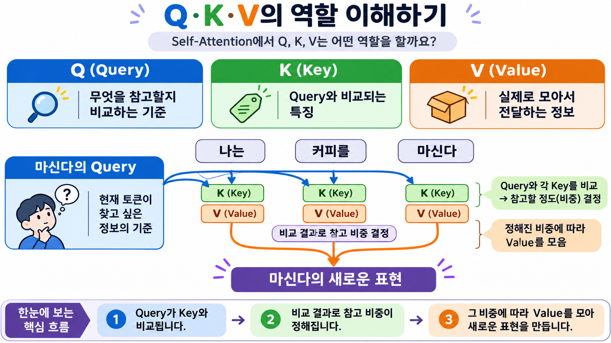
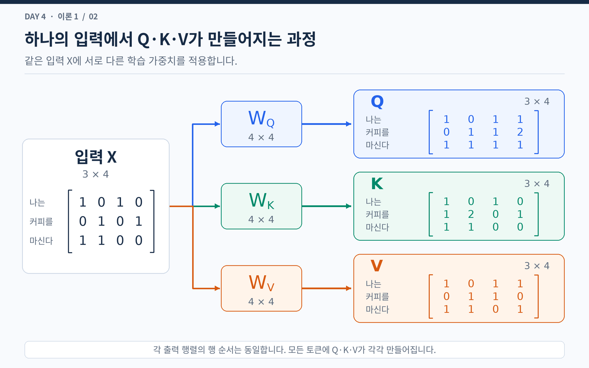
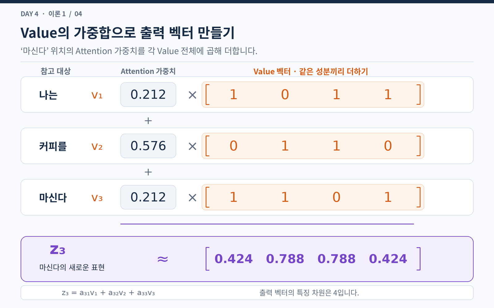

# Day 4. Self-Attention과 QKV 생성

> 자기 어텐션은 현재 토큰이 입력의 어느 위치를 얼마나 참고할지 계산한다. 같은 입력에서 Query, Key, Value를 만들고, 세 토큰의 정보를 결합해 새 벡터를 얻는 과정을 살펴본다.

## 1. 같은 문장 안에서 문맥 모으기

`나는 / 커피를 / 마신다`를 세 토큰으로 나누면, ‘마신다’는 행동을 나타내고 앞의 두 토큰은 행동의 주체와 대상을 알려준다.
‘마신다’ 위치의 벡터를 만들 때 이 단서들을 함께 사용하면 문장 속에서 쓰인 의미가 표현에 반영된다.

<strong>자기 어텐션(Self-Attention)</strong>은 같은 입력 시퀀스 안에서 각 토큰이 참고할 위치의 비중을 계산하고 정보를 모으는 연산이다.
마스크가 없는 예에서는 ‘마신다’가 ‘나는’, ‘커피를’, 자기 자신까지 참고할 수 있다.
‘나는’과 ‘커피를’도 각자의 기준으로 같은 계산을 하므로, 위치마다 다른 결과를 얻을 수 있다.

앞선 시퀀스 변환(Seq2Seq)에서 다룬 <strong>인코더-디코더 어텐션(Encoder-Decoder Attention)</strong>에서는 디코더의 표현을 기준으로 인코더 쪽 표현을 참고한다.
자기 어텐션에서는 참고 기준과 참고 대상이 같은 입력 시퀀스에서 만들어진다.

## 2. 비교하는 벡터와 전달하는 벡터

<strong>쿼리(Query, Q)</strong>는 현재 위치가 참고할 정보를 찾는 기준이다.
이를 참조 대상 위치의 <strong>키(Key, K)</strong>와 비교해 관련성 점수를 구한다.
점수로 비중을 정한 뒤에는 각 위치의 <strong>값(Value, V)</strong>을 그 비중으로 섞는다.
검색에 비유하면 Q는 검색 조건, K는 검색할 때 비교하는 특징, V는 가져오는 자료에 해당한다.

Q, K, V는 토큰마다 계산되는 숫자 벡터다.
역할별로 변환에 쓰는 학습 파라미터를 따로 두면 모델은 관련성 비교에 필요한 특징과 결과에 전달할 특징을 구분해 학습할 수 있다.

## 3. 입력 행렬에서 Q, K, V 생성하기

토큰별 입력 벡터를 순서대로 쌓아 **입력 행렬**을 만든다.
이 행렬을 $X$라고 한다.
세 토큰이 각각 네 성분을 가지므로 행렬의 형태(Shape)는 `(3, 4)`다.
행은 토큰 위치, 열은 토큰 벡터의 특징 성분에 대응한다.

$$
Q=XW_Q,\qquad K=XW_K,\qquad V=XW_V
$$

$W_Q$, $W_K$, $W_V$는 학습되는 가중치 행렬이다.
각 변환은 해당 가중치를 전체 토큰 위치에서 공유한다.
학습된 가중치가 같아도 입력 $X$가 바뀌면 계산된 Q, K, V가 달라진다.
이 예에서는 가중치 행렬의 형태를 모두 `(4, 4)`로 두었으므로 결과 세 행렬은 각각 `(3, 4)`다.

예를 들어 ‘마신다’의 입력은 $x_3=[1,1,0,0]$이다.
쿼리를 만드는 선형 변환(Linear Projection)에서 출력 성분 하나는 $x_3$과 $W_Q$의 대응 열을 내적해 계산한다.
$W_Q$의 첫 열이 $[1,0,0,0]$이므로 결과의 첫 성분은 $1\times1+1\times0+0\times0+0\times0=1$이다.
나머지 열에도 같은 연산을 적용하면 $q_3=[1,1,1,1]$을 얻는다.

## 4. Query와 Key로 참고 비중 계산하기

‘마신다’의 $q_3$을 세 토큰의 Key와 각각 비교한다.
<strong>내적(Dot Product)</strong>은 같은 위치의 성분끼리 곱한 뒤 더해 점수 하나를 만든다.
‘나는’의 $k_1=[1,0,1,0]$과 비교하면 $1\times1+1\times0+1\times1+1\times0=2$다.

| 참고할 토큰 | Key | 내적 점수 | 어텐션 가중치 |
| --- | --- | --- | --- |
| 나는 | `[1, 0, 1, 0]` | 2 | 0.212 |
| 커피를 | `[1, 2, 0, 1]` | 4 | 0.576 |
| 마신다 | `[1, 1, 0, 0]` | 2 | 0.212 |

내적 점수에 스케일링(Scaling)과 소프트맥스(Softmax)를 적용하면 합이 1인 <strong>어텐션 가중치(Attention Weight)</strong>를 얻는다.
이 예에서는 ‘커피를’의 Value에 가장 큰 비중이 주어진다.
점수는 예제 벡터로 계산한 값이며, 실제 모델에서 어떤 위치의 비중이 커지는지는 입력과 학습된 가중치에 따라 달라진다.

## 5. Value의 가중합으로 토큰 표현 갱신하기

$a_{ij}$는 $i$번 Query가 $j$번 위치의 Value를 참고하는 비중이다.
예를 들어 $a_{31}=0.212$는 세 번째 위치 ‘마신다’가 첫 번째 위치 ‘나는’을 참고하는 비중이다.
각 Value에 해당 비중을 곱하고 같은 성분끼리 더하는 계산을 <strong>가중합(Weighted Sum)</strong>이라고 한다.

$$
\begin{aligned}
z_3 &= a_{31}v_1+a_{32}v_2+a_{33}v_3 \\
    &\approx 0.212[1,0,1,1]+0.576[0,1,1,0]+0.212[1,1,0,1] \\
    &= [0.424,0.788,0.788,0.424]
\end{aligned}
$$

첫 성분에는 세 Value의 첫 성분만 쓰므로 $0.212\times1+0.576\times0+0.212\times1=0.424$가 된다.
두 번째와 세 번째 성분이 모두 $0.788$인 이유는 두 위치에서 합산되는 비중이 각각 $0.576$과 $0.212$로 같기 때문이다.
같은 연산을 나머지 Query에 적용하고 결과를 원래 토큰 순서로 쌓으면 출력 행렬 $Z$의 형태는 `(3, 4)`다.
각 행에는 참고한 토큰들의 정보가 들어가며, 행의 개수는 Query의 개수로 결정된다.

## 6. 핵심 개념 비교

| 개념 | 계산에서의 역할 | ‘마신다’의 표현을 구할 때 |
| --- | --- | --- |
| Query | 어떤 정보를 참조할지 비교하는 기준 | 마신다의 Query 하나 사용 |
| Key | Query와 비교할 각 위치의 특징 | 세 토큰의 Key를 모두 비교 |
| Value | 가중합에 들어가는 각 위치의 정보 | 세 Value에 가중치를 곱해 합산 |
| 어텐션 가중치 | Query가 각 위치를 참고하는 비중 | `[0.212, 0.576, 0.212]` |

## 7. 핵심 정리

- 자기 어텐션은 같은 시퀀스의 토큰 정보를 모아 위치별 문맥 표현을 만든다.
- 입력 행렬에 세 종류의 학습 가중치를 적용해 Q, K, V를 계산한다.
- 한 Query와 모든 Key의 내적을 통해 해당 위치에 필요한 관련성 점수를 얻는다.
- 스케일링과 소프트맥스는 내적 점수를 합이 1인 어텐션 가중치로 바꾼다.
- 각 Query의 어텐션 가중치로 Value를 가중합하면 해당 Query 위치의 출력이 된다.

[이전 글: 어텐션의 작동 원리](14-1-어텐션의-작동-원리.md) | [학습 목차](README.md) | [다음 글: 스케일 내적 어텐션과 마스크](16-스케일-내적-어텐션과-마스크.md)
