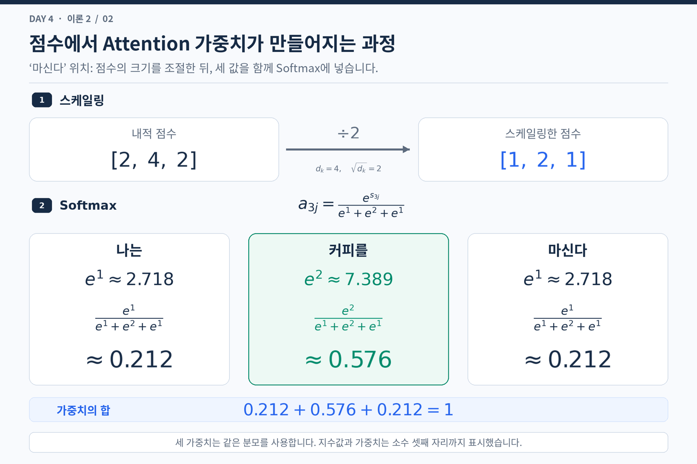
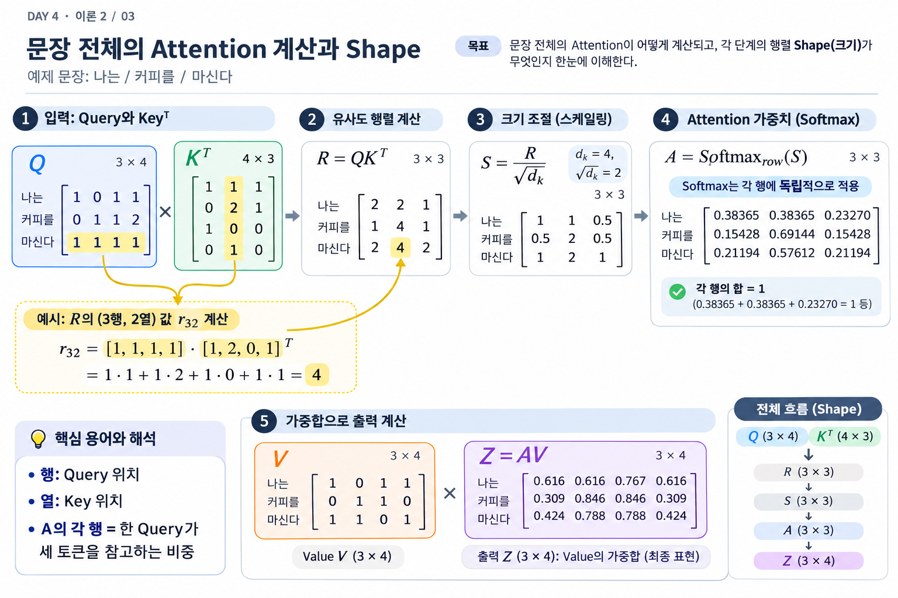
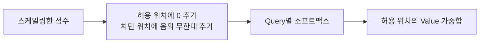
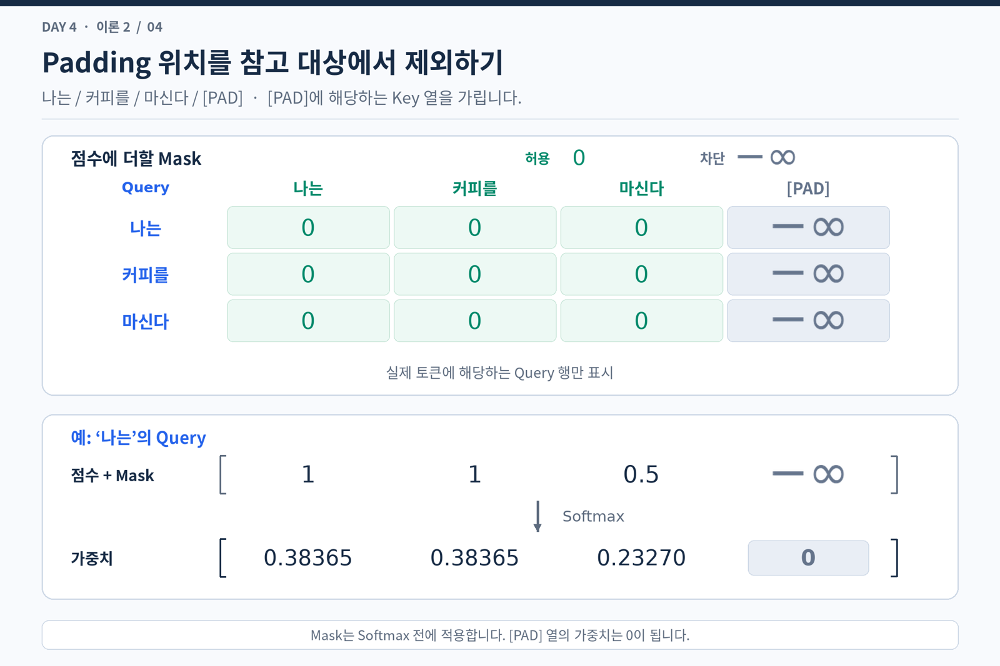
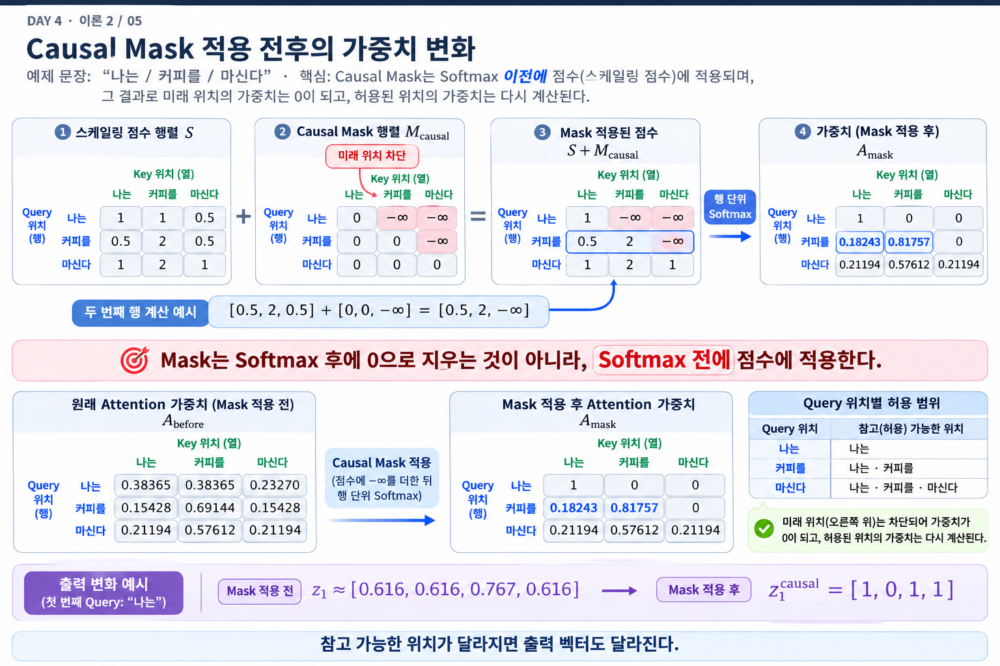

# Day 4. 스케일 내적 어텐션과 마스크

> 스케일 내적 어텐션은 Query와 Key의 점수를 조절하고, 각 Query가 참조할 위치의 비중을 계산한다. 패딩 마스크와 Causal Mask는 각 Query가 참조할 수 있는 위치를 제한한다.

## 1. 내적 점수를 참고 비중으로 바꾸기

입력은 앞선 예제와 같은 `나는 / 커피를 / 마신다`다.
‘마신다’의 Query $q_3=[1,1,1,1]$를 세 Key와 내적(Dot Product)하면 `[2, 4, 2]`를 얻는다.
예를 들어 ‘커피를’의 Key $k_2=[1,2,0,1]$과의 관련성 점수는 $1\times1+1\times2+1\times0+1\times1=4$다.

### 1.1 스케일링

벡터의 차원이 커지면 내적에서 더 많은 성분의 곱을 합치므로 점수의 크기도 커지는 경향이 있다.
큰 점수 차이를 그대로 소프트맥스에 넣으면 가중치가 한 위치에 강하게 집중되고 학습 신호가 약해질 수 있다.
<strong>스케일링(Scaling)</strong>은 내적 점수를 Key의 특징 차원 $d_k$의 제곱근으로 나누어 이를 완화한다.

$$
s_{ij}=\frac{q_i k_j^\mathsf{T}}{\sqrt{d_k}}
$$

$s_{ij}$는 $i$번째 Query와 $j$번째 Key 사이의 조정된 점수다.
이 예에서 $d_k=4$이므로 각 점수를 $\sqrt{4}=2$로 나눈다.
`[2, 4, 2]`가 `[1, 2, 1]`이 되며, 순위는 유지되고 점수의 차이는 절반으로 줄어든다.

### 1.2 소프트맥스

<strong>소프트맥스(Softmax)</strong>는 같은 Query에서 비교한 점수에 각각 지수함수 $e^x$를 적용한 뒤, 그 합으로 나눈다.
`[1, 2, 1]`에서 분모는 $e^1+e^2+e^1\approx12.826$이다.
가운데 원소의 가중치는 $e^2/12.826\approx0.576$으로, 다른 두 위치보다 더 큰 비중을 갖는다.

세 가중치 `[0.212, 0.576, 0.212]`의 합은 반올림 전 기준으로 1이다.
각 가중치는 같은 분모를 공유하므로 한 위치의 점수가 오르면 나머지 위치의 상대적인 비중이 감소한다.

## 2. 문장 전체를 행렬로 계산하기

토큰별 Key를 행으로 쌓은 뒤 <strong>전치(Transpose)</strong>하면 토큰별 Key가 열로 놓인다.
$QK^\mathsf{T}$에서 Query 한 행과 전치한 Key 한 열의 내적을 구하면 점수 하나가 나온다.
따라서 점수 행렬의 3행 2열은 ‘마신다’가 ‘커피를’과 비교한 점수 $4$다.

| 단계 | 연산 | 결과 형태(Shape) |
| --- | --- | --- |
| 입력 | Q, K, V에 토큰별 표현 쌓기 | 각각 `(3, 4)` |
| 전체 내적 | $(3\times4)(4\times3)$으로 $R=QK^\mathsf{T}$ 계산 | `(3, 3)` |
| 스케일링 | $R$의 모든 점수를 $\sqrt{d_k}$로 나누기 | `(3, 3)` |
| 행별 소프트맥스 | Query마다 Key 방향으로 정규화해 $A$ 계산 | `(3, 3)` |
| Value 결합 | $(3\times3)(3\times4)$로 $Z=AV$ 계산 | `(3, 4)` |

$$
Z=\mathrm{Softmax}_{\mathrm{row}}\left(\frac{QK^\mathsf{T}}{\sqrt{d_k}}\right)V
$$

이 연산을 <strong>스케일 내적 어텐션(Scaled Dot-Product Attention)</strong>이라고 한다.
소프트맥스의 분모는 Query별로 계산한다. 예를 들어 세 번째 행을 정규화할 때는 ‘마신다’가 각 Key에 매긴 세 점수만 쓴다.
가중치 행렬 $A$의 행 하나를 $V$와 곱하면 해당 Query 위치의 출력 벡터 하나를 얻는다.
세 번째 출력은 앞서 구한 `[0.424, 0.788, 0.788, 0.424]`와 같은 근삿값이다.

## 3. 소프트맥스 전에 마스크 적용하기

<strong>마스크(Mask)</strong>는 Query가 참고할 수 있는 Key 위치를 제한한다.
스케일링한 점수 행렬을 $S$, 여기에 더하는 마스크를 $M$이라고 하면, 가중치는 $A=\mathrm{Softmax}_{\mathrm{row}}(S+M)$으로 계산한다.
$M$에는 허용 위치에 $0$, 차단 위치에 $-\infty$를 넣는다.

차단 점수에 지수함수를 적용하면 $e^{-\infty}=0$이 되어 소프트맥스의 분자와 분모에 기여하지 않는다.
차단 점수를 $0$으로만 바꾸면 $e^0=1$이라 가중치가 남는다.
스케일링한 점수에 마스크를 먼저 적용해야 남은 위치끼리 가중치 합이 1이 되도록 정규화된다.

### 3.1 패딩 마스크

<strong>패딩 마스크(Padding Mask)</strong>는 길이가 다른 문장을 배치로 처리할 때 추가한 `[PAD]`가 참고 대상에 들어가지 않도록 한다.
`나는 / 커피를 / 마신다 / [PAD]`에서 실제 세 토큰은 그대로 두고, `[PAD]`에 해당하는 Key 열을 가린다.

‘나는’의 마스크 적용 후 점수는 `[1, 1, 0.5, -∞]`다.
소프트맥스 결과 `[0.38365, 0.38365, 0.23270, 0]`에서 마지막 원소가 0이므로, 패딩의 Value는 출력에 반영되지 않는다.

### 3.2 Causal Mask

<strong>Causal Mask</strong>는 각 Query보다 뒤에 있는 Key 위치를 가린다. 이렇게 마스크를 적용한 Causal Self-Attention에서는 각 위치가 현재와 이전 토큰으로 다음 토큰을 예측할 수 있다.
첫 번째 토큰은 자기 자신만, 두 번째는 처음 두 토큰을, 세 번째는 세 토큰 모두를 볼 수 있다.
행을 Query, 열을 Key로 놓으면 대각선 오른쪽 위가 미래 위치에 해당한다.

| Query | 나는 | 커피를 | 마신다 |
| --- | ---: | ---: | ---: |
| 나는 | 0 | -∞ | -∞ |
| 커피를 | 0 | 0 | -∞ |
| 마신다 | 0 | 0 | 0 |

‘커피를’의 점수 `[0.5, 2, 0.5]`에 두 번째 마스크 행을 더하면 `[0.5, 2, -∞]`다.
가중치는 `[0.15428, 0.69144, 0.15428]`에서 `[0.18243, 0.81757, 0]`으로 바뀐다.
미래 토큰 ‘마신다’의 몫이 사라지고 앞의 두 위치에 다시 비중을 배분한다.

첫 Query인 ‘나는’의 가중치는 `[1, 0, 0]`이므로 출력은 자신의 Value인 `[1, 0, 1, 1]`이다.
마지막 Query보다 뒤에 있는 Key가 없으므로 Causal Mask를 적용해도 이 예의 마지막 행은 그대로다.

## 4. 핵심 개념 비교

| 개념 | 적용 대상 | 결과에 미치는 영향 |
| --- | --- | --- |
| 스케일링 | 내적 점수 전체 | 점수 차이를 조절 |
| 행별 소프트맥스 | 각 Query 행 | 참고 가능한 위치에 비중을 배분 |
| 패딩 마스크 | 패딩에 해당하는 Key 열 | 길이를 맞추려고 추가한 토큰을 제외 |
| Causal Mask | 각 Query보다 뒤에 있는 Key 위치 | 다음 토큰 예측에서 미래 정보의 참조를 제한 |

## 5. 핵심 정리

- $QK^\mathsf{T}$의 행은 Query 위치, 열은 비교 대상인 Key 위치다.
- 내적 점수를 Key 차원의 제곱근으로 나누면 소프트맥스가 한 위치에 지나치게 집중하는 현상을 완화할 수 있다.
- Query별 가중치 합은 1이며, 각 행의 가중치로 Value를 결합해 토큰별 출력을 얻는다.
- 마스크는 소프트맥스 이전에 점수를 바꿔 차단한 위치의 가중치를 0으로 만든다.
- 패딩 마스크는 패딩 위치를 제외하고, Causal Mask는 각 Query보다 뒤에 있는 위치를 가린다.

[이전 글: Self-Attention과 QKV 생성](15-Self-Attention과-QKV-생성.md) | [학습 목차](README.md) | [다음 글: 멀티헤드 어텐션과 위치 정보](17-멀티헤드-어텐션과-위치-정보.md)
