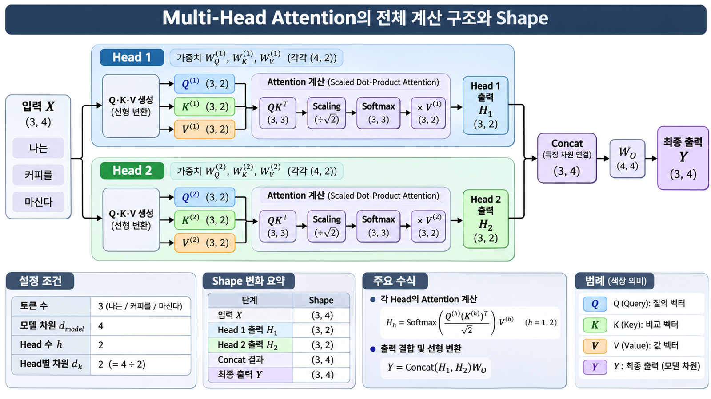
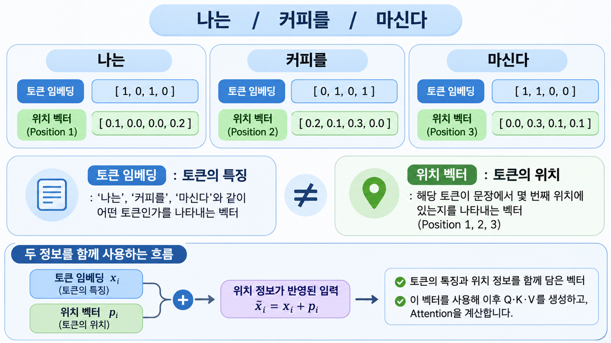
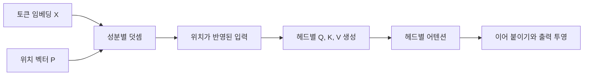

# Day 4. 멀티헤드 어텐션과 위치 정보

> 멀티헤드 어텐션은 같은 문장을 여러 방식으로 변환해 각각 어텐션을 계산하고, 결과를 하나의 토큰 표현으로 합친다. 위치 인코딩은 어텐션에 입력하기 전에 각 토큰이 놓인 순서의 단서를 더한다.

## 1. 같은 입력을 여러 헤드가 처리하기

<strong>헤드(Head)</strong>는 Query, Key, Value를 만들고 어텐션을 계산하는 단위다.
<strong>멀티헤드 어텐션(Multi-Head Attention)</strong>은 하나의 입력에 여러 헤드의 어텐션을 병렬로 적용한다.
모든 헤드가 같은 토큰을 받더라도 각자가 쓰는 학습 가중치가 다르므로 서로 다른 참고 비중과 출력 벡터가 나올 수 있다.

예를 들어 `나는 / 커피를 / 마신다`에서 한 헤드는 ‘마신다’와 행동의 주체 사이의 관계를, 다른 헤드는 행동의 대상과의 관계를 더 크게 반영할 수 있다.
이 관계는 가능한 예시이며, 헤드가 주체나 대상의 역할을 미리 배정받는 구조는 아니다.
한 헤드로도 여러 토큰을 참고할 수 있고, 여러 헤드를 쓰면 서로 다른 표현 공간에서 얻은 결과를 함께 사용할 수 있다.

## 2. 헤드별 투영에서 최종 출력까지

### 2.1 특징 차원을 헤드별로 나누기

강의 예에서는 토큰이 3개, **모델 차원**은 4, 헤드 수는 2다.
모델 차원 $d_{\mathrm{model}}$은 토큰 하나를 나타내는 특징의 개수다.
이 예처럼 특징 차원을 균등하게 나누면 헤드 하나의 차원은 $d_{\mathrm{head}}=d_{\mathrm{model}}/h=4/2=2$다. $h$는 헤드 수다.

입력 행렬 $X$의 형태는 `(3, 4)`다.
각 헤드는 자기 가중치 행렬 `(4, 2)`를 적용해 Q, K, V를 각각 `(3, 2)`로 만든다.
두 헤드 모두 `나는 / 커피를 / 마신다` 세 토큰을 처리하며, 줄어드는 것은 각 토큰을 표현하는 특징의 개수다.

### 2.2 각 헤드에서 어텐션 계산하기

각 헤드는 세 Query와 세 Key를 비교하므로 내적 점수 행렬은 `(3, 3)`이다.
스케일링의 분모는 각 헤드에서 사용하는 Key 차원의 제곱근인 $\sqrt{2}$다.
필요한 경우 이 점수에 마스크를 더하고, Query마다 소프트맥스를 적용한다.
가중치 `(3, 3)`와 해당 헤드의 Value `(3, 2)`를 곱하면 헤드별 출력 `(3, 2)`가 만들어진다.

### 2.3 특징을 이어 붙이고 다시 섞기

<strong>이어 붙이기(Concatenation, Concat)</strong>는 여러 벡터를 한 특징 축에 순서대로 연결하는 연산이다.
‘마신다’에서 헤드 1이 `[0.3, 0.1]`, 헤드 2가 `[0.2, 0.8]`을 출력했다면, 결합 결과는 `[0.3, 0.1, 0.2, 0.8]`이다.
토큰마다 같은 방식으로 연결하면 `(3, 2)` 출력 두 개가 `(3, 4)` 행렬 하나가 된다.

$$
H=\mathrm{Concat}(H_1,H_2),\qquad Y=HW_O
$$

$H_1$과 $H_2$는 각 헤드의 출력, $H$는 결합 결과, $W_O$는 학습하는 출력 가중치다.
$H$에 `(4, 4)` 가중치를 곱하는 <strong>출력 투영(Output Projection)</strong>으로 여러 헤드에서 얻은 특징을 다시 조합한다.
최종 출력 $Y$는 입력과 같은 `(3, 4)` 형태이며, 각 행에는 여러 헤드가 모은 정보가 담긴다.

## 3. 어텐션에 위치 정보가 필요한 이유

<strong>토큰 임베딩(Token Embedding)</strong>은 어떤 토큰이 입력됐는지 표현한다.
‘커피를’이 두 번째 위치에서 세 번째 위치로 옮겨가도 같은 임베딩 행렬에서 조회한 값은 같다.
위치 정보와 순서에 따른 참조 제한이 없는 자기 어텐션은 입력 토큰을 재배열하면 출력도 그 순서에 맞춰 재배열된다.
어순에 따라 문장의 각 토큰이 맺는 관계가 달라질 수 있으므로, 모델에는 별도의 위치 단서가 필요하다.

<strong>위치 인코딩(Positional Encoding)</strong>은 토큰이 놓인 위치마다 다른 벡터를 대응시키는 방법이다.
같은 토큰이 다른 위치에 놓이면 토큰 임베딩은 같고 위치 벡터가 달라진다.
두 벡터를 더하면 어떤 토큰인지와 어느 위치에 있는지를 하나의 입력에 함께 반영할 수 있다.

## 4. 위치가 반영된 입력으로 Q, K, V 만들기

기본 트랜스포머(Transformer)는 위치 벡터를 대응하는 토큰 임베딩에 성분별로 더한다.
‘커피를’의 벡터가 `[0, 1, 0, 1]`이고 두 번째 위치에 대응하는 벡터가 `[0.2, 0.1, 0.3, 0]`이면 합은 `[0.2, 1.1, 0.3, 1]`이다.
성분별로 더하려면 두 벡터의 차원이 같아야 하며, 덧셈 후에도 4차원을 유지한다.

$$
\tilde X=X+P
$$

$X$는 토큰 임베딩을 쌓은 행렬, $P$는 위치 벡터를 쌓은 행렬, $\tilde X$는 위치가 반영된 입력이다.
세 행렬 모두 형태는 `(3, 4)`다.
기본 트랜스포머에서는 사인과 코사인 함수로 위치 벡터를 만들었으며, 위치 벡터 자체를 학습하는 방식도 있다.

위치 정보를 더한 입력에서 Q, K, V를 계산하므로, 위치 정보는 어떤 토큰을 얼마나 참고할지와 어떤 정보를 가져올지에 모두 영향을 줄 수 있다.
이 위치 추가 예제에서 바뀌는 것은 입력의 값이며, 이후 헤드별 어텐션과 출력 결합의 계산 순서는 그대로다.

## 5. 핵심 개념 비교

| 개념 | 계산 또는 입력 | 역할 |
| --- | --- | --- |
| 단일 헤드 어텐션(Single-Head Attention) | 한 종류의 Q, K, V로 계산 | 토큰마다 하나의 어텐션 결과를 생성 |
| 멀티헤드 어텐션 | 헤드별 Q, K, V를 만들고 결과를 결합 | 여러 표현 공간에서 참고한 정보를 종합 |
| 이어 붙이기 | 같은 위치의 헤드별 출력을 특징 축으로 연결 | 각 헤드가 낸 성분을 한 벡터에 모음 |
| 출력 투영 | 결합한 벡터에 $W_O$ 적용 | 헤드별 특징을 섞어 모델 차원의 출력 생성 |
| 토큰 임베딩 | 토큰 ID로 조회한 벡터 | 해당 위치에 있는 토큰의 특징을 표현 |
| 위치 인코딩 | 위치에 대응하는 벡터를 토큰 임베딩에 더함 | 어텐션 입력에 순서의 단서를 제공 |

## 6. 핵심 정리

- 각 헤드는 같은 토큰열을 받아 별도의 가중치로 Q, K, V를 만든다.
- 헤드별 특징 차원이 줄어도 모든 헤드는 전체 입력의 토큰 위치를 처리한다.
- 스케일링의 분모는 각 헤드의 Key 차원에 맞춰 계산한다.
- 각 헤드의 출력은 특징 축으로 이어 붙인 뒤 출력 투영으로 조합한다.
- 기본 트랜스포머는 토큰 임베딩에 같은 차원의 위치 벡터를 더해 Q, K, V를 만들기 전에 순서 정보를 제공한다.

[이전 글: 스케일 내적 어텐션과 마스크](16-스케일-내적-어텐션과-마스크.md) | [학습 목차](README.md) | [다음 글: Transformer 블록과 인코더-디코더 구조](18-Transformer-블록과-인코더-디코더.md)
