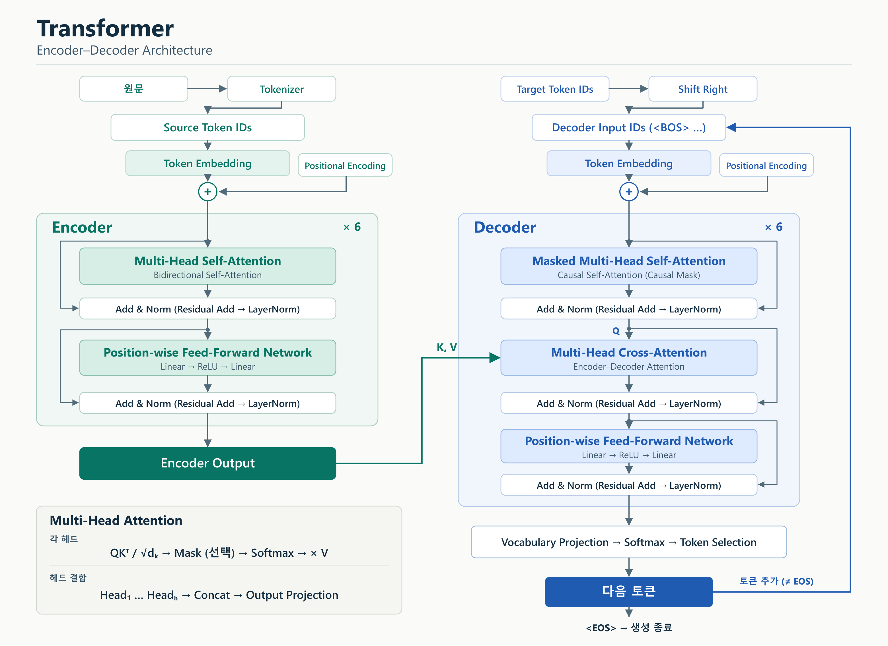

# Day 4. Transformer 입력부터 다음 토큰까지

`나는 커피를 마신다`를 `I drink coffee`로 번역해 보자. 그림 왼쪽에서 인코더가 원문을 읽고, 오른쪽에서 디코더가 영어 토큰을 하나씩 고른다.

[구조도 확대 보기 (SVG)](assets/Transformer-Encoder-Decoder.svg)

## 1. 인코더가 원문을 읽는다

원문을 `나는 / 커피를 / 마신다` 세 토큰으로 나누고, 각 토큰의 임베딩에 위치 정보를 더한다. 인코더의 <strong>Bidirectional Self-Attention</strong> 덕분에 `마신다`의 벡터에도 `나는`과 `커피를`의 정보가 담긴다.

인코더 블록 여섯 개(`× 6`)를 지나면 원문 토큰마다 벡터가 하나씩 남는다.

## 2. 학습할 때는 정답을 한 칸 옮긴다

정답 번역을 오른쪽으로 한 칸 밀고 맨 앞에 `<BOS>`를 넣어 디코더 입력을 만든다. 그림의 <strong>Shift Right</strong>가 이 과정이다.

| 위치 | 1 | 2 | 3 | 4 |
| --- | --- | --- | --- | --- |
| 디코더 입력 | `<BOS>` | `I` | `drink` | `coffee` |
| 예측할 정답 | `I` | `drink` | `coffee` | `<EOS>` |

두 번째 위치에서 디코더는 `<BOS> / I`를 보고 `drink`를 예측한다. Causal Mask가 뒤쪽 토큰을 가려 주므로 학습할 때는 표의 네 위치를 한꺼번에 처리할 수 있다.

## 3. 디코더가 원문을 참조한다

<strong>Cross-Attention</strong>에서 디코더는 `I` 위치의 Query를 원문 세 위치의 Key와 비교한다. 비교 점수로 가중치를 구하고, 그 비율에 따라 원문의 Value를 더한다.

그림에서 Query는 디코더의 첫 Add & Norm에서 오고, Key와 Value는 인코더 출력에서 온다. 번역 두 위치가 원문 세 위치를 참조하면 헤드 하나의 점수 행렬은 <strong>2행 3열</strong>이다.

## 4. 추론할 때는 고른 토큰을 다시 넣는다

마지막 디코더 블록을 지나면 Vocabulary Projection이 벡터를 어휘별 점수로 바꾼다. 추론할 때는 마지막 위치에 Softmax를 적용해 얻은 확률 분포에서 다음 토큰을 고른다.

`<BOS>`에서 `I`를 고르면 다음 입력은 `<BOS> / I`다. 인코더 출력은 그대로 두고, 방금 고른 토큰만 디코더 입력 끝에 붙인다. `<EOS>`가 나오면 번역을 마친다.

원 논문의 Figure 1에서 전체 구조를, §3.2에서 어텐션 계산을 볼 수 있다. [Attention Is All You Need](https://arxiv.org/abs/1706.03762)

## 용어 정리

입력과 블록 구성

| 용어 | 이 그림에서의 역할 |
| --- | --- |
| Tokenizer / Token ID | 문장을 토큰으로 나누고 각 토큰을 어휘집의 번호로 바꾼다. |
| Token Embedding / Positional Encoding | 인코더와 디코더 모두 토큰 ID에 해당하는 벡터에 같은 차원의 위치 벡터를 더한다. 그림의 ⊕가 이 덧셈이다. 원래 Transformer는 위치를 사인과 코사인 값으로 표현한다. |
| Position-wise Feed-Forward Network (FFN) | 어텐션으로 모은 정보를 각 위치에서 변환한다. 모든 위치에 같은 `Linear → ReLU → Linear` 연산을 적용한다. |
| Add & Norm | 각 연산의 입력을 출력에 더하고 LayerNorm을 적용한다. 입력이 연산을 우회하는 화살표가 잔차 연결이다. |
| Encoder Output | 서로 다른 가중치를 가진 인코더 블록 여섯 개를 거친 원문 위치별 벡터. 디코더의 각 Cross-Attention 층이 여기서 Key와 Value를 만든다. |

어텐션의 종류와 계산

| 용어 | 이 그림에서의 역할 |
| --- | --- |
| Query, Key, Value | Query와 Key를 비교해 각 위치를 얼마나 참조할지 결정한다. Value는 그 비율로 더할 벡터다. |
| Bidirectional Self-Attention | 인코더의 같은 층 입력에서 Query, Key, Value를 만든다. 원문의 앞뒤 유효 위치를 모두 참조할 수 있다. |
| Causal Self-Attention / Causal Mask | 디코더의 같은 층 입력에서 Query, Key, Value를 만든다. 마스크를 적용해 현재와 이전 위치만 참조한다. |
| Cross-Attention (Encoder-Decoder Attention) | 디코더에서 만든 Query로 인코더 출력을 참조한다. 디코더 블록의 계산 순서는 Causal Self-Attention → Cross-Attention → FFN이며 각 단계 뒤에 Add & Norm이 온다. |
| Scaled Dot-Product Attention | Query와 Key의 내적을 Key 차원의 제곱근으로 나눈다. 필요한 마스크를 적용한 뒤 Key 위치를 따라 Softmax를 계산하고 그 가중치로 Value를 더한다. |
| Multi-Head Attention / Concat / Output Projection | 여러 헤드에서 어텐션을 각각 계산한다. 헤드별 결과를 이어 붙인 뒤 선형 변환으로 모델 차원에 맞춘다. |

학습과 다음 토큰 생성

| 용어 | 이 그림에서의 역할 |
| --- | --- |
| Shift Right | 학습할 때 정답 토큰열을 오른쪽으로 한 칸 옮겨 디코더 입력을 만든다. |
| Vocabulary Projection / Logits | 디코더 벡터를 어휘집 크기로 선형 변환한다. 결과는 어휘마다 하나씩 나온 점수인 로짓이다. |
| Softmax | 어텐션 안에서는 참조할 위치별 가중치를, 최종 출력에서는 다음 토큰 후보별 확률을 계산한다. |
| Token Selection / `<BOS>` / `<EOS>` | 추론은 시작 토큰 `<BOS>`에서 출발한다. 고른 토큰을 다음 입력에 붙이고, 종료 토큰 `<EOS>`가 나오면 멈춘다. |

[이전 글: Transformer 블록과 인코더-디코더 구조](18-Transformer-블록과-인코더-디코더.md) | [학습 목차](README.md) | [다음 글: BERT의 문맥 표현과 사전학습](19-BERT의-문맥-표현과-사전학습.md)
