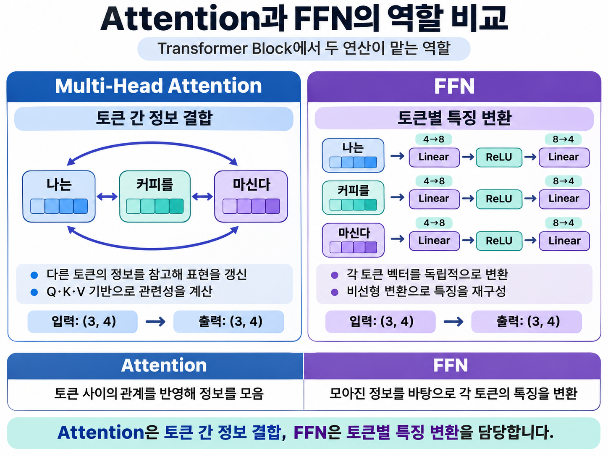
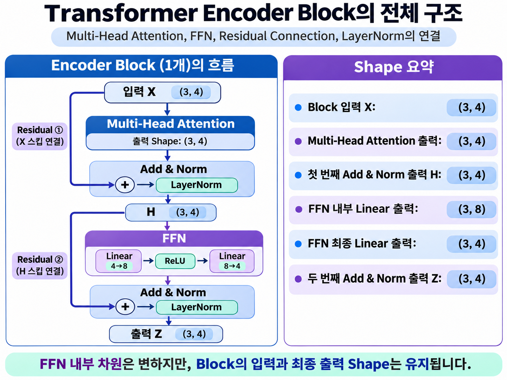
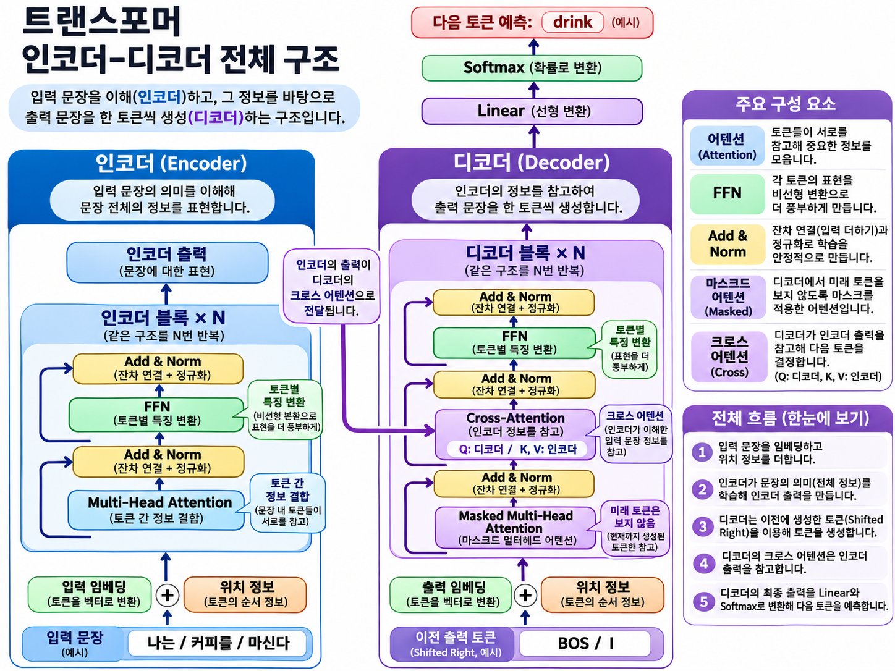
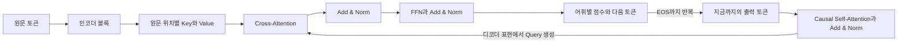
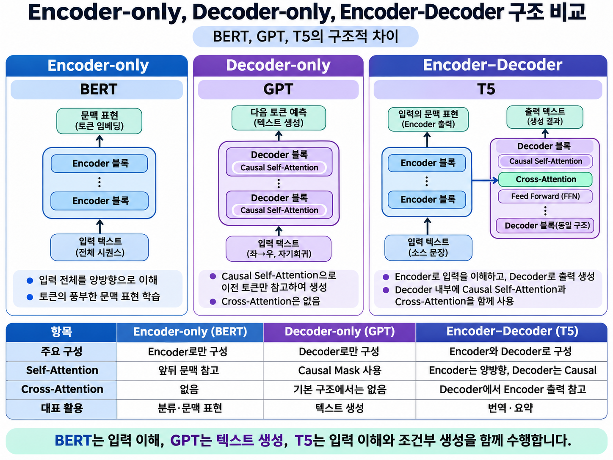

# Day 4. Transformer 블록과 인코더-디코더 구조

> 트랜스포머 블록은 토큰 간 정보를 모으는 어텐션과 토큰별 특징을 변환하는 신경망을 연결한다. 블록을 쌓아 문장을 처리하고, 인코더의 출력을 참고해 다음 토큰을 만드는 과정을 정리한다.

## 1. 토큰 간 정보 결합과 토큰별 변환

<strong>Multi-Head Self-Attention</strong>은 같은 시퀀스에서 Query, Key, Value를 만들고, 여러 헤드의 결과를 결합해 각 토큰의 표현을 갱신한다.
`나는 / 커피를 / 마신다`의 세 토큰을 각각 4차원으로 표현하면, 강의 예제의 어텐션 입출력은 모두 `(3, 4)`다.

<strong>순전파 신경망(Feed-Forward Network, FFN)</strong>은 어텐션으로 얻은 토큰 표현을 비선형적으로 변환한다.
세 토큰 모두 같은 FFN 가중치를 사용하며, 각 토큰의 벡터는 독립적으로 처리한다.
기본 트랜스포머(Transformer)의 FFN은 선형층(Linear Layer), 렐루 활성화 함수(ReLU), 다시 선형층 순으로 구성된다.

| 단계 | 형태(Shape) | 역할 |
| --- | --- | --- |
| FFN 입력 | `(3, 4)` | 토큰 세 개의 4차원 표현 |
| 첫 선형층 | `(3, 8)` | 각 토큰의 특징을 8차원으로 확장 |
| ReLU | `(3, 8)` | 음수만 0으로 바꿔 비선형성 추가 |
| 마지막 선형층 | `(3, 4)` | 특징을 모델 차원 4로 변환 |

## 2. 잔차 연결과 층 정규화

<strong>잔차 연결(Residual Connection)</strong>은 어떤 연산 $F$를 수행한 뒤, 그 연산에 들어간 입력 $x$를 출력 $F(x)$에 성분별로 더한다.
$x=[1,2,0,1]$, $F(x)=[0.5,-0.5,1,0]$이면 $x+F(x)=[1.5,1.5,1,1]$이다.
덧셈에는 같은 형태의 입력과 출력이 필요하다. 입력을 직접 더하는 경로는 깊은 모델에서 이전 층의 정보와 학습 신호가 전달되는 데 도움이 된다.

<strong>층 정규화(Layer Normalization, LayerNorm)</strong>는 한 토큰 안에서 특징들의 평균과 분산을 구해 값을 조정한다.
위 결과의 평균은 $1.25$, 표준편차는 $0.25$다. 각 성분에서 평균을 뺀 뒤 표준편차로 나누면 `[1, 1, -1, -1]`을 얻는다.
이는 기본 동작을 보여주는 계산이다. 실제 LayerNorm은 분모가 불안정해지는 것을 막는 작은 상수와 학습 가능한 크기 및 치우침 조정도 사용한다.
토큰별로 정규화하므로 `(3, 4)` 입력은 정규화 후에도 같은 형태를 유지한다.

## 3. 인코더 블록의 계산 순서

원래 Transformer의 인코더 블록은 **Multi-Head Self-Attention → Add & Norm → FFN → Add & Norm** 순서로 계산한다.
인코더에서는 각 토큰이 같은 입력 시퀀스의 앞뒤 위치를 모두 참조할 수 있다. 이 방식을 **Bidirectional Self-Attention**이라 한다.
<strong>더하기와 정규화(Add & Norm)</strong>는 해당 연산의 입력을 출력에 더하고 LayerNorm을 적용하는 단계다.
아래 식에서 `MHA`는 인코더의 Multi-Head Self-Attention을 가리킨다. $X$는 블록 입력, $H$는 첫 번째 정규화 결과, $Z$는 최종 출력이다.

$$
H=\mathrm{LayerNorm}(X+\mathrm{MHA}(X)),
\qquad
Z=\mathrm{LayerNorm}(H+\mathrm{FFN}(H))
$$

첫 잔차 연결은 어텐션 입력 $X$를, 두 번째 잔차 연결은 FFN 입력 $H$를 더한다.
FFN 내부에서만 특징 차원이 8로 늘고, 블록의 입출력은 모두 `(3, 4)`다.
따라서 블록의 결과를 같은 크기를 받는 다음 블록에 전달할 수 있다.
각 블록은 자체 학습 가중치를 가지며 이전 블록의 표현을 다시 갱신한다.

## 4. 원문을 읽고 번역 토큰을 생성하기

입력 문장은 `나는 / 커피를 / 마신다`, 목표 출력은 `I / drink / coffee`다.
인코더(Encoder)는 원문을 임베딩하고 위치 정보를 더한 뒤 여러 인코더 블록을 통과시킨다.
최종 출력 행렬 $E$의 형태는 `(3, 4)`이며, 각 행은 원문의 해당 토큰 위치에 대응하는 문맥 표현이다.

디코더(Decoder)는 시작 토큰(Beginning of Sequence, BOS)부터 출력을 생성한다.
생성 과정에서 `BOS` 다음에는 `I`, `BOS / I` 다음에는 `drink`를 예측한다.
<strong>Causal Self-Attention</strong>은 Causal Mask를 적용해 디코더 입력에서 현재 위치와 이전 위치만 참조하게 한다.
예를 들어 `I` 위치의 표현은 `BOS`와 `I`를 참조한 결과이며, 다음 토큰 `drink`를 예측하는 데 쓰인다.
원래 Transformer 논문의 구조도에서는 이 디코더 층을 **Masked Multi-Head Attention**으로 표기한다.

### 4.1 Cross-Attention으로 원문 참조하기

<strong>Cross-Attention</strong>은 디코더의 표현에서 Query를 만들고, 인코더의 토큰별 출력에서 Key와 Value를 만든다. 원래 Transformer 논문에서는 이 연결을 **Encoder-Decoder Attention**이라고 부른다.
예를 들어 `BOS / I`를 처리한 디코더가 `drink`를 예측할 때, 한국어 토큰 세 위치에서 현재 출력에 필요한 정보를 가져올 수 있다.
기본 LSTM Seq2Seq에서 넘긴 것은 인코더의 마지막 은닉 상태와 셀 상태였다. Transformer에서는 인코더의 위치별 출력이 각 디코더 블록의 Cross-Attention에 사용된다.

| 계산 대상 | 예제의 형태 | 축의 의미 |
| --- | --- | --- |
| 디코더 입력 표현 | `(2, 4)` | 출력 쪽 두 토큰, 모델 차원 4 |
| 인코더 출력 $E$ | `(3, 4)` | 원문 쪽 세 토큰, 모델 차원 4 |
| 헤드별 Q | `(2, 2)` | 디코더 두 위치의 Query |
| 헤드별 K와 V | 각각 `(3, 2)` | 인코더 세 위치의 Key와 Value |
| 헤드별 어텐션 점수 | `(2, 3)` | Query 두 위치와 Key 세 위치의 비교 |
| 헤드 결합 후 출력 | `(2, 4)` | 디코더 두 위치의 새 표현 |

점수 행렬의 행과 열이 서로 다른 시퀀스에서 오므로 원문 길이와 출력 길이가 달라도 계산할 수 있다.
Cross-Attention의 출력은 Query가 나온 디코더 위치에 대응한다.

### 4.2 어휘별 점수에서 다음 토큰 결정하기

원래 Transformer의 디코더 블록은 Causal Self-Attention, Cross-Attention, FFN을 차례로 적용하고 각 연산에 Add & Norm을 결합한다.
마지막 디코더 블록의 표현을 선형층에 넣으면 어휘별 로짓(Logits)을 얻는다.
이 점수의 소프트맥스(Softmax) 분포를 바탕으로 다음 토큰을 선택해 디코더 입력에 추가한다.
예제에서는 `I → drink → coffee → EOS`로 이어지며 종료 토큰(End of Sequence, EOS)이 나오면 생성을 마친다.

## 5. 핵심 개념 비교

| 구조 | 대표 모델 | 어텐션 방식과 참조 범위 | 대표 활용 |
| --- | --- | --- | --- |
| 인코더 전용(Encoder-only) | BERT | **Bidirectional Self-Attention**으로 같은 입력의 앞뒤 토큰을 참조 | 문장 분류, 토큰 분류, 문맥 표현 |
| 디코더 전용(Decoder-only) | GPT | **Causal Self-Attention**으로 현재 위치까지의 토큰을 참조 | 다음 토큰 예측, 텍스트 생성 |
| 인코더-디코더(Encoder-Decoder) | T5 | 인코더는 **Bidirectional Self-Attention**으로 입력의 앞뒤 토큰을 참조한다. 디코더는 **Causal Self-Attention**으로 현재 위치까지의 출력 토큰을, **Cross-Attention**으로 인코더 출력을 참조한다. | 번역, 요약 |

## 6. 핵심 정리

- 인코더의 Multi-Head Self-Attention은 같은 시퀀스의 정보를 모으고, FFN은 각 토큰의 표현을 개별적으로 변환한다.
- 잔차 연결은 각 연산의 입력을 출력에 더하고, LayerNorm은 토큰 내부의 특징값을 정규화한다.
- 인코더 블록을 쌓으면 원문의 각 토큰 위치에 대응하는 문맥 표현을 얻는다.
- 디코더의 Causal Self-Attention은 현재 위치까지의 토큰을 참조한다.
- Cross-Attention의 Query는 디코더에서, Key와 Value는 인코더 출력에서 만들어진다.
- BERT, GPT, T5는 사용하는 블록과 정보 참조 범위가 다른 세 가지 트랜스포머 구조를 대표한다.

[이전 글: 멀티헤드 어텐션과 위치 정보](17-멀티헤드-어텐션과-위치-정보.md) | [학습 목차](README.md) | [다음 글: Transformer 입력부터 다음 토큰까지](18-1-Transformer-입력부터-다음-토큰까지.md)
