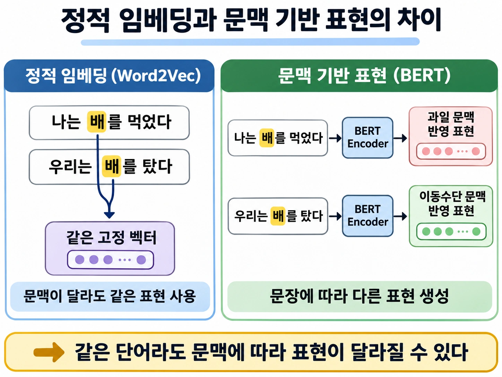
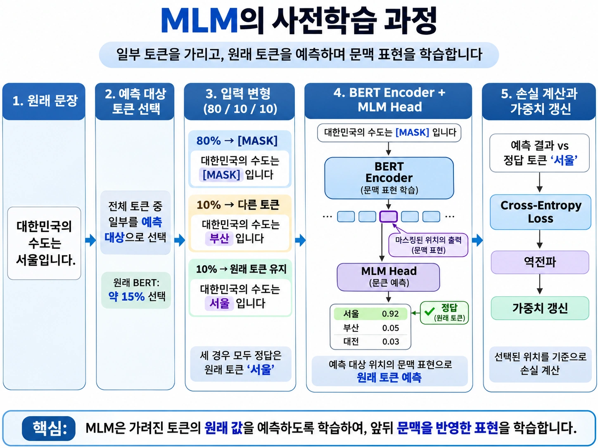
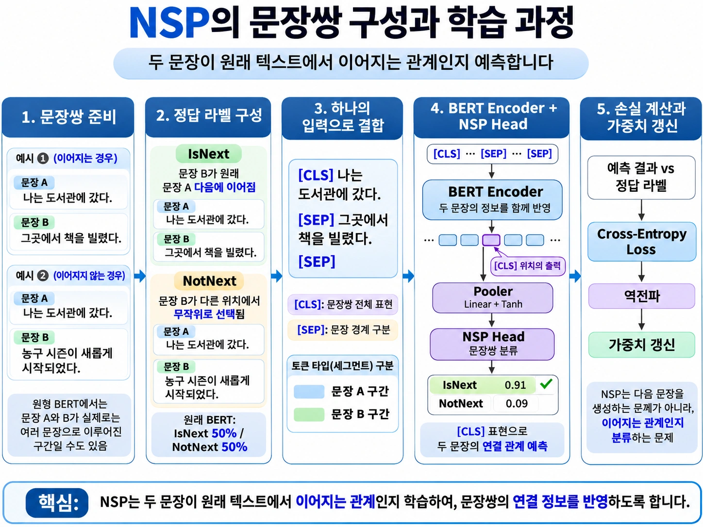
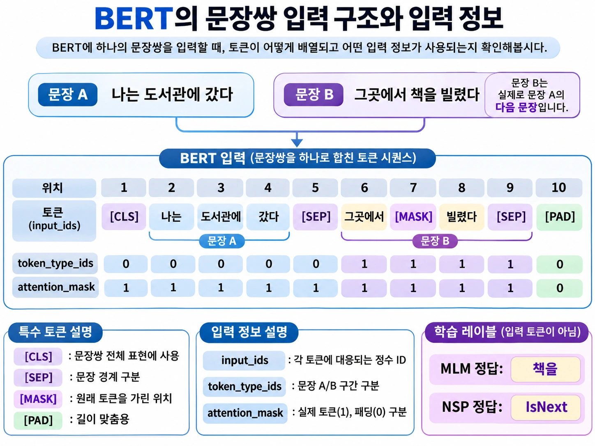
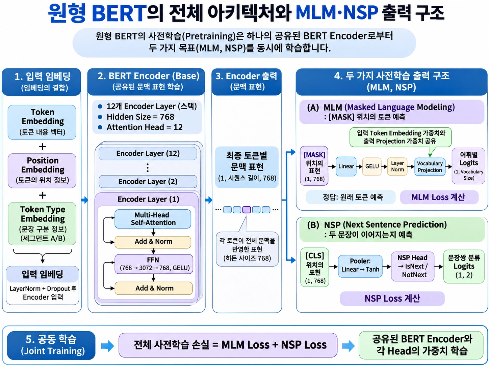

# Day 5. BERT의 문맥 표현과 사전학습

> BERT는 같은 토큰이라도 문맥에 따라 다른 벡터를 만든다. 원래 BERT가 문장쌍을 입력받아 두 가지 목표를 함께 학습하는 과정을 정리한다.

## 1. 고정된 단어 벡터에서 문맥에 따른 표현으로

Word2Vec의 <strong>정적 임베딩(Static Embedding)</strong>에서는 단어를 조회할 때 문장에 관계없이 같은 벡터를 가져온다.
‘나는 배를 먹었다’의 ‘배’와 ‘우리는 배를 탔다’의 ‘배’는 쓰임이 달라도 같은 기본 표현을 갖는다.

<strong>문맥 기반 표현(Contextual Representation)</strong>은 토큰의 앞뒤에 놓인 정보를 반영해 토큰 벡터를 갱신한다.
BERT(Bidirectional Encoder Representations from Transformers)는 트랜스포머 인코더(Transformer Encoder)만 사용한다.
<strong>Bidirectional Self-Attention</strong>으로 입력의 앞뒤 토큰을 모두 참조할 수 있으므로, ‘배’는 ‘먹었다’와 ‘탔다’ 같은 문맥에 따라 서로 다른 최종 표현을 얻는다.
입력 임베딩은 출발점이고, 문맥을 반영한 벡터는 인코더를 통과한 결과다.

ELMo(Embeddings from Language Models)도 문맥 표현을 학습한 초기 모델이다.
ELMo는 정방향과 역방향 LSTM 언어모델을 이용해 앞뒤 정보를 얻고, BERT는 인코더의 Bidirectional Self-Attention으로 입력 위치들의 정보를 결합한다.

## 2. 원래 BERT의 사전학습 목표

<strong>사전학습(Pre-training)</strong>은 대량의 텍스트에서 일반적인 언어 패턴을 익혀 여러 작업에 재사용할 가중치를 만드는 과정이다.
원래 BERT는 하나의 인코더를 공유하면서 마스크 언어 모델링과 다음 문장 예측을 함께 사용했다.

### 2.1 마스크 언어 모델링

<strong>마스크 언어 모델링(Masked Language Modeling, MLM)</strong>은 입력에서 예측할 토큰 위치를 선택한 뒤 원래 토큰을 맞히는 방식이다.
양방향 인코더가 정답을 그대로 읽는 지름길을 줄이기 위해 선택한 입력의 대부분을 가린다.
예를 들어 `대한민국의 수도는 [MASK]입니다`에서 앞뒤 문맥을 보고 원래 토큰 ‘서울’을 예측한다.

원래 BERT는 워드피스(WordPiece) 토큰의 약 15%를 예측 대상으로 선택했다.
아래 비율은 선택한 위치에 적용한다. 예측 대상 100개가 있다면 평균적으로 80개는 마스크로, 10개는 임의 토큰으로 바뀌고, 10개는 그대로 들어간다.

| 선택한 위치의 비율 | 모델이 보는 입력 예 | 정답 |
| --- | --- | --- |
| 80% | `[MASK]` | 서울 |
| 10% | 무작위 토큰 ‘부산’ | 서울 |
| 10% | 원래 토큰 ‘서울’ | 서울 |

항상 `[MASK]`로 바꾸면 분류와 같이 가림 토큰을 쓰지 않는 작업과 입력 조건이 크게 달라진다.
세 경우 모두 목표는 원래 토큰이며, MLM 손실은 **예측 대상으로 선택한 위치**를 기준으로 계산한다.

### 2.2 다음 문장 예측

<strong>다음 문장 예측(Next Sentence Prediction, NSP)</strong>은 두 번째 텍스트 구간이 원래 첫 번째 구간 바로 뒤에 이어졌는지를 분류하는 목표다.
원래 BERT의 구성에서는 실제로 이어지는 구간인 `IsNext`와 무작위로 선택한 구간인 `NotNext`가 각각 50%다.
두 문장이 주제상 비슷해도 데이터에서 무작위로 구성한 쌍의 라벨은 `NotNext`다.
NSP가 출력하는 것은 다음 문장의 텍스트가 아닌, 연결 여부에 대한 두 클래스의 점수다.

## 3. 입력에서 토큰별 문맥 표현까지

문장 A와 B를 `[CLS] 문장 A [SEP] 문장 B [SEP]` 형태로 연결한다.
`[CLS]`는 문장쌍 전체에 대한 판단에 활용하는 시작 위치, `[SEP]`는 구간의 경계다.
길이를 맞출 때에는 끝에 `[PAD]`를 추가할 수 있다.

| 입력 항목 | 담는 정보 | 예제 |
| --- | --- | --- |
| `input_ids` | 각 위치의 토큰 ID | 일반 토큰과 특수 토큰을 숫자로 표현 |
| `token_type_ids` | 각 위치가 속한 입력 구간 | 첫 `[SEP]`까지 0, 문장 B와 두 번째 `[SEP]`는 1 |
| `attention_mask` | 실제 입력 위치와 패딩을 구분 | `[PAD]`는 0, `[MASK]`를 포함한 실제 위치는 1 |

예를 들어 ‘나는 도서관에 갔다’와 ‘그곳에서 책을 빌렸다’를 연결하고 ‘책을’을 가리면, `[MASK]`는 인코더가 처리하는 입력 토큰이다.
그 위치의 원래 토큰 ‘책을’과 문장쌍 라벨 `IsNext`는 각각 손실에 사용하는 정답이다.

각 위치에서 <strong>토큰 임베딩(Token Embedding), 위치 임베딩(Position Embedding), 토큰 타입 임베딩(Token Type Embedding)</strong>을 같은 성분끼리 더한다.
세 벡터는 토큰의 종류, 시퀀스 안의 위치, A와 B 중 소속 구간을 각각 나타낸다.
원래 BERT의 위치 벡터는 학습 파라미터다. 세 임베딩의 합에 층 정규화(Layer Normalization)와 드롭아웃(Dropout)을 적용한 뒤 인코더에 전달한다.

BERT Base의 모델 차원은 768이고 Self-Attention 헤드는 12개다. 따라서 헤드 하나의 차원은 $768/12=64$다.
순전파 신경망(Feed-Forward Network, FFN)은 특징 차원을 `768 → 3072 → 768`로 변환하고 중간에 GELU 활성화 함수를 쓴다.
서로 다른 가중치를 가진 인코더 층 12개를 지나도 배치 하나에 위치 10개가 있을 때 출력 형태는 `(1, 10, 768)`이다.

## 4. 공유 인코더에서 나뉘는 두 출력

MLM 헤드는 선택한 토큰의 768차원 표현에 선형층(Linear Layer), GELU, 층 정규화를 적용하고 어휘별 로짓(Logits)으로 투영한다.
원래 BERT는 이 투영에 입력 토큰 임베딩의 가중치를 재사용하는 <strong>가중치 공유(Weight Tying)</strong>를 사용하고, 토큰별 편향을 더한다.
모든 위치의 로짓을 계산하는 구현에서도 손실에는 선택된 MLM 위치만 포함한다.

NSP는 마지막 인코더 층의 `[CLS]` 벡터를 사용한다.
풀러(Pooler)의 선형층과 탄젠트 쌍곡선(Tanh) 활성화로 768차원 표현을 변환한 뒤, 별도 NSP 헤드가 두 클래스의 점수를 만든다.
두 출력의 교차 엔트로피 손실(Cross-Entropy Loss)을 더하고 역전파로 공유 인코더와 각 헤드를 학습한다.

| 읽는 위치 | 예측 헤드 | 예제 출력 형태 |
| --- | --- | --- |
| 선택된 토큰 1개 | MLM 헤드 | `(1, 어휘집 크기)` |
| 문장쌍 1개의 `[CLS]` | 풀러와 NSP 헤드 | `(1, 2)` |
| 분류 목적의 문장 1개 | 문장 분류 헤드 | `(1, 클래스 수)` |

## 5. SpanBERT와 사전학습 가중치 활용

SpanBERT는 연속된 토큰을 한꺼번에 가리는 <strong>구간 마스킹(Span Masking)</strong>을 적용한다.
구간 경계 목표(Span Boundary Objective, SBO)는 가린 구간의 양 끝 바깥에 있는 토큰 표현과 구간 내부의 상대 위치를 이용해 원래 토큰을 예측한다.
예를 들어 ‘그는 새로운 AI 모델을 공개했다’에서 ‘새로운 AI 모델을’을 가리면 ‘그는’과 ‘공개했다’의 표현을 사용한다. SpanBERT는 NSP를 사용하지 않았다.

<strong>미세조정(Fine-tuning)</strong>에서는 사전학습된 인코더를 가져와 새로운 작업의 정답과 출력 헤드에 맞춰 가중치를 조정한다.
한국어용 예로 강의에서 사용하는 `klue/bert-base`는 인코더 층 12개, 모델 차원 768, 헤드 12개, 어휘집 크기 32,000인 BERT Base 모델이다.

## 6. 핵심 개념 비교

| 개념 | 학습 또는 처리 기준 | 결과 |
| --- | --- | --- |
| 정적 임베딩 | 단어 또는 토큰 ID | 문맥과 관계없이 조회하는 벡터 |
| BERT 문맥 표현 | 같은 시퀀스의 앞뒤 토큰 | 입력별로 갱신된 토큰 벡터 |
| MLM | 선택한 위치의 원래 토큰 | 어휘별 예측 점수 |
| NSP | 두 구간의 실제 연속 여부 | `IsNext`와 `NotNext` 점수 |
| 미세조정 | 다운스트림 작업의 정답 라벨 | 작업에 맞게 조정된 모델 |

## 7. 핵심 정리

- BERT는 Bidirectional Self-Attention으로 각 토큰에 앞뒤 문맥을 반영한다.
- 토큰, 위치, 토큰 타입 임베딩을 더해 인코더 입력을 만든다.
- MLM은 선택된 위치의 원래 토큰을, NSP는 두 구간이 이어졌는지를 예측한다.
- 원래 BERT는 인코더를 공유하고 MLM과 NSP의 손실을 합쳐 사전학습한다.
- SpanBERT는 연속 구간을 가리고 양쪽 경계의 표현을 활용해 구간 내부를 예측한다.
- 사전학습 가중치와 작업별 헤드를 조합하면 문장 분류 등의 목표에 맞춰 미세조정할 수 있다.

[이전 글: Transformer 입력부터 다음 토큰까지](18-1-Transformer-입력부터-다음-토큰까지.md) | [학습 목차](README.md) | [다음 글: BERT 텍스트 분류와 미세조정](20-BERT-텍스트-분류와-미세조정.md)
