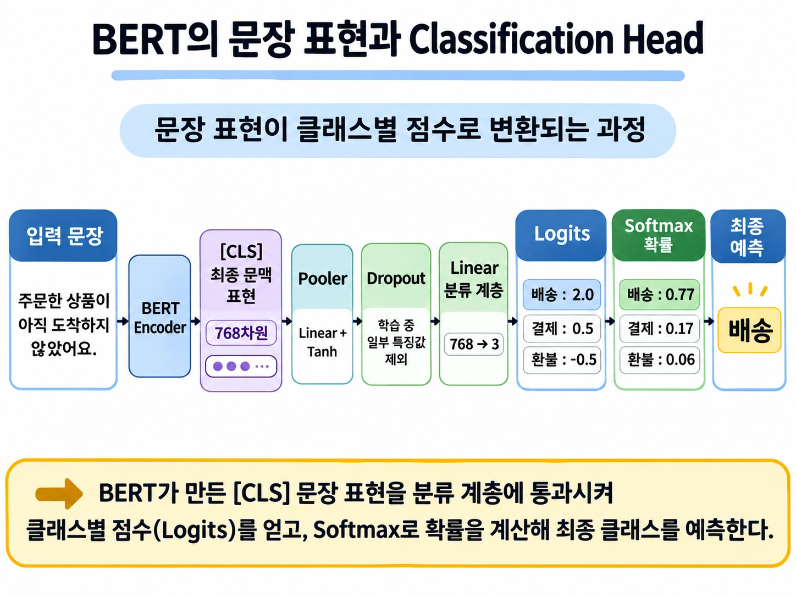
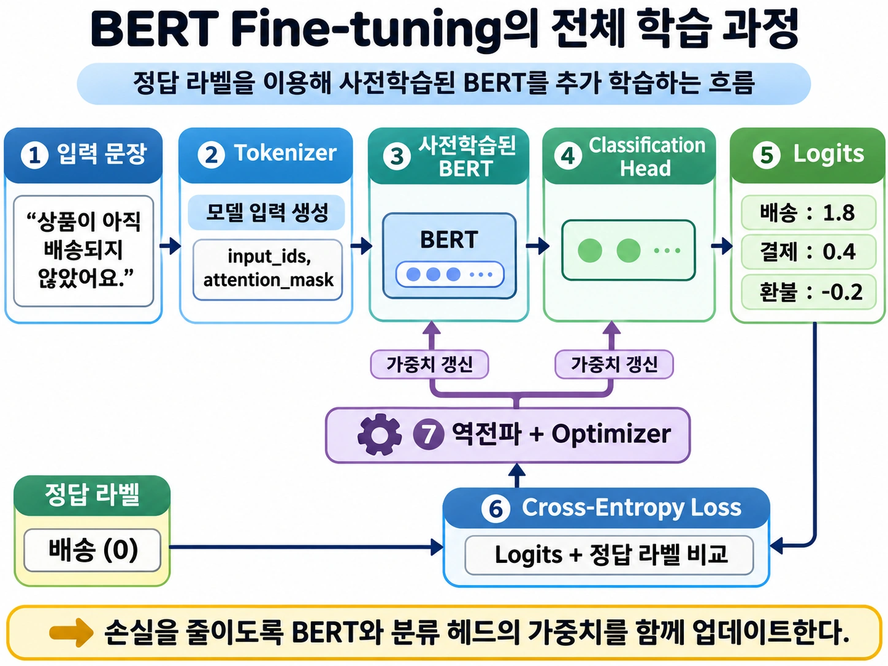
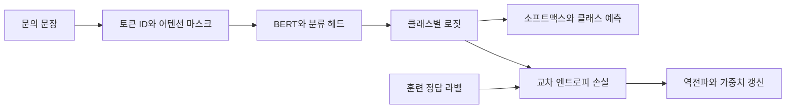
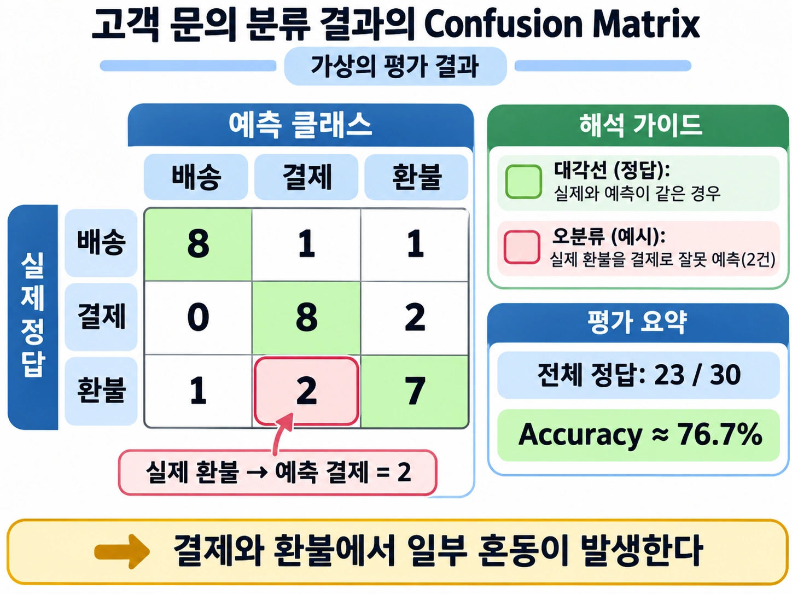

# Day 5. BERT 텍스트 분류와 미세조정

> 사전학습된 BERT의 문장 표현에서 클래스별 점수를 계산한다. 고객 문의를 배송, 결제, 환불로 나누는 예로 학습과 평가의 각 단계를 살펴본다.

## 1. 토큰별 출력에서 문장 분류 점수로

<strong>텍스트 분류(Text Classification)</strong>는 입력 문장에 미리 정한 범주를 부여하는 작업이다.
‘주문한 상품이 아직 도착하지 않았어요’처럼 단어 하나로 범주를 판단하기 어려운 문장은 문장 전체의 표현을 사용한다.

BERT의 인코더는 입력 위치마다 문맥이 반영된 벡터를 만든다.
문장 분류에서는 입력 맨 앞에 넣은 `[CLS]` 위치의 최종 벡터를 활용할 수 있다.
`[CLS]`도 자기 어텐션으로 다른 위치를 참고하므로, 분류 학습을 거치면서 작업에 필요한 문장 단서를 표현에 담는다.

| 처리 단계 | 차원 | 역할 |
| --- | ---: | --- |
| 마지막 인코더 층의 `[CLS]` | 768 | 문맥을 반영한 시작 위치의 표현 |
| 풀러(Pooler) | 768 | 선형층과 Tanh로 `[CLS]` 변환 |
| 드롭아웃(Dropout) | 768 | 학습 중 일부 특징을 무작위로 0으로 만들어 과적합 완화 |
| 선형 분류층(Linear Classifier) | 3 | 배송, 결제, 환불의 클래스별 점수 계산 |

풀러가 변환한 `pooler_output`은 분류 헤드(Classification Head)의 입력으로 쓰인다.
분류층의 출력 크기는 클래스 수에 맞추고, 각 위치를 클래스 ID에 대응시킨다.
드롭아웃은 학습에 적용하고 평가와 추론에서는 끈다.

## 2. 로짓을 읽고 배치 형태 확인하기

<strong>로짓(Logits)</strong>은 클래스별 원점수다.
배송, 결제, 환불의 점수가 `[2.0, 0.5, -0.5]`이면, 소프트맥스(Softmax)는 각 점수의 지수값을 합으로 나눠 확률을 만든다.
배송의 확률은 $e^2/(e^2+e^{0.5}+e^{-0.5})\approx0.77$이고, 결제와 환불은 각각 약 0.17과 0.06이다.
소프트맥스 전후의 순위가 같으므로 이 단일 정답 분류에서는 가장 큰 로짓을 골라도 배송을 예측한다.

강의 예제에서 문장 4개를 한 묶음인 배치(Batch)로 처리하고 토큰 길이를 32로 맞춘다고 가정한다.
배치 축은 유지되고, `[CLS]` 위치를 선택할 때 토큰 축이 사라진다.

| 단계 | 형태(Shape) | 각 축의 의미 |
| --- | --- | --- |
| 토큰 ID | `(4, 32)` | 문장, 토큰 위치 |
| 인코더 출력 | `(4, 32, 768)` | 문장, 토큰 위치, 특징 |
| `[CLS]` 선택 | `(4, 768)` | 문장, 특징 |
| 분류층 출력 | `(4, 3)` | 문장, 클래스 |

## 3. 정답 라벨로 모델 미세조정하기

<strong>미세조정(Fine-tuning)</strong>은 사전학습 가중치에서 시작해 특정 작업에 맞게 가중치를 조정하는 과정이다.
문의마다 배송, 결제, 환불 중 하나의 정답 라벨을 붙인다.
훈련(Train) 데이터는 가중치 갱신에, 검증(Validation) 데이터는 설정 선택에, 테스트(Test) 데이터는 최종 성능 확인에 쓴다.
같거나 사실상 중복된 문의가 훈련과 평가에 함께 들어가면 처음 본 문장에 대한 성능을 판단하기 어려워진다.

사전학습된 임베딩, 인코더, 풀러에서 시작하고, 새 분류층은 클래스 수에 맞춰 초기화한다.
<strong>전체 미세조정(Full Fine-tuning)</strong>에서는 두 부분을 함께 갱신한다.
드롭아웃은 학습 중 작동하는 연산이며 별도로 갱신하는 가중치가 없다.

단일 정답 다중 클래스 학습에는 <strong>교차 엔트로피 손실(Cross-Entropy Loss)</strong>을 사용한다.
PyTorch의 `CrossEntropyLoss`에는 정답 클래스 ID와 **원래 로짓**을 전달한다.
손실 함수가 내부에서 필요한 정규화를 처리한다. 역전파(Backpropagation)로 기울기를 계산하고 최적화 알고리즘(Optimizer)으로 가중치를 갱신한다.

| 학습 설정 | 의미 | 결과에 영향을 주는 방식 |
| --- | --- | --- |
| 에폭(Epoch) | 전체 훈련 데이터를 한 번 처리하는 단위 | 반복을 늘리면 검증 성능이 나빠지는 구간도 생길 수 있음 |
| 배치 크기(Batch Size) | 한 번에 처리하는 문장 수 | 메모리 사용량과 에폭당 갱신 횟수에 영향 |
| 학습률(Learning Rate) | 가중치 갱신 크기를 조절 | 너무 크면 사전학습으로 익힌 표현이 급격하게 바뀔 수 있음 |
| 최대 길이(Max Length) | 입력 토큰 수의 상한 | 짧으면 단서가 잘리고, 길면 연산량이 늘어남 |

## 4. 분류 성능과 오류 읽기

<strong>정확도(Accuracy)</strong>는 전체 문장 중 올바르게 분류한 비율이다.
배송 900개와 환불 100개가 있는 데이터에서 모두 배송으로 예측하면 정확도는 90%지만 환불 문의는 하나도 찾아내지 못한다.
<strong>매크로 F1(Macro F1)</strong>은 정밀도(Precision)와 재현율(Recall)을 함께 반영한 클래스별 F1 점수의 평균이다.
모든 클래스에 같은 비중을 주므로 문의 수가 적은 클래스의 성능도 반영한다.

<strong>혼동행렬(Confusion Matrix)</strong>의 행은 실제 정답이고 열은 모델 예측이다.
아래 예의 대각선은 각각 8, 8, 7건이므로 정확도는 $(8+8+7)/30\approx76.7$%다.
환불 행과 결제 열이 만나는 2는 실제 환불 문의 2건이 결제로 분류됐다는 뜻이다.

‘배송받은 상품이 고장 나서 환불받고 싶어요’를 배송으로 예측했다면 실제 요청을 담은 뒷부분을 제대로 활용했는지 확인한다.
클래스 경계가 모호한지, 환불 학습 예시가 충분한지, 최대 길이 때문에 뒷부분이 잘렸는지도 확인한다.
한 문장에 여러 업무가 등장한다면 어떤 요청을 정답으로 삼을지 라벨 기준을 일관되게 적용한다.

## 5. 핵심 개념 비교

| 구분 | TF-IDF 기반 분류 | BERT 기반 분류 |
| --- | --- | --- |
| 입력 특징 | 단어 출현 정보와 가중치 | 입력에 따라 달라지는 문맥 표현 |
| 학습 대상 | 계산한 특징으로 분류 모델 학습 | 사전학습 모델과 분류 헤드 미세조정 |
| 계산 비용 | 비교적 낮음 | 인코더 계산 때문에 비교적 높음 |
| 성능 비교 | 두 방식에 같은 데이터 분할과 지표 적용 | 문맥의 이점과 학습 및 추론 비용을 함께 평가 |

## 6. 핵심 정리

- 마지막 인코더 층의 `[CLS]` 출력은 분류에 사용할 문장 표현이다.
- 풀러와 드롭아웃을 거친 벡터는 분류층에서 클래스 수만큼의 로짓으로 바뀐다.
- 추론에서는 클래스의 순위나 소프트맥스 확률을 사용하고, 학습에는 로짓과 정답 라벨을 사용한다.
- 전체 미세조정에서는 사전학습된 BERT와 새 분류 헤드의 가중치를 모두 갱신한다.
- 정확도와 매크로 F1을 함께 보면 클래스 분포에 따른 성능 차이를 살펴볼 수 있다.
- 혼동행렬과 오분류 예시를 함께 보면 혼동이 생긴 클래스와 데이터 조건을 확인할 수 있다.

[이전 글: BERT의 문맥 표현과 사전학습](19-BERT의-문맥-표현과-사전학습.md) | [학습 목차](README.md) | [다음 글: 문장 임베딩과 의미 기반 검색](21-문장-임베딩과-의미-기반-검색.md)
